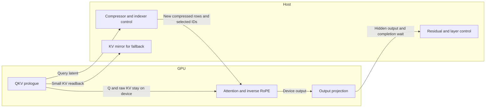

# DeepSeek inference: dataflow audit and next experiments

2026-10-15. Model on the H100 host: `DeepSeek-V4.1-Flash-Q8_0`,
`general.architecture=deepseek41`. This audit concerns the new DS41 path, not
the Llama streaming path or the Brandon training adapter.

Evidence and validation: [local results](benchmarks/h100-deepseek-2026-10-15/RESULTS.md).
The model inventory reads the ten GGUF headers, not their weight payloads.
The [end-to-end benchmark](benchmarks/h100-deepseek-2026-10-15/end-to-end/RESULTS.md)
measures real-text prefixes of 32, 128 and 512 tokens with 64 fixed decode
steps, including initial and reused expert-cache conditions on one H100.
The [llama.cpp comparison](benchmarks/h100-deepseek-2026-10-15/llama-comparison/RESULTS.md)
uses the same consumed token IDs and exposes a substantial, reproducible
cross-engine numerical discrepancy in addition to the performance gap.
The [performance-gap investigation](DEEPSEEK_PERFORMANCE_GAP.md) follows the
execution chain and makes eliminating CPU dependencies in steady-state inference
an explicit design requirement, including GPU-resident state and a peer-cache
residency protocol.

## What is actually running

The reference checkout is `vcruz305/llama.cpp`, branch `runtime/deepseek41`,
commit `5210c7c5ed61dddaee6ed476623abf4b63093d16`. The
[converter's model card](https://huggingface.co/vcruz305/DeepSeek-V4.1-Flash-GGUF)
describes a runtime still under development. The
[original model configuration](https://huggingface.co/deepseek-ai/DeepSeek-V4.1-Flash/raw/main/config.json)
identifies the V4.1 architecture; numerical acceptance must use this model and
the pinned reference, rather than assuming V3/V4 equivalence.

`src/main.cpp` dispatches DS41 before constructing the normal inference engine.
The DS41 options currently do not forward the Llama peer-cache, speculative
decoding or streaming options. `ExpertCache::ensure_device()` selects logical
CUDA device 0; the existing `PeerCache` is not connected to this path.

For each input token, `Session::forward()` traverses 40 layers. The current
schedule is approximately:

```text
CPU embedding / hyper-connections / norms
  -> GPU Q/KV projections + norms + RoPE
  -> CPU raw KV, compression bookkeeping, sparse selection, attention, inverse RoPE
  -> GPU grouped output projection
  -> CPU residual / hyper-connections / norm / expert routing
  -> CPU mmap -> pinned staging -> queue GPU expert GEMVs and readback
       GPU routed experts/readback || CPU shared expert
  -> completion wait -> ordered CPU sum / residual
  -> next layer
GPU LM head -> CPU full logits -> CPU sampling
```

The accelerator executes islands of work inside a CPU-owned forward pass.
Removing those boundaries requires moving the dependent operations and state
together. Merely making every copy asynchronous does not remove a dependency.

## Correctness fixes made before measuring speed

The saved `gputime.log` repeatedly reports a failed attention prologue and CPU
fallback. The original Q8 upload code used this pattern:

```cpp
size_t bytes;
get(q8_row_bytes_ok(weight, rows, cols, &bytes), bytes);
```

Argument evaluation order can read `bytes` before the helper writes it. The
first read can be uninitialized; subsequent calls can use the preceding
matrix's size. Recompiling the saved source with GCC 14.4 confirms
`-Wmaybe-uninitialized` in both prologue and tail. Oversized copies can also
consume VRAM needed by later layers. This is not numerical nondeterminism.

The fix calculates each matrix's size with a pure function. Attention,
compressor and indexer now reserve their input buffer independently of the
expert cache. Previously the buffer was allocated only by expert initialization,
although attention executes first. Failed input staging is propagated.

Four numerical tests now run in fresh processes, without an expert cache:
Q/KV prologue including RoPE, grouped output, gated/ungated compression and
Q8/BF16 indexer with input-buffer growth. All pass on H100; largest absolute
error is `1.43051147e-6` in these synthetic cases. Release CMake/CTest also passes
all four. These tests establish the corrected primitives, not full-model parity
or a measured generation speedup. Existing fast-math kernels were preserved.

Follow-up: the [prefill experiment](benchmarks/h100-deepseek-2026-10-15/prefill-head/RESULTS.md)
also ran the complete model. For the fixed single-token CPU-attention versus
GPU-attention comparison, maximum logit error was `3.33786011e-6`, relative L2
`2.60817e-7`, with identical top eight. This is a short numerical check of the
previous correction, not validation of long-context sparse attention.

## Capacity and bandwidth: different objects need different policies

The 1,046 tensor payloads total **473.064 GiB**:

| Tensor category | GiB | Proposed treatment |
| --- | ---: | --- |
| Routed experts, MXFP4 | 268.945 | Local/peer expert cache, bounded in-flight slots |
| Two Engram tables, Q8_0 | 194.555 | Gather selected rows; prefetch by token history |
| Attention and indexer | 5.091 | Reserve resident capacity first |
| Shared experts | 1.401 | CPU overlapped with routed GPU work; evaluate GPU residency separately |
| LM head | 1.233 | Resident; execute only when logits are consumed |
| Token embeddings | 1.233 | Gather rows; full residency optional |
| Other, including Engram projections and hyper-connections | 0.605 | Mostly resident; inspect individual tensors |

Everything except routed experts and Engram tables is **9.563 GiB**; excluding
the input embedding table leaves **8.330 GiB**. KV state, scratch, cache slots,
CUDA context and concurrent workloads require additional capacity. A global
budget must reserve these before choosing the expert cache size. The current
expert budget is independent of the lazily growing resident-weight registry.

Each expert's gate/up/down triplet is **18,800,640 bytes (17.930 MiB)**.
With six experts in every one of 40 layers, all misses imply **4,512,153,600
weight bytes per token**. At the earlier measured 55.041 GB/s pinned H2D rate,
the transfer-only floor is about **82 ms/token**. If every byte were already in
peer VRAM, the measured 304.365 GB/s GPU1-to-GPU0 rate implies about **14.8 ms**.
These are ideal payload bounds, not measured DS41 latencies; they omit CPU
staging, faults, launch overhead, computation and bandwidth contention.
See [the bandwidth measurements](H100_BENCHMARKS.md#transfer-bandwidth).

GPU P2P replaces transfers between GPU memories. It does not by itself remove
the CPU/staging path for an expert still in mmap or storage.

## Prioritized experiments

### 1. Make placement explicit and measure a functioning GPU path

Add a model-level memory plan, resident-byte accounting and per-layer GPU/CPU
fallback counters. Keep the current CPU reference available for parity.
Compare identical token IDs, weights and build flags; count failures as
failures, rather than treating a completed fallback run as GPU coverage.

The saved six-token prefill profile reports 3.21 s attention, 2.11 s MoE,
0.11 s Engram, 0.19 s hyper-connections and 0.46 s other. Attention's QKV and
tail account for 2.11 s and 1.01 s. These are historical phase totals including
initial uploads/fallbacks, not a steady-state decode profile. Re-profile after
the fixes and split first-use upload, warm prefill, decode, and host wait time.

### 2. Eliminate operations whose results are unused

Before this change, prefill called the entire `forward()` including the
1.233 GiB LM head for every prompt token, although the CLI consumes only the
final prompt logits.
Implemented `Session::forward(token, compute_logits=true)`: maintain every
layer's KV/history for every token, and compute the terminal collapse, norm and
head only for requested positions. The default preserves per-position logits
for API callers. The CLI requests only the last prompt position;
`DS41_PREFILL_ALL_LOGITS=1` restores the old schedule. `DS41_DUMP_STAGES` also
retains the full schedule so stage-sum diagnostics remain comparable.

The [measured result](benchmarks/h100-deepseek-2026-10-15/prefill-head/RESULTS.md)
is **+0.425% warm prefill throughput** on the complete model, across four
alternating pairs of 16-token prompts. Head evaluations fall from 16 to 1,
while final logits and four-token continuations remain bitwise identical.
This removes unused work, but its small wall-time effect directs the next
investigation toward the remaining layer pipeline. Decode speed was not
measured by this experiment.

CPU fallback scratch (`partials`, `hbuf`) now allocates only after GPU MoE
fails, as described below. Further candidates are preallocating other
per-session scratch and binding tensor handles once. The CPU thread pool is
already persistent, but expert-miss staging still creates one thread per
missing slice (up to 18 per layer for six experts) and joins all before H2D.
Use persistent workers only where a host copy is still required.

The next [warm-cache experiment](benchmarks/h100-deepseek-2026-10-15/cpu-chunks/RESULTS.md)
found substantial CPU scheduling cost. The persistent pool now claims adjacent
rows in adaptive chunks instead of performing a shared atomic operation for
every row. With 52 logical CPUs, 5,120 rows use 214 successful claims instead
of 5,120; each row keeps its original arithmetic and reduction order.
`DS41_CPU_GRAIN=1` restores the previous per-row schedule for diagnosis.

On one H100, the complete model's warm 16-token prefill improves from
**4.38649 to 3.48030 s (+26.04% throughput)**; four-step autoregressive decode
improves from **1.11753 to 0.87817 s (+27.26%)**. ABBA process order, six warm
windows per arm, identical prompt and continuation, 100% expert-cache hits
within every measured window. Final prompt logits and all four continuation
vectors remain bitwise identical. This measures short warm workloads, not
training, cold streaming or two-GPU scaling. Attention stays near 0.705 s per
prompt; most savings occur in CPU-heavy mixes/residuals and the MoE category.

### 2b. Overlap independent shared and routed expert work

The [next completed experiment](benchmarks/h100-deepseek-2026-10-15/moe-overlap/RESULTS.md)
splits MoE profiling into router, routed execution/wait and shared CPU work.
Both expert branches consume the same layer input; the shared expert does not
depend on the routed output. The GPU helper now queues its original kernels
and pinned readback, runs scoped CPU work, then waits and publishes the result.
The final ordered sum is preserved. `DS41_MOE_OVERLAP=0` selects the serial
control; stage-sum and GPU comparison diagnostics also retain serial execution.

On one H100 with warm expert cache, prefill improves from **3.44908 to
2.79074 s (+23.59% throughput)** and four-step decode from **0.87954 to
0.70774 s (+24.27%)**. Both arms already include adaptive CPU chunks. Six
windows per arm in ABBA process order show 100% cache hits, zero CPU routed
fallbacks, and bitwise-identical prompt/continuation logits, including comparison
with the preceding binary. MoE wall time falls from 1.634 to 0.960 s per prompt.

CPU fallback buffers now allocate only on fallback, removing 174 KiB of unused
array payload per layer on GPU success. The two timing arms share this cleanup;
its isolated speed contribution is not measured. The callback runs on the
calling thread, uses separate CPU output, and must not reenter DS41 GPU helpers.
Queued work is drained on callback exceptions; CUDA failures invalidate cache
entries. GPU memory allocation and numerical kernels are unchanged.

### 2c. Remove dispatch overhead from small hyper-connection operations

The [direct HC experiment](benchmarks/h100-deepseek-2026-10-15/hc-direct/RESULTS.md)
targets the remaining pool dispatches for stream collapse and residual
post-mixing. With four streams, these operations perform only four or twenty
products per hidden coordinate. They now execute on the calling thread,
preserving each output's original accumulation order. `DS41_HC_DIRECT=0`
restores pool execution; projection matvecs and attention retain their
existing policies.

For 40 layers, this removes 2,561 pool dispatches per 16-token final-head-only
prefill and 644 per four-step decode window. This removes coordination, not
model arithmetic. Direct/pool/scalar comparisons cover 84 shape/value cases;
tiny-model logits match the preceding binary bitwise, with identical stage
sums. The complete-model comparison uses the same warm-cache ABBA protocol.

On one H100, six warm windows per arm improve prefill from **2.78437 to
2.23845 s (+24.39% throughput)** and four-step decode from **0.70263 to
0.56803 s (+23.70%)**. Prompt and continuation logits remain bitwise identical
to the preceding binary. Every measured window has 100% expert-cache hits,
zero routed CPU fallbacks and the same MoE overlap. The HC/other categories
shrink substantially; MoE and attention now account for about 75% of prefill
wall time. GPU allocation code and cache capacity are unchanged.

### 2d. Submit independent attention output groups in one grid

The [grouped-tail experiment](benchmarks/h100-deepseek-2026-10-15/grouped-tail/RESULTS.md)
targets the eight independent Q8 GEMVs in attention's first output projection.
The original path launched each group separately, then projected their
concatenation. A two-dimensional grid now makes all eight groups available in
one launch. Each row retains its original warp, Q8 block traversal and FP32
reduction; the second projection remains ordered on the same stream.

This changes output-projection kernel counts from nine to two per layer,
eliminating 4,480 launches per 16-token prompt. `DS41_GROUPED_TAIL=0` restores
separate launches. Cumulative `gpu_backbone_stats()` counters expose successful
tail calls, grouped calls and projection launch counts, so measured window
deltas can verify both GPU coverage and the selected schedule. There are no
new GPU allocations, transfers, precision changes or intermediate tensors.

The full-model result is modest: **+0.36% prefill throughput and +0.55% decode**
across 12 warm windows per arm from four processes, using ABBA then BAAB order.
The output-projection phase itself takes **4.36% less time** in prefill, while
its launch count falls 77.78%. Both sequences show a small positive total
effect, with overlapping end-to-end timing ranges. All prompt/continuation
logits remain bitwise identical to the previous binary. This confirms a useful
local reduction, but identifies computation, movement and the remaining MoE
critical path as more consequential targets than this set of host launches.

### 2e. Batch independent routed experts and trace the exposed waits

The routed MoE path now submits four kernels per layer: a two-dimensional
gate/up grid across the selected experts, elementwise activation, a down grid
across experts, and an ordered weighted sum. Each dot product retains its
MXFP4 decode, per-row warp and FP32 reduction order. Intermediate gate, up,
activation and down values remain FP32. The final sum follows the router's
original expert order; it is not a parallel tree reduction.

For six experts this removes 26 of 30 launches per layer, or 16,640 launches
per 16-token prompt across 40 layers. The separate output memset is also
unnecessary because the final kernel writes every output from a local zero
accumulator. Eight-expert scratch adds 560 KiB of VRAM; weight-cache slots,
uploaded weight formats and CPU shared-expert overlap are unchanged.
`DS41_MOE_BATCH=0` restores the serial expert schedule. The switch is read
once per process, and successful call/launch/upload counters are available
through `gpu_moe_stats()`.

`DS41_MOE_TRACE=1` enables eight host phases and five CUDA-event intervals.
The six events are reused after the existing completion wait; tracing adds
no intermediate synchronization. Host phases separate input enqueue, cache
lookup, miss staging, weight-copy enqueue, kernel/readback enqueue, the CPU
callback, final wait and result publication. Stream intervals separate input
(and serial-path zeroing), the preparation gap, weight uploads, compute/launch
span and readback. Initialization and cache allocation precede these phases.
Only complete, successful traces contribute timings; failed or aborted traces
have a separate counter. Host and GPU intervals overlap and are not additive.

CUDA-event intervals are **elapsed stream spans, not pure GPU busy time**.
They can include host launch starvation, scheduling gaps and interference;
see the [CUDA 13.1 event timing documentation](https://docs.nvidia.com/cuda/archive/13.1.0/cuda-runtime-api/group__CUDART__EVENT.html).
Performance comparisons disable this extra tracing and use separate diagnostic
runs to locate waits. Tests cover 1/6/8 selected experts, repeated IDs, negative
and signed-zero weights, cache misses/hits, callback ownership and exception
recovery, including real and maximum supported dimensions.

The [batched-MoE experiment](benchmarks/h100-deepseek-2026-10-15/moe-batch/RESULTS.md)
improves full-model warm prefill from **2.22746 to 2.12996 s (+4.58% throughput)**
and four-step decode from **0.56515 to 0.54272 s (+4.13%)**, across six windows
per arm in ABBA order. All 646,400 prompt/continuation logits remain bitwise
identical to the preceding binary, with zero routed CPU fallbacks and 100%
warm expert-cache hits. Synthetic comparisons also agree bitwise for all
three tested shapes, up to eight experts at H=8192/FF=4096.

Separate warm traces show kernel/readback submission falling from 56.36 to
12.16 ms per prompt, final completion waits from 20.40 to 2.58 ms, and the
GPU compute/launch span from 752.41 to 576.96 ms. These overlapping intervals
are diagnostic, not an additive explanation of the total speedup. Shared CPU
work also became faster under the new schedule despite unchanged arithmetic;
the experiment does not isolate why. Its approximately 639 ms callback now
exceeds the GPU span, making that CPU/GPU boundary the next warm-cache target.

The first diagnostic prompt uploads 35.57 GB of expert slices. Both schedules
still spend approximately 0.81 s staging those misses and 0.67 s in the upload
stream span. This is an initially empty expert cache, not a cold-storage test.
Batching does not remove the miss pipeline: persistent staging resources,
copy/compute overlap and peer-owned expert execution remain separate targets.

### 2f. Keep the shared expert resident and reproduce CPU Q8 reductions on GPU

The [shared-expert experiment](benchmarks/h100-deepseek-2026-10-15/shared-expert/RESULTS.md)
moves the shared gate/up/down projections and activation onto the same GPU as
the routed experts. Three new kernels replace three CPU matrix-vector jobs
per layer. They reuse the routed input, keep outputs separate until the original
final addition, and use the existing single completion wait. Shared weights
add **1.40076 GiB** of residency and **47 KiB** of reusable scratch; the routed
expert cache remains 62 GiB. A second result adds 0.78125 MiB of D2H per token.

The Q8 kernel reproduces the CPU AVX2 block operations and ordered FP32
accumulation, verified bitwise for identical inputs. An exponential evaluated
in FP64 and rounded to FP32 reduces the CPU/CUDA library discrepancy; the rest
of the activation remains FP32. Explicit eight-lane masks preserve collective
membership even with partially populated warps. `DS41_SHARED_GPU=0` restores
the CPU shared expert. The GPU path is enabled by default for compatible Q8
tensors in AVX2 CPU builds, with the old path retained as fallback.

The final BAAB comparison measures **+3.33% warm prefill throughput**
(2.15960 -> 2.08998 s) and **+3.30% decode** (0.54814 -> 0.53062 s), six windows
per arm. An earlier ABBA run before tightening subgroup membership showed
+3.03%/+3.06%; final outputs match that run bitwise. No measured window uses
routed CPU fallback or shared CPU fallback in the GPU arm. The gain is much
smaller than the removed CPU work because that work previously overlapped
routed GPU execution. The GPU now performs both experts on the same stream.

Across **3,232,000 compared logit values** from the short benchmark and two
contexts through length 129 plus continuation, maximum absolute error is
**2.86102e-5**, maximum relative L2 **1.35367e-6**, and all 25 sampled top-1 and
ordered top-8 results agree. This is a reproducible arithmetic difference,
not run-to-run nondeterminism. CPU controls remain bitwise equal to the old
binary. The isolated shared FFN is bitwise equal in the synthetic fixtures,
but small activation differences still propagate in the complete model.

The first GPU version used FP32 `expf`. FP64 reduces short-benchmark maximum
logit error from 3.14713e-5 to 2.86102e-5; the strong local improvement does
not make the full model bitwise equal. Separate final traces show a routed-only
GPU span of 577.07 ms per prompt versus 622.77 ms with the shared expert, while
the 655.61 ms CPU callback disappears. The final host wait increases because
it no longer contains useful CPU work. These overlapping intervals are not
additive; they point to routed GPU execution as the next MoE target.

### 2g. End-to-end requests expose expert-cache pressure

The [real-text benchmark](benchmarks/h100-deepseek-2026-10-15/end-to-end/RESULTS.md)
uses the final shared-expert engine, one H100, a 62 GiB expert cache and batch
size one. Each prompt length starts in a separate process, then repeats the
same request three times with reset attention/history state and reused weights.
Prefill is still sequential token execution. Throughput over the three repeats:

| Prompt tokens | Prefill tokens/s | Decode tokens/s, 64 fixed steps | Ready-model TTFT |
|---:|---:|---:|---:|
| 32 | 6.067 | 6.229 | 5.275 s |
| 128 | 6.162 | 6.178 | 20.771 s |
| 512 | 6.052 | 5.364 | 84.605 s |

EOS is ignored for fixed-work timing. The 512-token case emits EOS after 32
non-EOS predictions; its pre-EOS prefix runs at 5.627 tokens/s. The other two
cases do not emit EOS within the 65 predictions (one from prefill plus 64
decode forwards). These are raw text completions, without a chat template.

Unlike the earlier 16+4 synthetic workload, even the repeated requests evict
experts. Decode hit rates are 87.93%, 90.01% and 82.45%, with 32.46, 26.86 and
47.19 GiB of routed H2D uploads per 64 steps. These are cache-slice hits and
host-to-device bytes, not disk-read measurements. Initial prefill rates are
2.455, 4.157 and 4.749 tokens/s; host page cache was not flushed. The changed
workload prevents interpreting the difference from 7.54 decode tokens/s as
a code regression.

All 12 passes complete with finite logits and full routed/shared/tail GPU
coverage; each repeated request reproduces its initial pass bit for bit.
Observed maximum GPU memory is 72,173 MiB (70.48 GiB); sampled GPU utilization
averages 41.1% over setup, requests and gaps. The largest process reaches
155.85 GiB host RSS. The second GPU remains unused. The measurements make
expert residency/transfer overlap and the growing attention cost relevant
targets alongside kernel compute; they do not measure a two-GPU speedup.

### 2h. Comparison with the pinned llama.cpp CUDA runtime

The [comparison artifact](benchmarks/h100-deepseek-2026-10-15/llama-comparison/RESULTS.md)
builds the clean pinned `runtime/deepseek41` commit with CUDA 13.1 for SM90.
The earlier reference executable was CPU-only. Both measured engines use
physical H100 1, the same GGUF files, the same prompt IDs and 64 identical
consumed continuation IDs. llama.cpp records its own predictions while
consuming the saved NTransformer continuation, so differing argmax choices
do not change the subsequent measured context.

| Prompt tokens | NTransformer prefill | llama.cpp prefill | NTransformer decode | llama.cpp decode |
|---:|---:|---:|---:|---:|
| 32 | 6.067 tok/s | 8.349 tok/s | 6.229 tok/s | 28.785 tok/s |
| 128 | 6.162 tok/s | 18.122 tok/s | 6.178 tok/s | 28.910 tok/s |
| 512 | 6.052 tok/s | 46.210 tok/s | 5.364 tok/s | 27.821 tok/s |

These are pooled rates from three reused-weight requests after an initial
pass, with reset attention state. llama.cpp uses 52 CPU threads (faster than
26 in the short pilot), FP32 K/V cache, and native prompt microbatches up to
512 tokens. Its routed weights reside on CPU for layers 0-30 and GPU for the
last nine layers; standard operation-offload heuristics remain enabled.
Weight residency therefore does not establish where every batched operation
executes. Shared/backbone projections reside on GPU and Engram rows load
lazily. Observed peak memory is 73,827 MiB GPU and 278.82 GiB process RSS.
NTransformer retains its 62 GiB dynamic expert cache and sequential prefill.

**This is a same-input throughput comparison, not established equal-quality
inference.** Greedy predictions agree at only 52/65, 41/65 and 43/65 positions.
Final-vector relative L2 differences are 0.327875, 0.702881 and 0.271061,
with maximum absolute differences up to 10.233688. A 128-token control using
single-token llama.cpp prefill still agrees at only 44/65 positions, with
relative L2 0.666395. Batching alone does not explain the discrepancy.

Each implementation reproduces its own outputs bit for bit across these
repeats. The difference between implementations must not be labeled the
small determinism margin established by earlier intra-engine tests. The completed
[first-token audit](benchmarks/h100-deepseek-2026-10-15/performance-gap/RESULTS.md)
explains the first substantial query-A difference through llama's Q8_1 activation
quantization versus NTransformer's FP32 input. This does not establish full-model
quality. Identical logits are useful, not mandatory: preserve precision and task
quality, and validate arithmetic changes with held-out measurements. Scheduling
improvements need not wait for cross-engine equivalence. The artifact preserves
all input IDs, final logits, both logger
variants, the serial control, binaries, build settings and telemetry.

### 2i. Move the router projection to resident GPU weights

The 2026-10-15 follow-up first removed unnecessary QKV completion waits, moved
independent shared-expert launches before host staging, reused staging workers,
and replaced the MXFP4 constant-table lookup with an exact register expression.
The [isolated experiment](benchmarks/h100-deepseek-2026-10-15/gpu-flow/RESULTS.md)
found no throughput improvement from the combined candidate: 6.2334 to 6.2047
decode tok/s at prompt 32. The register lookup alone measured 6.2302 tok/s.
All 65 logit vectors matched bitwise. Worker reuse and register lookup remained
opt-in at this stage. Section 2l later retests register lookup with cooperative
weight loading and promotes that combination; worker reuse stays opt-in.

The profile instead identified about 13.3 ms/token in the CPU router. Its dense
projection now has a resident GPU path for BF16/F32 weights, FP32 inputs and
FP32 accumulation. It reproduces the CPU's AVX2 reduction order, with a separate
scalar-order path, and falls back to CPU for unsupported tensors or unavailable
device storage. Expert scoring, selection and normalization retain their CPU
implementation. The 40 real-model router matrices add **150 MiB** of resident
VRAM, without changing the 62 GiB expert-cache budget.

The new defaults also combine Q/K/V readbacks into one wait and launch the
shared expert before CPU miss staging. QKV readback waits fall from 120 to 40
per token; the router adds 40 waits, so these two changes together remove a net
40 waits/token. This is an intermediate step toward resident layer state, not
the elimination of the CPU boundary. Activation and expert-transfer bytes are
not reduced by batching those readback waits.

`DS41_ROUTER_GPU=0`, `DS41_SHARED_EARLY=0`, and
`DS41_QKV_READBACK_BATCH=0` restore the corresponding controls.
`DS41_STAGING_POOL=1` enables the worker-reuse experiment, still off by default.
Register lookup was also opt-in for this router benchmark; section 2l records
its later promotion with cooperative MXFP4 loads. The detailed measurements and validation are
recorded in the [resident-router benchmark artifact](benchmarks/h100-deepseek-2026-10-15/gpu-router/RESULTS.md).

| Prompt | Control decode tok/s | New defaults decode tok/s | Decode gain | Prefill gain |
|---:|---:|---:|---:|---:|
| 32 | 6.2385 | 6.7163 | 7.66% | 7.72% |
| 128 | 6.1817 | 6.6836 | 8.12% | 8.41% |

Each process runs one initial request and three warm repeats, with 64 consumed
decode predictions. All 65 logit vectors match the paired control bitwise in
both contexts (8,403,200 values per case), with unchanged expert upload bytes
and complete GPU routed/shared coverage. The control's final vectors also match
the original end-to-end baseline hashes. An independent prompt-32 run with
explicit switches measured 6.7175 tok/s, consistent with the final-default run.
The router-only intervention measured 6.6501 tok/s; most of this gain comes from
moving its projection, not from the small scheduling changes.

The final build passed 17 CTest cases, including the tiny F32 prefill-state
fixture. Forty-eight dense projection comparisons cover BF16/F32, AVX2/scalar
orders, non-aligned shapes, repeated inputs, buffer growth/reuse and bounds.
These checks establish a regression-free result for the exercised workload;
they do not claim that arbitrary future arithmetic changes preserve quality.
The original llama.cpp throughput gap remains substantial. The next structural
targets are resident attention/HC state and expert placement/dispatch, with the
same precision and quality controls.

Results and measured sources are local under
`docs/benchmarks/h100-deepseek-2026-10-15/gpu-router/` and persisted at
`/lambda/nfs/btiny/ntransformer-training/deepseek-router-20261015`.
The isolated remote build is
`/home/ubuntu/ntransformer-h100/ds41-router-20261015/build`.
The 380-file archive SHA-256 is
`35f635a52ca187b703d422715378ec942b3a0d61cbe7decbe3bcbcaa6daeeda2`.
Local verification checked every payload hash, reproduced the analysis/report
and confirmed that the local implementation matches the measured final source.

### 2j. Remove HC worker dispatch and stage GPU reads cooperatively

The HC follow-up separates normalization, matrix projection and coefficient
mixing across both attention and FFN sublayers. There are 80 projections per
token, each with 20,480 inputs and 24 outputs; their F32 weights total 150 MiB.
Previously each projection dispatched to the CPU pool. The nested HC timings
span the existing top-level `hc` and `other` phases and must not be added to them.

The first prompt-32 ablation measured:

| Projection implementation | Projection ms/token | Decode tok/s |
|---|---:|---:|
| CPU worker pool | 22.964 | 6.7508 |
| Direct CPU rows, without pool | 11.514 | 7.2856 |
| Resident GPU, direct eight-lane reads | 17.162 | 7.0618 |
| Resident GPU, cooperative tiled reads | 5.326 | 7.6830 |

Simply moving this small projection to GPU underutilized memory access. The
selected kernel uses 256 threads per row to load tiles of 2,048 weights and
inputs into 16 KiB of shared memory. Eight lanes then continue the same two
FP32 FMA chains across tiles, retaining the CPU reduction order. The other
threads help transfer data; they do not introduce new partial sums. Barriers
protect each tile before overwrite. F32/BF16 weights retain their original
precision, and larger router matrices keep the previous kernel.

The defaults are `DS41_HC_PROJECTION_GPU=1` and `DS41_HC_COOPERATIVE=1`.
`DS41_HC_PROJECTION_GPU=0` restores CPU projection;
`DS41_HC_PROJECTION_SERIAL=1` additionally removes its pool dispatch as a
diagnostic control. With GPU projection enabled, `DS41_HC_COOPERATIVE=0`
selects the first direct GPU kernel. Unsupported shapes/types or unavailable
GPU storage retain CPU fallback. CPU serial mode remains off by default.

The new GPU weights add **150 MiB** beyond the resident-router implementation,
without reducing the 62 GiB expert cache. This placement still adds 80 uploads,
80 readbacks and 80 host waits per token: 6,561,280 bytes of logical activation
traffic, excluding initial weight uploads. HC normalization, sigmoid/Sinkhorn,
collapse and residual mixing remain on CPU. The measured gain therefore does
not establish GPU-resident layer state or eliminate its host boundary.

The expanded projection test compares 72 F32/BF16 projections with AVX2 and scalar
references, including the real HC shape and a partial tile with 4,115 columns.
Both direct and cooperative kernels pass. The initial model ablations reproduce
all 65 logit vectors bitwise, including the preceding router baseline. These
checks cover the exercised inputs and arithmetic; they are not a general model
quality evaluation.

The [final measured defaults](benchmarks/h100-deepseek-2026-10-15/gpu-hc-gpu/RESULTS.md)
passed all 18 CTest cases and reproduced the improvement in both contexts:

| Prompt | Control decode tok/s | New defaults decode tok/s | Decode gain | Prefill gain |
|---:|---:|---:|---:|---:|
| 32 | 6.7508 | 7.6908 | 13.92% | 13.44% |
| 128 | 6.6806 | 7.6372 | 14.32% | 14.49% |

Each process uses one initial request and three warm repeats, with 64 decode
steps. All 65 full logit vectors match the paired control and previous router
baseline in both contexts, with unchanged expert upload bytes and no routed,
shared or HC CPU fallback in the selected GPU runs. Sampled GPU memory peaks
were 70.638 GiB for the control and 70.792 GiB for the new defaults. These are
one-second samples, not allocator high-water marks. Repeated warm requests do
not establish independent process-level variance.

The isolated build and raw evidence are under
`/home/ubuntu/ntransformer-h100/ds41-hc-gpu-20261015`; results are persisted at
`/lambda/nfs/btiny/ntransformer-training/deepseek-hc-gpu-20261015` and copied to
`docs/benchmarks/h100-deepseek-2026-10-15/gpu-hc-gpu/`. The artifact preserves
the initial, cooperative and final source snapshots with their build hashes,
all seven measured cases, complete logits, telemetry and analysis scripts.
The 543-file archive SHA-256 is
`564a3526253eadb3a6e3794cc7573dcdb5010c6d77d6e06297bcd9c555974190`.
Local verification checked every payload hash, regenerated the analysis and
report exactly, and confirmed that the local implementation and benchmark
harness match the measured final source. The verification record is also
persisted with the Lambda results.

### 2k. Keep Q, the KV window and attention output resident on GPU

The next implementation gives each `Session` its own GPU attention state.
The QKV prologue writes Q directly into this state and appends the new KV row
to a device ring. Attention consumes that ring plus the selected compressed
rows, applies inverse RoPE, and feeds the existing output projection directly.
The session owns its allocations and reset invalidates visibility metadata;
neither a previous request nor another session can supply stale visible rows.
The surrounding inference engine still uses one stream and is non-reentrant.

The changed attention boundary is shown below. Compressor/indexer projections
already use GPU helpers; their state management and completion decisions still
return to the host. This diagram omits their internal operations and the HC
projection details.



The control reads 32,768 FP32 Q values back and uploads the same number of
attention-output values at each of 40 layers. The resident path eliminates
**10 MiB/token** from these two transfers. It retains the 1,280-value query
latent and 512-value KV readbacks for CPU indexing and fallback: 280 KiB/token.
Compressed rows are still computed and selected on CPU. New visible rows and
selected indices are copied into persistent device buffers; capacity growth
recopies a prefix, and reset invalidates its uploaded-row count. These additional
copies are counted separately, rather than claiming a net traffic reduction
of exactly 10 MiB/token in every context.

Raw KV payload is **10 MiB** (`40 * 128 * 512 * 4` bytes), plus per-session
query/output scratch, RoPE, scores, selection metadata and compressed buffers.
At prompt 32, sampled total GPU memory rose from 70.792 to 70.804 GiB, with
the routed-expert cache unchanged at 62 GiB. This experiment uses one physical
H100; it does not implement multi-GPU attention or expert P2P placement.

The score kernel uses cooperative loads for groups of sixteen keys, with an
odd shared-memory pitch to avoid bank conflicts during transposition. It keeps
ordered FP32 dot products. A second kernel includes attention sinks, computes
exponentials in double and rounds to FP32, accumulates denominator and values
in key order, and applies the consecutive-pair inverse RoPE. Tensor precision
and the model architecture stay unchanged. Library/FMA rounding can differ
from CPU, and the benchmark measures those differences explicitly.

The paired comparisons use the same prompt, 64 decode steps and three warm
requests after one initial request. EOS is recorded but does not stop this
fixed-work benchmark. Rates divide total warm tokens by total warm time.

| Prompt tokens | Control decode tok/s | Resident decode tok/s | Decode gain | Control / resident prefill tok/s | Relative logit L2 |
|---:|---:|---:|---:|---:|---:|
| 32 | 7.7385 | 8.5951 | +11.07% | 7.4929 / 8.2559 | 5.10e-7 |
| 128 | 7.6443 | 8.6118 | +12.66% | 7.6314 / 8.4863 | 5.59e-7 |
| 512 | 6.4298 | 7.3845 | +14.85% | 7.4491 / 8.4130 | 6.99e-7 |

At prompt 32, attention's total host interval falls from 45.14 to 33.12 ms/token.
All three contexts preserve all 65 greedy predictions and expert upload bytes.
The comparison covers 25,209,600 logits across aligned input contexts. Maximum
absolute difference is 5.54e-5 (rounded up), and maximum per-vector KL is
2.27e-11 (rounded up). Within-process repeats remain bitwise identical. The
cross-path difference is deterministic, not evidence of run-to-run
nondeterminism. These are numerical and behavioral regression checks for the
tested inputs, not a general language-quality benchmark or independent
process-level variance estimate.

Twenty CTest cases cover the new primitive and previous backbone, HC, router,
shared-expert, MoE and prefill behavior. The attention fixture exercises 852
steps and 3,301,312 comparisons, including the actual 64-head/512-dimensional
shape, circular-window wrap, compressed-prefix growth/sharing, duplicate and
reordered keys, sinks, reset, owner isolation, bounds and Q recovery. Maximum
absolute error against its independent CPU reference is 2.98e-08. Prologue
tests also verify the resident Q and the retained host outputs bitwise against
the ordinary prologue and count the readback bytes.

The `resident_attention` profiling interval combines attention, inverse RoPE,
the output projection and its completion wait. The CPU control still reports
`attention_loop` and `attention_tail` separately. These intervals are nested in
`attention` and must not be added to that total or compared as isolated kernel
times. Prologue and tail completion waits remain; compression/indexing and
residual state are the next host boundaries to remove.

<!-- ds41-attention-final -->
Resident attention is enabled by default; `DS41_ATTENTION_GPU=0` restores the
CPU attention control, and detailed stage dumping retains that control path.
The final build passed all 20 CTest cases without skips, including zero-RoPE
attention, isolated reset and query recovery after an unsupported tail. With
the flag unset, its prompt-32 verification measured 8.6048 decode tok/s;
all 8,403,200 logits matched the explicit resident run bitwise. The six paired
cases use the archived initial source; the final build additionally enables
the default and hardens metadata invalidation and probe recovery. Both source
snapshots and build hashes are retained.

The [local results](benchmarks/h100-deepseek-2026-10-15/gpu-attention/RESULTS.md)
include raw measurements, logits, telemetry, tests and source snapshots.
Archive SHA-256: `bcb056d97a6b541710cbcd3d6e2bae95e3d0f427f0252859cc42f0e772f0ed93`.
All 398 payload files were hash-verified locally.
Local reanalysis reproduced the report byte for byte; numerical JSON fields
agree within FP64 absolute 5e-15 / relative 1e-12 across Windows and Linux.
The modified implementation, tests, CMake file and harness match the measured
final source. The archive and local verification record are also persisted at
`/lambda/nfs/btiny/ntransformer-training/deepseek-attention-20261015`.
<!-- /ds41-attention-final -->

<!-- ds41-moe-memory -->
### 2l. Cooperatively load MXFP4 blocks and decode with register arithmetic

The [completed experiment](benchmarks/h100-deepseek-2026-10-15/moe-memory/RESULTS.md) separates MoE preparation, upload and
execution before changing the kernel. The existing warp-per-output-row GEMV
loaded 17-byte quantization blocks through strided byte accesses; its FP32
activation reads repeated across eight rows in the CTA. The new path loads
contiguous weight words and one activation tile into shared memory. A
33-float pitch makes the lane-per-block activation reads bank-distinct.
Each CTA uses 8,576 shared bytes and retains the original per-row FP32
arithmetic/reduction order. Columns not divisible by 128 retain the original
kernel; invalid row warps still participate in barriers.

The four-way prompt-32 probe reveals an interaction:

| Cooperative loads | Register lookup | Decode tok/s |
|---|---|---:|
| off | off | 8.6070 |
| off | on | 8.6067 |
| on | off | 9.0613 |
| on | on | 11.5429 |

Register lookup alone did not improve the original path. Once cooperative
loading removes repeated global access work, combining it with register lookup
substantially improves throughput. The exact table uses shifts and a sign to
decode the same 16 code values. This is consistent with memory-access costs
masking each other, rather than evidence that a locally neutral change can
never help. NVIDIA documents coalesced accesses and constant-memory address
serialization in its [CUDA Best Practices Guide](https://docs.nvidia.com/cuda/cuda-c-best-practices-guide/index.html#constant-memory).
No hardware-counter trace was obtained to assign individual stall causes.

A fresh paired comparison uses the same candidate library, one H100, unchanged
FP32 activations, the same 62 GiB expert cache and three warm requests per case:

| Prompt | Control decode tok/s | Combined decode tok/s | Decode gain | Prefill gain |
|---:|---:|---:|---:|---:|
| 32 | 8.5866 | 11.5367 | 34.36% | 32.26% |
| 128 | 8.6260 | 11.5965 | 34.44% | 33.76% |
| 512 | 7.3923 | 9.4616 | 27.99% | 33.96% |

All 195 predicted tokens and all 25,209,600 logits across these three paired
contexts match bitwise. Each implementation also repeats exactly. Routing code
is unchanged; consumed tokens and logical uploaded bytes agree. This improvement
does not depend on an arithmetic discrepancy or a change in model precision.
These inputs are a regression check, not an independent task-quality suite.
The additional independent combined prompt-32 process reproduces the same
logits and rate. The earlier llama.cpp decode reference remains about 2.50x
faster at prompt 32; that comparison retains the engines' different native
placement and arithmetic.

In trace-enabled runs the routed compute/launch span falls from
36.04 to 6.40 ms/token.
Host staging stays at 14.52 ms/token and the
weight-upload stream span at 10.37 ms/token.
These intervals overlap and cannot be added. CUDA-event spans include idle
submission gaps, not just GPU busy time. The throughput table uses untraced
runs; the separate traced controls expose instrumentation overhead.
Prompt-32 logical expert traffic remains
519.40 MiB/token,
with 70.804 GiB sampled peak VRAM.

The result changes the next priority: staging and expert movement now cost more
than the routed compute span. Reserve slots with explicit lifetimes and measure
ready-expert/copy overlap, then compare peer-cache transfers with execution on
the GPU that owns each expert. Activations and expert results are much smaller
than weight triplets. This experiment uses one GPU and introduces no P2P or new
copy stream; those mechanisms need their own matched two-GPU controls.

Both `DS41_MXFP4_COOPERATIVE` and `DS41_MXFP4_REGISTER_LUT` now default to 1.
Set both to 0 for the original control, or either one to 0 for isolation.
The final build passes all 28 selected DS41 CTest cases without skips, plus 18
cross-process numerical cases (small, alignment fallback, actual and maximum
dimensions, cold/hit paths, routing duplication and exception recovery).
The final default fixtures match the control bitwise, with both flags unset.
These bounded correctness checks use a 2 GiB expert cache alongside Brandon
training. All throughput measurements come from the earlier isolated candidate
with both flags explicitly enabled. A source comparison verifies that the final
production changes only enable the defaults and correct a size comment. Original, opt-in candidate and final source
snapshots are archived alongside build hashes and the actual compiled harnesses.

Archive SHA-256: `8e5db5450c7ec8a8b6be0882dc38726aa9a4627d1b2e7c150107b1075c488782`.
All 737 payload files are hash-verified locally;
local reanalysis reproduces the report exactly and numerical JSON within
FP64 absolute 5e-15 / relative 1e-12. Final implementation, harness and tests
match the archived and functionally validated final source. The archive and verification record are also stored
at `/lambda/nfs/btiny/ntransformer-training/deepseek-moe-pipeline-20261015`.
<!-- /ds41-moe-memory -->

<!-- ds41-peer-experts -->
### 2m. Compute experts on their owner GPU and calibrate reduced arithmetic

Implemented opt-in `DS41_PEER_MODE=copy|execute` on the two H100s. Expert ID modulo two determines ownership. Both modes reserve 62 GiB of expert cache per GPU; the copy control additionally has bounded temporary primary-GPU weight slots.

[Verified report and raw evidence](benchmarks/h100-deepseek-2026-10-15/peer-experts/REPORT.md) · [precision controls and selector](DEEPSEEK_PRECISION_SELECTION.md).

| Prompt | One GPU FP32 tok/s | Two GPUs, P2P copies tok/s | Two GPUs, owner execution tok/s | Execution gain vs copy |
|---:|---:|---:|---:|---:|
| 32 | 11.5246 | 13.6763 | 16.3525 | 19.57% |
| 128 | 11.4826 | 13.0547 | 15.4324 | 18.21% |

These measurements consume the same actual corpus tokens: 64 continuation steps, one cold request and three warm repeats. They differ from the earlier autoregressive workload. The one-GPU control has 62 GiB total cache versus 124 GiB in both peer modes, so its comparison also includes added capacity/hardware. Copy versus execute isolates placement and communication at the same owner-cache capacity.

At prompt 32, execute replaces 2268.39 MiB/token of peer weight copies with 3.243 MiB/token of FP32 inputs/outputs. The warmed fixed workloads fit the combined cache and measured zero host weight uploads in both peer modes; this does not mean the entire model fits or that new requests avoid misses.

Every selected block is reserved before dispatch and retained until both streams finish. Cross-device events order P2P input/output transfers; the final sum follows the original expert order. Exceptions drain both streams and invalidate pending cache entries. Cold cache misses still stage through CPU pinned memory, and the host still schedules layers.

`DS41_MXFP4_COMPUTE=fp32|f16|q8` now selects routed GEMV arithmetic over the same MXFP4 weights. FP16 uses packed half products; Q8 uses block-32 activation quantization and signed DP4A. Scaling, nonlinearities and the final reduction retain FP32. `tools/select_ds41_precision.py` evaluates fixed-token KL/NLL and repeat-aware speed, outside token decode. Raw logit L2 and argmax equality are diagnostic by default, because exact logits are not the quality requirement.

The selector chose **fp32**. FP16 passed the final distribution/NLL limits but was slower; Q8 was also slower and slightly exceeded the context-128 KL/NLL limits. Neither reduced mode met the required 3% speed improvement on both contexts. This is 130 prediction positions from one corpus, not a task-quality or instruction-following certification.

Validation: 44 CUDA CTests without skips/failures, 27 cross-process shape/precision/placement fixtures with equal outputs within each arithmetic mode, and six selector unit tests. All 16,806,400 FP32 logits matched bitwise across single/copy/execute on the two model workloads. Each reduced mode repeated bitwise within itself.

Local verification checked 374 payload hashes and reproduced the report and selection. Archive SHA-256: `14e1e1988561905934cc8e13e18cf40c7fb76ca9b7f34d840963d30a88a64895`. Lambda copy: `/lambda/nfs/btiny/ntransformer-training/deepseek-peer-20261015`.

Both new controls remain opt-in; default arithmetic stays FP32. Attention still takes approximately 33–37 ms/token while MoE falls to approximately 11.65 ms/token. The next target is the attention/backbone chain and its host boundaries. Rebenchmark llama.cpp on the same token workload and GPU count before claiming a new cross-engine gap.
<!-- /ds41-peer-experts -->

<!-- ds41-q8-backbone -->
### 2n. Coalesce Q8 attention projection loads

Implemented opt-in `DS41_Q8_COOPERATIVE=1` for Q-A, Q-B, KV, grouped O-A, O-B and Q8 indexer projections. Each warp loads contiguous packed weight words; eight rows reuse a CTA activation tile. FP32 activations/accumulation and Q8_0 weight storage retain their previous arithmetic order. Odd block counts fall back to the legacy kernel; `0` selects the control.

[Verified report, measurements and source snapshot](benchmarks/h100-deepseek-2026-10-15/q8-backbone/REPORT.md). Both variants use two H100s, peer expert execution, 62 GiB cache per GPU, the same corpus tokens and 64 continuation steps. The table shows median warm decode throughput from three repeats.

| Prompt tokens | Legacy tok/s | Cooperative tok/s | Gain | Attention ms/token, before -> after |
|---:|---:|---:|---:|---:|
| 32 | 16.3772 | 23.5314 | 43.68% | 33.210 -> 14.681 |
| 128 | 15.4544 | 21.6056 | 39.80% | 36.852 -> 18.465 |
| 512 | 13.3465 | 17.6649 | 32.36% | 43.332 -> 24.901 |

All 25,209,600 logits match bitwise across these three workloads. The five warm projection microbenchmarks improve 2.22x to 5.92x; they reuse operands and must not be interpreted as full-model HBM bandwidth.

48 CTests passed without skips/failures, including independent CPU dot references and aligned/unaligned/grouped/partial CUDA cases. Eight cross-process backbone fixture outputs match their paired controls. The cooperative kernel needs 12,928 shared bytes per CTA and no extra global weight allocation; sampled VRAM and RSS are in the report.

This removes inefficient GPU operand access, while CPU scheduling, QKV mirrors, compressor/indexer work and tail readback remain. At context 512, warm requests still upload about 68.9 MiB of expert weights per token after cache evictions. The main CPU boundaries are unchanged; host stage timers are not isolated device-busy measurements. Broader task quality and a matched llama.cpp rerun remain separate evaluations.

The routed FP32/F16/Q8 selector is independent. Its policies bind the binary and environment: recalibrate for this build before using a saved selection. The current comparison explicitly uses FP32 routed arithmetic.

Local verification checked 266 payload hashes, reproduced the report/summary and matched changed workspace sources to the measured snapshot. Remote archive SHA-256: `4c68de6ff23d50c5d7431d35023b97a312c7dbabcc22c97b09077601f21ec9d8`. Persistent copy: `/lambda/nfs/btiny/ntransformer-training/deepseek-backbone-20261015`.
<!-- /ds41-q8-backbone -->

<!-- ds41-cache-policy -->
### 2o. Reserve expert slots and evaluate protected reuse

Implemented explicit per-operation reservations and opt-in `DS41_CACHE_POLICY=slru`. First-use slices enter probation; reuse in a later operation promotes them to a protected queue. The candidate reserves 80% of cache slots for that queue. LRU remains the default.

[Verified report and raw evidence](benchmarks/h100-deepseek-2026-10-15/expert-cache/REPORT.md). Both policies use the same 62 GiB per GPU, owner execution and cooperative Q8 backbone. One cold request plus three warm repeats, 64 fixed continuation steps, two corpora.

| Workload | LRU tok/s | SLRU tok/s | Decode gain | Whole warm-request gain | H2D MiB/token LRU -> SLRU |
|---|---:|---:|---:|---:|---:|
| p32 | 23.4145 | 23.3751 | -0.17% | -0.07% | 0.000 -> 0.000 |
| p128 | 21.5839 | 21.5686 | -0.07% | -0.22% | 0.000 -> 0.000 |
| p512 | 17.6081 | 18.0755 | 2.65% | 5.08% | 68.917 -> 43.704 |
| heldout-p512 | 17.9735 | 18.1311 | 0.88% | 2.92% | 54.349 -> 37.540 |

The candidate does not meet the predeclared transfer/performance gates on these workloads. The report includes cold and prefill costs; fewer decode misses alone do not establish a faster request.

52 CTests passed without skips/failures; 33,612,800 logits match bitwise between policies. CPU tests also passed ASan/UBSan. Offline replay reproduces every LRU hit/miss and predicts measured phase upload bytes for both policies. Trace collection is separate from throughput measurement.

Selected slots cannot be evicted until their streams finish, including when a protected entry is demoted. Duplicate keys within one operation are reserved but do not manufacture temporal reuse. Cache replacement metadata and remaining misses still involve the CPU; GPU weight formats, arithmetic and ownership are unchanged.

Local verification checked 335 payload hashes and reproduced the report. Remote archive SHA-256: `94ca7b39678a4fdc98a86a13aec3ebd15008dc2a1cd1c47c2f51d1ab741402bb`. Persistent copy: `/lambda/nfs/btiny/ntransformer-training/deepseek-cache-20261015`.
<!-- ds41-cache-interpretation -->
**Measured scope and next bottleneck.** The decode gains are 2.65% and 0.88% on the two context-512 corpora; both fall below the predeclared 3% gate. The protected cache reduces transfers and improves warm request time on both, but remains opt-in. On the first corpus, warm MoE time falls from 15.41 to 14.09 ms/token, while attention remains 24.74 ms/token. The remaining attention execution path therefore deserves separate optimization.

**Cold-start confound.** The OS file cache was not reset between policy processes. The held-out SLRU process recorded 28,180 major page faults, versus 1,061 for LRU; these are process-wide totals, not per-phase counters. Its first request took 50.347 s versus 36.569 s, with 14.757 s versus 1.684 s inside Engram. This is consistent with file-backed lookup paging and execution order affecting cold latency; the measurements cannot isolate a cold-start effect of the replacement policy. The reported speedups apply to warm repeats. A controlled cold comparison needs matched OS cache state or counterbalanced runs plus page-fault/I/O counters for each phase.

Engram currently gathers and dequantizes table rows on the CPU in `Session::engram_add` (`src/model/ds41/ds41_forward.cpp`). This identifies a separate data-path target: measure lookup residency and staging independently from projection compute, then evaluate buffer reuse and GPU-resident gathers. The expert-cache experiment does not implement that change or remove the remaining CPU dispatch.
<!-- /ds41-cache-interpretation -->
<!-- /ds41-cache-policy -->


### 3. Move computation to resident experts as an alternative to copying them

Test two distinct two-GPU paths:

* **Peer cache:** on a local miss, fetch a ready triplet from GPU1 through
  `cudaMemcpyPeerAsync`, then compute on GPU0. Reuse the existing peer-cache
  concepts at expert granularity, rather than assuming its Llama layer layout.
* **Expert ownership:** keep a subset of experts on GPU1 and execute them there.
  Send the activation and route metadata, then return expert outputs. For
  three remote experts, transferring weights costs 56,401,920 bytes; one
  5,120-float input plus three outputs costs 81,920 bytes, excluding metadata.
  That is about **688.5 times fewer communication bytes**, not a speedup claim.

The second path makes both H100s compute and avoids moving a weight matrix
every time a cached remote expert is used. Preserve expert output order when
reducing: returning one pre-summed remote result changes FP32 association.
Measure launch/transfer latency, load balance and cache hit rates before
choosing either strategy; a single token has only six routed experts per layer.

### 4. Reserve blocks early; overlap only work with known dependencies

Current MoE stages every miss, enqueues every H2D, then runs all expert kernels
on the same stream. Introduce separate copy/compute streams and completion
events per triplet. Compute a ready expert while another triplet is loading.
Reserve fixed slots before dispatch and prevent eviction until consumers finish.
Keep the host staging source alive until its DMA completion event.

Block reservation can precede routing; the identity of a required MoE expert
cannot generally be known before the router sees that layer's activation.
Speculative weight prefetch therefore needs a bounded budget and must be
measured by useful bytes, pollution and stalls. It must never change routing.
The ideal overlapped interval approaches `max(copy, compute)` rather than their
sum, but shared hardware and dependencies can prevent that bound.

Pinned memory and explicit completion ownership matter: CUDA's `Async` suffix
alone does not guarantee host-asynchronous behavior for pageable memory.
See [CUDA 13.1 synchronization semantics](https://docs.nvidia.com/cuda/archive/13.1.0/cuda-runtime-api/api-sync-behavior.html).

### 5. Prefetch Engram exactly, without predicting hidden states

`Session::engram_add()` derives table row IDs from the current token, previous
tokens and fixed hash parameters. All Engram row addresses for the token can
therefore be computed before layer 0. For prefill, the prompt tokens are
already known. Schedule gathers ahead of the layer that consumes them.

The current configuration has two layers, 24 buckets each, 256 Q8_0 values per
row: only **13,056 logical quantized bytes** are selected per token from the
194.555 GiB tables, before reuse. Actual storage traffic can be larger because
of page/read granularity. This argues for row-level gathering and a hot-row
cache, not reserving entire tables in VRAM. Keep the small Engram projections
resident and overlap row fetching with unrelated layer work.

### 6. Keep the attention state and intermediate tensors on GPU

In the initial implementation, the QKV prologue performed three output copies,
each followed by a stream synchronization; the tail returned to the GPU after
CPU attention. These historical counts precede the resident-attention and
selective-readback implementations documented in `DEEPSEEK_PERFORMANCE_GAP.md`.
Prologue+tail boundaries alone move **310,272 bytes/layer**, about
**11.836 MiB/token** across 40 layers, excluding compressor/indexer/MoE and
initial weights. More significant than those bytes may be their 160 explicit
host waits per token when both paths succeed.

Implement the raw KV ring, compressed state, sparse selection, attention,
inverse RoPE and output projection as one GPU-owned chain. Migrate one
subgraph at a time and preserve sinks, compression visibility, shared layer
roles and rotation semantics. Aggregate readback while migrating, but make
the eventual interface return the next consumed result rather than every
intermediate. Use stage-specific comparisons, not just final generated text.

### 7. Group expert dispatch and use a distinct prefill path

The four-launch expert batching described in section 2e preserves arithmetic
and ordered reduction. Further fusions should be evaluated separately, with
the same numerical checks and measurements of the exposed critical path.

For longer prompts or concurrent requests, group tokens by expert and evaluate
matrix-matrix kernels to reuse weights. The current prefill is a loop of
single-token GEMVs. Keep single-request decode and batched prefill metrics
separate; a higher prefill token rate does not establish faster decode.

## Acceptance for the next full run

Use the pinned reference and fixed input IDs at single-token, compression
boundaries, sliding-window rollover and contexts exceeding sparse top-k.
Measure stage errors, logits, top-k agreement and greedy continuations;
attribute any discrepancy before accepting it as numerical variation.
Record actual GPU coverage and reject silent fallback from the GPU experiment.

Collect warm/cold expert hits by layer, bytes from host/peer/storage, copy wait
time, kernel time, allocation events, reserved/used VRAM, prefill tokens/s,
time to first token and per-token decode latency. Run controlled before/after
benchmarks with the GPUs available. The initial synthetic GPU tests ran
alongside Brandon and do not provide throughput measurements. The subsequent
prefill-head and CPU-chunk experiments above use separate idle-GPU windows;
their short warm-cache measurements do not establish cold or long-context
performance.
<!-- ds41-hc-layout-summary -->
## HC correctness prerequisite for further prefill work (2026-10-16)

The [HC layout audit](benchmarks/h100-deepseek-2026-10-16/hc-layout-audit/REPORT.md) corrects a destination/source transpose between Sinkhorn and residual mixing. It explains most of the former cross-engine numerical discrepancy: mean KL falls from 0.424–0.975 to 0.0073–0.0113 across four same-token cases, with 93.85–96.92% argmax agreement after correction. GPU arithmetic, kernels and P2P ownership are unchanged. New directed-layout and double-precision oracle tests cover the producer/consumer boundary that the former direct-versus-pool tests missed.

Historical traces and arithmetic calibration were produced with the former graph and must be regenerated against the corrected serial path for subsequent policy decisions. The independent ubatch control confirms that a layer-wise, tiled prefill path is a major next target, alongside eliminating intermediate CPU readbacks. See the audit for raw results, profiling counts, numerical limits and timing confounds.
<!-- /ds41-hc-layout-summary -->

<!-- ds41-selective-readback -->
## Selective QKV readback completed (2026-10-16)

The [controlled experiment](benchmarks/h100-deepseek-2026-10-16/selective-readback/REPORT.md) removes about 80% of prologue host waits and 85.7% of its D2H bytes, with exact logits against the corrected HC baseline. Overall throughput improves only around 1%: much of the apparent QKV timer reduction reappears in later attention waits. The next optimization must shorten the exposed compute path or keep a larger operation chain on device, rather than infer speedup from fewer synchronization calls alone. The resident state now owns its asynchronous upload buffer; CPU fallback recovers the full valid raw ring on demand. `DS41_QKV_SELECTIVE_READBACK=0` provides the control path. Prefill remains token-serial.
<!-- /ds41-selective-readback -->
