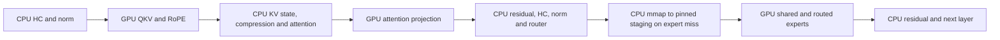

# DeepSeek performance gap: NTransformer and llama.cpp

## Design requirement

The product goal is to make large models accessible on more hardware, eventually
including an RTX 3090. Identical logits are a useful win, **not a requirement**.
Preserve numerical precision and useful model quality while improving speed and
resource efficiency. A logit difference alone neither proves quality loss nor
establishes acceptability: arithmetic changes need held-out likelihood and
task-quality measurements, including instruction following where relevant.
Do not limit the H100 implementation to consumer-GPU capabilities; NVLink/P2P
and speculative block reservation remain part of the design space.

The objective is to minimize, and where possible eliminate, the CPU from the
steady-state inference critical path. The user explicitly reaffirmed this on
2026-10-15. A faster CPU/GPU hybrid is a comparison point, not the destination.
CPU work during model loading, allocation, request admission, and diagnostics is
different from CPU work that every layer must wait for on every token.

For each proposed optimization, record the host decisions, synchronization
points, activation transfers, weight transfers, and allocations that it removes.
Keep activations and attention state on GPU across operator boundaries. Treat
expert misses as a residency and scheduling problem, rather than automatically
returning the whole layer to CPU.

## What the completed benchmark establishes

The [comparison artifact](benchmarks/h100-deepseek-2026-10-15/llama-comparison/RESULTS.md)
uses the same GGUF shards, physical H100, input token IDs, and 64 consumed decode
tokens. Each engine uses its native execution and weight placement. It exercises
one H100; it does not measure a two-GPU NVLink implementation.

| Prompt tokens | NTransformer decode, tok/s | llama.cpp decode, tok/s | Ratio | NTransformer prefill, tok/s | llama.cpp prefill, tok/s |
|---:|---:|---:|---:|---:|---:|
| 32 | 6.2294 | 28.7849 | 4.621× | 6.0666 | 8.3486 |
| 128 | 6.1780 | 28.9096 | 4.679× | 6.1624 | 18.1224 |
| 512 | 5.3638 | 27.8210 | 5.187× | 6.0516 | 46.2104 |

These are speed measurements at equal consumed input, not a finding of equivalent
numerical output or quality. Greedy agreement is 52/65, 41/65, and 43/65. Each
engine repeats deterministically by itself. The discrepancy must not be described
as ordinary run-to-run nondeterminism.

## Where NTransformer spends time

The existing production-path counters give these mean milliseconds per decode
token, over three warm requests. Parent rows partition elapsed time; indented
subdivisions in the second table must not be added to the parent rows.

| Phase | Prompt 32 | Prompt 128 | Prompt 512 |
|---|---:|---:|---:|
| MoE | 78.692 | 74.948 | 88.472 |
| Attention | 46.039 | 50.470 | 61.027 |
| Hyper-connections | 13.648 | 13.824 | 13.951 |
| Engram | 2.833 | 2.926 | 2.921 |
| Other | 19.140 | 19.517 | 19.887 |
| Total | 160.529 | 161.864 | 186.436 |

| Subphase, already included above | Prompt 32 | Prompt 128 | Prompt 512 |
|---|---:|---:|---:|
| CPU router, within MoE | 13.267 | 13.495 | 13.624 |
| Routed/shared GPU path and transfers, within MoE | 65.358 | 61.380 | 74.769 |
| QKV prologue, within attention | 13.471 | 13.524 | 13.519 |
| Compression/indexing, within attention | 3.280 | 3.415 | 3.939 |
| CPU attention loop and inverse RoPE, within attention | 14.264 | 18.425 | 28.278 |
| GPU attention tail and readback, within attention | 14.927 | 14.999 | 15.172 |

These are host wall intervals, including waits and transfers, not isolated kernel
durations. In particular, the routed interval includes the shared-expert work
enqueued on the same stream. Even an impossible zero-cost MoE would leave about
81.8 ms/token at prompt 32, versus llama.cpp's approximately 34.7 ms/token total.
Fixing only the expert kernel cannot close the gap.

## Different execution chains

NTransformer currently executes this path for every token and layer:

The attention prologue reads back three buffers with three separate stream waits;
the attention tail adds another readback/wait. This is 160 host synchronization
points per token across 40 layers, before counting MoE, the output head, and other
branches. The prologue/tail transfers alone total about 11.84 MiB/token. Their
small size does not make their serial dependencies cheap.

The routed-expert cache introduces a different cost: warm decode moves
approximately 32.46/26.86/47.19 GiB of expert weights per 64-token request for the
three contexts. Misses go through `mmap → CPU memcpy → pinned RAM → H2D`.
There is no P2P expert-cache path in this DS41 execution chain yet.

There is also avoidable CPU work inside this miss path. `gpu_moe_impl` constructs
one new `std::thread` for every missed weight slice, joins all of them, and only
then submits the H2D copies. From the warm cache counters, this entails about
86.9/71.9/126.3 copier threads created and joined per decode token for the three
contexts. These are counts inferred from the executed branch and miss counters,
not a measured attribution of milliseconds to thread creation. The persistent
CPU row-worker pool introduced earlier does not cover these copier threads.

The same function enqueues the resident shared expert only **after** all routed
misses have been staged and their H2D transfers have been queued on its stream.
The shared expert depends on the activation, not those routed weights. This
submission order creates an avoidable dependency. A persistent staging facility,
earlier shared-expert submission, and a separate copy stream are concrete
intermediate experiments; GPU-managed residency remains the architectural goal.

The pinned llama.cpp implementation instead represents the model as a scheduled
graph. The measured preset places the first 31 layers' routed weights in CPU
memory and the remaining nine in GPU memory. Backbone and shared weights are
GPU eligible. Its CUDA backend can replay graphs and fuse supported operations.
This does not make it CPU free: graph splits, CPU experts, input preparation, and
some transfers still involve the host.

The scheduler can also offload operations whose weights live in CPU memory. The
CUDA backend's default threshold is 32 tokens. For `MUL_MAT_ID`, the scheduler
reads the expert IDs, groups consecutive selected experts, and copies their
weights. Weight placement therefore does not by itself establish execution
placement during prefill. See the pinned source's `ggml-backend.cpp` and
`ggml-cuda.cu`, included in the comparison artifact.

NTransformer has no multi-token DS41 forward API: prefill calls the same
single-token session repeatedly. It cannot amortize weight reads, scheduling,
and small launches across prompt tokens as a batched matrix implementation can.

## Numerical contract is part of the performance investigation

NTransformer's routed MXFP4 and backbone Q8 kernels multiply dequantized weights
by FP32 activations. llama.cpp's quantized vector kernels use quantized
activations, including MXFP4×Q8 CPU dots and CUDA Q8_1 activation quantization.
This is an arithmetic difference beyond a different summation order. Both decode
the MXFP4 weight format with the same scale convention and nibble layout in the
code inspected; no weight-format mismatch has been established.

The completed [first-token audit](benchmarks/h100-deepseek-2026-10-15/performance-gap/RESULTS.md)
locates the first substantial difference at query-A projection. An FP64 replay
of each engine's own captured input matches NTransformer's normalized output
with FP32 inputs (relative L2 1.36e-7) and llama.cpp's with Q8_1 inputs (7.01e-8).
The alternate input arithmetic differs by about 0.00337. This explains that
operation; it does not establish a full-model quality difference. Both dump
probes reproduce their own ordinary first-token final logits bitwise.

Use the current FP32-activation implementation as a diagnostic reference, while
allowing faster arithmetic when numerical and task-quality evidence supports
it. Matching llama.cpp's logits is not the acceptance gate. Scheduling changes
that preserve the calculation can be validated against the existing output
without first solving cross-engine arithmetic differences.

## Implementation priorities

1. **GPU-resident layer state and backbone.** Keep the HC stream, normalization,
   raw/compressed KV, attention result, residuals, router logits, and selected IDs
   on device. Give kernels device buffers instead of host-vector input/output
   contracts. First remove unnecessary intermediate readbacks; then replay a
   stable backbone graph. CPU orchestration remains outside recurrent layer
   boundaries as far as dependencies allow.
   Capturing only the existing small CUDA fragments cannot remove the CPU
   calculations and waits between them.
2. **A GPU-facing expert residency protocol.** Preallocate slot pools and metadata;
   separate residency lookup, reservation, transfer completion, and consumption.
   Use a copy stream and explicit readiness events. Evaluate lookahead and
   speculative reservations against miss rate and wasted traffic, with a bounded
   fallback. Routing for the current token still determines which experts are
   required: speculative work cannot be assumed correct in advance.
3. **Two-GPU peer cache.** Use the second H100's memory and NVLink/P2P for suitable
   missing blocks. Measure local hits, peer hits, host misses, transferred bytes,
   and exposed wait time separately. GPU-to-GPU P2P does not itself remove the
   existing host staging step for weights still in RAM/storage. Plan that path
   explicitly. Consumer GPU workarounds belong to a later capability fallback.
   Also test executing an expert on the GPU that already owns its weights,
   sending the activation and returning its output. One expert's gate/up/down
   weights occupy 18,800,640 bytes here, versus 40,960 bytes for one FP32 input
   plus output of width 5,120: about **459× less inter-GPU payload**, before
   metadata and protocol overhead. This is a byte-count argument, not a promised
   speedup. Preserve per-expert outputs and the selected-expert reduction order
   when testing numerical equivalence. Compare peer execution with peer copies
   under the same two-GPU resource budget, including load balance and waiting.
4. **Multi-token prefill.** Introduce a real token-batch interface, tiled matrix
   work, and MoE dispatch grouped by expert. Account for compressed-state and
   Engram history updates; merely wrapping the current token loop is insufficient.
5. **Kernel work under a stated precision policy.** Investigate MXFP4 lookup,
   input reuse, reduction, and launch efficiency using measured device time.
   Evaluate integer dot products or other lower-precision paths separately from
   preserving the existing FP32-activation calculation.

The acceptance criteria include tokens/s, latency, numerical/quality checks,
host waits/token, CPU critical-path time, activation traffic, expert traffic,
cache hit location, and GPU active time. A speedup that merely consumes more CPU
does not satisfy the architectural objective by itself.

## First measured implementation after the audit

The [resident-router experiment](benchmarks/h100-deepseek-2026-10-15/gpu-router/RESULTS.md)
moves the BF16/F32 router projection to GPU while keeping its weights resident,
retaining FP32 activation/accumulation precision and the CPU reduction order.
It also batches QKV readback waits and advances independent shared-expert work.
The final defaults improve decode from **6.2385 to 6.7163 tok/s** at prompt 32
and **6.1817 to 6.6836 tok/s** at prompt 128, with the same 62 GiB expert cache
and 150 MiB additional resident router weights. All 65 compared logit vectors
match the control bitwise in both contexts. The router-only control accounts
for most of the improvement; its CPU/GPU interval falls from about 13.3 to
3.7 ms/token.

The [preceding ablation](benchmarks/h100-deepseek-2026-10-15/gpu-flow/RESULTS.md)
showed no measurable gain from the combined worker-pool, MXFP4 lookup and
scheduling candidate. Worker reuse and register lookup therefore remain off by
default. Do not count reduced operation counts as a speedup until measured.

The new router still uploads its input and returns logits for CPU selection.
QKV removes 80 completion waits/token, while the router introduces 40: a net
reduction of 40 for these paths. This is an intermediate result, with the larger
CPU/state and expert-transfer bottlenecks still open; it does not close the
multi-fold gap with llama.cpp.

## HC projection follow-up: dispatch and memory access both matter

The [HC experiment](benchmarks/h100-deepseek-2026-10-15/gpu-hc-gpu/RESULTS.md)
isolated another avoidable CPU cost. Eighty small projections per token took
22.96 ms through the worker pool; direct CPU row evaluation took 11.51 ms.
The first resident GPU kernel took 17.16 ms. Moving the operation alone was
insufficient: eight active lanes per row issued too little concurrent memory
work. A 256-thread block now loads weight/input tiles cooperatively, then keeps
the same FP32 accumulation chains and reduction order. Its projection interval
is about 5.34 ms/token.

Final defaults improve decode from **6.7508 to 7.6908 tok/s (+13.92%)** at
prompt 32 and **6.6806 to 7.6372 (+14.32%)** at prompt 128. Prefill improves
13.44% and 14.49%, respectively. All 65 logit vectors match the paired control
and preceding router baseline, while expert upload bytes stay unchanged.
The final build passes 18 tests; the projection fixture covers 72 comparisons
for both direct and cooperative kernels. These are fixed-work regressions,
not a general quality evaluation or independent process-level variance study.

This adds 150 MiB of resident weights beyond the router implementation, keeping
the expert cache at 62 GiB. It also introduces 80 HC host waits and about
6.257 MiB of activation traffic per token. Normalization, Sinkhorn and residual
state still live on CPU. The result improves placement and memory access but
leaves the architectural boundary described below open. It does not close the
remaining multi-fold llama.cpp gap.

## Next residency boundary identified in the implementation

The raw attention window is small compared with the expert cache:
`40 layers * 128 positions * 512 dimensions * 4 bytes = 10 MiB`.
The HC stream and its residual each occupy 80 KiB. These are calculated tensor
payloads, not measured allocation peaks; compressed KV and index state grow
separately with context. Resident state should therefore be evaluated before
assuming that every intermediate needs a host round trip.

The CPU control in `Session::attention` reads Q/K/V back from the GPU, updates the CPU KV
ring, builds a vector of raw and compressed key pointers, computes attention on
the CPU, applies inverse RoPE, and uploads the result for the GPU output
projection. Its per-head callback also creates two temporary vectors, yielding
5,120 vector allocations per token at 64 heads and 40 layers. This count follows
from the code; it is not a measurement of how much time those allocations cost.

A useful next GPU ownership unit is the raw KV ring plus attention and inverse
RoPE feeding the output projection directly. It must preserve chronological
ring order, compressed-key visibility/selection, attention sinks, layer sharing
and reset semantics. Moving only the dot products while still reconstructing
and copying the full window on the host would leave the main state boundary in
place. The implementation below now crosses that boundary for Q, the raw KV
ring and attention output; compression/indexing and the residual state remain
separate follow-up targets.

## Resident attention implementation

Session-owned device storage now keeps the raw KV ring, query and attention
output resident. It caches compressed prefixes by their owning layer and
uploads newly visible rows and selected indices. Attention and inverse RoPE
feed the output projection directly. This removes the 5 MiB/token Q readback
and 5 MiB/token output upload, while retaining the much smaller query-latent
and KV readbacks for CPU indexing and fallback. The 62 GiB expert budget stays
unchanged; observed prompt-32 peak VRAM increases by about 12 MiB.

The paired comparison improves decode from 7.7385 to 8.5951 tok/s (+11.07%) at
prompt 32, from 7.6443 to 8.6118 (+12.66%) at prompt 128, and from 6.4298 to
7.3845 (+14.85%) at prompt 512. Attention total falls from 45.14 to 33.12 ms/token
in the shorter case. All 65 predictions per context agree and expert traffic
is unchanged. Relative logit L2 is 5.10e-7 / 5.59e-7 / 6.99e-7;
the cross-path difference is deterministic, with exact repeats inside each
implementation. The kernels retain FP32 tensor precision and ordered arithmetic;
these results support the exercised regression, not a general quality claim.
Raw outputs, profiles, telemetry and both source snapshots are kept in the
[resident-attention results](benchmarks/h100-deepseek-2026-10-15/gpu-attention/RESULTS.md).
The earlier llama.cpp prompt-32 baseline remains about 3.35 times faster at
decode (28.7849 versus 8.5951 tok/s); this is progress on one measured boundary,
with a substantial engine gap still open.

There are still 40 prologue and 40 output-projection host waits per token.
The smaller transfers and removal of CPU attention help, but the host still
drives the layer loop, compressed-state/indexer work, residual mixing and expert
placement. Resident attention also adds two CUDA core launches per layer; that
cost is included in the measured throughput. Eliminating bytes, allocations
and CPU arithmetic must be evaluated together with the new device submission
cost rather than equating any one count with overall acceleration.

The new profile keeps expert placement as a priority. These are inclusive host
intervals from the resident decode runs, not GPU busy time:

| Prompt tokens | Total ms/token | MoE ms/token | Attention ms/token | Routed expert uploads MiB/token |
|---:|---:|---:|---:|---:|
| 32 | 116.35 | 66.91 | 33.12 | 519.40 |
| 128 | 116.12 | 63.03 | 36.76 | 429.75 |
| 512 | 135.42 | 75.74 | 43.25 | 755.01 |

The uploads are successful logical payload bytes, and are unchanged between
each control/resident pair. MoE includes routing, staging, copies, computation,
overlap and waits; this table cannot attribute all its latency to PCIe. The
measured compression/indexer interval at prompt 32 is only 3.25 ms/token,
including its GPU projections. Removing that whole interval while leaving
everything else fixed would cap that isolated change near 1.029x. Its stronger
architectural benefit would be to remove the dependency on query-latent
readback and enable scheduling several device operations before the next host
wait. That benefit still needs measurement.

The next experiments should distinguish two effects: keeping the residual,
compressor and index state on device to reduce host barriers; and serving
routed experts where their weights reside to reduce weight movement. A
two-GPU ownership or peer-cache experiment needs its own same-hardware control.
Neither follows automatically from putting attention on GPU. Ordered FP32
attention is also a conservative first kernel; parallel reduction can be
evaluated with numerical and behavior checks without requiring identical
logits, as long as model precision and quality remain acceptable.

<!-- ds41-moe-memory -->
## Cooperative MXFP4 follow-up

The [next implementation and verified artifact](benchmarks/h100-deepseek-2026-10-15/moe-memory/RESULTS.md) reduces repeated
global loads inside routed-expert kernels, with contiguous word loads, shared
activation reuse and exact register-based MXFP4 decoding. It preserves FP32
arithmetic and the cache/transfer policy.

| Prompt | Control decode tok/s | Combined decode tok/s | Decode gain | Prefill gain |
|---:|---:|---:|---:|---:|
| 32 | 8.5866 | 11.5367 | 34.36% | 32.26% |
| 128 | 8.6260 | 11.5965 | 34.44% | 33.76% |
| 512 | 7.3923 | 9.4616 | 27.99% | 33.96% |

All 25,209,600 compared logits match bitwise across the three contexts, with
the same consumed tokens and expert uploads. Final defaults pass 28 CTest
cases and 18 cross-process numerical cases. These are regression checks for
the exercised data. The earlier llama.cpp prompt-32 reference of 28.7849 tok/s
is now about 2.50x the combined NTransformer rate; the remaining engine gap
still requires work on placement, host dependencies and prefill batching.
Even an ideal zero-cost full MoE would leave 49.37 ms/token in the
measured non-MoE work, versus llama.cpp's 34.74 ms/token total.
Removing weight movement alone cannot close the remaining gap.

The four-way probe matters: register lookup alone measures
8.6067 versus
8.6070 tok/s, cooperative loads alone
9.0613, and their combination
11.5429. A neutral isolated
change can expose a gain when another bottleneck is removed. This is a measured
interaction; a device-counter diagnosis remains unavailable.

The traced routed compute/launch span drops from
36.04 to 6.40 ms/token.
Host staging remains 14.52 ms/token and weight
uploads 10.37 ms/token. Host/stream intervals
overlap and stream spans include submission gaps. The next bounded experiment
should reduce staging and weight movement, using explicit slot/readiness
ownership and then a same-budget two-GPU comparison of peer copies versus
expert execution where weights reside. Existing host boundaries in the
backbone remain a separate target.
<!-- /ds41-moe-memory -->

## Follow-up probes prepared on 2026-10-15

The suite completed after Brandon `mapping-layout-budget-v1`, respecting its
training locks and idle-GPU checks. The [verified local results](benchmarks/h100-deepseek-2026-10-15/performance-gap/RESULTS.md)
contain 2,331 hashed payload files. Ordinary llama execution versus disabled CUDA
Graphs measured 26.30 versus 26.88 decode tok/s at prompt 32, with identical final
logits. This single-process control does not show a graph benefit and cannot
explain the multi-fold engine gap.

Raising the CPU-weight operation-offload threshold at prompt 128 improved
llama prefill from 17.87 to 67.12 tok/s; decode stayed near 29 tok/s. Final logit
relative L2 changed by 0.1088, so this is a speed/placement observation, not a
quality acceptance result. Automatic offload can incur more cost than the
computation it moves. Measure bytes and dependencies before choosing placement.

The initial CUPTI 13.0.1 trace process exited with SIGSEGV and produced no usable
timeline. Its pre-trace warm request reproduced NTransformer's final logits;
it is not used as an explanation of the gap. The isolated CUPTI 13.1.115 retry
also failed (exit 139 for both engines), without replacing system or training
libraries. No valid device timeline was obtained. Trace failures are recorded
independently of the successful uninstrumented controls.

Remote queue: `/home/ubuntu/ntransformer-h100/ds41-gap-20261015/queue-status.json`;
detailed execution/admission status: `status.json` in the same directory.
Completed results are copied to
`/lambda/nfs/btiny/ntransformer-training/deepseek-gap-20261015`.
The local watcher downloads and verifies the archive and regenerates its
analysis/report under
`docs/benchmarks/h100-deepseek-2026-10-15/performance-gap/`.
Its status is `build/ds41-gap/local-status.json`.

The archive SHA-256 is
`35f48134e14c20a4629f8ab9939159e9ecd4902fa621f0d9c6dc6018522c4f8d`.
Local verification checked all payload hashes and reproduced the analysis and
report; the first-projection replay uses its archived result because extracted
model weights are deliberately excluded from the artifact.

<!-- ds41-peer-experts -->
## Peer expert execution and calibrated precision

Implemented opt-in `DS41_PEER_MODE=copy|execute` on the two H100s. Expert ID modulo two determines ownership. Both modes reserve 62 GiB of expert cache per GPU; the copy control additionally has bounded temporary primary-GPU weight slots.

[Verified report and raw evidence](benchmarks/h100-deepseek-2026-10-15/peer-experts/REPORT.md) · [precision controls and selector](DEEPSEEK_PRECISION_SELECTION.md).

| Prompt | One GPU FP32 tok/s | Two GPUs, P2P copies tok/s | Two GPUs, owner execution tok/s | Execution gain vs copy |
|---:|---:|---:|---:|---:|
| 32 | 11.5246 | 13.6763 | 16.3525 | 19.57% |
| 128 | 11.4826 | 13.0547 | 15.4324 | 18.21% |

These measurements consume the same actual corpus tokens: 64 continuation steps, one cold request and three warm repeats. They differ from the earlier autoregressive workload. The one-GPU control has 62 GiB total cache versus 124 GiB in both peer modes, so its comparison also includes added capacity/hardware. Copy versus execute isolates placement and communication at the same owner-cache capacity.

At prompt 32, execute replaces 2268.39 MiB/token of peer weight copies with 3.243 MiB/token of FP32 inputs/outputs. The warmed fixed workloads fit the combined cache and measured zero host weight uploads in both peer modes; this does not mean the entire model fits or that new requests avoid misses.

Every selected block is reserved before dispatch and retained until both streams finish. Cross-device events order P2P input/output transfers; the final sum follows the original expert order. Exceptions drain both streams and invalidate pending cache entries. Cold cache misses still stage through CPU pinned memory, and the host still schedules layers.

`DS41_MXFP4_COMPUTE=fp32|f16|q8` now selects routed GEMV arithmetic over the same MXFP4 weights. FP16 uses packed half products; Q8 uses block-32 activation quantization and signed DP4A. Scaling, nonlinearities and the final reduction retain FP32. `tools/select_ds41_precision.py` evaluates fixed-token KL/NLL and repeat-aware speed, outside token decode. Raw logit L2 and argmax equality are diagnostic by default, because exact logits are not the quality requirement.

The selector chose **fp32**. FP16 passed the final distribution/NLL limits but was slower; Q8 was also slower and slightly exceeded the context-128 KL/NLL limits. Neither reduced mode met the required 3% speed improvement on both contexts. This is 130 prediction positions from one corpus, not a task-quality or instruction-following certification.

Validation: 44 CUDA CTests without skips/failures, 27 cross-process shape/precision/placement fixtures with equal outputs within each arithmetic mode, and six selector unit tests. All 16,806,400 FP32 logits matched bitwise across single/copy/execute on the two model workloads. Each reduced mode repeated bitwise within itself.

Local verification checked 374 payload hashes and reproduced the report and selection. Archive SHA-256: `14e1e1988561905934cc8e13e18cf40c7fb76ca9b7f34d840963d30a88a64895`. Lambda copy: `/lambda/nfs/btiny/ntransformer-training/deepseek-peer-20261015`.

Both new controls remain opt-in; default arithmetic stays FP32. Attention still takes approximately 33–37 ms/token while MoE falls to approximately 11.65 ms/token. The next target is the attention/backbone chain and its host boundaries. Rebenchmark llama.cpp on the same token workload and GPU count before claiming a new cross-engine gap.
<!-- /ds41-peer-experts -->

<!-- ds41-q8-backbone -->
## Cooperative Q8 backbone projections

Implemented opt-in `DS41_Q8_COOPERATIVE=1` for Q-A, Q-B, KV, grouped O-A, O-B and Q8 indexer projections. Each warp loads contiguous packed weight words; eight rows reuse a CTA activation tile. FP32 activations/accumulation and Q8_0 weight storage retain their previous arithmetic order. Odd block counts fall back to the legacy kernel; `0` selects the control.

[Verified report, measurements and source snapshot](benchmarks/h100-deepseek-2026-10-15/q8-backbone/REPORT.md). Both variants use two H100s, peer expert execution, 62 GiB cache per GPU, the same corpus tokens and 64 continuation steps. The table shows median warm decode throughput from three repeats.

| Prompt tokens | Legacy tok/s | Cooperative tok/s | Gain | Attention ms/token, before -> after |
|---:|---:|---:|---:|---:|
| 32 | 16.3772 | 23.5314 | 43.68% | 33.210 -> 14.681 |
| 128 | 15.4544 | 21.6056 | 39.80% | 36.852 -> 18.465 |
| 512 | 13.3465 | 17.6649 | 32.36% | 43.332 -> 24.901 |

All 25,209,600 logits match bitwise across these three workloads. The five warm projection microbenchmarks improve 2.22x to 5.92x; they reuse operands and must not be interpreted as full-model HBM bandwidth.

48 CTests passed without skips/failures, including independent CPU dot references and aligned/unaligned/grouped/partial CUDA cases. Eight cross-process backbone fixture outputs match their paired controls. The cooperative kernel needs 12,928 shared bytes per CTA and no extra global weight allocation; sampled VRAM and RSS are in the report.

This removes inefficient GPU operand access, while CPU scheduling, QKV mirrors, compressor/indexer work and tail readback remain. At context 512, warm requests still upload about 68.9 MiB of expert weights per token after cache evictions. The main CPU boundaries are unchanged; host stage timers are not isolated device-busy measurements. Broader task quality and a matched llama.cpp rerun remain separate evaluations.

The routed FP32/F16/Q8 selector is independent. Its policies bind the binary and environment: recalibrate for this build before using a saved selection. The current comparison explicitly uses FP32 routed arithmetic.

Local verification checked 266 payload hashes, reproduced the report/summary and matched changed workspace sources to the measured snapshot. Remote archive SHA-256: `4c68de6ff23d50c5d7431d35023b97a312c7dbabcc22c97b09077601f21ec9d8`. Persistent copy: `/lambda/nfs/btiny/ntransformer-training/deepseek-backbone-20261015`.
<!-- /ds41-q8-backbone -->

<!-- ds41-cache-policy -->
## Expert-cache reservations and protected reuse

Implemented explicit per-operation reservations and opt-in `DS41_CACHE_POLICY=slru`. First-use slices enter probation; reuse in a later operation promotes them to a protected queue. The candidate reserves 80% of cache slots for that queue. LRU remains the default.

[Verified report and raw evidence](benchmarks/h100-deepseek-2026-10-15/expert-cache/REPORT.md). Both policies use the same 62 GiB per GPU, owner execution and cooperative Q8 backbone. One cold request plus three warm repeats, 64 fixed continuation steps, two corpora.

| Workload | LRU tok/s | SLRU tok/s | Decode gain | Whole warm-request gain | H2D MiB/token LRU -> SLRU |
|---|---:|---:|---:|---:|---:|
| p32 | 23.4145 | 23.3751 | -0.17% | -0.07% | 0.000 -> 0.000 |
| p128 | 21.5839 | 21.5686 | -0.07% | -0.22% | 0.000 -> 0.000 |
| p512 | 17.6081 | 18.0755 | 2.65% | 5.08% | 68.917 -> 43.704 |
| heldout-p512 | 17.9735 | 18.1311 | 0.88% | 2.92% | 54.349 -> 37.540 |

The candidate does not meet the predeclared transfer/performance gates on these workloads. The report includes cold and prefill costs; fewer decode misses alone do not establish a faster request.

52 CTests passed without skips/failures; 33,612,800 logits match bitwise between policies. CPU tests also passed ASan/UBSan. Offline replay reproduces every LRU hit/miss and predicts measured phase upload bytes for both policies. Trace collection is separate from throughput measurement.

Selected slots cannot be evicted until their streams finish, including when a protected entry is demoted. Duplicate keys within one operation are reserved but do not manufacture temporal reuse. Cache replacement metadata and remaining misses still involve the CPU; GPU weight formats, arithmetic and ownership are unchanged.

Local verification checked 335 payload hashes and reproduced the report. Remote archive SHA-256: `94ca7b39678a4fdc98a86a13aec3ebd15008dc2a1cd1c47c2f51d1ab741402bb`. Persistent copy: `/lambda/nfs/btiny/ntransformer-training/deepseek-cache-20261015`.
<!-- ds41-cache-interpretation -->
**Measured scope and next bottleneck.** The decode gains are 2.65% and 0.88% on the two context-512 corpora; both fall below the predeclared 3% gate. The protected cache reduces transfers and improves warm request time on both, but remains opt-in. On the first corpus, warm MoE time falls from 15.41 to 14.09 ms/token, while attention remains 24.74 ms/token. The remaining attention execution path therefore deserves separate optimization.

**Cold-start confound.** The OS file cache was not reset between policy processes. The held-out SLRU process recorded 28,180 major page faults, versus 1,061 for LRU; these are process-wide totals, not per-phase counters. Its first request took 50.347 s versus 36.569 s, with 14.757 s versus 1.684 s inside Engram. This is consistent with file-backed lookup paging and execution order affecting cold latency; the measurements cannot isolate a cold-start effect of the replacement policy. The reported speedups apply to warm repeats. A controlled cold comparison needs matched OS cache state or counterbalanced runs plus page-fault/I/O counters for each phase.

Engram currently gathers and dequantizes table rows on the CPU in `Session::engram_add` (`src/model/ds41/ds41_forward.cpp`). This identifies a separate data-path target: measure lookup residency and staging independently from projection compute, then evaluate buffer reuse and GPU-resident gathers. The expert-cache experiment does not implement that change or remove the remaining CPU dispatch.
<!-- /ds41-cache-interpretation -->
<!-- /ds41-cache-policy -->

<!-- ds41-fair-comparison -->
## Matched two-H100 comparison

These measurements precede the HC matrix-layout correction below. Their logits, expert routing and cache traces describe the former graph; use the corrected graph for new numerical references and policy calibration.

[Verified matched report](benchmarks/h100-deepseek-2026-10-16/fair-comparison/REPORT.md). Both engines use the same two H100s and fixed corpus tokens: two independent launches with reversed engine order, two warmups and three measured requests per launch. Native execution/precision is preserved. The bounded llama pilot selects a balanced layer placement, CPU thread count and operation-offload setting before the main cases. The NT SLRU path is opt-in; LRU is measured separately at context 512.

| Workload | NT decode tok/s | llama decode tok/s | llama / NT | NT prefill tok/s | llama prefill tok/s | Warm major faults NT / llama |
|---|---:|---:|---:|---:|---:|---:|
| p32 | 23.5329 | 33.7132 | 1.433x | 25.2461 | 84.0887 | 0 / 0 |
| p128 | 21.6057 | 33.8955 | 1.569x | 23.8474 | 95.9958 | 0 / 0 |
| p512 | 18.1975 | 31.5693 | 1.735x | 20.2261 | 104.5600 | 0 / 0 |
| heldout-p512 | 18.2967 | 31.4071 | 1.717x | 20.2081 | 104.5951 | 0 / 0 |

The report includes paired launch ratios, target NLL, distribution differences, repeat stability, VRAM/RSS and per-phase page-fault/I/O counters. Equal tokens and hardware do not establish equivalent task quality. Initial-request timings remain diagnostic because OS file-cache state is not reset; any residual warm paging is explicitly flagged.

527 payload hashes verified locally; analysis reproduced with 1e-12 floating-point tolerance. Archive SHA-256: `1a735ca148527172f05fa30f327e9f65b544ff1c58e96d6957c9d71a5c6d94bf`. Persistent copy: `/lambda/nfs/btiny/ntransformer-training/deepseek-fair-20261016`.
<!-- /ds41-fair-comparison -->

<!-- ds41-hc-layout -->
## HC layout correction and prefill diagnosis

The [follow-up audit](benchmarks/h100-deepseek-2026-10-16/hc-layout-audit/REPORT.md) found a destination/source transpose in the hyper-connection mixing matrix. Sinkhorn produced row-major `matrix[dst * hc + src]`, then copied it directly into a consumer expecting `comb[dst + src * hc]`. Exporting the intended layout corrects the directed residual connections. The GPU kernels, routed FP32 arithmetic and P2P execution are unchanged.

| Workload | Previous NT NLL | Corrected NT NLL | llama NLL | Previous / corrected KL |
|---|---:|---:|---:|---:|
| p32 | 2.169373 | 1.750829 | 1.757762 | 0.975198 / 0.007380 |
| p128 | 2.244304 | 2.148210 | 2.137048 | 0.513642 / 0.008898 |
| p512 | 2.533017 | 2.131490 | 2.128646 | 0.620707 / 0.007260 |
| heldout-p512 | 1.463863 | 1.380446 | 1.370942 | 0.423722 / 0.011263 |

Each corrected case repeats bitwise across five requests. The asymmetric producer/consumer regression fails before the correction and passes afterward; release and ASan/UBSan tests also pass an independent double-precision Sinkhorn oracle. These are 260 prediction positions from two corpora. Remaining distribution differences still require characterization; this does not certify downstream task quality.

A separate llama control changes only ubatch from 512 to 1. At p512, warm prefill rises from 4.897 s in the prior native run to 14.931 s in the serial control; the original NT run takes 25.314 s. At p32 the corresponding times are 0.381 s, 0.944 s and 1.268 s. The control has one measured repeat and is diagnostic, not a paired speedup estimate. It confirms a substantial batching contribution and a remaining per-token execution gap.

The corrected audit baseline schedules 40 layers per prompt token, including 20,480 QKV readback waits for p512; the subsequent experiment below removes most of those waits. The next path should process token tiles layer by layer, batch dense projections and owner-GPU experts, and keep HC/norm/router/attention intermediates on the device. Preserve P2P and explicit block reservation; verify causal compressed state and delayed HC pre-mixes against the corrected serial implementation. The audit implements the numerical correction, not that new prefill path. Corrected timing samples remain diagnostic; a CPU-validation overlap is recorded explicitly.
<!-- /ds41-hc-layout -->

<!-- ds41-selective-readback -->
## Selective QKV readback (2026-10-16)

Removed eager CPU mirroring of the GPU-owned raw KV ring and made prologue host mirrors optional. Only the eight indexer-source layers require the normalized query latent; other resident layers enqueue QKV and continue without a host completion wait. A dedicated pinned input buffer and upload event protect caller-input reuse. CPU fallback recovers the valid ring history and Q on demand. `DS41_QKV_SELECTIVE_READBACK=0` restores the previous mirrors; the optimized path is enabled by default.

[Verified report and raw results](benchmarks/h100-deepseek-2026-10-16/selective-readback/REPORT.md). Same corrected-HC binary in both modes, two launches in reversed order, six warm measurements per mode/workload, unchanged tokens, FP32 routed arithmetic, Q8 backbone, SLRU cache and P2P execution.

| Workload | Decode before / after tok/s | Decode gain | Prefill before / after tok/s | Prefill gain |
|---|---:|---:|---:|---:|
| p32 | 23.5669 / 23.8196 | +1.07% | 25.2516 / 25.5638 | +1.24% |
| p512 | 18.1769 / 18.3122 | +0.74% | 20.1740 / 20.3772 | +1.01% |

At p512 prefill, QKV readback waits fall from **20,480 to 4,093** and readback volume from **140 MiB to 19.985 MiB**. There are no staging-reuse waits, GPU-to-CPU fallback recoveries, warm major faults or warm input blocks in these cases. The extra pinned input storage is 20,736 bytes per attention state; this change adds no device tensor allocation.

**The end-to-end gain is modest.** The host QKV interval shrinks, while some pending GPU computation moves into later attention waits. Removing a synchronization does not eliminate the underlying compute. Host intervals in the report show this redistribution; they are not GPU kernel timings. Prefill still traverses every layer once per token, and HC, router, compressed state and attention-output boundaries still involve the CPU. A layer-wise token-tile path and longer device-resident subgraphs remain the larger targets. This experiment does not rerun llama.cpp.

All **33,612,800 unique logits** across four workloads match the corrected HC reference bitwise, including the two additional numerical-control workloads. Each process repeats exactly across five requests. The CUDA fixtures cover both Q8 kernels, both readback modes, distinct session/layer inputs, caller-buffer reuse, queued prologues, ring wrap, stale-read rejection and failed-tail recovery. CUDA-disabled behavior and the existing attention/HC/backbone checks pass. Compute Sanitizer was unavailable in the configured toolchain. These checks preserve the existing numerical baseline without extending task-quality coverage.

Local verification checked **205 payload hashes**, reproduced the report and analysis, compared full logits with the locally saved HC reference and matched the measured source to the workspace. Persistent copy: `/lambda/nfs/btiny/ntransformer-training/deepseek-readback-20261016`.
<!-- /ds41-selective-readback -->
