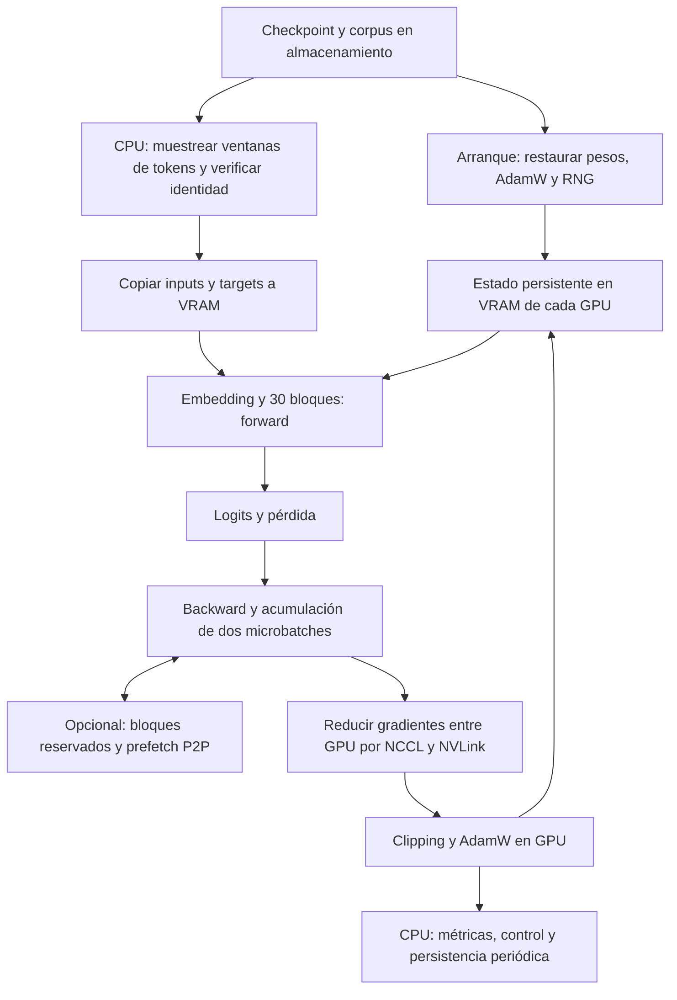

# Brandon Mini: traza operacional del entrenamiento

Esta revisión parte de una pregunta: **¿qué dependencias exige entrenar el modelo
y qué operaciones aparecen solamente por cómo lo expresa el entrenador?**
El objetivo es mantener estados y dependencias cerca de quien los consume,
reservar memoria antes de necesitarla y retirar intermediarios del camino crítico.
La unidad de diseño es el paso de entrenamiento completo, incluidos datos,
gradientes, comunicación y actualización; un kernel más rápido es sólo una parte.

La primera eliminación medida ya produjo **+19,46% en el modo determinista**:
318.144 tokens/s de media en dos continuaciones de 100 pasos, conservando estados
y métricas exactamente iguales a la referencia determinista. El modo habitual
mejoró de 334.314 a 342.491 tokens/s. La traza y las pruebas que sustentan esos
resultados están [guardadas en local](benchmarks/h100-training-2026-10-13/operational/RESULTS.md).

La segunda eliminación, conversiones compartidas de activaciones, agrega
**+2,41% determinista** frente a controles nuevos y **+1,75% en modo habitual**.
Este último alcanza **349.241 tokens/s** y reduce el pico asignado de 14,943 a
12,959 GiB por GPU. Los seis controles deterministas de esta tanda son exactos;
P2P conserva su protocolo y mejora 2,58%. Véase la
[ablación de conversiones](benchmarks/h100-training-2026-10-13/shared-casts/RESULTS.md).

La tercera eliminación entrega las tres cabezas KV directamente a SDPA:
**+3,40% habitual**, hasta **360.951 tokens/s**, **+2,54% determinista** y
**+2,71% P2P**, frente a controles nuevos que ya comparten conversiones.
Desaparecen las expansiones explícitas; seis continuaciones deterministas
conservan exactamente estados y métricas. Véase
[GQA directo](benchmarks/h100-training-2026-10-13/direct-gqa/RESULTS.md).
La [investigación matemática](TRAINING_RESEARCH.md) deriva las siguientes
eliminaciones y dos posibles cambios de arquitectura, todavía sin entrenar.

La cuarta eliminación fusiona conversiones y aritmética de RoPE: **+5,45%
habitual**, hasta **380.757 tokens/s**, **+4,94% determinista** y **+5,54% P2P**.
Retira 720 lanzamientos CUDA por paso y rank; seis auditorías deterministas son
exactas. Los picos asignados de las continuaciones estrictas/P2P suben unos
0,40 GiB por GPU, mientras el habitual queda prácticamente igual. No se declara
un ahorro total de VRAM. Véase la [ablación RoPE](benchmarks/h100-training-2026-10-13/fused-rope/RESULTS.md).

## Referentes de diseño

El autor del proyecto identifica como inspiración el trabajo de Karpathy con
TinyStories y nanochat. Dejamos ese antecedente explícito: [llama2.c](https://github.com/karpathy/llama2.c)
incluye entrenamiento de pequeños Llama sobre TinyStories y un motor de
inferencia en C; [nanochat](https://github.com/karpathy/nanochat) permite examinar
el recorrido desde datos y entrenamiento hasta evaluación e inferencia. Esta
revisión compara mecanismos concretos; no establece procedencia de cada línea
de Brandon ni atribuye novedad a técnicas ya presentes en esos proyectos.

La comparación de código usa nanochat en el commit
[`92d63d4e8bb4df75c3b71618f31ddde2378b2bcd`](https://github.com/karpathy/nanochat/tree/92d63d4e8bb4df75c3b71618f31ddde2378b2bcd).
No se ejecutó su entrenamiento ni se compararon sus tokens/s con Brandon.

| Mecanismo observado en nanochat | Aplicación a esta traza de Brandon |
|---|---|
| [Activaciones en el tipo de cómputo y `Linear` que convierte el peso al tipo de la entrada](https://github.com/karpathy/nanochat/blob/92d63d4e8bb4df75c3b71618f31ddde2378b2bcd/nanochat/gpt.py). Evita depender de autocast para cada proyección. | Motiva compartir las conversiones de activaciones Q/K/V y gate/up. Adoptar directamente toda su política BF16 cambiaría el contrato numérico de Brandon; primero conservar los puntos de redondeo y las ramas FP32 del backward. |
| [Buffers CPU pinned y GPU persistentes, con inputs y targets contiguos y una copia H2D por batch](https://github.com/karpathy/nanochat/blob/92d63d4e8bb4df75c3b71618f31ddde2378b2bcd/nanochat/dataloader.py). | Preparar un anillo con las mismas ventanas y hashes de Brandon; reutilizar cada slot sólo después de su último consumidor. El perfil actual indica poco volumen H2D: se investiga preparación y coordinación. |
| [`torch.compile(dynamic=False)`, preparación del siguiente batch tras lanzar backward y lectura de pérdida después del optimizador](https://github.com/karpathy/nanochat/blob/92d63d4e8bb4df75c3b71618f31ddde2378b2bcd/scripts/base_train.py). | El despacho y las consultas al host forman parte del diseño. Aquí se agruparon las lecturas después de acumular, pero antes de clipping/AdamW para conservar el control de finitud; compilación/captura sigue pendiente. |
| [Optimizador con reducciones y gathers asíncronos, estado distribuido y reutilización de buffers de comunicación](https://github.com/karpathy/nanochat/blob/92d63d4e8bb4df75c3b71618f31ddde2378b2bcd/nanochat/optim.py). | Referencia para planificar propiedad y vida útil. Brandon conserva AdamW y clipping global: no se puede actualizar un bloque antes de disponer de la norma requerida. Cambiar a Muon sería otro experimento. |
| [Atención con FA3 y alternativa SDPA con `enable_gqa`](https://github.com/karpathy/nanochat/blob/92d63d4e8bb4df75c3b71618f31ddde2378b2bcd/nanochat/flash_attention.py). | La ablación `--direct-gqa` retiró la expansión explícita de K/V. Las trazas verifican Flash SDPA en modo estricto y cuDNN en el habitual, sin cambiar el backend dentro de cada par. FA3 no se instaló ni se midió. |

La consecuencia para nuestro diseño es decidir representación, propietario y
vida útil de cada dato a lo largo del paso completo. Las ablaciones implementadas
comparten conversiones de activaciones y retiran expansiones de KV, cuyo volumen
redundante está cuantificado más abajo. P2P y la reserva anticipada siguen siendo recursos
del planificador para los casos con presión de memoria.

### Conversión compartida con backward por rama

`--shared-projection-casts` habilita un buffer BF16 compartido dentro de cada
grupo Q/K/V y gate/up. El scope vive durante ese forward y se limpia incluso
si ocurre una excepción; autograd conserva el almacenamiento que necesitan
los GEMM para calcular gradientes de pesos. La recomposición local y P2P crea
sus propios scopes, sin reutilizar activaciones de otra versión del modelo.

Compartir un único `.to(BF16)` diferenciable también compartiría su nodo de
backward: los gradientes de las ramas se sumarían en BF16 antes de convertirse
a FP32. La implementación comparte el almacenamiento del forward y conserva
un nodo de conversión de gradiente por rama; cada gradiente vuelve a FP32 antes
de que autograd los acumule en la activación original. Pesos, GEMM, RMSNorm,
SwiGLU, atención y AdamW conservan sus implementaciones.

El adaptador aplica la transformación a activaciones FP32 bajo autocast CUDA
BF16. Conserva la ruta original para otros tipos, CPU, inference tensors y
hojas entrenables. Este último caso importa: la
[caché de autocast de PyTorch](https://github.com/pytorch/pytorch/blob/v2.14.1/aten/src/ATen/autocast_mode.cpp)
ya puede compartir conversiones de hojas como las que representan pesos;
cambiar esa topología alteraría sus gradientes. Un test inicial detectó esa
excepción antes de lanzar benchmarks y se añadió el fallback correspondiente.
El alcance sigue siendo primer orden y forwards secuenciales por módulo.

La evidencia de esta ablación se conserva en
[shared-casts/RESULTS.md](benchmarks/h100-training-2026-10-13/shared-casts/RESULTS.md).

## Contrato y evidencia

Se conserva Brandon Mini de 107.604.288 parámetros, 30 capas, dimensión 576,
FFN 1472, 9 cabezas Q y 3 KV, vocabulario 8192 y contexto 1024. Cada paso contiene
dos microbatches de 16 secuencias por GPU: 65.536 tokens globales. Pesos FP32,
autocast BF16 y AdamW fused con estado restaurado; dos H100 SXM5 por NVLink.

La reconstrucción combina el código congelado `sources/stage1-v1`, el adaptador
local y una traza CUDA de dos pasos del backend compatible. Los resúmenes están
en [operational/initial-profile](benchmarks/h100-training-2026-10-13/operational/initial-profile/).
La traza inicial incluye calentamiento, asignaciones y el coste del profiler.
Sirve para identificar operaciones y transferencias, **no para calcular el
speedup alcanzable**. Tampoco se suman tiempos CPU y CUDA como si fueran seriales.
`scripts/analyze_training_trace.py` separa copias físicas, conversiones mediante
kernels, llamadas del host e intervalos de actividad por dispositivo.

La utilización cercana a 98% de la baseline tampoco demuestra que el trabajo
sea necesario: `nvidia-smi` mide la fracción del intervalo con kernels en
ejecución. Una GPU puede mantenerse ocupada convirtiendo o rellenando buffers.
No equivale a saturación de Tensor Cores, ancho de banda alcanzado o fracción
de operaciones útiles. Véase la [definición de NVIDIA](https://docs.nvidia.com/deploy/nvidia-smi/index.html#utilization).

## Recorrido completo

El estado que debe persistir entre pasos es relativamente pequeño: pesos,
momentos de AdamW, contador del optimizador y estado de muestreo/RNG. Para este
modelo, pesos, gradientes y dos momentos FP32 suman unos 1,603 GiB por rank;
activaciones, copias de trabajo, buckets y reservas explican el resto de la
memoria. Ninguna dependencia matemática exige exportar las activaciones al CPU.

El orden obligatorio es:

1. Los dos microbatches de un paso leen la misma versión de los pesos.
2. Cada backward consume las activaciones de su forward o una recomposición
   equivalente, y produce los gradientes de esa misma versión.
3. Una parte de los gradientes puede comunicarse en cuanto está lista; no es
   necesario esperar a que termine todo el backward para empezar cada bucket.
4. El clipping global necesita la norma del conjunto de gradientes reducidos.
   Esa dependencia sí existe, pero el escalar puede permanecer en GPU.
5. AdamW actualiza pesos y momentos; recién entonces el siguiente paso puede
   consumir esa versión. Datos futuros y buffers sí pueden prepararse antes.
6. Un bloque puede reutilizarse cuando termina su último lector, no cuando la
   CPU supone que terminó. Eventos y propiedad explícita resuelven esa condición.

Una reserva especulativa anticipa **espacio y transferencias**, no inventa un
gradiente ni actualiza pesos antes del clipping. El diseño puede quitar consultas
al CPU manteniendo estos seis invariantes.

| Etapa | Qué hace hoy y dónde | Dependencia real / oportunidad |
|---|---|---|
| Arranque | `torch.load` deserializa en RAM; modelo, momentos de AdamW y RNG se restauran en GPU. Se valida el corpus y el software. | Coste de arranque. No se cargan los pesos desde RAM en cada capa o paso. Separarlo del rendimiento sostenido. |
| Muestreo | `PackedCorpus.batch` usa NumPy y mmap de tokens uint16; semilla derivada de paso/rank/microbatch. Apila ventanas, convierte a int64 y copia inputs y etiquetas desplazadas. | Se necesita conservar las ventanas elegidas, no reconstruirlas justo antes de cada forward. Cabe preparar índices y un anillo de entrada con anticipación. |
| Identidad | CPU calcula SHA-256 de inputs y targets. | Es instrumentación del experimento. Puede verificarse un plan de batches anticipadamente, sin eliminar la auditoría. |
| Entrada | `.to(device)` copia inputs y targets desde memoria pageable. | Inputs y targets comparten casi toda la ventana original. Es posible transferirla una vez y construir vistas o reunir tokens en GPU. Primero medir: el volumen actual es pequeño. |
| Embedding y residual | Lookup en GPU produce activaciones FP32. Residual de forma 16×1024×576. | Pesos ya residentes; cada residual ocupa 36 MiB por microbatch. |
| RMSNorm | Reducciones FP32 de PyTorch y kernels nativos compatibles. | Hay temporales y varias pasadas, pero el orden de reducción y de suma con el residual forma parte del contrato numérico comprobado. |
| Q/K/V | Tres proyecciones con autocast; BF16 para GEMM. | La misma activación FP32 se convierte para cada proyección. Reutilizar una conversión de forward exige conservar las ramas FP32 de backward. |
| RoPE | La ruta original convierte Q/K a FP32, multiplica como números complejos y vuelve a BF16. `--fused-rope` mantiene esos intermedios en registros. | Un kernel para Q/K en forward y otro en backward reproducen las contracciones FMA comprobadas. Se leen gradientes con sus strides y se conserva la tabla original. No cambia SDPA ni sus cabezas. |
| GQA | La ruta original materializa K/V con 9 cabezas mediante `repeat_interleave(3)`. La opción `--direct-gqa` entrega las 3 cabezas originales. | La expansión explícita desaparece en las trazas. Sumar los gradientes de las cabezas Q sobre cada KV sigue siendo necesario; lo resuelve el backend. Cambiar la implementación puede cambiar el orden de acumulación. |
| Atención | SDPA calcula atención causal en GPU; cuDNN en el modo habitual de esta traza. | Cálculo necesario. No se materializa desde Python una matriz de atención completa ni se usa un KV cache autoregresivo durante estos pasos. |
| Salida de atención | Transpose seguido de `contiguous`, proyección y suma residual. | Revisar si el consumidor puede usar el layout existente, o si el productor puede escribir el layout requerido. |
| FFN | Dos proyecciones 576→1472, SwiGLU nativo y proyección 1472→576. | Dos proyecciones vuelven a convertir la misma entrada FP32. Gate y up ocupan 46 MiB BF16 cada uno. SwiGLU ya elimina temporales frente a la expresión original. |
| Pérdida | Proyección a 8192 logits y cross-entropy bajo autocast. | Logits BF16: 256 MiB por microbatch; su representación FP32: 512 MiB. Se entrena para obtener una pérdida y sus gradientes, no para exportar todos los logits. Fusión o procesamiento por bloques merece una auditoría independiente. |
| Backward | Autograd recorre el grafo; GEMM de gradientes, conversiones y acumulación FP32. | El CPU reconstruye y despacha un itinerario casi fijo. Se puede preparar una vez; eliminar intermediarios no autoriza cambiar asociaciones de sumas. |
| Activaciones | Eager retiene intermedios; checkpoint recompone cada bloque. P2P reserva entradas de bloques en la otra GPU y dos buffers locales de staging. | Recomposición intercambia cómputo por memoria. P2P ya evita RAM: eventos ordenan escrituras, lecturas y reutilización; el siguiente bloque se trae mientras se procesa el actual. |
| DDP | Sólo el último microbatch sincroniza gradientes; NCCL reduce buckets FP32 entre GPU. | La comunicación ya circula por GPU/NVLink. Hay copias entre gradientes y buckets; vistas del bucket pueden eliminar la copia de vuelta. |
| Clipping / AdamW | Norma global, clipping y actualización fused sobre pesos y momentos residentes en GPU. | Dependencia necesaria: no actualizar un peso antes de consumir su gradiente reducido. CPU sólo coordina las llamadas, aunque aún hay comprobaciones que lo sincronizan. |
| Telemetría | `.item()`, comprobaciones de finitud, reducción de pérdidas y máximo de tiempo entre ranks; escritura JSON por paso. | Leer un escalar puede frenar la cadena aunque transfiera sólo bytes. Agrupar lecturas después de la acumulación mantiene la comprobación antes de AdamW. |
| Validación / guardado | Evaluación inicial y final, captura de RNG y serialización de checkpoint. | Trabajo necesario fuera de la ventana sostenida. Guardado asíncrono exige una instantánea coherente y memoria reservada; no basta con escribir mientras se modifican los tensores. |

## Qué muestran los movimientos reales

En **dos pasos de un rank**, la traza inicial registra:

| Movimiento u operación | Cantidad |
|---|---:|
| Copias RAM→GPU | 14; 1.049.780 bytes en total |
| Copias GPU→RAM | 20; 1.234 bytes en total |
| Memcpy dentro del dispositivo | 544; 860.834.304 bytes |
| Operaciones `aten::copy_`, incluidas conversiones por kernel | 5.384 |
| Multiplicaciones `aten::mm` | 2.532 |
| Expansiones `repeat_interleave` de K/V | 240 |

Los datos de entrada explican exactamente 1 MiB de RAM→GPU: cuatro microbatches,
dos tensores int64 de 16×1024 por microbatch. Los restantes 1.204 bytes son
pequeños metadatos. La suma de duraciones de esos memcpy H2D es aproximadamente
0,047 ms; no incluye todo el coste de preparar, alojar o sincronizar los datos.
La observación no respalda que el enlace de entrada sea el cuello de botella
principal de este modelo.

En cambio, las conversiones FP32↔BF16 de tensores 16×1024×576 representan
**76,359 GiB de lecturas más escrituras lógicas** en esos dos pasos. Es un
inventario por tamaño de tensor, no una medición de bytes que llegaron a HBM:
cachés y reutilización física pueden cambiar el tráfico real. Las operaciones
`copy_` acumulan 70,63 ms de actividad CUDA atribuida, frente a 80,93 ms para
`mm`, en este perfil instrumentado. No son porcentajes exclusivos del paso.

Hay repeticiones estructurales concretas que merecen eliminarse:

* Q, K y V consumían el mismo resultado de RMSNorm, pero autocast convertía la
  activación para cada GEMM; gate y up repetían el patrón. La nueva opción
  comparte esa conversión: las trazas nuevas confirman retirar 180 conversiones
  por paso y rank, **9,492 GiB lógicos** de lectura/escritura. El backward
  mantiene conversiones y acumulaciones por rama para no sumar antes en BF16.
* K y V pasan de 6 a 18 MiB cada uno al repetirse. La expansión escribe
  **2,109 GiB por paso y rank** a lo largo de 30 capas y dos microbatches.
  De ese volumen, 1,406 GiB corresponde a las dos réplicas adicionales.
  `--direct-gqa` retira esa expansión: 240 llamadas `repeat_interleave` pasan
  a cero en dos pasos. Incluidas otras dos formas de copias KV, desaparecen
  480 `copy_` y 480 kernels en cada perfil; los 2.532 GEMM permanecen.
* RoPE fusionado retira 600 copias/conversiones y 720 lanzamientos netos por
  paso y rank. Las copias retiradas suman 16,934 GiB lógicos de lectura/escritura;
  esto no equivale a tráfico HBM neto ahorrado, porque el kernel fusionado
  también lee y escribe Q/K. Los picos globales observados no bajaron de forma
  material, y subieron en las continuaciones estrictas/P2P.
* Los gradientes de 107.604.288 parámetros ocupan **410,478 MiB FP32** por rank.
  Una copia de todo ese conjunto por paso coincide con los 860.834.304 bytes
  D2D observados en dos pasos. La ablación posterior con vistas de buckets
  retiró las 544 copias del perfil caliente; el pico de memoria nativa no bajó.

## Qué retirar primero

1. **Escrituras sin consumidor.** Determinismo estricto activa rellenos de
   memoria no inicializada. Nuestros kernels compatibles escriben todos sus
   elementos antes de leerlos: `rms_apply`, `rms_prepare`, `rms_finish` y
   SwiGLU no dependen del contenido previo de sus salidas. Se validó omitir
   ese relleno manteniendo algoritmos deterministas y las inicializaciones
   requeridas por sumas, embeddings y optimizador. No se elimina todo `fill_`.
2. **Copias para adaptar la representación.** Se validaron vistas de gradientes DDP,
   conversiones compartidas, GQA directo, RoPE y pérdida fusionada. La pérdida
   fusionada conserva los logits BF16 y elimina intermediarios densos de NLL.
   El streaming por vocabulario ya se probó: ahorra algo más, pero pierde
   igualdad de gradientes y no demuestra una ventaja de velocidad.
3. **Consultas prematuras al host.** Se leen las pérdidas juntas después de los
   dos backward, conservando la comprobación de finitud antes de actualizar.
   Los perfiles pasaron de 18 a 12 lecturas GPU→CPU por cada dos pasos y rank.
4. **Despacho repetido de un plan fijo.** Reservar direcciones, buffers y eventos
   del paso y reproducir su DAG. CUDA Graphs es una herramienta para medir esta
   eliminación; no sustituye revisar el contenido del DAG. Capturar trabajo
   redundante lo deja siendo redundante.
5. **Planificación por adelantado.** Extender la reserva P2P con vida útil,
   propietario, versión del peso y consumidor conocidos; anillo de entradas,
   ventanas de prefetch y comunicación que respeten créditos de memoria.
   Evaluar ejecución iniciada por GPU sólo donde quede coordinación costosa
   después de estas mediciones. No implica que NCCL esté copiando datos por CPU.

El diseño buscado deja al CPU preparando planes y atendiendo excepciones,
evaluación y persistencia; las dependencias locales gobiernan la ejecución
repetitiva de GPU. Lo que se mide es la reducción de trabajo, viajes y esperas,
además del rendimiento final. La 3090 será una adaptación posterior de las
capacidades de memoria y comunicación, sin recortar P2P o reserva en las H100.

En este caso de 108M parámetros, el modo nativo cabe holgadamente en cada H100.
Enviar activaciones a la otra GPU añade transferencias y recomposición; la
ventaja comprobada de ese modo es capacidad/localidad de memoria, no superar
el throughput de conservarlas localmente. Un planificador debe elegir según
presión de memoria y vida útil, manteniendo P2P disponible para los casos que
lo necesitan. No conviene forzar tráfico remoto para demostrar que existe.

## Estado de los controles

Los cambios son optativos. La ejecución habitual conserva sus valores previos.
Cada variante mantiene checkpoint inicial, batches y hashes, batch efectivo,
precisión, tasa de aprendizaje y número de actualizaciones. Se exige igualdad
de pesos, estados AdamW/RNG, pérdidas, normas de gradiente y validación contra
la referencia determinista ya conservada; las tolerancias no se amplían.

La revisión operacional inicial completó 12 continuaciones de 100 pasos: diez deterministas
con auditoría exacta aprobada, y dos con la política habitual que pasan la
comparación numérica. Se conservaron los casos de checkpoint local y P2P.
Los perfiles nuevos capturan los pasos 12 y 13 después del calentamiento y se
separan de las corridas de rendimiento. La ejecución esperó las reservas de
GPU del pipeline Brandon antes de empezar. Los resultados medidos están
en [operational/RESULTS.md](benchmarks/h100-training-2026-10-13/operational/RESULTS.md).

En esa primera tanda operacional, la política determinista optimizada era un
7,11% más lenta que la habitual también optimizada. Las tandas posteriores de
conversiones compartidas, GQA directo y RoPE fusionado agregan ocho continuaciones cada una,
con seis auditorías exactas por tanda y un par habitual. Sus controles son
nuevos: no se multiplican los porcentajes como si fueran una sola medición.
Queda trabajo en pérdida, planificación y explicación del pico de memoria,
además de las hipótesis de
arquitectura derivadas en [TRAINING_RESEARCH.md](TRAINING_RESEARCH.md).

Referencias de comportamiento del runtime:
[relleno y determinismo en PyTorch 2.14](https://docs.pytorch.org/docs/2.14/notes/randomness.html#filling-uninitialized-memory),
[captura CUDA y DDP](https://docs.pytorch.org/docs/2.14/notes/cuda.html#usage-with-distributeddataparallel).

## Pérdida fusionada: resultado medido

La fusión mantiene exactamente las seis continuaciones estrictas de control,
candidato y P2P. Reduce el pico estricto de **12,667 a 11,514 GiB por rank**;
el ahorro habitual es 0,351–0,753 GiB y el de cómputo P2P unos 0,765 GiB.
Las medias de velocidad cambian +1,80% estricto y +0,64% habitual, con pares
habituales de -0,42% y +1,70%: no hay evidencia de aceleración general robusta.
El par P2P mejora 2,16% y conserva reservas, DMA y prefetch.

Se retiran 3 GiB lógicos de conversiones y aproximadamente 1 GiB de escrituras
a cero por paso/rank; no son contadores físicos de HBM. La preparación de
etiquetas añade 18 kernels por paso: queda trabajo operacional por fusionar.
El streaming de vocabulario agrega 26 GEMM por paso; falla el diagnóstico de
2% por tensor (máximo 6,33%), aunque pasa la continuación corta con 1,91% de
discrepancia relativa de actualización. No se promueve como ruta habitual.
Resultados, controles y límites en
[target-loss/RESULTS.md](benchmarks/h100-training-2026-10-13/target-loss/RESULTS.md).

## Despacho capturado: resultado medido

La preparación y validación de etiquetas ya se ejecuta dentro del kernel de
pérdida: retira 20 kernels por paso/rank, sin acelerar consistentemente por sí
sola. La captura de forward/backward con direcciones reservadas sí mejora las
medias contra controles nuevos: **+3,57% estricto y +4,45% habitual**, con dos
repeticiones por variante. Las ocho continuaciones estrictas de 100 pasos,
incluido el par P2P, conservan exactamente pesos, AdamW, RNG y métricas.

Por dos pasos/rank, las llamadas de lanzamiento pasan de 11.660 a 1.728
directas y 8 de grafo. El CPU deja de reconstruir el despacho de los operadores
capturados. Los kernels matemáticos permanecen; hay 548 kernels adicionales
para acumulación, ceros y el nuevo calendario DDP. El beneficio medido proviene
de cambiar la ejecución del plan, no de asumir que todo trabajo capturado sobra.

La vida útil importa: un gradiente de replay no puede ser simultáneamente el
acumulador del siguiente microbatch. Una prueba detectó esa corrupción y se
corrigió con almacenamiento independiente y `zero_grad(set_to_none=False)`.
La reserva total del allocator queda en 12,281 GiB/rank; el contador asignado
de 2,534 GiB no representa la VRAM necesaria porque el grafo retiene su pool.

DDP, AdamW y comprobaciones de finitud siguen fuera del grafo. Allí quedan
1.088 `add_` y 1.088 `div_` por dos pasos/rank: la siguiente hipótesis es agrupar
la acumulación/comunicación por bloques, respetando el orden de redondeo y la
propiedad de cada buffer. P2P conserva sus reservas y transferencias; capturar
su calendario requiere representar explícitamente las dependencias y créditos.
Evidencia y límites en
[labels-graph/RESULTS.md](benchmarks/h100-training-2026-10-13/labels-graph/RESULTS.md).

## Acumulación agrupada: resultado medido

El backward capturado entrega ahora sus gradientes a bloques persistentes,
con propiedad independiente. El primer microbatch sobrescribe; el siguiente
suma en el mismo orden. Se escala antes de NCCL y se espera la reducción antes
del clipping y AdamW. El bloque único de 410,5 MiB mejora la media habitual
**398.615 → 403.675 tokens/s (+1,27%)** y un 1,14% frente al control estricto
con DDP agrupado. Las diez continuaciones estrictas permanecen exactas.

Los perfiles reducen llamadas de lanzamiento **1.736 → 76 por dos pasos/rank**
y kernels GPU **12.208 → 10.548**, conservando las cuentas de kernels de matriz.
La reserva baja sólo 90 MiB: de 12,281 a 12,193 GiB/rank. El resultado muestra
que retirar gran parte del despacho restante proporciona una mejora pequeña
cuando el trabajo del modelo continúa dominando el paso.

El primer control estricto fue anormalmente lento y no se usa para anunciar
una ganancia de 16%. Se conserva junto a la repetición estable. El par extra
de confirmación se aplazó porque Brandon inició otra etapa; las 18 corridas
principales y ocho trazas ya estaban completas. El informe conserva todas las
muestras y sus límites en
[gradient-buckets/RESULTS.md](benchmarks/h100-training-2026-10-13/gradient-buckets/RESULTS.md).
