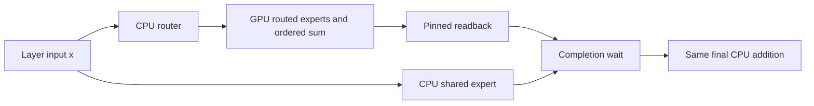

# DS41: overlap routed GPU experts with the CPU shared expert

2026-10-15. DeepSeek-V4.1-Flash Q8_0/MXFP4, physical H100 GPU1, GCC 14.4.0,
CUDA 13.1.115, Xeon Platinum 8480+ with 52 logical CPUs. The preceding
adaptive CPU-row scheduling and final-position-only prefill head are retained.

## Dependency analysis and implementation

For a layer input `x`, the FFN is the ordered routed-expert result plus a
shared-expert result:

```text
routed = sum_k weight[k] * down[k](swiglu(gate[k](x), up[k](x)))
shared = down_shared(swiglu(gate_shared(x), up_shared(x)))
output = routed + shared
```

The shared branch consumes `x`, not `routed`. Its CPU calculation can run
while the queued routed-expert kernels execute on GPU. The final addition
still waits for both branches and retains the same operation order.



The new `gpu_moe_experts` overload accepts scoped host work. It queues the
original GPU kernels and readback into pinned storage, executes the CPU
callback on the calling thread, then waits and publishes the GPU result.
The ordinary overload keeps its synchronous interface. This uses the existing
stream and buffers; it adds no GPU allocation or GPU worker thread.

Pinned storage remains owned until completion. The callback must not call
DS41 GPU helpers or modify input/weight buffers: the current DS41 cache and
scratch are global and are not reentrant. A callback exception drains queued
work before propagation. CUDA failures drain the stream and invalidate cache
entries so an incomplete upload is not reused. The caller tracks whether
shared work already ran, avoiding duplicate evaluation after a late failure.
Unsupported dimensions/counts return to the CPU path before submission.

The staging choice follows NVIDIA's documented distinction between pageable
and pinned asynchronous copies; the `Async` suffix alone does not establish
host-asynchronous execution. See [CUDA 13.1 synchronization semantics](https://docs.nvidia.com/cuda/archive/13.1.0/cuda-runtime-api/api-sync-behavior.html).

The default enables overlap. `DS41_MOE_OVERLAP=0` restores the serial
schedule. Stage-sum diagnostics and `DS41_GPU_TEST` select the serial schedule
to preserve diagnostic execution order. Routing, weight formats, kernels,
precision and reduction order are unchanged.

Separately, `partials` and `hbuf` now allocate only inside the CPU fallback.
On GPU success this avoids 44,544 unused float elements per layer: 174 KiB,
or 108.75 MiB of array payload across a 16-token/40-layer prompt. This is
calculated allocation/initialization work, not measured peak memory or memory
bus traffic; it excludes temporary vector prototypes. Both benchmark arms
include this cleanup, so the overlap comparison does not separately measure
its speed contribution.

## Trace and performance

The initial warm trace separated the 16-token MoE time into approximately
0.183 s router, 0.779 s routed execution/wait and 0.692 s shared CPU work.
All 640 layer calls used GPU routed experts. This established two substantial
independent branches before implementing the overlap.

Controlled full-model results, six warm windows per arm from two processes:

| Workload | Serial | Overlapped | Throughput increase |
| --- | ---: | ---: | ---: |
| 16-token prefill | 3.44908 s | 2.79074 s | **23.59%** |
| Prefill tokens/s | 4.63892 | 5.73324 | |
| Four autoregressive decode steps | 0.87954 s | 0.70774 s | **24.27%** |
| Decode tokens/s | 4.54784 | 5.65177 | |

Latency falls 19.09% for prefill and 19.53% for the four-step decode window.
The prefill saves 658.34 ms per prompt. Ranges are 3.44396–3.45463 s serial
versus 2.78741–2.79430 s overlapped; decode-window ranges are
0.86960–0.91786 s versus 0.70463–0.71130 s. These are short-context, one-GPU,
warm-cache measurements, not training, two-GPU scaling or cold-storage results.
Repeated windows within a process are not independent workload samples.

Every measured prefill has 640 successful routed-GPU calls and every decode
window has 160. CPU fallbacks are zero; overlap runs execute exactly one shared
callback per layer. Per-window expert-cache deltas are **100% hits and zero
evictions**, with 11,520 slice lookups per prompt and 2,880 per decode window.
Each process warms the same 6,393 distinct slices before measurement. The
aggregate hit rate printed at process end includes cold misses and is lower.

Mean warm prefill phase times:

| Phase | Serial, s | Overlapped, s |
| --- | ---: | ---: |
| Complete MoE | 1.63390 | 0.95957 |
| Router | 0.18055 | 0.18060 |
| Routed host submission/wait, excluding shared callback | 0.76844 | 0.10026 |
| Shared CPU calculation | 0.68244 | 0.67706 |
| Attention | 0.70047 | 0.70207 |
| Engram | 0.04354 | 0.04355 |
| Initial attention hyper-connection/norm | 0.32497 | 0.32955 |
| Other, including remaining mixes/residuals and terminal head | 0.74619 | 0.75600 |

The MoE wall interval falls by about 41.27%. Router and shared computation
remain comparable; most routed waiting is hidden behind useful CPU work.
The existing `hc` category does not cover all hyper-connections; remaining
FFN mixes and residuals are included in `other`.

Prompt-final logits and all four continuation vectors are bitwise identical
across all four timing processes, the initial instrumented probe and the
unmodified CPU-chunk binary. Each comparison covers 646,400 finite FP32 values;
the concatenated SHA-256 remains
`8c8ea79cda4da03fe1d1bbd8774b17eaf71b1a7602bc0a8952d061a9a37cd470`.
The separate full-model head/state test also passes final-only and mixed
prefill schedules, continuation, reset and single-token checks.

GPU allocation code is unchanged: 10,622 expert-cache slots, approximately
62 GiB, and the same resident weights and scratch. Peak VRAM was not newly
sampled. The host shared-expert output remains live until the ordered addition,
as it did in the serial calculation.

`Session::moe_profile()` and the CLI's `[prof-moe]` report router time,
routed host submission/wait time excluding the CPU callback, shared CPU time,
GPU/CPU call counts and overlapped calls. These are host wall-time intervals,
not CUDA-event kernel durations. After overlap, a smaller `routed_seconds`
does not mean the GPU executes fewer operations. It reflects GPU work hidden
behind the CPU branch. Profile counters are cumulative; the harness subtracts
snapshots around each measured window and resets model state before timing.

## Validation

- Synthetic MXFP4 tests exercise 1, 6 and 8 experts, cold uploads and cache
  hits, varying activations, exact equality with the synchronous overload,
  same-thread CPU work, and deferred publication of output.
- Callback exceptions propagate after draining GPU work. A subsequent call
  reloads cache entries and produces the same result. Invalid expert counts
  and GPU-disabled execution do not run the callback.
- Four attention-backbone tests pass, covering prologue, output projection,
  compressor and indexer.
- Tiny-model prefill tests pass with CPU fallback, including raw-window
  rollover, compression, mixed head schedules, continuation and reset.
- Against the previous binary, the tiny model's prompt logits match bitwise
  and all 147 printed stage sums agree. These diagnostics use the serial mode.

The first six small GPU checks ran alongside authorized Brandon work with a
1 GiB expert cache; their subsecond timings are not throughput benchmarks.
The full-model comparison requires the existing pipeline locks and idle GPUs.
The first admission was deferred when Brandon's rule-mapping pipeline acquired
the GPU. Its two training/evaluation arms completed at 09:13:43 UTC; the suite
then obtained exclusive admission. The bounded initial wait expired less than
a second before that pipeline completed, and `run_gpu.py` was resumed after
completion. No Brandon process was stopped.

## Reproduction and artifacts

The harness processes the same 16-token prompt followed by four greedy decode
steps. Input IDs are BOS and `3 + (i * 37) % (vocab_size - 3)` for positions
1 through 15. Each process warms that entire path once, then measures three
repetitions. Process order is serial/overlap/overlap/serial, with the same
candidate binary and `DS41_MOE_OVERLAP` set to 0 or 1. Both arms use a 62 GiB
cache, GPU attention and GPU LM head. The older unmodified CPU-chunk binary
is an additional correctness reference, not a separate headline timing arm.

```bash
ctest --test-dir build -V -R 'test_ds41_moe_overlap|test_ds41_backbone'
DS41_GPU=0 DS41_TEST_MODEL=/home/ubuntu/tiny-deepseek41.gguf \
  ctest --test-dir build -V -R '^test_ds41_prefill$'
CUDA_VISIBLE_DEVICES=1 DS41_GPU=1 DS41_GPU_ATTN=1 DS41_VRAM_GB=62 \
  DS41_PROFILE=1 DS41_MOE_OVERLAP=1 ./profile-candidate MODEL.gguf 16 3 output.bin
```

`common.py`, `probe_run.py`, `run_experiment.py`, `run_gpu.py` and `profile.cpp`
record the exact build, initial instrumentation, deferred admission and resumed
GPU suite. `analyze.py` verifies coverage, per-window cache deltas and outputs.
The bundle includes raw logs, outputs, commands, source snapshot, original
source files and hashes. Model assets remain external; `model-layout.json`
copies the prior GGUF header inventory, not a new full weight-payload hash.

- Local: `docs/benchmarks/h100-deepseek-2026-10-15/moe-overlap/`.
- Isolated executable: `/home/ubuntu/ntransformer-h100/ds41-moe-overlap-20261015/build/ntransformer`.
- Persistent results: `/lambda/nfs/btiny/ntransformer-training/deepseek-moe-overlap-20261015/`.

The shared remote source/build directories were not replaced.
