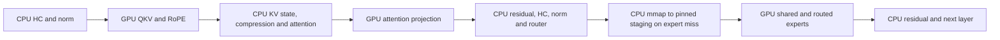

# DeepSeek performance gap: NTransformer and llama.cpp

## Design requirement

The objective is to minimize, and where possible eliminate, the CPU from the
steady-state inference critical path. The user explicitly reaffirmed this on
2026-10-15. A faster CPU/GPU hybrid is a comparison point, not the destination.
CPU work during model loading, allocation, request admission, and diagnostics is
different from CPU work that every layer must wait for on every token.

For each proposed optimization, record the host decisions, synchronization
points, activation transfers, weight transfers, and allocations that it removes.
Keep activations and attention state on GPU across operator boundaries. Treat
expert misses as a residency and scheduling problem, rather than automatically
returning the whole layer to CPU.

## What the completed benchmark establishes

The [comparison artifact](benchmarks/h100-deepseek-2026-10-15/llama-comparison/RESULTS.md)
uses the same GGUF shards, physical H100, input token IDs, and 64 consumed decode
tokens. Each engine uses its native execution and weight placement. It exercises
one H100; it does not measure a two-GPU NVLink implementation.

| Prompt tokens | NTransformer decode, tok/s | llama.cpp decode, tok/s | Ratio | NTransformer prefill, tok/s | llama.cpp prefill, tok/s |
|---:|---:|---:|---:|---:|---:|
| 32 | 6.2294 | 28.7849 | 4.621× | 6.0666 | 8.3486 |
| 128 | 6.1780 | 28.9096 | 4.679× | 6.1624 | 18.1224 |
| 512 | 5.3638 | 27.8210 | 5.187× | 6.0516 | 46.2104 |

These are speed measurements at equal consumed input, not a finding of equivalent
numerical output or quality. Greedy agreement is 52/65, 41/65, and 43/65. Each
engine repeats deterministically by itself. The discrepancy must not be described
as ordinary run-to-run nondeterminism.

## Where NTransformer spends time

The existing production-path counters give these mean milliseconds per decode
token, over three warm requests. Parent rows partition elapsed time; indented
subdivisions in the second table must not be added to the parent rows.

| Phase | Prompt 32 | Prompt 128 | Prompt 512 |
|---|---:|---:|---:|
| MoE | 78.692 | 74.948 | 88.472 |
| Attention | 46.039 | 50.470 | 61.027 |
| Hyper-connections | 13.648 | 13.824 | 13.951 |
| Engram | 2.833 | 2.926 | 2.921 |
| Other | 19.140 | 19.517 | 19.887 |
| Total | 160.529 | 161.864 | 186.436 |

| Subphase, already included above | Prompt 32 | Prompt 128 | Prompt 512 |
|---|---:|---:|---:|
| CPU router, within MoE | 13.267 | 13.495 | 13.624 |
| Routed/shared GPU path and transfers, within MoE | 65.358 | 61.380 | 74.769 |
| QKV prologue, within attention | 13.471 | 13.524 | 13.519 |
| Compression/indexing, within attention | 3.280 | 3.415 | 3.939 |
| CPU attention loop and inverse RoPE, within attention | 14.264 | 18.425 | 28.278 |
| GPU attention tail and readback, within attention | 14.927 | 14.999 | 15.172 |

These are host wall intervals, including waits and transfers, not isolated kernel
durations. In particular, the routed interval includes the shared-expert work
enqueued on the same stream. Even an impossible zero-cost MoE would leave about
81.8 ms/token at prompt 32, versus llama.cpp's approximately 34.7 ms/token total.
Fixing only the expert kernel cannot close the gap.

## Different execution chains

NTransformer currently executes this path for every token and layer:

The attention prologue reads back three buffers with three separate stream waits;
the attention tail adds another readback/wait. This is 160 host synchronization
points per token across 40 layers, before counting MoE, the output head, and other
branches. The prologue/tail transfers alone total about 11.84 MiB/token. Their
small size does not make their serial dependencies cheap.

The routed-expert cache introduces a different cost: warm decode moves
approximately 32.46/26.86/47.19 GiB of expert weights per 64-token request for the
three contexts. Misses go through `mmap → CPU memcpy → pinned RAM → H2D`.
There is no P2P expert-cache path in this DS41 execution chain yet.

There is also avoidable CPU work inside this miss path. `gpu_moe_impl` constructs
one new `std::thread` for every missed weight slice, joins all of them, and only
then submits the H2D copies. From the warm cache counters, this entails about
86.9/71.9/126.3 copier threads created and joined per decode token for the three
contexts. These are counts inferred from the executed branch and miss counters,
not a measured attribution of milliseconds to thread creation. The persistent
CPU row-worker pool introduced earlier does not cover these copier threads.

The same function enqueues the resident shared expert only **after** all routed
misses have been staged and their H2D transfers have been queued on its stream.
The shared expert depends on the activation, not those routed weights. This
submission order creates an avoidable dependency. A persistent staging facility,
earlier shared-expert submission, and a separate copy stream are concrete
intermediate experiments; GPU-managed residency remains the architectural goal.

The pinned llama.cpp implementation instead represents the model as a scheduled
graph. The measured preset places the first 31 layers' routed weights in CPU
memory and the remaining nine in GPU memory. Backbone and shared weights are
GPU eligible. Its CUDA backend can replay graphs and fuse supported operations.
This does not make it CPU free: graph splits, CPU experts, input preparation, and
some transfers still involve the host.

The scheduler can also offload operations whose weights live in CPU memory. The
CUDA backend's default threshold is 32 tokens. For `MUL_MAT_ID`, the scheduler
reads the expert IDs, groups consecutive selected experts, and copies their
weights. Weight placement therefore does not by itself establish execution
placement during prefill. See the pinned source's `ggml-backend.cpp` and
`ggml-cuda.cu`, included in the comparison artifact.

NTransformer has no multi-token DS41 forward API: prefill calls the same
single-token session repeatedly. It cannot amortize weight reads, scheduling,
and small launches across prompt tokens as a batched matrix implementation can.

## Numerical contract is part of the performance investigation

NTransformer's routed MXFP4 and backbone Q8 kernels multiply dequantized weights
by FP32 activations. llama.cpp's quantized vector kernels use quantized
activations, including MXFP4×Q8 CPU dots and CUDA Q8_1 activation quantization.
This is an arithmetic difference beyond a different summation order. Both decode
the MXFP4 weight format with the same scale convention and nibble layout in the
code inspected; no weight-format mismatch has been established.

A first-token intermediate-tensor comparison is needed to identify where the
executed calculations first diverge. A faster quantized activation path should
be an explicit precision mode, validated separately, rather than silently
changing the reference calculation.

## Implementation priorities

1. **GPU-resident layer state and backbone.** Keep the HC stream, normalization,
   raw/compressed KV, attention result, residuals, router logits, and selected IDs
   on device. Give kernels device buffers instead of host-vector input/output
   contracts. First remove unnecessary intermediate readbacks; then replay a
   stable backbone graph. CPU orchestration remains outside recurrent layer
   boundaries as far as dependencies allow.
   Capturing only the existing small CUDA fragments cannot remove the CPU
   calculations and waits between them.
2. **A GPU-facing expert residency protocol.** Preallocate slot pools and metadata;
   separate residency lookup, reservation, transfer completion, and consumption.
   Use a copy stream and explicit readiness events. Evaluate lookahead and
   speculative reservations against miss rate and wasted traffic, with a bounded
   fallback. Routing for the current token still determines which experts are
   required: speculative work cannot be assumed correct in advance.
3. **Two-GPU peer cache.** Use the second H100's memory and NVLink/P2P for suitable
   missing blocks. Measure local hits, peer hits, host misses, transferred bytes,
   and exposed wait time separately. GPU-to-GPU P2P does not itself remove the
   existing host staging step for weights still in RAM/storage. Plan that path
   explicitly. Consumer GPU workarounds belong to a later capability fallback.
   Also test executing an expert on the GPU that already owns its weights,
   sending the activation and returning its output. One expert's gate/up/down
   weights occupy 18,800,640 bytes here, versus 40,960 bytes for one FP32 input
   plus output of width 5,120: about **459× less inter-GPU payload**, before
   metadata and protocol overhead. This is a byte-count argument, not a promised
   speedup. Preserve per-expert outputs and the selected-expert reduction order
   when testing numerical equivalence. Compare peer execution with peer copies
   under the same two-GPU resource budget, including load balance and waiting.
4. **Multi-token prefill.** Introduce a real token-batch interface, tiled matrix
   work, and MoE dispatch grouped by expert. Account for compressed-state and
   Engram history updates; merely wrapping the current token loop is insufficient.
5. **Kernel work under a stated precision policy.** Investigate MXFP4 lookup,
   input reuse, reduction, and launch efficiency using measured device time.
   Evaluate integer dot products or other lower-precision paths separately from
   preserving the existing FP32-activation calculation.

The acceptance criteria include tokens/s, latency, numerical/quality checks,
host waits/token, CPU critical-path time, activation traffic, expert traffic,
cache hit location, and GPU active time. A speedup that merely consumes more CPU
does not satisfy the architectural objective by itself.

## Follow-up probes prepared on 2026-10-15

The CUDA harnesses compile successfully. The measurement suite is queued behind
the active Brandon `mapping-layout-budget-v1` pipeline, with its training locks
and idle-GPU checks. It will run ordinary llama execution versus disabled CUDA
Graphs, ordinary prefill versus a raised CPU-weight operation-offload threshold,
then separate CUPTI traces and first-token intermediate dumps. The dump probes
include uninstrumented controls because observing individual GGML nodes can
change fusion and graph boundaries.

The initial CUPTI 13.0.1 trace process exited with SIGSEGV and produced no usable
timeline. Its pre-trace warm request reproduced NTransformer's final logits;
it is not used as an explanation of the gap. An isolated CUPTI 13.1.115 package
is prepared for the retry. Trace failures are recorded independently of the
uninstrumented controls. No production engine changes are included here.

Remote queue: `/home/ubuntu/ntransformer-h100/ds41-gap-20261015/queue-status.json`;
detailed execution/admission status: `status.json` in the same directory.
Completed results are copied to
`/lambda/nfs/btiny/ntransformer-training/deepseek-gap-20261015`.
The local watcher downloads and verifies the archive and regenerates its
analysis/report under
`docs/benchmarks/h100-deepseek-2026-10-15/performance-gap/`.
Its status is `build/ds41-gap/local-status.json`.

The controls and traces are **pending at the time this analysis was written**.
The completed measurements above and the source-level findings stand separately
from the queued causal experiments. Consult the generated `RESULTS.md` when the
queue completes; do not treat prepared probes as measured results.
