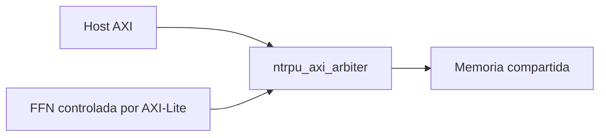

# Memoria compartida entre host y FFN

`ntrpu_axi_arbiter` prepara el puerto compartido que falta entre el host,
la [FFN con control MMIO](FFN_HOST_INTEGRATION.md) y la memoria. Su banco
aislado, síntesis e integración funcional con carga real por AXI están
calificados dentro de los alcances descritos aquí. El conjunto FFN/control/
árbitro tiene síntesis y ruteo OOC revisados; reloj padre y fronteras de placa
siguen pendientes.

## Contrato RTL



Dos iniciadores, datos de 512 bits, direcciones de byte de 64 bits e IDs de
cuatro bits. Lectura y escritura arbitran independientemente por turnos;
cada dirección admite una ráfaga pendiente. El propietario se conserva hasta
que consume RLAST o B, incluyendo pausas en la respuesta. Los IDs pueden
coincidir entre iniciadores porque no hay dos ráfagas pendientes del mismo
tipo. No se reordenan respuestas ni se estrechan direcciones.

Los cinco canales usan registros. AW y W avanzan independientemente hacia
la memoria: esta puede esperar WVALID antes de aceptar AW. El árbitro espera
la dirección del iniciador para asignar W; no exige que la memoria haya
aceptado esa dirección. El banco comprueba ambos órdenes, coherente con la
separación de fases que describe [AMD UG900](https://docs.amd.com/r/2024.1-English/ug900-vivado-logic-simulation/Analyzing-AXI-Memory-Mapped-AXI-MM-Interfaces).

Los buffers R/W actuales tienen **dos entradas** y permiten recibir y entregar
en el mismo ciclo. El banco de caudal mide un beat por ciclo con ambos extremos
listos. READY depende de ocupación registrada; al salir del estado lleno hay
una burbuja de recuperación. La referencia anterior de una entrada, conservada
por hash, entrega un beat cada dos ciclos.

Requiere un único reloj, iniciadores AXI válidos y AxLOCK=0. No aporta
exclusivos, QoS/USER, traducción, firewall, coherencia, timeout ni CDC. El reset
debe coordinar ambos iniciadores y el par de memoria; no cancela tráfico
externo por sí solo. Un iniciador que retenga una respuesta puede bloquear
esa dirección. El runtime debe respetar propiedad y vida útil de los buffers.

## Evidencia de la referencia de una entrada

Vivado/XSIM 2026.1, `xcvu5p-flva2104-2-i`, reloj de 5 ns y cuatro hilos.

| Tanda | Resultado |
| --- | --- |
| `20261003T132136Z-V7-axi-arbiter-unit` | Banco inicial, tres semillas; 51,789 s. Su traza coincide exactamente con la posterior al excluir los nuevos eventos de instrumentación. |
| `20261003T132256Z-V7-axi-arbiter-trace` | 27 bancos, incluidos 12 resets coordinados; 52,299 s. Revisión independiente de los handshakes en ambos lados y doce corrupciones de evidencia rechazadas. |
| `20261003T132256Z-V7-axi-arbiter-synth` | 419 LUT, 1.300 FF, cero DSP/BRAM/latches/cajas negras; 87,423 s. |

Por semilla hay 80 ráfagas de escritura completadas y 81 de lectura, incluidos
los prefijos anteriores al reset; 801 beats R consumidos y 803 W enviados a
memoria. Se prueban ráfagas INCR alineadas de 1, 2, 3, 4, 16 y 64 beats,
direcciones superiores a 4 GiB, IDs repetidos, máscaras completas/parciales/
nulas, SLVERR/DECERR, contención sostenida y pausas en todos los canales.

Los resets ocurren con AR retenida, R retenida por el iniciador, W enviada
antes de AW y B retenida. Cada uno va seguido de tráfico correcto. Este reset
del modelo AXI **no resuelve el fallo de warm reset DDR4**.

Síntesis OOC: WNS estimado +4,046 ns, WHS +0,077 ns y pulso +2,225 ns.
Sin endpoints internos sin reloj/restricción ni DRC, pero faltan retardos de
2.051 entradas y 1.820 salidas, contexto del reloj padre y ruteo. Se conservan
Netlist 29-101, Timing 38-242, DRC 23-814 y TIMING-18. No demuestra timing de
placa ni frecuencia física.

RTL SHA-256: `2add1bdf3b164ad8f0591e5cd6257e34304a2e3f3c8347e27401289e033f5ce9`.
Fuente de la traza y síntesis: `source-20261003T132240Z`, SHA-256
`3433a90737de2cb75006d87fe2c1fc09902de095c881b7e4cca513434a32ffcb`.
Los tres respaldos están verificados en `artifacts/ntrpu-board-vivado/`.

## Árbitro de dos entradas: pruebas y caudal

Fuente `source-20261003T141618Z`, SHA-256
`d53504ce7a4f15dc06039de3318ac862b0a713d1da403b66cad88730a8b05267`.
Las cinco tandas siguientes tienen revisión y respaldo local verificado:

| Tanda | Resultado |
| --- | --- |
| `20261003T141646Z-V7-axi-arbiter-2deep-unit` | 27 bancos; 53,354 s. Conserva contención, máscaras, errores y doce resets coordinados. |
| `20261003T141646Z-V7-axi-arbiter-2deep-pipeline` | Otros 27 bancos; 53,600 s. Ofrece comandos y datos de la ráfaga siguiente mientras sigue pendiente la anterior. |
| `20261003T141646Z-V7-axi-arbiter-2deep-rate` | Cuatro casos de 64 beats; 29,880 s. Lectura y escritura simultáneas, ambos propietarios, con/sin pausas. |
| `20261003T141646Z-V7-axi-arbiter-1deep-rate-reference` | Mismo banco con RTL anterior fijado por hash; 29,712 s. |
| `20261003T142059Z-V7-axi-arbiter-2deep-negative` | Fallo esperado, salida 1 en 29,268 s: quitar únicamente la protección WLAST permite aceptar W prematura; assertion al ciclo 4. |

| Ventana de salida, 64 beats por dirección | Una entrada | Dos entradas |
| --- | ---: | ---: |
| Ambos extremos listos | 127 ciclos | 64 ciclos |
| Pausa intermedia de ocho ciclos | 134 ciclos | 72 ciclos |
| Recepción/entrega simultánea, sin pausa | 0 ciclos | 63 ciclos |
| Ocupación máxima con pausa | 1 beat | 2 beats |

Cada variante de caudal conserva 1.024 eventos de handshake; el revisor Python
reconstruye datos, máscaras, respuestas, orden, ciclos y ocupación. Rechaza nueve
corrupciones de evidencia por variante; los revisores de estrés rechazan doce
por tanda. Son ventanas medidas entre primer y último beat entregado, sin
incluir asignación de dirección ni B; no representan ancho de banda PCIe/DDR.

W registra por separado la aceptación y la entrega de WLAST. Tras aceptar
WLAST no admite la siguiente ráfaga antes de su asignación. R conserva el
propietario hasta que el iniciador consume el último beat. La prueba negativa
anterior verifica que el banco realmente presenta la escritura anticipada.

La integración Brandon de esta revisión (`20261003T142109Z-V7-ffn-host-transfer-2deep`)
pasa en **705,216 s**, con los mismos 1.777.152 bytes cargados, 42.048 bytes
calculados exactos y 3.072 bytes recuperados por el host. Los 768 resultados
FP32 conservan la igualdad bit a bit con Q8 nativo. Se rechazan doce
corrupciones de evidencia; todos los RTL, copias HLS y 37 archivos del fixture
están identificados y verificados.

| Muestra | Carga AXI | Programación/cómputo hasta MMIO | Contador interno | Lectura final |
| --- | ---: | ---: | ---: | ---: |
| 1 | 46.674 | 309.408 | 308.889 | 77 |
| 2 | 46.799 | 309.389 | 308.871 | 76 |
| 3 | 46.587 | 309.289 | 308.771 | 73 |

Todas las cifras de la tabla son ciclos. Se mantienen los conteos de ráfagas
y beats por muestra de la referencia descrita abajo. El conjunto acumula
928.080 ciclos de banco y 1380/246/563/232 pausas AR/AW/W/completion.
Las pausas aleatorias dependen de la evolución temporal: la diferencia de
ciclos integra ese cambio de secuencia y no aísla únicamente el buffer.
Respaldo local verificado: 131.411.190 bytes, SHA-256
`c569ccccd286e1d0451a60343b10b3c4815bf04bb9529f121f1e00440dbc8610`.

La síntesis `20261003T142216Z-V7-ffn-fabric-2deep-synth` termina en
**452,198 s**: **43.146 LUT, 41.364 FF, 93 DSP, 39 RAMB36 y tres RAMB18**.
Cuesta 615 LUT y 1.104 FF más que el conjunto anterior. WNS estimado
**+0,735 ns**, WHS **+0,039 ns**; los 22 RTL coinciden con la simulación.
El árbitro dentro del conjunto ocupa 918 LUT/2407 FF. Conserva los mismos
1396/1333 retardos de entrada/salida ausentes, avisos HLS/RAM y metodología
de la referencia; cero errores/avisos críticos, latches o cajas negras.
Respaldo verificado: 80.396.842 bytes, SHA-256
`c072277eb7f0c302837238e1d809f6ed9d91dfb0557fc1cd71c466b9a2b7c3e6`.
DCP `6049a687f839f721308987ac366a7d4cb71cde96b46bf6dce74970d4ff8184c4`.

## Ruteo del conjunto de dos entradas

`20261003T143841Z-V7-ffn-fabric-2deep-route` termina en **762,734 s**;
la auditoría `20261003T145146Z-V7-ffn-fabric-2deep-audit`, en **82,971 s**.
Resultado: **43.148 LUT, 41.216 FF, 93 DSP, 39 RAMB36 y tres RAMB18**;
WNS final **+0,206 ns**, WHS **+0,010 ns** a 5 ns. Las 74.978 nets
ruteables figuran completas y no hay errores de ruteo ni latches. El peor
camino interno va de `total_k_reg[2]` al enable de `error_code_reg[0]`
en el núcleo GEMV. La congestión intermedia no dejó una violación temporal
en el informe final.

Persiste **un hueco explícito en el reloj padre**: 1.055 segmentos jerárquicos
PARTIAL comparten exactamente la ruta de `clk`. La auditoría no modifica
constraints ni checkpoint. Faltan retardos de 1396 entradas/1333 salidas y
ubicaciones de frontera; `HD.CLK_SRC=BUFGCE_X0Y60` es contexto supuesto.
No hay excepciones añadidas. `report_cdc` omite puertos sin retardos; ese
reporte no califica los cruces de la futura integración.

Se conservan Route 35-198 (100), DRC 23-814 (4), RTSTAT-10, recomendaciones
DSP/RAM, SYNTH-6/9 y TIMING-18. La auditoría no emite warnings. Es timing
interno OOC, **no cierre de reloj, interfaces o placa**.

Fuente del ruteo/auditoría: `source-20261003T143409Z`, SHA-256
`ebcdf154d8391b680898454f4defa6785ae0e6550d7a564f9e10bea229c65158`.
Se cotejan los 22 RTL contra simulación/síntesis y ambos checkpoints de entrada.
DCP ruteado `5914e15dbc215e6b839d87549da47ec6521543fd8b3442a71cb3a9c9a9040109`.
Las dos tandas tienen respaldo local verificado en `artifacts/ntrpu-board-vivado/`:
ruteo, 86.955.516 bytes, SHA-256
`68d2d6100d1805ae665554ece3c1792670ee6fda4c1abb16aab3a7911bc17685`;
auditoría, 37.311.830 bytes, SHA-256
`970896663266848517bd75b4e3184206b6e2f94576be509ce1d6f3eb8d178f9c`.

## Carga desde el host y recuperación de resultados

`ntrpu_ffn_fabric` conecta la FFN al iniciador 0 y expone el iniciador 1 al
host, sin modificar el RTL aritmético. `tb_ntrpu_ffn_transfer` empieza con
RAM de destino vacía. Lee el fixture Brandon a una imagen de memoria del
host y carga entradas/pesos mediante escrituras AXI. Después programa el
descriptor por MMIO, mantiene lecturas concurrentes de pesos inmutables y
recupera los resultados por AXI solo tras la finalización válida.

`20261003T133841Z-V7-ffn-host-transfer` pasa tres muestras en **714,259 s**.
Usa pesos Brandon de capa 0 con entradas sintéticas,
no prompts ni inferencia completa.
`tools/check_ntrpu_ffn_transfer.py` reconstruye carga, direcciones, respuestas
y lectura final; reutiliza la referencia escalar y el revisor MMIO.

Se cargan **1.777.152 bytes** de entradas/pesos por AXI. Todos los
**42.048 bytes** calculados coinciden con la referencia escalar independiente,
incluidos **768 valores FP32** finales idénticos a Q8 nativo. El host recupera
los **3.072 bytes** finales desde el bus, después de la finalización válida.
Se rechazan doce corrupciones de evidencia de carga, direcciones, respuestas,
lectura final, salida aritmética y control MMIO. Los 37 archivos del fixture y
los RTL HLS coinciden byte a byte con sus referencias calificadas.

| Muestra | Carga hasta consumir B | Programación/cómputo hasta finalización MMIO | Contador interno del motor | Lectura de la salida |
| --- | ---: | ---: | ---: | ---: |
| 1 | 48.633 ciclos | 316.683 ciclos | 316.163 ciclos | 88 ciclos |
| 2 | 48.601 ciclos | 316.759 ciclos | 316.238 ciclos | 84 ciclos |
| 3 | 48.501 ciclos | 316.699 ciclos | 316.177 ciclos | 86 ciclos |

Por muestra: 592.384 bytes cargados mediante 2.318 AW/B y 9.256 W; 69 AR y
266 R del host, incluyendo 250 beats de pesos leídos concurrentemente y
16 beats de salida. Hay diez ciclos con ambos iniciadores solicitando AR.
El cómputo conserva 418 AR, 9.980 R, 82 AW/B y 219 W por FFN.
MMIO suma 384 escrituras y 189.522 lecturas, incluido polling.

La RAM se vacía y los pesos se recargan para cada muestra; no se mide la
amortización de pesos residentes. El banco usa buses ideales a 5 ns con pausas
explícitas, ráfagas del host de hasta cuatro beats y división en páginas de
4 KiB. Estos ciclos no son latencia PCIe, ancho de banda físico ni tokens/s.
La referencia FP32 conserva los errores L2 de cuantización 1,149197%, 1,369425%
y 1,503418%; RTL y Q8 nativo coinciden exactamente.

Fuente de integración/regresión: `source-20261003T133806Z`, SHA-256
`8e624fa66ea310cdbc5e9ee2d0b8e9b5aafd2bc1092377dcbc45475a4bd8fc3c`.
Los avisos XSIM 43-3431 y Wavedata 42-489 quedan registrados; no hay errores
ejecutados. El respaldo de integración está verificado localmente:
134.637.765 bytes, SHA-256
`5272ff393855cf727b0a1c9259932f20a6b9b2c5ec658c4cc5bcbb14982f1373`.

## Síntesis del conjunto de referencia, una entrada

`20261003T135323Z-V7-ffn-fabric-synth` termina en **448,253 s** con
**42.531 LUT, 40.260 FF, 93 DSP, 39 RAMB36 y tres RAMB18**. Incluye 168
LUTRAM y 244 SRL en el total LUT. Frente al top FFN/control anterior aumenta
729 LUT y 1.279 FF, sin cambiar DSP/BRAM; la optimización del conjunto hace
que el incremento no sea idéntico al coste del árbitro aislado.

WNS estimado **+0,735 ns**, WHS **+0,039 ns** a 5 ns; cero endpoints internos
sin reloj/restricción, latches o cajas negras. El peor camino sigue entre
`device/control/running_reg` y el enable de `done_rows` del secuenciador de
matrices. Los 22 RTL y las copias HLS coinciden con la integración simulada.

Faltan retardos de 1.396 entradas/1.333 salidas y el reloj padre. Persisten
los avisos HLS de aritmética, cachés en registros y puertos sin carga; DRC
DPIP-2/DPOP-3/DPOP-4, recomendaciones RAM, SYNTH-6/9 y TIMING-18. No hay
errores ni avisos críticos. Estos resultados son de síntesis OOC, **no timing
posrutado ni rendimiento físico**.

Fuente `source-20261003T135252Z`, SHA-256
`9ac8bcdcedd91ab50b4a6595152d375d029b635c3c831bec8fe42e9ab3ac9303`;
DCP `384a790c72774674179ec6d9184a5b20c0e60e380d497042e0f8f2cd66a8c131`.
El respaldo de síntesis está verificado localmente: 80.237.788 bytes, SHA-256
`0f7acc3485f7999b04f8e297f9d3b30cf209a148a794101135a10098a9efb088`.

La regresión `20261003T133841Z-V7-ffn-host-transfer-regression` pasó 63 casos
en 392,555 s, con 71.232 bytes físicos y 8.052 escrituras MMIO. Todas sus
líneas `NTRPU_*`, incluidos ciclos, coinciden exactamente con
`20261003T122927Z-V7-ffn-host-memory`. Tiene respaldo local verificado.

```bash
vivado -mode batch -source tools/ntrpu_board_axi_arbiter.tcl \
  -tclargs sim build/ARB_RUN_NUEVO
vivado -mode batch -source tools/ntrpu_board_axi_arbiter.tcl \
  -tclargs sim_pipeline build/ARB_PIPELINE_NUEVO
vivado -mode batch -source tools/ntrpu_board_axi_arbiter.tcl \
  -tclargs sim_rate build/ARB_RATE_NUEVO
vivado -mode batch -source tools/ntrpu_board_axi_arbiter.tcl \
  -tclargs synth build/ARB_SYNTH_NUEVO
vivado -mode batch -source tools/ntrpu_board_ffn_memory.tcl \
  -tclargs "$MAC_RUN" "$SWIGLU_RUN" sim_transfer_fp32 \
  build/TRANSFER_RUN_NUEVO "$BRANDON_FIXTURE"
# synth_fabric_fp32 exporta ffn_fabric_synth.dcp y reportes del conjunto.
```

Con el conjunto respaldado, siguen la conexión XDMA, relojes/reset y DDR conforme a
las dependencias de [VIVADO_QUEUE](board/VIVADO_QUEUE.md).

El [XDMA ya probado](board/PCIE_DMA_VALIDATION.md) usa AXI de 512 bits a
250 MHz; esta FFN se estudia a 200 MHz. No deben conectarse ambos dominios
directamente: queda por calificar el puente de reloj/reset y las restricciones
del conjunto. Compartir anchos de datos/dirección no demuestra compatibilidad
temporal ni coherencia de memoria.

## Siguiente integración

Conservar ambas versiones como referencias reproducibles de funcionamiento
y recursos. Calificar
el puente de reloj/reset XDMA 250 MHz → FFN 200 MHz antes de conectarlos.
El [plan de integración de relojes](HOST_CLOCK_INTEGRATION.md) ya tiene
54 casos aislados de conversores AMD y 24 resets coordinados aprobados,
además de una inyección de época vieja detectada. Los IP ya están
[conectados al fabric](FFN_ASYNC_INTEGRATION.md): tres FFN Brandon por
perfil 4/5 y 6,2/5 ns, 768 FP32 exactos por perfil, IRQ retenida y confirmada
por MMIO. La recodificación reversible de RRESP conserva ambas trazas
funcionales completas y elimina TIMING-37 en síntesis: 44.194 LUT/44.819 FF/
93 DSP. El ruteo revisado usa 44.038 LUT/44.607 FF/93 DSP, WNS +0,068 ns y
WHS +0,010 ns, sin TIMING-37 ni Route 35-470. Quedan dos huecos de reloj
padre y fronteras sin restricciones. CDC-15 sigue pendiente, junto con
supervisor, recuperación integrada y protocolo IRQ XDMA.
La simulación FIFO no modela retardos de sincronización físicos.
