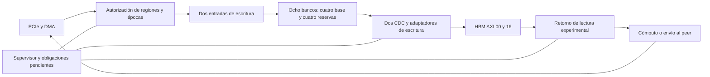

# Integración del receptor doble en NTRPU

Revisión del 2026-10-07, posterior a las pruebas del [receptor CDC/HBM](PEER_RX_DUAL_HBM.md). El [retorno sintetizable](HBM_READ_RETURN.md) ya tiene RTL y regresión propia; este plan distingue sus evidencias de la integración pendiente y conserva la cola del principal.

## Fronteras del diseño

Los bloques experimentales comienzan en comandos ya autorizados: escritura doble y retorno de lectura separado. Un BAR es una ventana del endpoint; la agregación de memoria conserva direcciones, propietario y época por nodo. La integración peer/PCIe de ambos bloques continúa pendiente.

## Contrato de la primera implementación de lectura

- Dos canales independientes, inicialmente con un comando pendiente por canal. Empezar por 1–64 beats de 64 bytes, alineación de 64 bytes y sin cruzar 4 KiB, igual que el perfil de escritura.
- Conservar dirección de 64 bits hasta verificar límites; reducir a 34 bits solo después. Mantener identidad de comando independiente de los IDs nativos de cada fragmento.
- Emitir AR únicamente después de reservar capacidad de recepción. No depender de que el consumidor retire datos para terminar una respuesta ya aceptada. El inventario debe incluir fragmentos pendientes, conversión 256→512, almacenamiento CDC y payload ofrecido al consumidor.
- Una respuesta RLAST termina un fragmento, no necesariamente el comando. Comprobar RID, RRESP, longitud y cobertura antes de publicar éxito; no ocultar errores de un fragmento posterior.
- Con backpressure, mantener datos, identidad y último beat estables. En la primera versión, liberar la reserva del frame al retirar CPL, después de entregar todos sus datos; conservar créditos correctamente sincronizados.
- `stop` cierra nuevas lecturas y conserva las obligaciones aceptadas. Un timeout, reset de enlace o fallo de memoria no autoriza a reutilizar su identidad ni a declarar vaciado. Rearmado y recuperación requieren un protocolo explícito.

La primera versión reutiliza IP AMD de conversión/CDC y reserva un frame de 4 KiB por canal. La revisión 1 registra además RREADY en la frontera nativa y retiene las respuestas malformadas. Aumentar después los comandos pendientes exige demostrar el presupuesto completo de créditos; no basta con incrementar el número de buffers.

## Orden de integración y aceptación

| Paso | Trabajo | Evidencia necesaria |
| --- | --- | --- |
| R0 | Retorno 256→512 con almacenamiento ligero | Patrones independientes, longitudes 1/8/9/64, stalls en ambas fronteras, ningún byte perdido o duplicado |
| R1 | CDC de lectura con relojes independientes | Pausa/cambio de reloj, datos retenidos, reset frío, stop y errores; informes CDC y timing sin excepciones globales |
| R2 | Mismo retorno con HBM nativa | Escribir por el receptor probado y leer por el retorno sintetizable; el banco solo compara la salida |
| R3 | Rendimiento tras cerrar R0–R2 | Medir fragmentos nativos pendientes 1/2/4/8 y luego dos frames por canal; errores tardíos, agotamiento, stop, recursos y timing nuevamente comprobados |
| P0 | Adaptador peer y permisos | Rechazar dirección inválida, desbordamiento de rango, región revocada, época antigua y comando duplicado antes de reservar banco |
| P1 | Composición con PCIe del principal | Correlacionar descriptor, DMA, memoria, completion y recepción final; conservar obligaciones ante pérdida de enlace |
| C0 | Cómputo y sistema | Pesos reales, resultado numérico comparado con referencia y ensayo de dos nodos; tiempos y anchos medidos por ruta completa |

R0–R2 tienen evidencia positiva para la revisión RTL 3, dentro del alcance aislado documentado. La revisión RTL 3 y el paso de rendimiento R3 son identificadores diferentes.

El primer barrido de R3 conserva la referencia [W1 de ocho créditos](HBM_READ_WINDOW.md), con un frame por canal. El segundo conserva el [candidato F1 de dos frames](HBM_READ_FRAMES.md): 16 KiB totales y una ventana nativa tras calentamiento de 14,711 GB/s frente a 8,445 GB/s con un frame. El [estudio C1 posterior](HBM_READ_CUT.md) seleccionó un nuevo ruteo del mismo F1: +87 ps de setup y +7 ps de hold en memoria, sin aumentar recursos. Pasaron las transacciones del nuevo netlist y la auditoría DRC; la evidencia nativa anterior se vincula por hashes de RTL y parámetros de IP. Sigue pendiente cerrar el timing de la composición integrada; no se declara equivalencia exacta por ciclo. P0/P1/C0 conservan sus criterios propios y estas cifras no acreditan PCIe ni placa.

El detalle y el estado vigente de R0–R2 están en [HBM_READ_RETURN.md](HBM_READ_RETURN.md). P0/P1 tienen un [contrato de integración](PEER_READ_INTEGRATION.md) y un [primer subperfil RTL compuesto](PEER_READ_LEDGER.md); el contrato completo sigue abierto.

Comenzar con un comando por canal limita el alcance de R0–R2; no acredita saturación del bus. El escalado posterior debe medir varias profundidades con idéntica carga, registrar recursos y mostrar mejora antes de aumentar el pool. Ningún paso se cierra solo por el código de salida de la herramienta.

## Entrega a la placa

La selección DDR4/HBM, los componentes y el pinout conjunto siguen los [criterios de cierre de placa](BOARD_CLOSURE_REVIEW.md). Esta composición aislada no incluye endpoint PCIe, controlador HBM físico, DDR4, motor completo ni restricciones de E/S de la tarjeta. Su frecuencia conseguida no se hereda automáticamente por el sistema integrado.

## Avance P0 — contexto peer (2026-10-07)

Actualización posterior: la [admisión compartida por origen](PEER_READ_SHARED.md)
pasó 15 escenarios aislados y seis integrados, con cuatro reservas y 27
transferencias completadas. Esto cubre funcionalmente replay y solapamientos
entre canales del mismo NTRPU. La nueva composición aún no tiene cierre físico
ni prueba con HBM nativa; siguen pendientes secuenciador, localidad, gestor de
regiones y multispan. Las cifras físicas del perfil histórico de abajo no se
transfieren a este wrapper.

El [ledger de lectura peer](PEER_READ_LEDGER.md) ya tiene RTL compuesto con F1, cuatro contextos y pruebas de permisos, replay, ACK y cuarentena. Es un perfil de un span y dos identidades de origen independientes. P0 sigue abierto por la admisión compartida entre canales de un mismo nodo, el gestor de regiones y las transferencias multispan; P1 requiere el endpoint real. Consultar ese documento para evidencia y límites, sin heredar el timing de F1 aislado.

La revisión funcional `pair5` pasa 21 escenarios, incluida parada global con ambos canales activos. Su [composición posterior con corte registrado](PEER_READ_CUT.md) conserva una ruta con +21 ps de setup a 200 MHz y +6 ps en memoria a aproximadamente 450 MHz; hold y las transacciones del netlist pasan. El control sin corte permanece abierto. La [prueba funcional con HBM nativa](PEER_READ_NATIVE.md) ya pasó sobre el mismo RTL: 20 transferencias, 37.376 bytes, ACK, reutilización y retención tras parada. Este margen interno estrecho y esa prueba acotada no cierran P0/P1 ni la placa: quedan admisión compartida por origen, gestor de regiones, multispan, rendimiento sostenido e integración física con HBM/PCIe.
