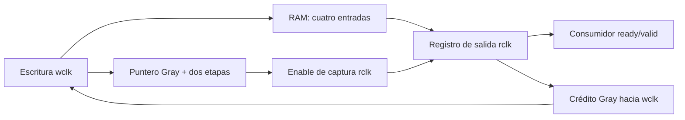

# Puente HBM–DMA: captura FIFO en el receptor

Variante aislada sobre [revisión 1](HBM_DMA_BRIDGE_REV1.md). Solo sustituye
el FIFO por `fpga/experimental/hbm_dma_rev2/ntrpu_bridge_async_fifo.sv`;
conserva la lane de revisión 1, el paquete y el wrapper original. No compilar
simultáneamente las distintas implementaciones del mismo módulo.
Tanda: `D:/AI/artifacts/ntrpu-hbm-dma-rev2/20261009T022945511244Z`.

## Propiedad y captura

`output_data` se carga únicamente si existe una palabra publicada y la salida
está vacía o se acepta su oferta anterior. `output_valid` y el contenido se
mantienen bajo contrapresión. El puntero de lectura avanza al **capturar**;
el crédito devuelto permite reutilizar la ubicación RAM porque el dato ya
pertenece al registro de salida.

Cada FIFO tiene ahora **cuatro posiciones RAM y una posición de salida**.
La captura añade un ciclo receptor respecto a la salida asíncrona anterior.
Una cola precargada puede entregar una palabra por ciclo, incluido el relevo
entre dos ofertas consecutivas. Esto es comportamiento del banco, no una
medición de ancho de banda físico.

La RAM y `output_data` no se borran; el reset coordinado invalida punteros y
`output_valid`. Se conserva el contrato de aislamiento externo de revisión 1.
La salida registrada alimenta descriptor, AXIS y completions; la RAM no debe
alcanzar directamente sus controles, enables o salidas externas.

## Pruebas y síntesis

- Los **144 escenarios del puente** pasan, incluidos fallos, parada, ambas
  lanes, las ordenaciones CPL/DMA/ACK y dos Done consecutivos con el lector
  detenido. Las 110 transferencias y 108.416 bytes comparados con el modelo
  mantienen las imágenes de memoria de revisión 1.
- **72 corridas de FIFO** cubren anchos 2/143/514 y 24 semillas con tres
  relaciones de reloj. Comprueban capacidad de cinco palabras, bloqueo de
  una sexta, devolución de un crédito, pausas independientes de ambos relojes,
  salida estable, entrega consecutiva, wrap, tráfico con contrapresión y
  reset con cinco palabras antiguas seguido de una transferencia nueva.
- El respaldo restaurado se recompila y reproduce ambos conjuntos. No se
  afirma equivalencia formal ni simulación de netlist o IP AMD.

Vivado 2026.1 sintetiza el VU47P en 236,306 s. Reconoce 1.318 FF de datos de
captura y 98 registros `ASYNC_REG`.

| Recurso | Revisión 1 | Revisión 2 |
| --- | ---: | ---: |
| LUT totales | 8.639 | 8.671 |
| LUT de RAM | 768 | 768 |
| FF | 7.944 | 9.268 |

El informe de los dominios con reloj definido no contiene CDC críticos.
Conserva cinco `CDC-3`, 14 `CDC-6` y 1.318 `CDC-15`. Estos últimos requieren
validar el enable y la llegada del dato: AMD explica esta limitación en
[UG906, CE-Controlled CDC](https://docs.amd.com/r/en-US/ug906-vivado-design-analysis/CE-Controlled-CDC).

## Límites temporales y alcance

El conjunto `ntrpu_hbm_dma_rev2_capture_cdc.xdc` añade seis límites de datos a
los 19 grupos de control: desde RAM distribuida hasta el pin D de cada registro
de salida. Presupuesta un período receptor: 4 ns para comandos/payload,
5 ns para completions. No añade dispensas ni grupos de reloj asíncronos que
anulen esos límites.

La habilitación de una palabra recién escrita espera las dos etapas del
puntero y la posterior captura. El presupuesto de un período deja margen
respecto a esa secuencia; la propiedad de la palabra impide sobrescribirla
antes de capturarla. El camino local de dirección RAM también debe cumplir
timing. Esta justificación funcional necesita comprobarse tras routing.

El revisor valida ambos sincronizadores, los relojes de RAM y captura, el
fanout exclusivo hacia el banco de salida y la cobertura de cada bit.
La tanda seleccionada `capture3` completa la revisión del DCP restaurado en
72,352 s: 25 límites de máximo, 45 bits de control, 1.318 bits de datos y
ninguna excepción ignorada. El menor margen estimado de datos es 3,483 ns.
`capture1`/`capture2` conservan el diagnóstico del revisor: Vivado devuelve
salidas RAM sin conexión como endpoints propios. La selección final demuestra
que esas 210 salidas no tienen cargas hoja ni puertos externos antes de
apartarlas, y exige un controlador RAM por cada pin D capturado.

Los resultados estimados de síntesis no sustituyen ubicación/ruteo ni
presupuestos de los puertos externos, `HD.CLK_SRC`, reset integrado o pruebas
HBM/XDMA nativas. La calificación física continúa abierta.
En particular, el hold interno estimado es −0,006 ns en el lector y −0,012 ns
en DMA; debe resolverse con relojes e implementación física reales. No se
declara cierre temporal a partir de los márgenes de captura positivos.

## Reproducción y respaldo

`tools/prepare_ntrpu_hbm_dma_rev2.py NUEVO_REPO --donor TANDA_REV1` verifica
el donante, copia el banco anterior y sustituye únicamente el FIFO. Ejecutar
`NUEVO_REPO/tools/run_ntrpu_hbm_dma_rev2.py NUEVA_SALIDA --toolchain TOOLCHAIN`
con `python -B`. Donante: `D:/AI/artifacts/ntrpu-hbm-dma-rev1/20261009T021147988156Z`.

Los recibos `BACKUP_*.json`, los hashes y `OUTCOME.json` conservan la evidencia
por tanda. Las fuentes anteriores y la cola principal permanecen protegidas.
`tools/check_ntrpu_hbm_dma_rev2_review.py SYNTH_STAGE CAPTURE_STAGE` verifica
identidad del DCP, cobertura, recursos, clocks y endpoints. Rechaza ocho
alteraciones de evidencia, incluidas rutas omitidas, cruces entre FIFO y
restricciones globales que ocultarían los límites particulares.
