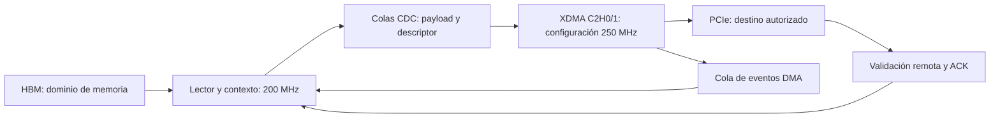

# Contrato propuesto del puente lector HBM–XDMA

Diseño de integración pendiente de RTL y pruebas. Entradas: lector seleccionado
en [TRACKER_HEAD_NATIVE.md](TRACKER_HEAD_NATIVE.md), semántica de propiedad en
[PEER_READ_INTEGRATION.md](PEER_READ_INTEGRATION.md) y
[XDMA VU47P generado](HBM_PCIE_GENERATION.md). Este documento fija el siguiente
banco aislado; no modifica el endpoint ni la cola del principal.

## Fronteras de datos y control

Asignar inicialmente un canal C2H a cada lane del lector. Conservar dos
contextos por lane y cuatro en total, sin aumentar las reservas actuales.
La cola de descriptores debe asociar cada finalización a identidad completa,
handles, generación de ventana, epoch, destino y bytes esperados. El tag del
lector y los IDs AXI no reemplazan ese registro. `ntrpu_peer_read_pkg` sigue
siendo un formato interno; el mensaje PCIe de control/ACK necesita definición
y validación separadas.

| Frontera actual | Responsabilidad del puente |
| --- | --- |
| `dma_context`, `dma_address` | Fijar contexto y destino autorizado antes de enviar descriptor; no recalcular con una región remapeada |
| `dma_valid/ready/data/last` | Transferir beats completos de 64 bytes y conservar datos bajo stalls |
| Descriptor C2H | Asociar longitud y destino con el mismo contexto; reservar espacio antes de aceptar payload |
| `dma_done_event` | Reconstruir identidad, destino, generación, bytes y estado desde la cola local |
| `ack_event` | Aceptar solo confirmación del destino con identidad y cobertura coincidentes |
| CPL local | Registrar la finalización del lector por separado de DMA y ACK |

El primer perfil debe limitarse a un span autorizado de 64–4096 bytes,
alineado a 64 y sin cruzar el bloque de 4 KiB del lector. Un descriptor y
un paquete por span simplifican la correlación. Las transferencias mayores
requieren agregación explícita antes de reutilizar el contexto.

## Semántica XDMA que debe conservarse

En C2H Stream, `src_addr` designa **el destino del writeback de metadatos**;
no contiene la dirección HBM que originó los datos. `dst_addr` contiene el
destino PCIe del payload. Reservar y autorizar un slot de writeback distinto
por descriptor pendiente. La alternativa de deshabilitarlo exige programar
y comprobar el bit 27 de C2H Channel Control; no asumirlo por defecto.
[PG195: descriptores](https://docs.amd.com/r/en-US/pg195-pcie-dma/Descriptors),
[control C2H](https://docs.amd.com/r/en-US/pg195-pcie-dma/C2H-Channel-Control-0x04).

La longitud C2H debe ser múltiplo de 64 bytes. Para este perfil todos los
beats llevan `tkeep=64'hffffffffffffffff`; `tlast` acompaña al último beat.
No mezclar contextos dentro de un paquete. Antes de ampliar a colas parciales,
probar las reglas de `tkeep` y el writeback, cuyo registro no puede cruzar 4 KiB.
[PG195: C2H Stream](https://docs.amd.com/r/en-US/pg195-pcie-dma/DMA-C2H-Stream).

`c2h_sts[3]` pulsa una vez por descriptor completado, sin transportar su
identidad. Capturarlo en `axi_aclk` y correlacionarlo con la cola del canal;
un sincronizador de nivel puede perder el pulso. No usar el descenso de
`busy`, `tready`, ni `Packet Done` como sustituto de una finalización atribuida.
La política de lectura de errores y habilitación del canal debe probarse
antes de producir `dma_done_event.status=OK`.
[PG195: puertos de estado](https://docs.amd.com/r/en-US/pg195-pcie-dma/Channel-0-3-Status-Ports?contentId=lvQzvWluXgPxMZm7RJbB9Q).

Ni Descriptor Done ni una respuesta AXI local certifican que el consumidor
remoto validó los pesos. Retirar la operación solo tras CPL local, DMA
atribuido y ACK remoto válido, con cobertura de bytes exacta y sin errores.

## Relojes, reset y fallos

Cruzar buses con colas asíncronas o un protocolo de handshake completo;
cruzar eventos mediante colas/créditos, conservando identidad y orden por
canal. Resolver primero la discrepancia 250/125 MHz del wrapper generado.
La interfaz efectiva de descriptor bypass y su secuencia `ready/load` deben
contrastarse con PG195 y el modelo de esta IP antes de escribir el adaptador.

Sincronizar la pérdida de enlace para cerrar admisiones. Mantener obligaciones
aceptadas en drenaje o cuarentena; un timeout no libera buffers, handles ni
generaciones. `axi_aresetn` no debe borrar unilateralmente el ledger del lector.
Un reset frío coordinado requiere demostrar que no quedan escrituras o ACK
de la sesión anterior capaces de afectar memoria reutilizada.

## Criterios del siguiente banco

1. Modelo de puente: probar ambos canales, destinos sobre 4 GiB, stalls en
   descriptor/payload/eventos, bytes exactos y asociación de cada contexto.
2. Inyectar error DMA, último beat fallido, ACK anticipado/duplicado/obsoleto,
   remapeo ocupado y pérdida de enlace en cada frontera; demostrar retención.
3. Integrar el perfil PIPE real: conectar también canal 1, enumerar BAR,
   comprobar TLP, memoria destino, writeback y finalizaciones. Medir el reloj.
4. Unir el HBM nativo del checkpoint seleccionado y repetir la correlación
   completa; después implementar el perfil serial con clocks, CDC, resets,
   GT y pines conjuntos. Registrar evidencia y restauración por tanda.

El enlace P2P entre dos tarjetas y el protocolo de publicación/ACK permanecen
como validación posterior. La generación actual solo cierra la preparación
de IP necesaria para iniciar estos bancos.
