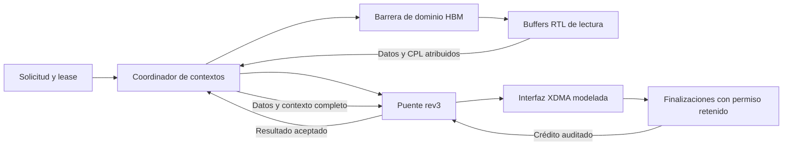

# Enlace de propiedad entre lector HBM y DMA

Tanda local: `D:/AI/artifacts/ntrpu-hbm-source-join/20261009T091511121189Z`.
Selección: `local6`, **`HBM_SOURCE_JOIN_LOCAL_PASS`**, 120 escenarios.
Este ensayo integra los buffers RTL de lectura con el puente DMA. La memoria
AXI y los registros/finalizaciones XDMA son modelos del banco; **no constituye
una simulación conjunta de las IP nativas HBM y XDMA**.

## Composición y alcance

`ntrpu_hbm_xdma_source.sv` conecta `ntrpu_hbm_source_join`, las barreras de
dominio HBM y la variante `ntrpu_hbm_xdma_guarded_held`. El puente rev3, sus
colas y el maestro AXI-Lite permanecen congelados por SHA-256. Los buffers
`ntrpu_hbm_read_frames` y la barrera `ntrpu_peer_read_domain` proceden de la
tanda seleccionada en [TRACKER_HEAD_NATIVE.md](TRACKER_HEAD_NATIVE.md).

El perfil admite **una lease física preautorizada**, dos canales y dos
contextos por canal. Traduce `source_base + source_offset`; no incorpora la
tabla de regiones de `ntrpu_peer_regions`, su publicación ni el adaptador
nativo de ancho/protocolo. No reemplaza esa arquitectura ni su evidencia.



El puente conserva la autoridad de admisión y retiro. El coordinador captura
la solicitud, espera un ciclo por el rechazo registrado y solo entonces fija
su copia y ofrece el comando HBM. Un rechazo no crea una reserva de lectura.
Cada copia conserva los 1.024 bits del contexto y la dirección autorizada;
el tag de 64 bits sirve únicamente para localizarla.

Un CPL erróneo no genera una finalización local de éxito. Liberar un frame
no libera el contexto. Ambos registros de propiedad se retiran cuando el
puente acepta el resultado correcto tras CPL, DMA validado y ACK. Si llega
un fallo mientras un resultado correcto espera `ready`, se mantiene el
resultado ya ofrecido, pero ambos registros quedan retenidos. Solo el reset
frío coordinado borra esa propiedad; no se calificó recuperación operacional.

Para conectar `ntrpu_hbm_read_return`, enlazar sus puertos `cmd_*`, `data_*` y
`cpl_*` con los equivalentes `cmd_*`, `r_data_*` y `r_cpl_*` del nuevo wrapper.
Conectar `reader_stop` al `stop` del lector y devolver `started/fault` en
`clk`. Sus puertos nativos y `mem_clk` siguen siendo responsabilidad del
lector. Esta conexión completa y sus CDC todavía requieren validación.

## Bloqueo descubierto y variante de permisos

La prueba de reutilización encontró un bloqueo reproducible con la política
anterior: sus permisos de un ciclo coincidían con `dsc_ready=0`. En
`local3/seed-01`, después de publicar cuatro descriptores del canal 0,
**65 permisos consecutivos** del canal 1 coincidieron con falta de disponibilidad,
separados por 240 ns. La política agotó su plazo a 21,826 µs y retuvo los
cuatro contextos. La traza y `STARVATION_CONFIRMED.json` conservan la evidencia.

`ntrpu_xdma_completion_guard_held.sv` crea permisos tras una auditoría válida
y los conserva hasta la aceptación efectiva del descriptor. Continúan
vigentes el máximo de dos pendientes, los controles de disponibilidad y
propiedad, el cierre ante fallos y la auditoría de contadores posterior al
Done. Publicar durante una auditoría no adelanta su objetivo de créditos.
La política anterior y su wrapper permanecen intactos.

Esta variante **todavía no hereda la calificación nativa** del banco
[HBM_XDMA_GUARDED.md](HBM_XDMA_GUARDED.md). `exclusive_owner` continúa siendo
una condición externa; falta impedir efectivamente los accesos host que
puedan alterar los registros durante la época.

## Validación y evidencia

| Ensayo seleccionado | Resultado |
| --- | --- |
| Composición, 15 casos × 8 pautas de pausas | 120 escenarios |
| Solicitudes aceptadas / rechazadas | 512 / 40 |
| Bytes DMA comprobados, incluidos recorridos fallidos | 303.616 |
| Bytes de recorridos completos HBM→DMA correctos | 254.464 |
| Regresión previa del lector de finalizaciones | 432 escenarios |
| Regresión previa del puente y sus fallos | 88 escenarios |
| Alteraciones de evidencia rechazadas por el nuevo revisor | 7 |
| Mutantes RTL rechazados por el banco | 3 |

Los casos cubren ACK antes/después de DMA, cambio de generación y base,
reutilización sin reset, errores RRESP/RID/RLAST, pausa en comandos/datos,
resultado correcto retenido durante un fallo, cinco rechazos de admisión,
configuración inválida/ocupada, tags alterados por encima de 32 bits, bytes
CPL erróneos y cambio de dominio HBM tras CPL local. Nueve casos de fallo
por pauta conservan los cuatro contextos después de reportarlos y de recibir
eventos tardíos. Los 32 avisos de compilación corresponden a sensibilidad de
arreglos en Icarus; no son una revisión de timing o DRC.

```powershell
python -B tools/run_ntrpu_hbm_source_join.py NUEVA_SALIDA --toolchain TOOLCHAIN --bridge-snapshot REV3_CONGELADO --hbm-snapshot LECTOR_CONGELADO --seeds 8
python -B tools/check_ntrpu_hbm_source_join.py NUEVA_SALIDA/seed-00/simulation.log
python -B tools/run_ntrpu_hbm_source_mutations.py NUEVA_SALIDA NUEVOS_MUTANTES --toolchain TOOLCHAIN
```

El preparador `prepare_ntrpu_source_policy_regression.py` crea una copia
privada para ejecutar los dos runners anteriores con un alias exacto de la
nueva política; no modifica sus bancos ni revisores originales.

Se preservan todos los intentos: `local1` probó once casos; `local2` detectó
una expectativa incorrecta del revisor para la inyección de bytes CPL;
`local3` descubrió el bloqueo real; `local4` detectó un evento del banco
atribuido a la siguiente fase durante reset; `local5` pasó los 120 casos;
`local6` añadió aserciones explícitas de rechazo de tags/CPL y volvió a pasar.
Los recibos `BACKUP_*.json`, manifest de hashes y restauraciones están en la
tanda. `replay` recompila la selección desde el respaldo restaurado.

No se accedió a la VM ni se modificaron las simulaciones del principal.
Pendientes: composición nativa HBM/XDMA con la nueva política, conexión del
gestor de regiones, exclusión real del host, fallos sobre IP, ACK remoto y
cierre físico de clocks, CDC, resets y pines. La tarjeta no está calificada.
