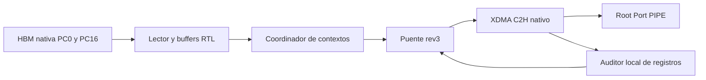

# Composici?n nativa HBM, propiedad y XDMA

Tanda aislada: `D:/AI/artifacts/ntrpu-hbm-source-native/20261009T124139575448Z`.
Estado de cierre: **composici?n compilada y arranque observado; transferencia
nativa conjunta NO validada; exclusi?n host NO establecida**.
La tanda conserva sus intentos, resultados parciales y respaldos.

## Dise?o del ensayo

Se conserva el puente rev3 y se conecta el coordinador de
[HBM_SOURCE_JOIN.md](HBM_SOURCE_JOIN.md) al lector nativo con tracker de cabeza
seleccionado en [TRACKER_HEAD_NATIVE.md](TRACKER_HEAD_NATIVE.md).
La variante de permisos retenidos est? conectada al XDMA nativo; este ensayo
no lleg? a ejercitar su tr?fico.



`ntrpu_hbm_source_native_memory.sv` est? preparado para inicializar 4.544 bytes
mediante escrituras
AXI3 aceptadas por el modelo HBM de AMD. Las solicitudes de 64, 128, 256 y
4.096 bytes leen direcciones distintas en PC0 y PC16, incluyendo direcciones
superiores a 4 GiB. No se inicializa ni consulta una memoria por backdoor.
El objetivo del monitor Root Port es verificar los TLP de carga ?til y los
32 bytes de writeback; no se alcanz? esa etapa.
El ACK remoto contin?a siendo un evento atribuido del banco.

Relojes previstos: lector 200 MHz, XDMA 250 MHz y HBM con per?odo de 2.222 ps.
No son medidas de rendimiento de una tarjeta f?sica.

## Relaci?n con la tarjeta DDR4 de 512 GiB

Este ensayo usa **VU47P / FSVH2892 y HBM**. El estudio de placa
[ARCHITECTURE.md](board/ARCHITECTURE.md) propone **VU5P / FLVA2104 o VU9P**,
cuatro canales DDR4 y 128 GiB por canal. Son plataformas distintas: el
snapshot HBM no valida DIMM, bancos, bolas BGA, pinout ni alimentaci?n DDR4.

| Contrato | Composici?n ensayada | Pendiente para la placa DDR4 |
| --- | --- | --- |
| Direcciones de solicitudes | Campos de 64 bits; regiones HBM de prueba | Decodificar el mapa de 39 bits y validar l?mites antes de reducir a 37 bits por canal |
| Memoria f?sica | Lector HBM, AXI3 de 34 bits, PC0/PC16 | Adaptador MIG, cuatro canales independientes y errores ECC |
| PCIe | Modelo PIPE y transferencias C2H al Root Port | Integraci?n con el endpoint de la parte/encapsulado seleccionados y cierre temporal |
| Propiedad | Una lease f?sica y cuatro contextos | Tabla de regiones, publicaci?n y protocolo de ACK entre tarjetas |
| Supervisi?n | Reset fr?o del banco; fallos previos probados localmente | Reset operativo coordinado, p?rdida de reloj y diagn?stico de placa |

El [pin planning DDR4](board/PIN_PLANNING.md) conserva sus propias reservas,
conflictos y resultados de timing. No trasladar sus XDC a VU47P ni aplicar
las restricciones de este ensayo al prototipo DDR4. Tampoco presentar los
4.544 bytes de prueba como calificaci?n de 512 GiB o de agregaci?n de tarjetas.

## Exclusi?n del host: resultado de configuraci?n

En `bar-probe2`, cada variante usa una sesi?n y directorio propios de Vivado
2026.1. Los par?metros generados muestran:

| Variante | BAR interno DMA PF0 | BAR externo PF0 | Resultado |
| --- | --- | --- | --- |
| Perfil original | m?scara `0x02` (BAR1) | `0x01` (BAR0) | Generado |
| Maestros de usuario desactivados | `0x01` (BAR0) | `0x00` | Generado; DMA sigue expuesto |
| Ning?n BAR declarado | ? | ? | Rechazado; exige al menos un BAR |

El [Target Bridge de AMD](https://docs.amd.com/r/en-US/pg195-pcie-dma/Target-Bridge)
enruta por separado las solicitudes a registros DMA y a las interfaces de
usuario. Por ello, cerrar ?nicamente el AXI-Lite de usuario no cerca la ruta
interna. La [pesta?a de BAR](https://docs.amd.com/r/en-US/pg195-pcie-dma/PCIe-BARs-Tab)
describe opciones de personalizaci?n, pero las variantes probadas no permiten
atribuir una exclusi?n efectiva a esta composici?n.

`bar-probe3` intenta habilitar otra declaraci?n de BAR mientras desactiva la
original; Vivado rechaza la combinaci?n y restaura el perfil anterior.
`bar-probe4` consulta los valores permitidos del tipo de BAR mediante
`list_property_value`; devuelve una lista vac?a y el script se detiene antes
de intentar cambiar el tipo. Este ?ltimo resultado no demuestra que la GUI
carezca de opciones; queda como exploraci?n inconclusa.

Esto es evidencia de configuraci?n, no una prueba exhaustiva de todas las
variantes XDMA ni un ensayo de TLP host adversos. `exclusive_owner` sigue siendo
una precondici?n externa. No se alteraron par?metros internos generados para
forzar una configuraci?n rechazada por Vivado.

## Decisi?n pendiente

Para exigir aislamiento por hardware, primero debe demostrarse una interfaz
soportada que intercepte **toda** escritura host a los registros relevantes.
Si XDMA no la ofrece, habr? que evaluar un endpoint y motor DMA cuyo camino
hacia esos registros est? bajo nuestro control. Un driver cooperativo puede
imponer disciplina operacional; no sustituye esa propiedad del hardware.
No se promover? esta composici?n como exclusiva antes de probar escrituras
host simult?neas, cambios de Run y lecturas destructivas durante transferencias.

## Conservaci?n

`bar-probe` conserva el intento inicial fallido. `bar-probe2` corrige el
solapamiento de productos generados y ejecuta cada variante por separado.
Ambas tandas y `bar-review/result.json` est?n respaldadas en el almac?n de
contenido local, con restauraci?n y SHA-256 comprobados. La relocalizaci?n
ahora actualiza tanto `gen_directory` como `runtime_parameters.OUTPUTDIR`;
no cambia par?metros funcionales del IP.


## Revisi?n reproducible

El runner crea un proyecto privado desde el ejemplo XDMA congelado y recibe
un plazo expl?cito. Nunca se debe ejecutar sobre el proyecto donante:

```bash
python3 -B repo/tools/run_ntrpu_hbm_source_native.py output --timeout 1800
```

La reconstrucci?n posterior exige fuentes y resultados intactos:

```powershell
python -B tools/check_ntrpu_hbm_source_native.py D:/AI/artifacts/ntrpu-hbm-source-native/20261009T124139575448Z/native1
```

El verificador comprueba direcciones HBM completas, datos le?dos frente a
escrituras reales del banco, tags y CPL, retenci?n de los cuatro contextos,
descriptores, bytes PCIe y cr?ditos posteriores a la auditor?a AXI-Lite.
Tambi?n altera evidencia deliberadamente para comprobar detecci?n. Un fallo
de compilaci?n, timeout o falta de traza completa no se convierte en PASS.
Las pruebas locales anteriores de fallos no sustituyen una matriz nativa
combinada; tampoco se validan aqu? el ACK sobre cable, el PCB o la operaci?n
t?rmica.


## Intento completo y reutilizaci?n del snapshot

`native1` compil? el snapshot `board_behav`: la elaboraci?n consumi? 1.427 s.
El l?mite global de 1.800 s termin? la ejecuci?n a 14.046.000 ps (14,046 ?s),
antes de la enumeraci?n y de cualquier transferencia del ensayo. Resultado:
**FAILED / timed_out**, no PASS funcional. El revisor rechaza ese resultado.
Los hashes de las fuentes y del ejemplo donante permanecieron iguales.

`native2` ejecut? una copia del mismo snapshot. Un intento de ampliar su plazo
mediante supervisi?n externa fall? al identificar el estado de espera del
watchdog. El bloque de limpieza de ese supervisor termin? la simulaci?n a
730,961 s: **FAILED / returncode -15**, sin timeout ni fallo RTL demostrado.
El supervisor experimental se conserva como evidencia y queda descartado.

`native3` parti? del mismo snapshot con **2.400 s fijados desde el inicio**.
No us? el supervisor externo ni recompil? o cambi? el RTL. Termin? por timeout
a **2.400,029 s**, con la traza en **94,255 ?s** y `phase=1`. El runner registra hashes del snapshot,
comprueba el donante antes/despu?s y conserva las advertencias de compilaci?n
separadas mediante un marcador de reutilizaci?n. Los resultados anteriores
se mantienen intactos.

`native-runtime2/runtime.tar.gz` guarda 21 archivos del runtime (628.705.187
bytes sin comprimir; 331.086.311 comprimidos), incluidos los archivos de
inicializaci?n y modos Unix. Se comprobaron todos sus hashes y la restauraci?n
del archivo desde el almac?n. No incluye los objetos intermedios del compilador;
no es un bitstream ni un paquete aut?nomo de Vivado. La ejecuci?n de la copia
local restaurada a?n no se ha probado.


## Resultado y criterio de continuidad

La auditor?a de `native3` observa ambos `apb_complete` a **43,7367 ?s** y
`user_lnk_up` a **54,0521 ?s**. El banco inici? una lectura del BAR DMA, pero
no lleg? a registrar su retorno antes del timeout. Hay **cero** escrituras o
lecturas de datos HBM, descriptores, beats C2H, Done o resultados del ensayo.
El lector de datos no lleg? a `started`. No hay error de parseo del VCD parcial.
Esto acredita arranque y elaboraci?n; no acredita la composici?n funcional.

| Intento | Segundos de ejecuci?n | ?ltimo tiempo simulado | Cierre |
| --- | ---: | ---: | --- |
| `native1` | 1.800,028 | 14,046 ?s | Timeout tras compilar |
| `native2` | 730,961 | 39,688 ?s | Error del supervisor experimental |
| `native3` | 2.400,029 | 94,255 ?s | Timeout; antes del tr?fico de datos |

El revisor rechaza las ejecuciones incompletas. Su rama de verificaci?n
integral y las mutaciones de payload/CPL preparadas **no se han ejecutado
sobre una traza completa de esta composici?n**. No registrar los controles
planeados como pruebas aprobadas. Los resultados locales de
[HBM_SOURCE_JOIN.md](HBM_SOURCE_JOIN.md) conservan su alcance anterior.

Una nueva tanda debe usar el snapshot congelado, un presupuesto de ejecuci?n
estimado con estos tiempos y un directorio nuevo. Mantener el plazo fijado al
inicio; no reutilizar los supervisores externos fallidos. Completar cuatro
transferencias, reconstruir 4.544 + 32 bytes y observar CPL, cr?ditos, ACK y
retiro antes de cerrar el gate. El siguiente paso de control host depende de
elegir disciplina de driver confiable o exclusi?n efectiva por hardware;
ninguna variante de configuraci?n probada demuestra esta ?ltima.

`generated-hbm` conserva 55 productos y su mapa de procedencia, adem?s del
manifiesto: son los archivos generados fuera de `output/work` por la versi?n
inicial del relocalizador. Las tandas `native1`?`native3`, las cuatro pruebas
de BAR, las revisiones y el runtime est?n en el almac?n local con restauraci?n
verificada. `partial-audit/result.json` registra el alcance observado.
