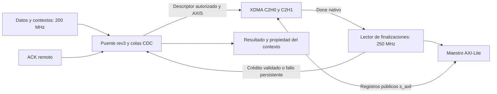

# Puente rev3 con validación autónoma XDMA

Tanda: `D:/AI/artifacts/ntrpu-hbm-xdma-guarded/20261009T082052905776Z`.
Resultado local: **`GUARDED_BRIDGE_LOCAL_PASS`**, `local2`, 88 escenarios.
Resultado nativo: **`REV3_GUARDED_NATIVE_DUAL_C2H_PASS`**, `native3`.
La revisión independiente valida tráfico y gestión autónoma sobre la IP real
en simulación PIPE; HBM todavía aporta datos mediante estímulos del banco.

## Composición

`ntrpu_hbm_xdma_guarded.sv` conecta el [puente rev3](HBM_DMA_BRIDGE_REV3.md),
el [lector de finalizaciones](XDMA_COMPLETION_GUARD.md) y el maestro
`ntrpu_xdma_local_master`. Los tres bloques anteriores permanecen sin cambios;
el banco compila las cuatro fuentes del puente congeladas y verificadas por
SHA-256 en la tanda nativa precedente.



La autorización del lector enmascara `dsc_ready` hacia el puente. El lector
observa el `dsc_load` efectivamente emitido y el Done nativo; el puente recibe
exclusivamente `validated_done`. Sus FIFOs, identidades y condiciones de
retiro siguen siendo las de rev3. AXIS ya ofrecido conserva su handshake
independientemente del cierre de nuevas emisiones.

Los controles de gestión pertenecen a `dma_clk`. `management_core_ready`
observa el reset nativo; no se conecta al reset de las colas. Un reset nativo
o una solicitud de reset bloquea la época, conservando la propiedad. Solo
`cold_reset_n`, reservado a configuración coordinada, reinicializa todo.

## Evidencia local de retención

Once casos con ocho variaciones de espera: dos recorridos correctos y nueve
fallos. Se transfieren 64, 128, 256 y 4.096 bytes, con direcciones de 64 bits
y dos contextos por canal. Se prueban ACK antes y después de los créditos:
ninguno reemplaza a la finalización local ni a la validación DMA.

Los fallos incluyen timeout de AR/R, error de Status, SLVERR, pérdida de
propietario/enlace, solicitud de reset, retirada de disponibilidad del núcleo
y vencimiento externo. En cada caso se consumen cuatro reportes de error
con identidad correcta, pero **los cuatro contextos permanecen retenidos**.
Luego se restauran las señales de disponibilidad y llegan Done/ACK tardíos:
los contextos continúan retenidos y la admisión sigue cerrada.

El revisor reconstruye bytes AXIS, descriptores, lecturas AXI-Lite, créditos,
CPL, ACK y resultados desde señales públicas. Rechaza cinco alteraciones de
la evidencia. Se conservan los avisos de sensibilidad a arreglos de Icarus.
Estos ensayos usan un destino de registros modelado; no simulan un reset
físico de la IP ni contienen un lector HBM nativo.

```powershell
python -B tools/run_ntrpu_hbm_xdma_guarded_local.py NUEVA_SALIDA --toolchain TOOLCHAIN --bridge-snapshot REPO_REV3_CONGELADO
python -B tools/check_ntrpu_hbm_xdma_guarded.py NUEVA_SALIDA/seed-00
```

## Banco nativo y propiedad de registros

La copia privada del ejemplo AMD conecta los 19 puertos `s_axil` al maestro
RTL. Esa interfaz permite acceso a registros DMA desde lógica de usuario,
según [PG195, AXI4-Lite Slave](https://docs.amd.com/r/en-US/pg195-pcie-dma/AXI4-Lite-Slave).
El host configura los canales antes del inicio de la época; las lecturas
posteriores y la emisión de créditos corresponden al RTL.

La exploración de BAR0 recibe una única palabra cero de un respondedor
limitado del banco; después se descubre BAR1 nativo. Ese respondedor no
sustituye las respuestas de registros XDMA. Las solicitudes BAR0 posteriores
están prohibidas en el ensayo. Los seis XCI deben coincidir con el donante.

`exclusive_owner` sigue siendo una condición externa. La secuencia del
banco respeta esa propiedad; el módulo **no impide** escrituras host por
BAR1 ni implementa un cerrojo compartido con el controlador host. La
integración de producción necesita esa exclusión efectiva antes de confiar
en el historial de errores y contadores.

## Resultado nativo revisado

`native3` completa la ejecución Vivado en 683,190 s, con salida cero y sin
timeout. La simulación finaliza a 107,205 µs. El perfil configura Gen3 x16;
el BFM comprueba capacidad máxima de 8 GT/s y ancho negociado de 16 lanes.
La traza confirma el periodo AXI de 4.000 ps y estos resultados:

| Observación | Resultado |
| --- | ---: |
| Descriptores / Done nativos / créditos validados | 4 / 4 / 4 |
| Lecturas del maestro RTL sobre registros nativos | 56 |
| Payload / metadatos writeback | 4.544 / 32 bytes |
| Paquetes PCIe reconstruidos | 11 |
| Contextos retirados tras CPL, DMA y ACK | 4 |
| Fallos del lector | 0 |
| XCI sin cambios respecto al donante | 6 |

Los destinos conservan sus bits por encima de 4 GiB. La memoria reconstruida
tiene el mismo SHA-256 que la prueba precedente:
`fad5f9ada948618189f137222e27993383799db536340189ca10f7c46f50977e`.
El host realiza cinco lecturas de configuración inicial; las 56 lecturas
posteriores pertenecen al maestro RTL. La revisión correlaciona AR/R,
identidades, contadores y créditos, además de los bytes y resultados.
Rechaza siete corrupciones de tráfico/contexto y cuatro de gestión.

Se conservan 134 avisos de compilación/elaboración y un aviso inicial del
modelo XDMA. El aviso adicional respecto del banco anterior señala que
`validated_done` se usa antes de declararse en el fixture; la declaración
final y la VCD conservan sus dos bits y ambos canales quedan comprobados.
El inventario exacto está exigido por el revisor; no es cierre DRC físico.

```powershell
python -B tools/check_ntrpu_hbm_xdma_guarded_native.py TANDA/native3
```

## Contrato del próximo enlace HBM

El donante previsto es el lector de [TRACKER_HEAD_NATIVE.md](TRACKER_HEAD_NATIVE.md),
con evidencia PC0/PC16 y checkpoint seleccionado por hash. La futura
composición debe congelar ese donante y comprobar las siguientes fronteras:

| Frontera | Condición de integración pendiente |
| --- | --- |
| Admisión | Reservar contexto en lector y puente antes de emitir AR; resolver rechazos sin dejar una reserva unilateral |
| Dirección | Conservar la traducción HBM autorizada y su generación; mantener separado el destino PCIe de 64 bits y el slot de writeback |
| Payload | Enlazar `dma_valid/ready/data/last` y el contexto completo de 1.024 bits, sin identificarlo solamente por el tag local |
| CPL local | Traducir tag, estado y bytes hacia el evento atribuido; un error HBM no puede producir una CPL de éxito |
| Propiedad | Definir un único retiro coordinado entre los registros de contexto del lector y del puente, condicionado por DMA validado y ACK |
| Fallos | Conservar reservas, traducciones y eventos al parar cada frontera; la liberación de un frame local no libera la región remota |

Esta tabla es un contrato pendiente de implementación y pruebas. El banco
actual todavía suministra payload y CPL local desde estímulos.

## Respaldo y límites

Cada tanda conserva fuentes congeladas, trazas, logs, manifest de hashes y
recibo de restauración. `local1` es exploratorio; `local2` es la regresión
seleccionada. `native1` falló antes de simular por una declaración del banco
que mezclaba una señal inicializada con otra sin inicializar; se conserva
para trazabilidad.

`native2` llegó al arranque del lector y falló porque el banco consultaba
`ready` sin dar tiempo a propagar la nueva época. `native3` añade un ciclo
de preparación. Reutiliza una copia privada de la compilación anterior,
verificando 774 archivos del caché antes/después; esa reutilización no evitó
la elaboración larga. Ambos intentos fallidos permanecen respaldados.

`replay-local` recompila desde fuentes y compilador restaurados y reproduce
los 88 casos con resultados idénticos. El resultado nativo se vuelve a
auditar desde la copia restaurada; no se afirma una segunda ejecución Vivado.

La reconstrucción limpia no requiere conservar la caché temporal. El
preparador verificó los 240 archivos del proyecto donante y generó una copia
sin referencias a esa caché. En Linux con Vivado, restaurar primero ese
donante y preparar una nueva raíz antes de ejecutar el runner:

```bash
python3 -B tools/prepare_ntrpu_hbm_xdma_guarded_rebuild.py NUEVO_REPO \
  --frozen-repo TANDA/native3/repo --seed DONANTE_RESTAURADO
python3 -B NUEVO_REPO/tools/run_ntrpu_hbm_xdma_guarded.py NUEVA_SALIDA --timeout 900
```

La preparación se probó localmente; no se ejecutó una compilación adicional
con esa nueva raíz. `NATIVE_OUTCOME.json`, `LOCAL_OUTCOME.json` y los recibos
`BACKUP_*.json` conservan los alcances y la procedencia.

Quedan pendientes HBM nativo, protocolo remoto de ACK, exclusión efectiva
del host, matriz de fallos sobre la IP nativa y cierre físico de clocks,
CDC, resets y pines. Un resultado funcional de esta composición no califica
una PCB ni autoriza recuperación operacional por reset.
