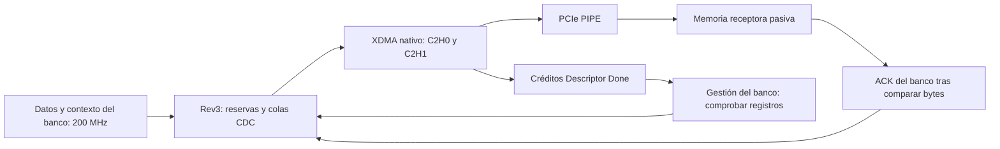

# Puente rev3 frente a XDMA nativo

Tanda: `D:/AI/artifacts/ntrpu-hbm-xdma-native/20261009T064859269458Z`.
Estado: **`REV3_NATIVE_DUAL_C2H_PASS`**, seleccionado `native5`.
La revisión independiente de la traza confirma el resultado funcional
del banco; la integración HBM y el gestor RTL de errores siguen pendientes.

## Integración acotada

Se conecta el RTL congelado de [rev3](HBM_DMA_BRIDGE_REV3.md) a los puertos
reales de descriptor bypass y AXI-Stream de ambos C2H del
[XDMA generado](HBM_PCIE_GENERATION.md). Se conserva el perfil Gen3 x16,
512 bits, direcciones de 64 bits y dos canales C2H. No se modifica la IP
generada ni el RTL que cerró [timing aislado](HBM_DMA_BRIDGE_REV3_PHYSICAL.md).



Los datos de origen y el ACK son estímulos del banco. No hay lector HBM
nativo conectado ni protocolo remoto de publicación/ACK. La gestión de
errores se realiza con lecturas PCIe del BFM; todavía no existe un proveedor
RTL autónomo de validación de finalizaciones para esta composición.

## Casos y criterios

Cuatro contextos, dos por canal, transfieren 64, 128, 256 y 4.096 bytes.
Los destinos de canales distintos comparten bits bajos y difieren por encima
de 4 GiB. Cada contexto recibe un slot propio de writeback de 64 bytes,
fuera del rango de payload. El receptor compara los 4.544 bytes y los
cuatro registros nativos de metadatos, ocho bytes cada uno.

Se exige reloj efectivo de 4.000 ps, enlace y reset estables, `Run && Ready`
al emitir descriptores, estabilidad del stream durante backpressure y
correspondencia de todos los resultados con los contextos admitidos.
La traza VCD contiene interfaces públicas y el revisor reconstruye las
escrituras CQ sin usar los contadores de memoria del banco como oráculo.

La política de esta prueba habilita logging de errores y conserva metadata
writeback: Control `0x00f83e7f`, leído antes y después del tráfico. Los
pulsos `c2h_sts[3]` se cuentan en el dominio XDMA. Solo después de leer
Status sin errores, comprobar dos descriptores por canal y comparar memoria
se entregan los créditos a rev3. El retiro también requiere CPL local y ACK.

La selección y significado de estos campos procede de
[PG195: estado por canal](https://docs.amd.com/r/en-US/pg195-pcie-dma/Channel-0-3-Status-Ports?contentId=lvQzvWluXgPxMZm7RJbB9Q),
[Control C2H](https://docs.amd.com/r/en-US/pg195-pcie-dma/C2H-Channel-Control-0x04),
[Status C2H](https://docs.amd.com/r/en-US/pg195-pcie-dma/C2H-Channel-Status-0x40)
y [writeback C2H Stream](https://docs.amd.com/r/en-US/pg195-pcie-dma/DMA-C2H-Stream).

## Descubrimiento y soporte

El ejemplo conecta `m_axil` de BAR0 a `s_axil` de gestión: el descubrimiento
puede encontrar un alias del identificador DMA en BAR0. El fixture registra
el BAR descubierto, selecciona BAR1 en el driver público del host y exige
que una lectura PCIe de su identificador confirme XDMA. No fuerza registros
internos ni sustituye respuestas de la IP.

`patch_ntrpu_hbm_xdma_native.py` opera únicamente sobre una copia nueva del
ejemplo AMD. Conecta ambos C2H, observa ambos estados y desactiva la emisión
automática H2C del ejemplo. `run_ntrpu_hbm_xdma_native.py` limita cada intento
a dos CPU y 900 s, verifica el donante antes/después y exporta HDL, XCI,
trazas, logs y hashes. El directorio de trabajo del simulador permanece
separado de los respaldos incrementales.

Los intentos previos al tráfico se conservan: `native1/2` rechazaron la
sintaxis usada para opciones Tcl; `native3`, un identificador reservado
en el receptor del banco; `native4`, la opción `-mt` duplicada. Son fallos
del soporte de prueba, sin resultados funcionales aceptados.

## Resultado medido

`native5` termina en 741,685 s, sin timeout y con salida cero. La simulación
finaliza a 115,555 µs tras negociar Gen3 x16. El periodo observado de
`axi_aclk` es **4.000 ps (250 MHz)** durante toda la fase medida. Esto
resuelve la discrepancia de metadatos para este modelo PIPE; aún corresponde
revisar relojes derivados y constraints en la implementación conjunta.

| Contexto | C2H | Destino PCIe | Bytes | Writeback |
| --- | ---: | --- | ---: | --- |
| 1 | 0 | `0x0000000100000800` | 64 | `0x0000000300001000` |
| 2 | 1 | `0x0000000200000800` | 128 | `0x0000000300001080` |
| 3 | 0 | `0x0000000100001800` | 256 | `0x0000000300001040` |
| 4 | 1 | `0x0000000200001800` | 4.096 | `0x00000003000010c0` |

El revisor reconstruye 71 beats AXI-Stream, once paquetes CQ y las cuatro
escrituras de metadatos `magic=0x52b4`, EOP=1 y longitud exacta. Comprueba
cuatro pulsos nativos Done, sus créditos validados, once lecturas de registros
y cuatro retiros, comparando logs y VCD. Status todavía contiene Busy=1
con contador dos en cada canal: Descriptor Done no se interpreta como
drenaje global. BAR0 fue el alias descubierto; BAR1 quedó en `0x00010000`
y respondió con identificador `0x1fc08006`.

Los siete controles negativos rechazan direcciones altas truncadas,
writeback equivocado, payload alterado, metadatos alterados, Done perdido,
contexto de resultado incorrecto y ACK anterior a la validación. La revisión
de buses empaquetados conserva los estados desconocidos del canal inactivo
y exige conocidos todos los bits del canal válido. Se corrigió esa
distinción en el lector de evidencias sin repetir ni modificar la simulación.

Se preservan 133 avisos de compilación/elaboración: 52 de anchos, 70 de
índices, siete de puertos, uno de redeclaración y tres de entorno/soporte.
Además hay un aviso de `unique case` a tiempo cero en el modelo XDMA.
Los avisos de anchos incluyen las salidas no usadas de la aplicación AMD;
los puertos C2H conectados al puente se verifican explícitamente por canal.
No hay errores ni avisos críticos. El inventario exacto queda exigido por
el revisor; no se aplican dispensas a la IP para una implementación física.

## Reproducción y respaldo

```powershell
python -B tools/check_ntrpu_hbm_xdma_native.py D:/AI/artifacts/ntrpu-hbm-xdma-native/20261009T064859269458Z/native5
```

Cada intento conserva fuentes, exportación del simulador, resultado original,
manifest de hashes y recibo `BACKUP_native*.json`. Los seis XCI compilados
siguen idénticos al donante. Los cuatro módulos de producción coinciden por
SHA-256 con rev3; el agente principal y sus 166 archivos protegidos quedan
fuera de las modificaciones de esta tanda. El almacén incremental es
`D:/AI/artifacts/ntrpu-content-store`.

`OUTCOME.json` registra el resultado y los controles negativos. El paquete
`handoff/` congela herramientas, dependencias y procedencia. La restauración
debe volver a ejecutar el revisor contra `restored-native5` y obtener el
mismo resultado, sin volver a gastar tiempo de Vivado.

## Siguientes puertas de integración

1. Sustituir la gestión del banco por un lector RTL de registros públicos
   AXI-Lite: créditos acotados por canal, identidad conservada, respuesta
   AXI validada y fallo persistente ante timeout/error. Evitar que otro
   gestor borre evidencias de error mediante Run o registros clear-on-read.
2. Repetir con errores, pérdida de enlace, stalls sostenidos y reset:
   retener buffers y generaciones; nunca interpretar timeout como drenaje.
3. Conectar el lector HBM nativo y validar la correlación completa.
4. Implementar clocks, CDC, resets, GT y pines en conjunto. El timing de la
   frontera registrada no califica esta nueva composición ni una PCB.
