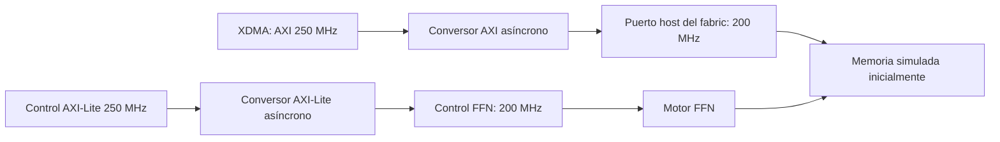

# Cruce de relojes entre XDMA y FFN

Actualizado el 2026-10-03. **Conversores AMD aislados aprobados en simulación**;
su [integración con FFN](FFN_ASYNC_INTEGRATION.md) también pasa dos perfiles
asíncronos. Faltan conexión XDMA y gestor de reset sintetizable.
Conserva los bancos [XDMA](board/PCIE_DMA_VALIDATION.md),
[memoria compartida](AXI_MEMORY_FABRIC.md) y [FFN completa](FFN_LARGE.md).
La calificación DDR permanece separada bajo V2/V3.

La [revisión RRESP del conjunto](FFN_ASYNC_INTEGRATION.md) añade un
adaptador reversible alrededor de AXI-Lite para evitar la fusión de dos
registros de respuesta. El banco conserva sus 54 casos/24 resets y trazas;
una corrupción intencional de RRESP se detecta. Las dos regresiones FFN
también conservan exactamente sus resultados, ciclos e IRQ. La síntesis
elimina TIMING-37 con una LUT adicional. El ruteo revisado también elimina
Route 35-470: WNS +0,068 ns/WHS +0,010 ns, 33 fuentes variables con un
destino cada una y una captura conectada a cero. Relojes padres, fronteras
y CDC-15 siguen pendientes; no es cierre de placa.

## Frontera propuesta



Preparar primero puentes independientes. Conservar 512 bits de datos y 64
bits de dirección en AXI; comprobar los IDs efectivos del wrapper XDMA antes
de conectarlos al puerto de cuatro bits. Control conserva 32 bits de datos y
dirección. IRQ requiere su propio protocolo de cruce y confirmación; no cruzar
un pulso combinacional.

Se propone modo asíncrono: 250/200 no es una razón entera 1:N y no se ha
calificado una relación de fase. AMD ofrece conversión asíncrona por FIFO y
parámetros [`ACLK_ASYNC`/`SYNCHRONIZATION_STAGES`](https://docs.amd.com/r/en-US/pg059-axi-interconnect/AXI-Clock-Converter-Parameters); consultar las propiedades
reales instaladas antes de generar la IP. Se localizó el paquete
`axi_clock_converter:2.1`, revisión 36, en Vivado 2026.1. Ambas instancias
generadas están `Up-to-date`, con licencia `Included`, `ACLK_ASYNC=1` y
tres etapas de sincronización. AXI4 usa 512/64/4 bits de datos/dirección/ID;
AXI4-Lite usa 32/32. Se conservan los XCI y XDC generados.
[PG059: conversión](https://docs.amd.com/r/en-US/pg059-axi-interconnect/Clock-Conversion).

## Reset y recuperación

El reloj `axi_aclk` de XDMA puede detenerse; no usarlo como reloj de supervisión
global. La lógica de control del arranque necesita una fuente estable.
[PG195: relojes](https://docs.amd.com/r/en-US/pg195-pcie-dma/Clocking-and-Resets).

Diseñar reset coordinado de ambos lados y todos sus pares, con pulsos
solapados y sincronizados en cada dominio. PG059 no admite reset parcial;
recomienda al menos 16 ciclos del reloj más lento. Esa duración no sustituye
el contrato de reset PCIe ni funciona como contador si el reloj está parado.
[PG059: reset](https://docs.amd.com/r/en-US/pg059-axi-interconnect/Resets).

Cerrar admisión, drenar cuando sea posible y descartar resultados privados
del trabajo interrumpido. Tras pérdida de enlace/reloj, conservar el estado de
fallo hasta recuperar ambos dominios y reiniciar coordinadamente; comprobar
que no reaparezcan respuestas o IRQ de una época anterior.

## Tandas y criterios de avance

### Contrato IRQ XDMA — CSR y FFN aprobados con pares de protocolo

En ABI1, `irq` refleja `completion_pending && irq_enable`, atraviesa XPM
y desaparece al aceptar ACK por MMIO. No tiene entrada `usr_irq_ack`.
AMD exige conservar la solicitud hasta recibir la confirmación de transporte
y hasta que el host atienda y limpie la interrupción; `usr_irq_ack` por sí
solo no acredita atención del software.
[PG195, MSI/MSI-X, revisión 4.2 del 2026-07-22](https://docs.amd.com/r/en-US/pg195-pcie-dma/MSI-and-MSI-X-Interrupts).

Propuesta para el prototipo: una notificación pendiente con identidad de
secuencia/época y rearme confirmado entre dominios. Registrar por separado
la aceptación del evento, el ACK de transporte y el ACK MMIO. Bloquear un
nuevo START hasta completar el retiro y rearme; permitir lecturas y ACK
mientras tanto. Un cambio de `irq_enable` no debe cancelar una solicitud
ya presentada. El [transporte RTL aislado](IRQ_TRANSPORT.md) ya implementa
ese handshake y pasa 45 casos/24 resets, incluida recuperación con reloj
host detenido. Usa 78 LUT/486 FF en síntesis. La [ABI 2.0](FFN_IRQ_CONTROL.md)
ya conecta ese transporte al CSR, con 54 casos propios y 27 resets PASS;
la versión explícita permite conservar la semántica de ACK de la ABI1.

El banco corto cubre ACK de transporte antes/después de la atención,
coincidencia en destino, ACK retrasado o retenido desde el estado ocioso,
modo polling capturado y eventos consecutivos. Comprueba una notificación
por evento admitido, retención hasta ambas confirmaciones e identidad;
la retirada prematura inyectada se detecta. El reset aislado se prueba en
siete puntos, incluido reloj host detenido. El [conjunto FFN ABI2](FFN_IRQ_INTEGRATION.md)
ya valida descriptores, errores, cancelaciones y resets durante cómputo,
además de seis FFN Brandon con lectura de resultados antes del servicio.
Sigue conectar XDMA/MSI y su máscara de interrupción. Un par simulado
no califica transporte PCIe ni recuperación del DIMM.

### Orden de ejecución

1. Inventariar parámetros/puertos y generar AXI/AXI-Lite en carpetas nuevas;
   guardar XCI, VLNV, constraints y licencias. No tomar generación como PASS.
2. Banco corto con 4 ns/5 ns, fases desplazadas y otra razón no entera:
   direcciones altas, ráfagas contiguas al límite de 4 KiB, máscaras, errores, AW/W independientes
   y pausas en los cinco canales; comparar cada handshake y byte.
3. Reset solapado durante AR/R/W/B y con reloj host detenido; después exigir
   recuperación limpia. Usar un ensayo negativo para comprobar respuestas
   obsoletas. No prometer recuperación de un reset unilateral no soportado.
4. Conectar los puentes al fabric calificado y repetir carga/FFN/lectura
   Brandon. Después sustituir el iniciador simulado por XDMA real.
5. Sintetizar y revisar CDC/timing con ambos clocks definidos una sola vez.
   Conservar los XDC del fabricante y revisar `set_max_delay` aplicados;
   no ocultar cruces mediante excepciones globales.
   [PG059: constraints CDC](https://docs.amd.com/r/en-US/pg059-axi-interconnect/Asynchronous-Clock-Domain-Crossing-Constraints).

Registrar caudal, latencia y ocupación en cada reloj, además de tiempo
simulado común. Una memoria conductual no aprueba DDR ni el reset del DIMM.

## Resultado funcional aislado

`20261003T152740Z-V7-host-clock-sim-r5`: **54 casos, 24 resets y revisión
independiente PASS**, 71,759 s de ejecución. Cada perfil incluye dos bancos
(AXI4 y AXI4-Lite), cinco transferencias completas y cuatro abortos por banco.
Cada transferencia completa contiene 12 lecturas y 12 escrituras; AXI4
transporta 180 beats por sentido y AXI4-Lite, 12. En los casos completos se
comparan **172.800 bytes por sentido AXI4 y 720 por sentido AXI4-Lite**;
los prefijos abortados se contabilizan aparte.

| Perfil | Periodos host/dispositivo; fase destino | Ciclos host AXI4 | Ciclos host AXI4-Lite |
| --- | --- | ---: | ---: |
| 0 | 4/5 ns; 0,7 ns | 382 | 270–274 |
| 1 | 6,2/4,6 ns; 0,9 ns | 297–302 | 218–227 |
| 2 | 3,4/5,8 ns; 0,3 ns | 517 | 362–364 |

Estos ciclos cubren ambos sentidos simultáneos con pausas programadas.
**No miden latencia física:** AMD emite cinco avisos por perfil porque el
modelo FIFO de relojes independientes no reproduce los retardos de
sincronización. No convertir esta tabla en caudal de placa ni MTBF.

Se verifican dirección de 64 bits por encima de 512 GiB, ID/sidebands,
ráfagas legales de 1/2/3/4/16/64 beats, máscaras completas/alternadas/cero,
respuestas OKAY/SLVERR/DECERR, AW/W independientes y pausas en los cinco
canales. No se envía una ráfaga que cruce ilegalmente una página AXI.
El reset interrumpe AR, R, W o B; en este último caso el reloj host se detiene
durante 32 flancos descendentes del destino. Tras reanudar ambos relojes,
se mantienen los resets y se exige una recuperación sin tráfico viejo.
Es una secuencia del banco, todavía no un circuito supervisor de placa.

El revisor `tools/check_ntrpu_host_clock.py` reconstruye datos y orden desde
ofertas y confirmaciones de ambos extremos. AXI4-Lite puede entregar al
receptor antes de devolver READY al emisor: las 900 confirmaciones de canal
AW/W/B/AR/R de los casos completos observados presentan ese orden. Se comprueba contra la oferta
estable y se drenan ambas confirmaciones. Las 12 mutaciones de evidencia
por perfil son rechazadas (36 en total).

`20261003T152812Z-V7-host-clock-stale` inyecta contenido de la época 2 en
la primera lectura de la época 3, tras abortar AR. XSIM falla exactamente
en la comparación de R (`sc=27`, `mc=21`), como se esperaba, en 38,587 s.
Prueba la detección del dato incorrecto; no demuestra una reproducción
espontánea por la IP.

## Diagnósticos y respaldo

Se conservan los intentos anteriores: generación `145923Z`; error de opciones
Tcl `150817Z`; repetición con snapshot viejo `151033Z`; suposición errónea
sobre orden de READY en AXI4-Lite `151147Z`; y PASS de herramienta rechazado
por el revisor `151612Z`, cuyo marcador de aborto precedía al último flanco
host. La repetición `152740Z` registra el prefijo en la frontera real de reset.
El lanzador ahora rechaza fuentes RTL/herramientas que difieran del snapshot
publicado; finalizar `boardctl refresh` antes de iniciar una tanda.

Las siete tandas están respaldadas en NFS y `artifacts/ntrpu-board-vivado/`
con sus fuentes y todos los miembros verificados. Fuente funcional y negativa:
`source-20261003T152726Z`, SHA-256
`f49a05195709e5e979b95cf290acbd61474b368035cea2424424793a230be549`.
Archivo funcional: 32.634.242 bytes, SHA-256
`7a3e64817d71f13ced85d91d568a6d8645455e5ae96d84970f33eb26e8d2d214`;
negativo: 31.607.260 bytes, SHA-256
`a12c85b3830fc75b57f23a7430e884417f230f72b250d8575cb5f859746f32bd`.
Los avisos de generación OOC y entorno del compilador XSIM están revisados;
los avisos FIFO permanecen como límite explícito del modelo.

```bash
vivado -mode batch -source tools/ntrpu_board_host_clock.tcl \
  -tclargs sim build/CDC_RUN_NUEVO
python3 tools/check_ntrpu_host_clock.py build/CDC_RUN_NUEVO/profile-0.log --profile 0
# Repetir el revisor con perfiles 1 y 2.
# sim_stale debe terminar con fallo por dato R obsoleto.
```

La [integración FFN a dos relojes](FFN_ASYNC_INTEGRATION.md) ya verifica
carga/cómputo/lectura Brandon, IDs de cuatro bits y una IRQ retenida con
confirmación MMIO. La frontera XDMA todavía requiere confirmación de
transporte y rearme de IRQ, además de un supervisor que funcione con el
reloj host detenido. DDR y reset del DIMM siguen bajo las dependencias V2/V3.

## Síntesis de los conversores

Las tandas `20261003T153913Z-V7-host-clock-axi-synth-r2` y
`20261003T153913Z-V7-host-clock-axil-synth-r2` sintetizan cada IP por separado
con `host_clk=4 ns` y `device_clk=5 ns`, definidos una sola vez. Los modelos
HDL y las restricciones internas AMD coinciden byte a byte con la simulación;
solo se deshabilita el XDC OOC de clocks ficticios de 100 ns.

| IP | LUT (LUTRAM incluidas) | FF | WNS/WHS estimados | Restricciones bus skew; margen mínimo |
| --- | ---: | ---: | --- | --- |
| AXI4 | 998 (746) | 3102 | +3,216/+0,013 ns | 10; +3,851 ns |
| AXI4-Lite | 49 (0) | 377 | +3,345/+0,077 ns | 5; +11,852 ns |

Cero DSP, BRAM, URAM, latches o cajas negras en ambos. Duraciones:
99,616 y 91,142 s. Los dos sentidos del cruce tienen `set_max_delay
-datapath_only` del fabricante: AXI4 4/5 ns; datos AXI4-Lite 15/12 ns.
No se añadieron `set_clock_groups`, excepciones globales ni waivers propios;
no hay excepciones ignoradas.

El reporte CDC conserva las excepciones AMD: AXI4 informa 13 CDC-3 y diez
CDC-9 informativos, además de **un CDC-15 pendiente** dentro del FIFO
protegido. AXI4-Lite informa diez CDC-3 de tres etapas y usa los waivers
CDC-15 originales de XPM handshake. No considerar la ausencia de avisos
no exentos como una revisión completa de todos los cruces.

Faltan fuentes físicas de ambos relojes (`HD.CLK_SRC`), retardos de
1308/1306 entradas/salidas AXI4 y 154/152 AXI4-Lite. Los puertos sin
retardo quedan fuera de parte del análisis CDC. DRC=0 es OOC con comprobaciones
de conectividad incompletas; TIMING-18 persiste y el listado AXI4 se limita
a 1000 avisos. Se conserva también el aviso sobre el objeto jerárquico del
waiver LUTAR-1 del fabricante. **No hay colocación/ruteo ni cierre de placa.**

Las dos síntesis preliminares `20261003T153412Z-*` se conservan: el lanzador
cambiaba la política de checkpoint después de generar y dejaba la otra IP
sin instanciar. Las revisiones r2 corrigen ambos avisos sin cambiar los modelos,
los parámetros funcionales ni los recursos resultantes.

Fuente de síntesis revisada `source-20261003T153853Z`, SHA-256
`114bb0579c362b7e07e818aee6f77ba571b90636f131b0b97baf283df72c4f2a`.
Checkpoints: AXI4
`efadabb57812156f5bd045941096de8953cd9903d196274db126080d2c2e335e`;
AXI4-Lite `b9fffc890c5d17edd06c47952247f6ee881ad8cb6719899218aaf2390f8e33d6`.
Las cuatro síntesis están respaldadas. Archivos r2: AXI4, 16.308.763 bytes,
SHA-256 `c2240c32b5b9f326263575e0abed82c4a85924c52ab4c19ef11546444a17066f`;
AXI4-Lite, 15.350.619 bytes,
`f879ee7304ba4e10f1b5557dc28d0f431f98c3a03efdcebd2484af9b92cd4cc5`.

```bash
vivado -mode batch -source tools/ntrpu_board_host_clock.tcl \
  -tclargs synth_axi build/CDC_AXI_SYNTH_NUEVO
vivado -mode batch -source tools/ntrpu_board_host_clock.tcl \
  -tclargs synth_axil build/CDC_AXIL_SYNTH_NUEVO
```
