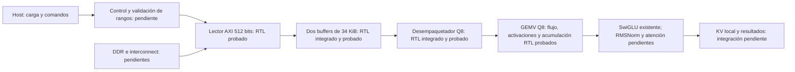

# Diseño de la FPGA con Llama 3.2 1B Instruct

Fecha: 2026-10-03 UTC. Este documento dimensiona el circuito programable y su memoria. VU5P/FLVA2104-2-i es el candidato provisional implementado en las exploraciones; faltan DIMM exacto y aprobación de la tarjeta. ZU7EV conserva las primeras pruebas HLS.

Actualización 2026-10-11: ya está fijado y auditado el
[GGUF Q8_0 de Unsloth con pesos reales](LLAMA32_Q8_REAL_WEIGHTS_R1.md).
Confirma las dimensiones y habilita un banco de proyecciones, pendiente de
ejecución RTL. Las referencias históricas siguientes al checkpoint Meta
original y a inferencia completa conservan sus limitaciones.

## Carga objetivo y procedencia

Modelo elegido: [Meta Llama 3.2 1B Instruct](https://huggingface.co/meta-llama/Llama-3.2-1B-Instruct), revisión `9213176726f574b556790deb65791e0c5aa438b6`. La consulta pública del archivo de configuración devolvió 401; no se descargaron sus pesos. La validación numérica deberá usar acceso autorizado y registrar los hashes de los archivos reales.

Para avanzar en dimensionamiento se usa la [configuración publicada por AMD de su derivado](https://huggingface.co/amd/Llama-3.2-1B-Instruct-FP8-KV/blob/02dadcc0bba747a3d3af2b38fb858ba08ab1d89f/config.json): 16 capas, dimensión 2.048, FFN 8.192, 32 cabezas Q, 8 KV, dimensión de cabeza 64 y vocabulario 128.256 con embeddings compartidos. Solo se toman las dimensiones; no se adopta su cuantización FP8. Contrastar el perfil con el checkpoint Meta antes de declarar compatibilidad.

`fpga/profiles/llama32_1b_instruct.json` conserva procedencia y revisión. Reproducir el presupuesto sin GPU ni pesos:

```bash
python tools/plan_ntrpu_llama.py --output build/llama32-1b-budget.json
```

## Camino de datos propuesto



La primera integración tiene un lector, [dos bancos internos de pesos](WEIGHT_TILE_BUFFER.md) y un [desempaquetador Q8](Q8_UNPACKER.md) en un solo dominio de reloj. Los cruces hacia DDR/PCIe necesitarán puentes o FIFOs con CDC y reset definidos. El [GEMV integrado](Q8_GEMV_STREAM.md) conecta 32 pesos y su escala FP16 al MAC HLS, con caché de activaciones y acumuladores privados; pasó errores/reset, dimensiones K=2048/8192 y proyecciones reales de Brandon. La ocupación ya motivó el candidato de [dos MAC](Q8_GEMV_PARALLEL.md), con ~1,92× de aceleración en las proyecciones Brandon; no extrapolar ese resultado a canales DDR ni a tokens/s.

## Matrices y almacenamiento

Presupuesto propuesto: Q8_0 de 34 bytes por cada 32 pesos, normas FP32 y embeddings/output compartidos. No incluye cabeceras, metadatos ni copias de trabajo.

| Matriz por capa | Filas × columnas | MiB Q8_0 | Tiles de 32 × 1.024 |
| --- | --- | ---: | ---: |
| Q / O, cada una | 2.048 × 2.048 | 4,25 | 128 |
| K / V, cada una | 512 × 2.048 | 1,0625 | 32 |
| Gate / up, cada una | 8.192 × 2.048 | 17 | 512 |
| Down | 2.048 × 8.192 | 17 | 512 |

Son 61,625 MiB por capa, 266,15625 MiB para embeddings compartidos y 0,2578125 MiB de normas: **1.252,4140625 MiB, aproximadamente 1,223 GiB**, en total. Es una previsión del formato propuesto, no el tamaño de un checkpoint convertido.

Para batch 1 y KV almacenado en FP16/BF16, `2 × 16 × 8 × 64 × 2 = 32.768` bytes por token entre todas las capas: 64 MiB a 2.048 tokens; 256 MiB a 8.192; 1 GiB a 32.768; 4 GiB a 131.072. Almacenar ese contexto no acredita soporte funcional ni rendimiento de atención. Empezar las pruebas de inferencia con contextos cortos.

## Buffers, layout y acumulación

Conservar tiles de **32 filas × 1.024 columnas**: 34.816 bytes, 544 beats AXI y nueve ráfagas si comienzan alineados a 4 KiB. Los dos buffers implementados ofrecen 68 KiB de carga útil; la síntesis ocupa 28 RAMB36 + 2 RAMB18. Ya se verificó lectura/llenado simultáneo y publicación solo después de validar la finalización del lector; el cálculo está conectado y probado contra memoria AXI simulada.

El [secuenciador de matrices](MATRIX_MEMORY.md) implementa el layout `[grupo_filas][tile_K][bloque_K][fila][34 bytes]`, con bloques Q8_0 intactos y escala FP16 little-endian. El empaquetador del host y las matrices Brandon completas están probados; la conversión del checkpoint Llama y el runtime siguen pendientes. En un tensor row-major, un tile parcial de K no es contiguo entre filas: requiere comandos por fila o empaquetado previo. Alinear cada matriz a 4 KiB; los tiles de 34 KiB alternan offsets 0/2 KiB y siguen necesitando nueve ráfagas completas/parciales por tile.

Gate/up necesitan dos tiles de K por grupo de filas y down necesita ocho. El controlador conserva acumuladores FP64 por fila y el orden original de bloques entre tiles: **sumar subtotales no conserva necesariamente el redondeo de la referencia**. Pasó casos sintéticos K=2048/8192 y errores tardíos sin publicación. Emite FP64 al terminar K; el escritor de la raíz convierte down a FP32. Faltan las siguientes operaciones del transformer.

Reservas iniciales propuestas: 8 KiB de activación INT8 máxima, 2 KiB de escalas FP64, 8 KiB por vector oculto FP32 y 256 bytes para 32 acumuladores FP64. La cadena AXI vigente conserva gate/up en **binary64**: para H=8192 requiere 128 KiB entre ambos destinos, frente a los 64 KiB de una futura variante FP32. Son componentes del presupuesto, no la memoria total del motor; faltan atención, temporales, colas y adaptación de puertos. No basta con aumentar las constantes del top Brandon (`D≤256`, `H≤720`).

## Ancho de banda y ampliación de la tarjeta

Un bus de 512 bits a 200 MHz transportaría como máximo 12,8 GB/s. Con lectura de los pesos densos por token, el presupuesto anterior implica un techo ideal de aproximadamente 9,75 tokens/s por lector, antes de KV, pausas, arbitraje, refresco y cómputo. **No es una medición ni una predicción**; el lector de una sola ráfaga pendiente y el núcleo FP64 pueden limitar mucho más. Añadir capacidad DDR no aumenta por sí sola este ancho de banda.

El desempaquetador implementado entrega como máximo un bloque Q8 de 34 bytes por ciclo: a esos mismos 200 MHz, 6,8 GB/s y unos 5,18 tokens/s como techo ideal de esa etapa. Es un límite más ajustado para el camino actual, todavía sin medir rendimiento real. El calculador conserva ambos techos por separado.

Llama 1B permite validar el camino completo con bastante menos de 512 GB. La selección física sigue el [roadmap de la tarjeta](BOARD_DESIGN_ROADMAP.md): compatibilidad FPGA/controlador/DIMM, canales, ranks, bancos de E/S, PCIe, alimentación y pinout antes de fijar PCB. No se ha aprobado todavía una combinación 4 × 128 GB u 8 × 64 GB.

Para dos unidades, comenzar con capas 0–7 y 8–15; mantener embedding/output en la primera y devolverle la última activación evita duplicar esos pesos. El runtime coordinará las transferencias y las épocas según [NTRPU Fabric](NTRPU_FABRIC.md). El tráfico y rendimiento de esa distribución todavía deben probarse.

## Próximas piezas verificables

1. Conectar registro de buffers y DMA host. La [carga de activaciones desde AXI](ACTIVATION_MEMORY.md) y la [escritura de resultados](RESULT_MEMORY.md) ya están integradas y probadas; conservan épocas, rangos y publicación tras validación y respuestas B.
2. Ampliar a dimensiones Llama la cadena integrada de conversión FP32, SwiGLU y control entre proyecciones. La versión de [dos MAC](Q8_GEMV_PARALLEL.md) reduce los ciclos de las proyecciones Brandon aproximadamente 1,92×, de 0,283 a 0,542 GB/s útiles simulados. No extrapolar estos resultados a inferencia Llama.
3. Una FFN con dimensiones de Llama y pesos autorizados, seguida de RMSNorm, RoPE, atención GQA y KV; después comparar logits y tokens.
4. Integrar IP DDR y PCIe con el dispositivo elegido, restricciones temporales completas y medición física.

La validación actual cubre transporte, GEMV integrado, 72 casos de fallos/reset y 162 proyecciones reales de Brandon. Su ruteo OOC cumple timing interno bajo contexto provisional, sin cerrar el reloj ni los puertos del padre. La FFN completa de Brandon continúa en su banco separado; todavía no hay inferencia Llama ejecutándose en FPGA.

La ampliación dual cubre 87 casos de errores/reset y jobs máximos de
32×2048/8192 con pesos sintéticos y referencia Python: 32×8192 tarda
100548–100713 ciclos frente a 194757–194887 del escalar. No cubre por sí
sola las 8192 filas de una proyección up/gate. El
[formato de pesos del host](GEMV_WEIGHT_LAYOUT.md) pasó además 174 jobs,
mezclando Brandon real con esas formas, consumidos desde imágenes AXI
inmutables. Continúan pendientes DMA, FFN con dimensiones completas de Llama
y pesos Meta autorizados.

El nuevo wrapper carga también activaciones ABI1 desde imágenes AXI y
repite 174 jobs/5376 valores exactos. Su 32×8192 sintético tarda
100689–100844 ciclos. No cubre todavía una proyección de 8192 filas,
el encadenamiento FFN ni los pesos de Llama.

El wrapper con escritor repite los 174 jobs y compara los 5376 valores
también en memoria de destino. Su forma 32×8192 tarda 100630–100806 ciclos
bajo el nuevo patrón de pausas. Solo la completion exitosa publica el
destino; los errores de escritura pueden dejar bytes privados modificados.
Su ruteo OOC consume 18.239 LUT/52 DSP y cumple restricciones internas
de 5 ns con WNS +0,395 ns/WHS +0,010 ns; faltan reloj y fronteras del padre.
El banco ampliado pasa 111 casos y recuperación de reset en cuatro fases.

El secuenciador de matrices completas elimina el límite de 32 filas por
comando externo: mantiene grupos internos y una única completion raíz.
Brandon completo pasa 9 matrices/5088 valores exactos. Las matrices
sintéticas completas 8192×2048 y 2048×8192 pasan RTL, semilla 1: 10.240
valores escritos exactos, 6.463.892 / 6.451.524 ciclos. Conservan todas las
filas y guardas; no son inferencia Llama. El bloque local SwiGLU/Q8 pasa
27/27 C/RTL y está ruteado OOC. El [adaptador AXI](SWIGLU_MEMORY.md)
procesa 8192 parejas y escribe 256 registros exactos en 980.075 ciclos;
ruteo interno WNS +0,567 ns.

La [FFN raíz por memoria](FFN_MEMORY.md) ya conecta esas fases y pasa
498 casos de control, incluidas las formas Llama. Su cálculo encadenado
pasa 63 casos sintéticos/error/reset a formas pequeñas 32/32, 64/96 y 64/80,
con 74.176 bytes físicos exactos y 672 valores down de jobs correctos.
Tres cadenas adicionales con pesos reales de Brandon pasan con 45.120 bytes
exactos y 307.289–307.377 ciclos. Ruteo: 38.627 LUT/93 DSP, WNS +0,068 ns
a 5 ns, con reloj padre/fronteras pendientes. Estas son métricas de la
referencia binary64. La [salida FP32 integrada](FFN_FP32.md) ya pasa
63 casos de cadena y 171 del escritor en RTL y netlist; su síntesis usa
40.407 LUT/93 DSP y el ruteo OOC 40.080 LUT/93 DSP, WNS +0,164 ns,
sin cerrar reloj padre/fronteras. La ampliación sintética se registra abajo;
todavía no hay inferencia Llama con pesos Meta sobre este diseño.

El [banco completo 2048/8192](FFN_LARGE.md) pasó con pesos sintéticos y la
misma raíz RTL ruteada: **20.332.664 ciclos**, 56.754.176 bytes leídos y
155.648 bytes escritos exactos, incluidos 2.048 resultados FP32. La referencia
escalar, el plan AR y los checksums R se revisaron independientemente; diez
corrupciones de evidencia fueron rechazadas. Terminó en 11.160,111 s y tiene
respaldo local verificado. La prueba corta 2048/96 queda conservada aparte.
Este banco conecta la raíz FFN directamente; PCIe/DMA/DDR y las demás capas
del modelo siguen pendientes.
