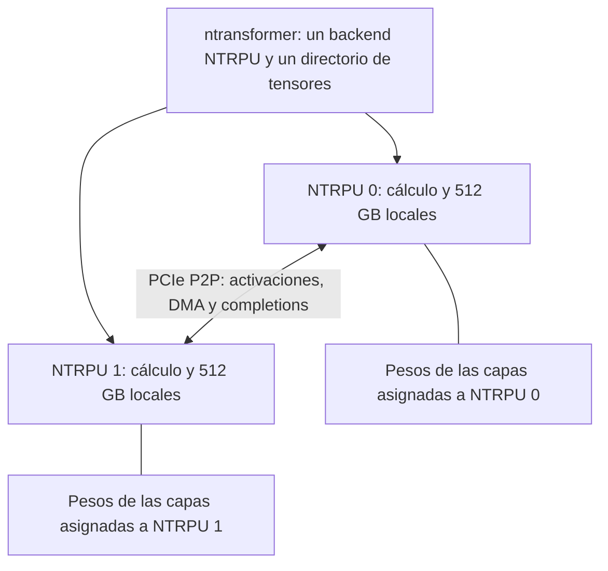

# Agrupación de varias NTRPU

## Objetivo y alcance

Una NTRPU es una unidad de procesamiento para ntransformer, con cálculo FPGA y memoria local. El objetivo confirmado es agrupar tarjetas de 512 GB en un único dispositivo lógico: dos unidades suman 1.024 GB físicos; cuatro, 2.048 GB. La capacidad disponible para pesos será menor por KV cache, buffers, metadatos y posibles réplicas. Esta es una propuesta nueva basada en la descripción del usuario, no una especificación recuperada.

La unificación se implementa en el backend de ntransformer y el protocolo entre tarjetas. Cada endpoint PCIe conserva sus BAR y su memoria física; una región BAR no crea por sí sola memoria coherente ni fusiona los endpoints.

El funcionamiento de una o varias NTRPU deberá ser independiente de CUDA y de los mecanismos BAR1 de NVIDIA. Esta autonomía de DMA y mapeo es un requisito del proyecto, motivado por las restricciones encontradas al intentar construir la solución sobre GPU. La presencia de una GPU no será un requisito de inicialización, ejecución ni validación del protocolo NTRPU.

## Memoria distribuida

Propuesta de direccionamiento lógico: `(model_epoch, tensor_id, byte_offset)` se resuelve a `(unit_id, local_offset, length, permissions)`. Un tensor puede tener varios fragmentos. El directorio conserva propietario, tamaño, formato de cuantización y versión; las direcciones PCIe se resuelven durante el registro del dispositivo, nunca se guardan como constantes del modelo.

Usar offsets y longitudes de 64 bits. Si cada unidad expone 512 GiB útiles, se requieren 39 bits de offset local; esto no obliga a reservar una ventana BAR del mismo tamaño. El espacio lógico puede abarcar todas las tarjetas aunque el acceso remoto utilice ventanas menores.

Los pesos serán inmutables después de cargar y publicar una versión completa del modelo. «Compartir pesos» significa poder localizar y utilizar fragmentos distribuidos; guardar una copia completa en cada tarjeta no multiplica la capacidad útil para un único modelo. Se podrán replicar tensores pequeños cuando reduzcan comunicación. KV cache y activaciones tendrán un propietario y reglas explícitas de escritura.

## BAR y transporte

La [propuesta de transporte PCIe y HBM](NTRPU_TRANSPORT.md) concreta los
candidatos de FPGA/encapsulado, el presupuesto de enlaces, las regiones
registradas, las confirmaciones y las pruebas de aceptación. Es una
especificación propuesta; no acredita DMA entre placas ni cambia la cola Vivado.

Propuesta inicial para cada tarjeta:

- Una región BAR de control: identificación, versión ABI, capacidades, estado y doorbells.
- Ventanas de datos hacia DDR local, con traducción PCIe→AXI y límites verificados.
- Motor DMA para transferencias por descriptores hacia buffers registrados en otra NTRPU, en RAM host o, opcionalmente, en VRAM.
- Colas de envío y finalización con secuencia, estado de error y timeout.

La elección de índices, tamaños y direcciones BAR depende del IP PCIe y de la plataforma. [AMD PG194](https://docs.amd.com/r/en-US/pg194-axi-bridge-pcie-gen3/Address-Translation) documenta traducción de direcciones; no garantiza que cualquier host pueda asignar BAR de 512 GB. Si se usan ventanas móviles, cada ventana necesita propietario y época: no puede reasignarse hasta que hayan terminado todos los DMA que la referencian.

Cada comando deberá transportar operación, tensor o buffer registrado, offsets, longitud, destino, época del modelo y número de secuencia. El receptor valida límites y estado antes de ejecutar. La señal de finalización solo se publica cuando los datos son visibles según el protocolo elegido; una escritura MMIO aislada no basta para establecer coherencia entre caches.

El driver host administrará los mapeos con las APIs DMA del sistema: una dirección virtual de aplicación, una dirección física de RAM y una dirección DMA/IOVA no son intercambiables. Los descriptores usarán direcciones obtenidas del registro correspondiente y conservarán su validez hasta completar o cancelar el trabajo. Para buffers host, seguir la [guía DMA de Linux](https://docs.kernel.org/core-api/dma-api-howto.html); para memoria de otra tarjeta, usar el mecanismo P2P compatible con la topología. El diseño no dependerá de descubrir direcciones mediante patrones escritos en memoria ajena ni de asumir páginas físicamente contiguas.

El acceso P2P debe descubrirse y probarse por cada par de dispositivos. La [documentación Linux de PCI P2PDMA](https://cdn.kernel.org/doc/html/latest/driver-api/pci/p2pdma.html) distingue las rutas dentro de una jerarquía PCIe de las que atraviesan host bridges. Una topología con switch puede permitir tráfico local entre endpoints; las rutas que cruzan un uplink comparten su capacidad. Tener ranuras o líneas libres no asegura una ruta P2P funcional ni ancho de banda adicional independiente.

HBM y DDR son memorias locales. Una tarjeta con HBM puede usarla como nivel rápido, pero HBM no enlaza automáticamente tarjetas. Las interconexiones serían PCIe o enlaces dedicados que habría que diseñar por separado.

## Reparto del cálculo

El primer prototipo distribuirá capas completas. Cada NTRPU ejecutará sus capas leyendo pesos locales; enviará activaciones a la propietaria de la siguiente etapa. Esto permite aumentar el tamaño del modelo sin transportar los pesos en cada token. Para una única secuencia, las dependencias entre capas siguen siendo secuenciales: duplicar tarjetas no promete duplicar tokens/s. Con varias peticiones, un pipeline puede mantener ocupadas varias etapas.

Una segunda fase podrá dividir matrices entre tarjetas. El paralelismo tensorial permite trabajar simultáneamente en una operación, pero requiere broadcast de entradas y reunión o reducción de resultados según el particionado. Deberá seleccionarse solo cuando la ganancia de cálculo/memoria supere la comunicación y las barreras. El acceso remoto directo a pesos quedará para carga, migración o casos medidos; la política principal es llevar el cálculo al propietario de los pesos.

El transporte con una GPU reutilizará conceptos de `gpu-nvme-direct`, según las limitaciones documentadas en [la arquitectura general](README.md). La cooperación NTRPU↔NTRPU podrá usar un protocolo propio sin depender del mecanismo experimental BAR1 de NVIDIA.

## Secuencia de construcción

1. **Simulador de dos unidades sin CUDA — implementado:** memoria dispersa, directorio de tensores y carga distribuida. Pruebas de límites de capacidad, accesos que cruzan fragmentos, offsets mayores de 4 GB, épocas obsoletas y finalizaciones fuera de orden. Ver [compilación, API y límites](SIMULATOR.md). Las direcciones son simuladas; todavía no hay DMA ni BAR reales.
2. **Núcleo numérico — GEMV simulado implementado:** INT8/INT32 y [Q8_0/FP32](Q8_DISTRIBUTED.md) con filas repartidas y contadores separados para cálculo y DMA. La demo Q8_0 encadena operaciones usando resultados transferidos entre unidades. El [top HLS](HLS.md) está verificado como C++, con flujo Vitis preparado. Quedan síntesis/co-simulación, FFN, carga GGUF y evaluación de modelos. Separar resultados reconstruidos de datos originales.
3. **Una placa:** DDR, DMA host, contadores de tráfico y una capa completa. Medir ancho de banda sostenido y latencia.
4. **Dos placas:** probar transferencias por cada ruta, ida y vuelta, y luego inferencia por capas repartidas. Verificar errores y detener la petición si una unidad desaparece; no presentar resiliencia sin implementar réplica/reinicio.
5. **Escala y GPU:** comparar particionado por capas y por tensores; incorporar P2P hacia GPU donde se valide; aumentar capacidad física una vez cerrado el diseño de memoria.

El criterio de éxito inicial es que ntransformer use dos unidades como un backend sin GPU ni CUDA, con un modelo repartido, resultados numéricos comprobados y tráfico medido. La suma de capacidades será una propiedad del sistema; el rendimiento deberá medirse para cada topología y carga.
