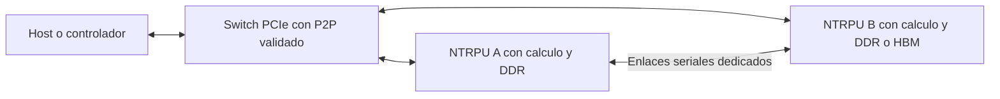

# Transporte entre NTRPU con PCIe y memoria HBM

Propuesta de arquitectura del 2026-10-04 UTC. Concreta la
[agrupación de NTRPU](NTRPU_FABRIC.md) para nodos con DDR, HBM o ambas:
un contrato de transferencias, DMA PCIe P2P y enlaces seriales dedicados
opcionales. La HBM permanece junto al cómputo que la utiliza.

Este documento define decisiones propuestas y criterios de validación.
No acredita DMA entre dos FPGA, enlace Aurora, compatibilidad de RDIMM,
pinout ni rendimiento físico. El estado de las implementaciones y sus
respaldos permanece en [VIVADO_STATUS.md](board/VIVADO_STATUS.md);
esta propuesta no modifica la cola ni sus dependencias.

## Arquitectura y reparto del trabajo

El host enumera dispositivos, registra memoria y distribuye trabajos.
Una tarjeta de apoyo puede aportar control, cálculo o HBM, pero su papel
como root complex, endpoint o router debe seleccionarse explícitamente.
El tráfico P2P entre endpoints no necesita copiarse por RAM host cuando
la plataforma y los drivers permiten esa ruta.

La primera distribución asigna capas completas y pesos residentes a cada
nodo. Viajan principalmente activaciones y resultados; KV tiene dueño
explícito y los pesos publicados son inmutables. El paralelismo tensorial
queda condicionado al coste medido de broadcast y reducción. Una única
secuencia conserva dependencias entre capas y no promete escalar tokens/s
linealmente con el número de tarjetas.

Dos nodos de 512 GiB sumarían 1024 GiB físicos antes de reservas y réplicas.
El runtime unifica el directorio de tensores; los BAR no fusionan endpoints
ni crean coherencia. HBM es memoria local, no una interconexión entre placas.
Un nodo HBM debe calcular sobre datos residentes o reutilizados: cargar
sus pesos completos por PCIe en cada token vuelve a limitarlo por ese enlace.

## Matriz de dispositivos y encapsulados

| Candidato | Memoria y recursos documentados | Uso propuesto |
| --- | --- | --- |
| VU5P, FLVA2104 | Sin HBM; 832 E/S HP y 52 GTY. El prototipo usa Gen3 x16 | Mantener como referencia DDR, cómputo y transporte |
| VU37P, FSVH2892 | HBM de 8 GB; 624 E/S HP y 96 GTY; opciones Gen3 x16 y Gen4 x8 | Variante HBM UltraScale+ |
| VU47P, FSVH2892 | HBM de 16 GB; 624 E/S HP y 96 GTY; opciones Gen3 x16 y Gen4 x8 | Variante con más capacidad HBM |
| VH1542 o VH1582, VSVA3697 | HBM de 16 o 32 GB; cuatro controladores DDR; 68 GTYP y 20 GTM; CPM5 con dos Gen5 x8 | Estudiar como generación de mayor comunicación externa |

Fuentes: [AMD DS890, tablas 16 a 18](https://docs.amd.com/api/khub/documents/dGU6Y~1b8XPqDFk5ulti6g/content)
y [Versal HBM XMP465, recursos y encapsulados](https://docs.amd.com/api/khub/documents/jEulezc2bGbehGd8brzgZw/content).
Las capacidades HBM conservan la denominación GB de AMD; el runtime debe
anunciar bytes utilizables. Las variantes HBM todavía requieren grado de
velocidad, temperatura, disponibilidad, potencia y coste verificados.

Los recursos seriales potenciales se presupuestan así, sin asignar bolas:

- VU5P: `52 - 16 = 36` GTY tras el PCIe actual. Sus quads PCIe 224 a 227
  quedan reservados según la [traza de lanes](board/PCIE_LANE_TRACE.md).
- VU37P/VU47P: `96 - 16 = 80` GTY con un Gen3 x16, o `96 - 8 = 88`
  con un Gen4 x8. No presupuestar ambos enlaces como si usaran los mismos GT.
- VH1542/VH1582: 16 de los 68 GTYP están dedicados a CPM5; quedan 52
  GTYP para otras funciones, además de los GTM. Los 20 GTM corresponden
  a 20 canales de 56G o diez combinados de 112G, no a ambas cantidades sumadas.

Estas restas no prueban coexistencia: faltan quads accesibles, PLL, refclocks,
velocidad admitida, conectores y ruteo. Dos Gen5 x8 tampoco equivalen a un
único endpoint x16; usar ambos exige dos conexiones lógicas y una plataforma
que las soporte, por ejemplo bifurcación adecuada o puertos separados.

**512 GiB DDR junto con HBM permanece sin demostrar.** Los cuatro
controladores del Versal no califican los RDIMM, ranks ni densidades del
proyecto. Las variantes Virtex HBM tienen menos E/S HP que el VU5P elegido;
el plan DDR requiere una evaluación nueva. La selección de memoria sigue
los criterios de [MEMORY_FEASIBILITY.md](board/MEMORY_FEASIBILITY.md).

## Presupuesto de ancho de banda

Todos los valores siguientes son techos calculados, no benchmarks.
GB/s usa bytes decimales. Para enlaces se descuenta la codificación de línea,
pero faltan cabeceras, control de flujo, compensación de reloj y pausas.
Cada cifra corresponde a una dirección, salvo que se indique agregación.

| Ruta | Cálculo | Techo en GB/s |
| --- | --- | ---: |
| PCIe Gen3 x16 | `8 * 16 * 128 / 130 / 8` | 15,754 |
| PCIe Gen4 x8 | `16 * 8 * 128 / 130 / 8` | 15,754 |
| PCIe Gen5 x8 | `32 * 8 * 128 / 130 / 8` | 31,508 |
| Dos Gen5 x8 | Dos rutas simultáneas sin cuello compartido | 63,015 agregados |
| Aurora, cuatro lanes a 25,78125 Gb/s | `4 * 25,78125 * 64 / 66 / 8` | 12,5 |
| Cuatro enlaces Aurora anteriores | 16 lanes y rutas internas suficientes | 50 agregados |
| Un puerto AXI de 512 bits a 200 MHz | `512 / 8 * 0,2` | 12,8 por canal de datos |
| Cuatro DDR de 64 bits a 1600 MT/s | `4 * 8 * 1,6` | 51,2 agregados |

Tasas y codificación PCIe: [PCI-SIG](https://pcisig.com/sites/default/files/files/PCI-SIG%202020%20Annual%20Press%20Conference_final.pdf).
Aurora: [AMD PG074, Throughput](https://docs.amd.com/r/en-US/pg074-aurora-64b66b/Throughput).
25,78125 Gb/s es un objetivo de estudio sujeto a parte/IP/timing y canal
eléctrico; no una tasa ya conseguida. El soporte GTM de 112G no implica
que Aurora pueda utilizarlo a esa velocidad.

La cifra DDR presupone los cuatro canales operativos; lectura y escritura
comparten su capacidad física. El [árbitro AXI actual](AXI_MEMORY_FABRIC.md)
comparte un puerto entre iniciadores: aumentar enlaces externos no multiplica
ese puerto. Para aproximarse a 50 GB/s hay que estudiar al menos cuatro
rutas de 512 bits a 200 MHz, distribución entre canales y margen de control.
Tráfico de cómputo, DMA y copias internas compiten por la memoria.

Presupuestar cada flujo como `B_util <= min(B_origen, B_ruta, B_destino)`,
sumando además los flujos que comparten cada recurso. Cuatro enlaces hacia
cuatro vecinos no dan 50 GB/s hacia un solo vecino. Para más de dos nodos,
un router activo necesita puertos y ancho de banda de cruce propios.

## Contrato mínimo del transporte

La propuesta usa una versión de protocolo negociada, independiente de la
ABI FFN existente. El descubrimiento anuncia memoria en bytes, transportes,
límites de colas, alineación, tamaño máximo y capacidades opcionales.
Comenzar con PUT hacia regiones registradas; GET, atomics y coherencia de
caches quedan fuera del primer contrato.

| Operación | Efecto requerido |
| --- | --- |
| DISCOVER | Negociar versión y capacidades, identificar sesión y rutas |
| REGISTER | Reservar región local y devolver un handle con generación y permisos |
| PUT | Copiar desde un buffer registrado a una región remota autorizada |
| FENCE | Esperar visibilidad de PUT anteriores de una cola hacia un destino; propagar sus fallos |
| RETIRE | Consumir una finalización por identidad y liberar su espacio de cola |
| UNREGISTER | Rechazar nuevas referencias y liberar solo después de drenar y revocar accesos |

Campos lógicos de PUT: sesión, identificador de transferencia, época del
modelo, nodo origen/destino, handles de región con generación, offsets y
longitud de 64 bits. La sesión y el identificador de transferencia serán
de 64 bits, sin reutilización dentro de una sesión. Reiniciar un proceso
no autoriza reiniciar esos identificadores sin negociar una sesión nueva.
El formato binario, offsets y codificaciones quedan pendientes de revisión.

Validar permisos, propietario, generación y límites antes de aceptar;
comprobar `offset <= size` y `length <= size - offset` sin overflow.
El perfil inicial propuesto usa transferencias alineadas a 64 bytes,
longitud positiva múltiplo de 64 y máximo negociado de 1 MiB. El software
reserva padding explícito cuando haga falta. El adaptador fragmentará por
límites AXI/PCIe y tamaños negociados, sin asumir que 1 MiB sea un único TLP.

El origen permanece inmutable y el destino excluye lectores y escritores
en conflicto mientras están retenidos. Rechazar copias con solapamiento
local en el perfil inicial. La finalización contiene identidad, estado y
longitud válida; solo SUCCESS valida toda la longitud solicitada.

## BAR y compatibilidad con ABI2

La [integración PCIe actual](PCIE_FFN_INTEGRATION.md) utiliza BAR0 para CSR
ABI2 y BAR1 para tabla/PBA MSI-X. Conservar esas asignaciones; la ventana
de datos requiere un espacio compatible con el IP, con índice y tamaño
todavía por seleccionar. No se exige un BAR de 512 GiB.

Una ventana tiene dueño, región, generación y referencias en vuelo. No se
reasigna hasta confirmar el drenaje remoto y retirar todos los accesos.
Los mapeos DMA los administra el driver; un puntero de usuario no es una
IOVA. Las escrituras PCIe ordinarias no transportan nuestra generación:
el cambio de época por sí solo no bloquea un DMA antiguo hacia una ventana
reasignada. Son necesarios drenaje y revocación efectivos.

Descubrir y probar P2P por cada par. Un switch puede mantener tráfico entre
endpoints dentro de su jerarquía; cruzar host bridges depende del soporte
de la plataforma. No deshabilitar ACS/IOMMU como requisito universal.
Conservar una ruta host explícita para diagnóstico cuando P2P no exista y
registrar qué transporte se midió. [Linux PCI P2PDMA](https://docs.kernel.org/driver-api/pci/p2pdma.html).

El adaptador de cómputo debe mantener el contrato de
[FFN_IRQ_CONTROL.md](FFN_IRQ_CONTROL.md): secuencia/época FFN de 32 bits,
sin reutilización dentro de la sesión, y retiro condicionado por atención
software y confirmación del notificador en modo IRQ; en polling basta la
atención software. Los IDs del nuevo transporte no
se truncan a esos registros; el adaptador mantiene la asociación.
`usr_irq_ack` confirma el transporte de la notificación y no demuestra
visibilidad de los datos ni atención del software.

## Orden de publicación y recuperación

Una transferencia pasa por aceptación, envío, drenaje, confirmación remota
y retiro. Puede fallar en cualquiera de las fases anteriores al éxito.
El receptor debe verificar cobertura de todos los fragmentos y errores,
esperar las respuestas de memoria y establecer la visibilidad para el
consumidor antes de publicar SUCCESS. La barrera concreta de cada adaptador
se valida por separado: un ACK de enlace, una IRQ o un B de un puente con
buffer no son por sí solos prueba suficiente.

No se permite computar sobre una región antes de recibir esa confirmación.
FENCE tiene alcance de cola/destino; no crea orden global entre colas ni
coherencia CPU. El driver aplica las barreras y sincronizaciones que
correspondan al mapeo utilizado.

El enlace serial añade encuadre, control de integridad, secuencia de
fragmentos y créditos por receptor. El tráfico de control/finalización
conserva capacidad reservada para progresar con las colas de datos llenas.
Para varios enlaces, el receptor sigue cada fragmento hasta completar la
transferencia; no publica un resultado por recibir solo el último paquete.

Un timeout o caída impide nuevas admisiones y deja los destinos afectados
inválidos. Un DMA fallido puede haber escrito parte del destino: longitud
válida cero significa que no se publica un resultado utilizable, no que
la memoria permanezca intacta. No reintentar ciegamente ni liberar/reasignar
memoria hasta probar que cesaron todos los accesos antiguos; si no se puede,
mantenerla en cuarentena hasta recuperación coordinada.

La primera versión aborta la petición afectada. El rearme exige drenar o
revocar el transporte, reset coordinado de los dominios afectados y nueva
sesión/registros. No promete rollback, continuidad de inferencia ni entrega
exactamente una vez ante pérdida de confirmaciones.

## Pruebas de aceptación y orden de implementación

El [simulador funcional](SIMULATOR.md) ya permite investigar direcciones
altas y memoria distribuida, pero no implementa este contrato: reutiliza
secuencias tras poll, ofrece copias sin efectos parciales en los fallos
modelados y no representa DMA, BAR, IOMMU, créditos ni reset físico.

La tabla fija criterios para el transporte implementado. La cobertura parcial
del nuevo [modelo de protocolo](TRANSPORT_MODEL.md) no acredita esos puntos
en hardware ni en los adaptadores todavía pendientes.

| Caso pendiente | Evidencia exigida |
| --- | --- |
| Descubrimiento | Rechazo de versión incompatible y respeto de límites negociados |
| Límites de memoria | Offsets superiores a 4 GiB y alrededor de 512 GiB; overflow, región ajena y permisos rechazados sin escritura |
| Vida de región | UNREGISTER y reasignación BAR bloqueados durante tráfico y confirmaciones pendientes |
| Sesión | Rechazo de descriptor/finalización antiguos tras rearme; acceso DMA antiguo drenado o revocado |
| Orden | Fragmentos y completions fuera de orden sin publicar datos incompletos |
| Visibilidad | El consumidor lee el payload completo después de SUCCESS bajo pausas y buffers intermedios |
| Congestión | Créditos agotados y colas llenas sin pérdida; control progresa sin depender de espacio de datos |
| Error parcial | Caída a mitad de escritura deja destino inválido; no aparece SUCCESS ni se reutiliza prematuramente |
| ABI2 | Preservar polling y ambos órdenes de ACK software/notificador; rechazar identidades equivocadas |
| Varias rutas | Comparar un enlace y varios, medir por vecino y detectar el cuello compartido |

Orden de implementación:

1. **Modelo funcional implementado:** [dos endpoints con sesiones, regiones,
   créditos y errores parciales](TRANSPORT_MODEL.md), separado del simulador
   C++. Pasaron 25 pruebas, incluidas 20 semillas de tráfico bidireccional.
   La visibilidad y la revocación del transporte son hipótesis del modelo.
2. **Modelo de adaptador implementado:** [PCIe/AXI con dos endpoints y memoria
   de prueba](PCIE_AXI_TRANSPORT_MODEL.md), con 18 pruebas y 25 regresiones PASS.
   Distingue envío PCIe, AW/W/B, memoria final y revocación; requiere todavía
   integración RTL, validación del IP y garantías de visibilidad/drenaje físicas.
3. **Receptor RTL aislado implementado:** [buffering y drenaje AXI](PEER_RX_GUARD.md),
   con 74 casos de simulación PASS, contraste de 62 trazas y 12 rechazos
   locales sin AXI. [Síntesis y 74 casos de netlist](PEER_RX_SYNTHESIS.md)
   revisados; pendientes timing integrado y conexión con el endpoint.
4. Un enlace serial dedicado con loopback/par de prueba, integridad y
   recuperación; después cuatro enlaces si memoria y timing lo justifican.
5. Integración con DMA/DDR y cómputo cuando cierre sus dependencias en la
   cola vigente. Calificar P2P real y el canal eléctrico con dos placas.

Cada futura tanda conserva fuentes/hashes, configuración, comandos, trazas,
resultado independiente y respaldo verificado. Medir bytes útiles, latencia
hasta visibilidad, ocupación, pausas, errores y tiempo total. Distinguir
simulación, síntesis, implementación y hardware en toda conclusión.

La síntesis aislada está revisada y el [contrato de adaptación](PEER_RX_INTEGRATION.md)
está definido. El siguiente paso es implementar el ingreso BAR y el dominio
de transporte que conserva las escrituras durante fallos de aplicación;
para rendimiento, solapar llenado/envío mediante buffers o colas adicionales.
La [propuesta de múltiples buffers](PEER_RX_MULTIBUFFER.md) estudia cuatro
bancos como dos pares y compara 2, 3 y 4 bancos antes de fijar la organización.
Los ACK de drenaje siguen siendo requisitos de la ruta física.
La decisión de PCB permanece abierta hasta demostrar memoria, lanes,
relojes, alimentación e integridad de señal en la combinación exacta.
