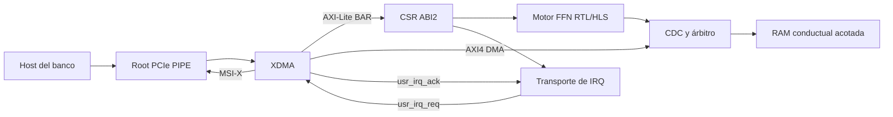

# FFN por PCIe/XDMA con MSI-X

Trabajo V7 iniciado el 2026-10-03 sobre `xcvu5p-flva2104-2-i`,
Vivado 2026.1 y XDMA 4.2. **Estado: PASS funcional revisado** del fixture
pequeño y de una FFN Brandon D256/H720, con MMIO/DMA concurrentes y
registros CQ/RC separados. Este banco conecta
la [FFN con ABI2 y host asíncrono](FFN_IRQ_INTEGRATION.md) al modelo
PCIe PIPE y al XDMA del ejemplo AMD conservado. Su RAM es conductual.

## Camino y contrato



Motor a 200 MHz; host con reloj generado por XDMA. Los puentes AMD
AXI4/AXI4-Lite y el transporte XPM conservan el RTL previamente probado.
El banco sincroniza la salida del reset inicial en ambos dominios durante
64 ciclos; aún no implementa recuperación por pérdida de reloj o reset
unilateral.

Una solicitud IRQ permanece activa hasta ACK de transporte y servicio
MMIO con identidad correcta, en cualquier orden. El ACK del bloque
PCIe indica envío, no ejecución del manejador del host.
[Contrato AMD PG195](https://docs.amd.com/r/en-US/pg195-pcie-dma/MSI-and-MSI-X-Interrupts).

## Cobertura aprobada

- Una FFN sintética `D=32/H=32`, layout 2: cuatro descriptores H2C
  cargan 3.328 bytes; el motor escribe 704 bytes entre intermedios y
  salida; C2H devuelve 128 bytes, equivalentes a 32 FP32.
- Direcciones host y dispositivo de 64 bits, mayores de 4 GiB,
  con transferencias que cruzan páginas mediante paquetes separados.
- MSI-X vector 4, destino `0x500000800`, dato `0x8badc0de`; las IRQ
  de los canales DMA se mantienen deshabilitadas.
- Un ACK de software con identidad incorrecta se rechaza sin retirar
  la finalización. El host lee la salida antes de servirla correctamente.
- Dos descriptores inválidos adicionales comprueban servicio primero
  con la IRQ enmascarada en XDMA y finalización por polling.

Los dos trabajos inválidos no representan otras dos FFN calculadas.
`check_ntrpu_pcie_ffn.py` reconstruye los bytes RAM/CQ y compara contra
una referencia numérica Python independiente. También exige metadatos,
identidades y orden de retiro; una marca PASS aislada no basta.

Medidas de la referencia serializada conservada:

| Medida de simulación | Resultado |
| --- | --- |
| Cómputo `JOB → DONE`, motor a 200 MHz | 5.424 ciclos; 27,120 µs |
| Carga H2C / escrituras del motor / devolución C2H | 3.328 / 704 / 128 bytes |
| Lecturas RAM, incluido C2H | 4.096 bytes |
| Salida numérica | 32 FP32 exactos contra referencia Python |
| Interrupciones | Dos ACK XDMA y dos paquetes MSI-X |
| CSR ABI2 reconstruidos | 204 escrituras, 90 lecturas; un `SLVERR` esperado |
| Finalización → retiro, casos 1/2/3 | 16,560 / 11,135 / 8,985 µs |
| Ejecución del banco | 961,264 s reales; 237,524 µs simulados |

Los intervalos de retiro incluyen las esperas del controlador de prueba;
no son latencia física de interrupción. El revisor rechaza 25 alteraciones
offline de la evidencia; estas pruebas no inyectan errores en el RTL.

## Reproducción y evidencia

`tools/ntrpu_board_pcie_ffn.tcl` recibe el directorio del ejemplo PIPE,
las dos tandas HLS aprobadas (`q8_block_mac`, `swiglu_q8_block`) y una
salida nueva. Copia el ejemplo y registra hashes antes/después de los
seis archivos de aplicación/control del banco modificados. Conserva
sin cambios los archivos RTL/IP protegidos del ejemplo de entrada.

Primer intento `20261003T192048Z-V7-pcie-ffn-msix`: fallo Tcl antes
de simular por `set_property` con un valor iniciado en guion. Corrección:
usar `-dict`, como en el lanzador PCIe anterior. El intento se conserva
en `artifacts/ntrpu-board-vivado/` con fuentes y SHA-256 verificados.
Segundo intento `20261003T192229Z-V7-pcie-ffn-msix-fixed-launch`:
enlace y BAR correctos, detenido a 113,864 us al comprobar que MSI-X
seguía deshabilitado. La XCI original tenía `pf0_msix_enabled=false`.
No llegó a DMA ni a cómputo. Respaldo verificado; 593,951 s de ejecución.

`20261003T193438Z-V4-pcie-pipe-msix-example` genera una IP nueva con
MSI-X PF0 habilitado, tabla de 32 vectores y BIR `BAR_1`; conserva las
otras opciones de enlace y bus. Configuración y wrappers generados
revisados, salida 0 en 90,984 s y respaldo verificado. Los registros
internos XDMA de tabla/PBA tienen offsets fijos `0x8000/0x8fe0`, según
[PG195](https://docs.amd.com/r/en-US/pg195-pcie-dma/MSI-X-Vector-Table-and-PBA-0x8).
La tanda final lee desde el host `0x60=0x801f7011`, `0x64=0x8001` y
`0x68=0x8fe1`: confirma habilitación, 32 vectores y tabla/PBA en BAR1
con los offsets anunciados `0x8000/0x8fe0`. BAR0 expone el CSR ABI2.

`20261003T193636Z-V7-pcie-ffn-msix-enabled` leyó correctamente
`0x3014=2`, pero se detuvo ante la primera escritura AXI a 83,5375 us.
El controlador de prueba usaba `0x02fffe7f`: su bit 25 seleccionaba
direcciones fijas. El replay `20261003T194619Z-V7-pcie-ffn-aw-diagnosis`
confirma `AWBURST=0` a ambos lados del CDC, con dirección, tamaño y
estado correctos. Reproduce las diez líneas de transacciones de su origen
y compara hashes del ejecutable/librerías; no fuerza señales. El exit 0
del replay corresponde a exportación diagnóstica, no a éxito funcional.
Ambas tandas están respaldadas y verificadas.

`20261003T194753Z-V7-pcie-ffn-incrementing` corrige el modo con
`0x00fffe7f`; 640 bytes escritos coinciden con la referencia Python.
Se detiene a 84,136 us por `NTRPU_LOG_RQ_LAYOUT`: sondeo MMIO y
completions DMA coinciden en los buffers de logging RQ/CC compartidos
del controlador AMD. Se conserva el comprobador y el intento fallido.

`20261003T200010Z-V7-pcie-ffn-serialized` termina con exit 0 y pasa
la revisión independiente de los tres casos. Separa las
fases DMA del sondeo de registros: una observación del banco espera
los bytes y su drenaje, y después el host lee y verifica contadores y
estado reales del DMA. No es un driver host ni homologa concurrencia
MMIO/DMA; las tandas posteriores estudian ese caso por separado.
La RAM sigue exigiendo INCR. La selección del bit 25 se documenta en
[PG195: alineación](https://docs.amd.com/r/en-US/pg195-pcie-dma/Address-Alignment).
El lanzador rechaza antes de elaborar una XCI sin las opciones MSI-X
esperadas. El sondeo de completions del controlador de prueba baja de
500 a 50 ciclos, conservando el presupuesto total de 15.000 ciclos.

El revisor final permite que la respuesta MMIO OKAY y la caída IRQ se
observen en el mismo flanco host, como ocurre a 159,956 µs. El registro
original y el RTL permanecen intactos. `review/` conserva el revisor final
con su hash, separado de la versión presente en el snapshot de lanzamiento.

Se cotejan 134 archivos HDL/IP AMD, todos los RTL NTRPU y los dos HLS
fijados. El cache exportado que Vivado regenera se registra aparte.
Hay 144 avisos: los 138 de la referencia PCIe, cinco sobre FIFO asíncrona
conductual sin retardos de sincronización y uno sobre
`cfg_interrupt_msix_vec_pending` sin conectar en el wrapper AMD.
La opción generada `AXISTEN_IF_ENABLE_INTERNAL_MSIX_TABLE=FALSE` fue
verificada por hash: ese puerto consulta/borra pendientes de la tabla
interna del bloque PCIe; XDMA proporciona una tabla externa.
[PG213: interfaz MSI-X](https://docs.amd.com/r/en-US/pg213-pcie4-ultrascale-plus/MSI-X-Interrupt-External-Interface).
No se modifica HDL AMD para ocultar el aviso. La máscara del caso 2 es
la de solicitud de usuario XDMA: no califica máscaras PCIe de función/vector
ni consultas/borrado de PBA.

```bash
# EXAMPLE: ejemplo MSI-X habilitado de 20261003T193438Z; salidas nuevas.
vivado -mode batch -source tools/ntrpu_board_pcie_ffn.tcl \
  -tclargs "$EXAMPLE" "$MAC" "$SWIGLU" build/PCIE_FFN_NUEVO
python3 tools/check_ntrpu_pcie_ffn.py \
  build/PCIE_FFN_NUEVO/simulation.log --output build/PCIE_FFN_NUEVO/review.json
```

Fuente de la simulación: SHA-256
`dfad1a0d0dad0f42879b178496849a3e04a9d381223e5e558eea7a3c4e52df2c`.
Log: `0d9e1dcaf27eb3f692be6a1fd0de9bca3aff2d98ed70efb93baff9f9820c39ee`.
Las siete tandas están respaldadas localmente y en NFS. El archivo aprobado
ocupa 230.159.372 bytes y contiene 1.128 archivos verificados; SHA-256
`dd64c548d99608cd4dc022de0bc8e85bea5ada07e246ffb0466d44a452a3c170`.
Consultar `artifacts/ntrpu-board-vivado/20261003T200010Z-V7-pcie-ffn-serialized/VERIFIED.json`;
la copia extraída conserva `result.md`, `FILES.json` y `review/`.

## Concurrencia RQ/CC y callback RX

El parche `patch_ntrpu_pcie_concurrent_log.py` separa las imágenes y
acumuladores del registro RQ/CC. Conserva las asignaciones AXIS de los
14 productores y el dispatch AMD; al completar un paquete, usa el parser
sin esperas sobre un búfer temporal. Rechaza fuentes cuyo parser incorpore
controles temporales. No aplica un bloqueo al tráfico PCIe.

| Tanda | Resultado |
| --- | --- |
| `20261003T202838Z-V4-pcie-concurrent-log` | PASS en 72,801 s: ocho intercalados, 16 paquetes/2.256 bytes exactos y ocho negativos, incluida reproducción del estado compartido anterior. La etiqueta de tiempo mostraba unidades locales ns; no usarla como ps. |
| `20261003T203150Z-V4-pcie-concurrent-log-time` | PASS en 72,338 s, misma cobertura con `$realtime/1ps`; final a 254 ns. Fuente exacta para el registro usado en la integración siguiente. |
| `20261003T203427Z-V7-pcie-ffn-concurrent` | FAIL en 507,017 s: 3.328 B H2C exactos y diez paquetes MMIO durante datos; contador 4 seguido de estado 0x4 donde se exigía 0x6. No se inició la FFN. Respaldo verificado. |
| `20261003T204611Z-V7-pcie-ffn-stop-poll` | Exit 0 en 1.154,231 s, revisión numérica correcta; diagnóstico sin aprobación por el callback conocido defectuoso. Respaldo verificado. |
| `20261003T204611Z-V7-pcie-ffn-stop-poll-fast` | Exit 0 en 1.165,428 s, mismos 932 eventos observados; mismo límite del modelo host. Respaldo verificado. |
| `20261003T205059Z-V4-pcie-completion-callback` | PASS en 89,658 s: misma cobertura de paquetes, cuatro casos de callback y diez negativos; reproduce y corrige la respuesta MMIO falsa causada por registrar TX. |
| `20261003T205405Z-V7-pcie-ffn-rx-only` | PASS revisado, 1.068,218 s: callback RX únicamente; tres MMIO solapados con H2C y uno con C2H. Respaldo verificado. |
| `20261003T210329Z-V4-pcie-rx-log` | PASS unitario en 76,261 s: reproduce mezcla CQ/RC y comprueba la separación; 2.304 bytes, ocho callbacks y ocho negativos. Respaldo verificado. |
| `20261003T210622Z-V7-pcie-ffn-rx-split` | PASS revisado en 958,987 s; mismos datos y ciclos que RX-only, con 25 CQ/143 RC contrastados y 33 negativos del revisor. Respaldo verificado. |

Ambos bancos cortos están respaldados con 70 archivos verificados por
tanda. SHA-256: `e380fb45a4ad65b83341bd1b34705fb7058412d856481dcd24706c5cba59bad3`
y `a4d4e44f7601ea3e2fd692a8a1df33aa99777d43b56763efcf515e979e1141a3`.
Un aviso XSIM 43-3431 identifica `LIBRARY_PATH` del entorno de herramientas;
no hubo otros avisos de compilación/elaboración ni errores positivos.
Los negativos son del registrador, no inyección de fallos en el DUT.

La tanda del callback conserva 75 archivos verificados, SHA-256
`069f57e64933a62b629ce3e99e7ef9e167465d1b0d38360679dd5e631c768902`.
El parser original llamaba `TSK_SET_READ_DATA` también al registrar TX;
esto podía despertar un sondeo MMIO con cero antes de su respuesta.
La revisión nueva añade únicamente `if (!txrx)` a esa llamada en `TSK_3DW`
y verifica el cambio por inversión textual. El dispatch y decodificador
AMD se conservan. Las dos tandas de sondeo anteriores son diagnósticas:
una marca funcional no basta para aprobar ese modelo host conocido defectuoso.

El modo nuevo se selecciona con `concurrent` como quinto argumento del
Tcl y se revisa con `check_ntrpu_pcie_ffn.py --concurrent`. Exige paquetes
de registros dentro del intervalo de datos de cada sentido DMA, además
de exactitud, longitudes CC e identidades. El modo por defecto conserva
la separación anterior como regresión. Un observador adicional registra
la aceptación del servicio por el notificador para ordenar ese evento
sin inferirlo del retorno de la respuesta MMIO por otro CDC.

La tanda `205405Z` completa una FFN y los dos rechazos esperados con
32 FP32 exactos, 3.328 B H2C, 704 B escritos por el motor y 128 B C2H.
Tarda 5.431 ciclos de motor (27,155 µs); el banco termina a 235,476 µs.
Se observan dos ACK XDMA y dos MSI-X, 204 escrituras/90 lecturas CSR,
ambos órdenes de servicio y retiro por polling. Tres paquetes MMIO
coinciden con H2C entre 85,004–87,4575 µs, y uno con C2H entre
153,068–153,748 µs. Los intervalos DONE→retiro son 15,415/11,150/8,985 µs,
dependientes de las esperas del banco. Los 29 negativos del revisor se
rechazan. El parser común coincide por hash con el unitario del callback;
144 avisos revisados, 134 HDL/IP AMD y 26 RTL NTRPU conservados.
Esto valida la secuencia concurrente observada; no demuestra todos los
intercalados CQ/RC, que tienen la ampliación siguiente.
Su respaldo tiene 213.512.061 bytes y 1.129 archivos verificados; SHA-256
`87b1b2ea1dd38f233a77f5906845ba2abadc06226fb00e1efc825af1e1f84076`.
Las dos tandas diagnósticas anteriores también conservan todos sus archivos
y revisores, con su rechazo de aprobación explícito en `result.md`.

### Recepción CQ/RC

La unidad `20261003T210329Z-V4-pcie-rx-log` demuestra otra mezcla en el
registro original: 64 bytes de una escritura CQ parcial y una respuesta
RC de 16 bytes se concatenan en un único frame incorrecto de 80 bytes.
`patch_ntrpu_pcie_rx_log.py` mantiene acumuladores por canal y redirige
22 llamadas de escritura y 12 de parsing. Invertir esas sustituciones
restaura textualmente el RX; conserva asignaciones AXIS, lector, decoder,
dispatch y callback previamente corregido. El parche afecta al ejemplo
copiado del banco, no al RTL protegido PCIe ni al motor NTRPU.

La prueba extrae los constructores/lector reales, intercala respuestas
MMIO en cuatro posiciones dentro de CQ multibeat, compara los 2.304 bytes
y ejecuta ocho callbacks con valor `0x12345678`. El parser completo se
sustituye por un observador de bytes únicamente en esta unidad. El banco
completo nuevo conserva el parser AMD. El unitario termina a 48 ns;
no mide latencia PCIe. Un aviso de entorno `LIBRARY_PATH`, sin otros
avisos positivos; 72 archivos respaldados, SHA-256
`e975eec60a24563b993c4914c3db7bbb8795a083ff98981b1c315053a3c341a5`.
La integración anterior conserva sus fuentes y alcance; no cubre todos
los intercalados RX posibles aunque complete su secuencia particular.

La integración `20261003T210622Z-V7-pcie-ffn-rx-split` pasa la revisión
completa con el parser AMD y conserva los 32 FP32, 5.431 ciclos y ambos
órdenes de IRQ de `205405Z`. El revisor contrasta los 25 paquetes CQ
(536 bytes registrados) y 143 RC (2.208 bytes) con el observador AXIS y
las peticiones host; rechaza 33 alteraciones de evidencia. Los 144 avisos
siguen siendo los ya revisados. Respaldo de 1.129 archivos verificado;
SHA-256 `bf260152bbf1e86c28cc3e94cfdb27e7d3be6c99f3e0ccacc84eafd6d3923153`.
Es cobertura de estos intercalados y tamaños, no homologación universal PCIe.

## Preparación de Brandon y coste de simulación

`prepare_ntrpu_pcie_ffn_fixture.py` empaqueta una muestra de la referencia
Brandon ya aprobada, verificando todos sus hashes. Conserva `D=256/H=720`,
layout 2 y tiles `4/4/8`: H2C 592.384 B, intermedios/salida 14.016 B y C2H
1.024 B, con 256 FP32 esperados. Los pesos son reales; la activación de
entrada sigue siendo sintética de RMS unitario.

El paquete `20261003T204113Z-pcie-brandon-fixture` tiene copia local/NFS
verificada, SHA-256
`e9113382308e766a0d87b0e16b6a6518d324662fbe825bcabf6327f1967c98ee`.
Solo prepara datos y cinco descriptores DMA: **no es una nueva simulación
Brandon por PCIe**. Las ventanas host ahora se separan 1 MiB; reutilizar
los 64 KiB del banco D32 solaparía matrices de hasta 200.192 B.
`prepare_ntrpu_pcie_ffn_brandon.py` genera copias especializadas del host,
RAM y tareas CSR: límites por búfer, carga de imágenes por `$readmemh`,
10.000 sondeos de estado y 5.000 del contador DMA. Conserva el banco D32;
sus seis archivos parcheados siguen siendo idénticos por hash al aprobado.
El revisor admite `--fixture` y verifica pesos, referencias, transferencias
y metadatos sin retirar las comprobaciones de rangos, páginas e IRQ.

| Tanda Brandon | Resultado y alcance |
| --- | --- |
| `20261003T212322Z-V7-pcie-brandon-host` | Datos correctos, banco rechazado: VRFC 10-8884 truncó el watchdog sin ancho explícito a 1.410.065.408 ps. Intento respaldado. |
| `20261003T212632Z-V7-pcie-brandon-host-wide-time` | PASS en 74,750 s, sin avisos de compilación/positivo. Watchdog explícito de 64 bits para 10 ms; respaldo verificado. |
| `20261003T212950Z-V7-pcie-ffn-brandon` | PASS revisado: 256 FP32 exactos; 307.291 ciclos de cómputo; 33 alteraciones de evidencia rechazadas. Salida 0 en 6.714,865 s. |

La unidad del host recorre 592.384 bytes y 160 bytes de descriptores en
2.320 peticiones limitadas a 256 B y páginas de 4 KiB. Seis CRC32 sobre
todos los bytes devueltos coinciden con Python; ocho negativos rechazan
alias, la antigua separación de 64 KiB, cruce de página, fin de matriz,
inicialización duplicada, índice negativo, petición vacía y fin de tabla.
Esta unidad compila la aplicación, pero no elabora ni ejecuta la FFN o PCIe.
La tanda corregida conserva 83 archivos, SHA-256
`9ae97a864a4c05f790362133b30f769aa52291a7af84fbcdd5c3ca455c04e904`.

```bash
# Séptimo argumento: fixture NTRPCIEFFN01 previamente calificado.
vivado -mode batch -source tools/ntrpu_board_pcie_ffn.tcl \
  -tclargs "$EXAMPLE" "$MAC" "$SWIGLU" build/BRANDON_PCIE_NUEVO \
  concurrent fast "$FIXTURE"
python3 tools/check_ntrpu_pcie_ffn.py build/BRANDON_PCIE_NUEVO/simulation.log \
  --concurrent --rx-split --fixture build/BRANDON_PCIE_NUEVO/bench/fixture
```

La tanda Brandon terminó el 2026-10-03 a las 23:21:49 UTC y pasó la revisión
independiente. Usa la variante dual original; la FFN quad tiene pruebas
separadas. Es una FFN de la capa 0 con pesos reales y entrada sintética,
no inferencia del modelo completo.

| Medida observada de Brandon | Resultado |
| --- | ---: |
| Cómputo, reloj simulado de 5 ns | 307.291 ciclos / 1536,455 µs |
| H2C / escrituras intermedias y finales / C2H | 592.384 / 14.016 / 1.024 B |
| Lecturas RAM totales | 639.744 B |
| Resultados | 256 FP32 exactos |
| MMIO | 204 escrituras, 2.449 lecturas, un rechazo de identidad esperado |
| Notificación | Dos ACK XDMA, dos paquetes MSI-X; retiro en ambos órdenes y polling |
| CQ / RC cotejados con AXIS y peticiones host | 2.330 / 2.771 paquetes |
| DONE → retiro en los tres trabajos | 15,870 / 11,150 / 8,990 µs |

Se observan 273 paquetes de registros durante H2C y uno durante C2H.
Los otros dos trabajos son descriptores inválidos, no cálculos adicionales.
Se conservan 134 archivos HDL/IP AMD sin cambios y los 144 avisos ya
revisados. Permanecen los límites sobre modelos FIFO, máscaras PCIe/PBA,
supervisor de reset y RAM conductual. El monitor administra el respaldo
local/NFS, verificado a las 23:26:11 UTC: 227.731.419 bytes y 1.147
archivos, incluidos logs, fuentes y revisión. SHA-256 del comprimido:
`1ba035656af28480e879acaa31ec28b0baf25dd87df47b8f257a9f542c4a108a`.
`VERIFIED.json` confirma la comparación de todos los miembros y del ZIP
de fuentes contra la copia NFS.

El perfil opcional `fast` (sexto argumento Tcl)
deshabilita visibilidad de depuración y consultas Tcl de señales internas,
conservando monitores HDL y la configuración numérica. La pareja diagnóstica
`204611Z` tarda 1.154,231 s normal / 1.165,428 s fast; CPU del simulador
838,960 / 843,180 s. Sus 932 eventos observados son idénticos, pero conservan
el callback defectuoso. Una muestra por perfil no demuestra equivalencia
general y **no mostró mejora de rendimiento**. AMD documenta la desactivación de
debug para mejorar rendimiento de simulación:
[UG900, opciones de elaboración](https://docs.amd.com/r/en-US/ug900-vivado-logic-simulation/Vivado-Simulator-Elaboration-Options).
No presupuestar el fixture grande suponiendo una aceleración de este perfil.

Este banco no homologa la DDR, la capacidad de 512 GiB, el reset de
placa, el pinout ni rendimiento físico. Esas dependencias siguen en
[VIVADO_STATUS](board/VIVADO_STATUS.md). La ampliación a pesos reales de
Llama requiere nuevas tandas y referencias identificadas. Diseñar
el supervisor de reset/reloj y conservar los bloqueos V2/V3 para V8.

## Variante experimental quad/FIFO con SwiGLU optimizado

`tools/ntrpu_board_pcie_ffn_quad.tcl` conserva el lanzador anterior y sus
argumentos en una copia separada. Únicamente añade los dos módulos quad
y las definiciones `NTRPU_GEMV_QUAD`/`NTRPU_QUAD_BLOCK_FIFO` a los filesets;
mantiene las definiciones del ejemplo AMD. El HLS optimizado se selecciona
mediante la ruta del tercer argumento. El host, la aplicación, los modelos
AMD, los clocks y la referencia numérica permanecen iguales.

La cola `pcie-quad-pipeline-queue` exige la revisión y el respaldo de
Brandon nativo con esos mismos RTL/HLS antes de lanzar el banco pequeño
D32/H32, MMIO concurrente y dos trabajos inválidos. Presupuesto: cuatro
hilos y 1800 s. El colector conserva también los proyectos de compilación;
el revisor exige ambos defines, elaboración quad sin core dual, hashes
del candidato calificado, comparación numérica y los 33 negativos.
Mantiene la revisión de los avisos y los 134 archivos AMD originales.

La prueba corta `20261003T235734Z-V7-pcie-quad-pipeline-small` pasa:
32 FP32 exactos, **1.809 ciclos de cómputo**, H2C 3.328 bytes y C2H 128 bytes.
Dos descriptores inválidos conservan sus errores; se observan dos ACK XDMA,
dos MSI-X, ambos órdenes de retiro y polling. El monitor compara
204 escrituras/62 lecturas MMIO, un SLVERR esperado y 25 paquetes CQ/115 RC;
los 33 negativos siguen rechazados. Duración de ejecución: 953,372 s.
El período de 5 ns es nominal del banco, no rendimiento físico.

Respaldo local/NFS verificado: 215.802.037 bytes/1.134 archivos, SHA-256
`d7e693582f30bfd1ee1dae41956d464964961a454a755fcbe6f07e5ca90c3eab`.
La transferencia se reanudó tras cortes SSH sin repetir Vivado ni sellar
de nuevo el comprimido. El registro de recuperación acompaña al índice.

Con esa prueba, Brandon nativo y el ruteo OOC revisados y respaldados,
`20261004T003453Z-V7-pcie-quad-pipeline-brandon` termina en 4.081,766 s:
D256/H720, pesos reales de la capa 0 de Brandon y activación sintética,
MMIO concurrente, cuatro hilos y presupuesto explícito de 10.800 s.
**PASS: 256 FP32 exactos y 136.909 ciclos de cómputo**. H2C carga
592.384 bytes; la FFN escribe 14.016 bytes intermedios/finales y C2H
devuelve 1.024 bytes. Se verifican dos trabajos inválidos, dos MSI-X,
204 escrituras/1.118 lecturas MMIO y los 33 rechazos del verificador.
Los 134 archivos AMD originales permanecen intactos. Los contadores
corresponden al banco PIPE con RAM conductual, sin calificar caudal físico.

La ejecución remota terminó a las 01:42:59 UTC. Se cerró únicamente su
observador SSH local que había quedado atascado, después de comprobar
`invocation.json` terminal y ausencia del proceso remoto; no se repitió
Vivado. La misma cola retomó la revisión y el respaldo.

Respaldo local/NFS verificado a las 01:52:40 UTC: 229.604.703 bytes,
1.152 archivos; SHA-256
`b8bca7d529ec5e7a3b5641860fadfeb2c9f2241ac702615a011d4715f20789b2`.

Dos intentos previos fueron rechazados por la clasificación del presupuesto
antes de arrancar Vivado. El primero fue local; `20261004T003148Z` solo
creó `launch.tcl` en la VM. Su diagnóstico está respaldado y no se cuenta
como simulación. La corrección admite exclusivamente el workload quad
Brandon identificado; conserva los límites anteriores.
