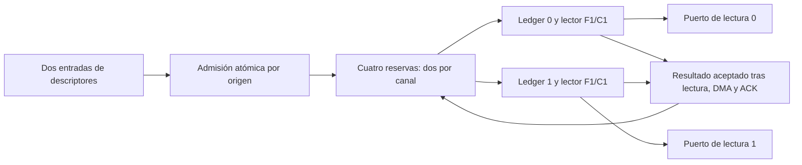

# Admisión compartida de lectura peer

## Estado y alcance — 2026-10-07, hora de Chile

**Validación funcional aprobada; timing, HBM nativa y PCIe pendientes para esta
composición.** Dos canales usan ahora el mismo origen lógico 0 y destino 1,
una lease fijada y cuatro reservas de metadatos. El perfil conserva el lector
F1/C1 de dos frames por canal, ocho créditos nativos y corte de retorno de dos
slots. No aumenta sus 16 KiB de payload ni incorpora reservas del escritor.

La [implementación física posterior](PEER_READ_SHARED_PHYSICAL.md) ya conserva
la síntesis revisada y el banco de puertos públicos validado contra RTL. Dos
tandas de ruteo de referencia y una de la candidata compacta agotaron sus
límites. La candidata pasó las mismas pruebas funcionales y redujo el área
sintetizada, pero sigue sin timing cerrado. No trasladar a este wrapper los
márgenes del perfil anterior.

El nuevo `ntrpu_peer_read_admission.sv` se compone en
`ntrpu_peer_read_shared.sv` con dos instancias del ledger existente. La
[referencia de dos orígenes](PEER_READ_NATIVE.md) conserva su evidencia propia;
sus márgenes físicos y su prueba nativa no califican este wrapper nuevo.



## Contrato de admisión y propiedad

- Aceptar como máximo un descriptor por ciclo; arbitraje round-robin entre
  entradas elegibles. La secuencia aumenta estrictamente **en el orden del
  handshake**, con un watermark común que no se reinicia al cambiar generaciones.
  El árbitro no ordena secuencias: si acepta 12 antes de 11, rechaza 11. El
  productor debe coordinar ese orden; falta un secuenciador de ingreso común.
- Comprobar identidad, handles, generaciones, permisos, límites, publicación,
  alineación, tamaño de 64–4096 bytes y ausencia de cruce de 4 KiB. Comparar el
  destino con las cuatro reservas, incluso las que aún esperan despacho.
  Un rechazo no consume reserva ni avanza el watermark.
- Fijar el canal al admitir. Son dos entradas por canal, sin reasignación dinámica
  ni préstamo entre canales. La selección por localidad y su correspondencia con
  las direcciones físicas siguen siendo responsabilidad externa, aún sin validar.
- Conservar descriptor y VALID ante contrapresión. Las reservas pendientes
  cuentan en `contexts_held`; `admission_pending` indica trabajo sin despachar.
  No confundir esos metadatos con frames disponibles para recibir payload.
- Liberar únicamente al aceptar un resultado satisfactorio del ledger con
  contexto completo y cantidad exacta de bytes. El ledger exige lectura local,
  completion DMA y ACK remoto. Un resultado ofrecido pero retenido por el
  consumidor sigue ocupando el destino. El guard confía en el ledger; no es un
  verificador autónomo de mensajes procedentes de PCIe.

## Revocación, configuración y fallos

Revocar cierra nuevas admisiones; las ya reservadas conservan autorización y
pueden terminar, incluso si esperaban despacho. Por eso el wrapper aplica la
revocación en la admisión, no en ambos ledgers después de reservar. No es una
revocación destructiva ni un protocolo de cancelación remota.

Una configuración requiere cero reservas y ausencia de halt; las generaciones
de ambos handles y de la ventana deben aumentar. Configuración y revocación
simultáneas mantienen la revocación. Una generación posterior puede reabrirla.

Parada, pérdida de enlace o fallo cierran el origen completo. Un resultado
fallido conserva su reserva; una supuesta corrección posterior no la libera.
Contexto desconocido, retirada prematura o recuento incorrecto también detienen
la admisión. Un éxito que el ledger ya había fijado puede retirarse durante la
parada. Trabajo aceptado aún sin despachar puede quedar retenido sin resultado:
no hay timeout, descarte automático ni recuperación en caliente.

## Evidencia de esta tanda

Vivado/XSim 2026.1, dos CPU por ejecución y prioridad baja. El banco integrado
usa relojes de 200 MHz y periodo de memoria 2,222 ns, convertidores AMD y CDC;
las respuestas AXI3 de memoria, DMA y ACK son estímulos del banco.

| Prueba | Resultado |
| --- | --- |
| `unit1`: guard aislado, 15 escenarios | 39 solicitudes, 20 reservas, 19 rechazos; pico de cuatro contextos |
| `full2`: composición, seis escenarios | 31 reservas; 27 éxitos y cuatro fallos con reserva retenida |
| Payload con éxito | 46.848 bytes, 27 completions DMA y 27 ACK |
| Payload total observado | 50.944 bytes; incluye 4.096 de una operación luego fallida por parada global |
| Auditor independiente | 353 muestras unitarias y 2.759 integradas; verifica propiedad y cada byte |
| Evidencia alterada | Ocho controles negativos unitarios y 15 integrados rechazados |
| RTL alterado deliberadamente | Cuatro mutantes detectados: replay, solapamiento cruzado, liberación tras fallo y revocación |

Se probaron duplicados simultáneos, reservas antes del despacho, progreso del
otro canal bajo pausa, agotamiento, reutilización, resultados retenidos,
revocación, cambio de generación, secuencia máxima, error tardío de memoria y
parada global con ambos canales activos. La auditoría vincula fuentes y
configuración de los tres IP de lectura al donante. No es equivalencia formal
ni una medición de ancho de banda sostenido.

`full1` conserva el fallo inicial de compilación del banco: una declaración
combinaba dos wires con una sola inicialización. Se separaron las declaraciones;
`full2` pasó en 62,148 s y 14,190001 µs simulados. El error no requirió modificar
el RTL de referencia.

| Resultado | SHA-256 |
| --- | --- |
| `unit1` | `c0b548405f84a5f06a8346eb272fc4ee83b93f9f30f02953fe26922be845b32b` |
| `full2` | `f00fc52977a8e6c24341f00bcb02080976edf13c56fe9031f2eea6dff37eeea0` |

Fuentes, resultados y revisiones están en
`D:/AI/artifacts/ntrpu-peer-shared/20261008T002644738883Z`.
Los siete respaldos por tanda usan manifiestos `peer-shared-<tanda>` en
`D:/AI/artifacts/ntrpu-content-store`; todos se restauraron y verificaron. Los
aprobados repitieron la auditoría desde la restauración. Conservar manifiestos
y objetos juntos. La entrega consolidada utiliza
`peer-shared-20261008T002644738883Z-handoff`.

## Reconstrucción aislada y siguiente aceptación

El donante `prepared` se conserva en la entrega nativa anterior. No usar los
adaptadores del árbol principal en su lugar: representan otra revisión.
Todas las salidas deben ser nuevas; ejecutar con Vivado 2026.1 inicializado.

```bash
python3 -B tools/prepare_ntrpu_peer_shared.py /ruta/donante/prepared /tmp/shared/repo
python3 -B /tmp/shared/repo/tools/run_ntrpu_peer_shared.py /tmp/shared/output --full
python3 -B /tmp/shared/repo/tools/check_ntrpu_peer_shared.py /tmp/shared/output
# Para el banco aislado, usar otra salida hermana de repo y omitir --full.
```

El auditor espera que la salida y `repo` sean carpetas hermanas. La entrega
incluye una copia preparada cuyos inputs RTL/TB/Tcl coinciden con `full2`.

El siguiente paso es sintetizar y rutear **esta composición**, comprobar
CDC/constraints/recursos, simular sus transacciones de netlist y repetir HBM
nativa. Después: secuenciador y localidad, gestor de regiones con exclusión de
escritores, multispan, rendimiento sostenido y endpoint PCIe. La admisión serial
y cuatro contextos pendientes de ACK son límites a medir antes de ampliar el
pool. P0/P1 y el diseño de placa siguen abiertos.

La [revisión de localidad HBM](PEER_HBM_LOCALITY.md) identifica que las
direcciones bajas del banco no reparten carga entre stacks, y propone las
pruebas de mapa y traducción necesarias antes de medir escalado del pool.
