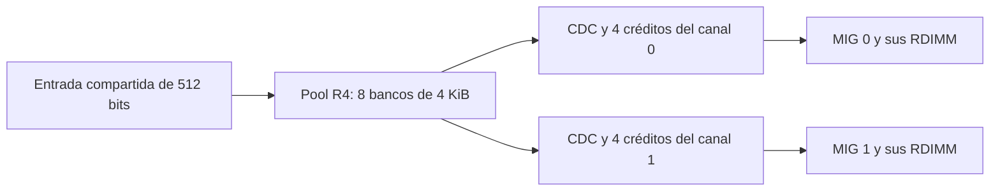

# Receptor multibuffer con dos controladores DDR4

## Alcance y política

Experimento lateral del 2026-10-04, continuación del
[primer canal MIG](PEER_RX_MULTIBUFFER_MIG.md). Se conecta el núcleo R4
existente a dos instancias del MIG generado por Vivado, cada una con su
propio reloj y dos modelos RDIMM. El RTL anterior permanece intacto.

La admisión es conjunta: ambos controladores deben estar calibrados y
fuera de reset. Una memoria lista por sí sola no habilita comandos.
Después de abrir la sesión, cualquier pérdida de disponibilidad cierra
la isla completa y exige reconfigurar antes de otra sesión. No hay modo
degradado ni recuperación en caliente en esta variante.

Esta decisión evita reiniciar sólo una parte del receptor compartido.
AMD requiere resets solapados en ambos extremos de sus interfaces AXI;
véase [PG059: Resets](https://docs.amd.com/r/en-US/pg059-axi-interconnect/Resets).
El supervisor coordina el reset AXI; los resets físicos de los MIG siguen
separados, conforme a [PG150: Reset Sequence](https://docs.amd.com/r/en-US/pg150-ultrascale-memory-ip/Reset-Sequence).

## Organización



Dos bancos están dedicados a cada canal y cuatro son reservas compartidas.
Cada destino tiene 16 descriptores, su propio orden de completions y
admite cuatro escrituras pendientes. Una parada ordinaria impide nuevos comandos y
permite vaciar el trabajo ya aceptado, sin cortar sus canales AXI.

`ntrpu_dual_mig_cold_start.sv` supervisa tres relojes mediante sondas de
ida y vuelta. Mantiene los resets durante 64 ciclos locales, verifica
origen limpio y ausencia de respuestas durante el arranque, y espera la
liberación de los tres dominios. `rearm` pertenece al dominio de gestión;
el bloqueo de una segunda sesión se fija en el mismo ciclo que entra en
`RUN`. Esas condiciones sólo son válidas para
una sesión fría sin tráfico anterior pendiente.

`ntrpu_dual_multibuffer_mig.sv` conserva los filtros de dirección de
64 bits antes de reducir a 37 bits por MIG. Cada dirección es local al
destino: no existe todavía una ventana BAR unificada.

La entrada de 512 bits a 200 MHz mantiene un techo bruto compartido de
12,8 GB/s. Dos memorias permiten solapar servicio; no duplican por sí
solas la capacidad de esa entrada. Aumentar el pool necesita justificar
la espera que se desea absorber, no sólo que quede BRAM disponible.

## Banco y revisión

El banco utiliza dos instancias del mismo IP en modo `BFM`, DDR4-1600,
CL12/CWL9, tRCD/tRP de 15 ns, ECC habilitado y ventanas exploratorias de
128 GiB por controlador. Sus referencias de 250 MHz son generadas por
separado, con un desfase de 731 ps. Ambos UI tienen periodo nominal de
5 ns; no se prueba deriva de frecuencia en esta simulación integrada.
El banco unitario del supervisor sí usa periodos UI distintos, 5 y 7,3 ns.

El segundo MIG sale de reset físico 6 µs después del primero. Las pruebas
ejercitan direcciones iguales con payloads distintos, fronteras de rank,
direcciones superiores a 4 GiB, ráfagas de 4 KiB y el final del rango.
Retienen B para saturar créditos y las ocho asignaciones de banco usando
marcos de 256 bytes; esto no equivale a llenar los 32 KiB con datos útiles.
La ráfaga de 4 KiB se comprueba por separado. Retienen W para comprobar avance del
otro canal, y completions para comprobar propiedad de los resultados.

`check_ntrpu_dual_mig.py` reconstruye payloads, orden y destino a partir
de las trazas y compara lecturas con las escrituras confirmadas. Separa
las observaciones periódicas por controlador. Los avisos del modelo,
que no incluyen identidad de instancia, se asignan únicamente cuando
su tiempo coincide con un único candidato READ físico; después se exige
la cadena causal completa y que no queden avisos sin explicación.

El supervisor pasó 13 casos unitarios: sano, pérdida de calibración o reset
UI de cada memoria, pérdida de cada uno de los tres relojes, reset externo,
origen ocupado y respuestas B/R pendientes durante arranque. El caso 13
usa un periodo de origen artificial de 1 ns y reset externo inmediatamente
después de abrir la admisión; no es una reivindicación de frecuencia física.
Un control negativo que retrasa un ciclo el bloqueo de rearme falla en ese
caso, mientras el diseño con bloqueo simultáneo pasa.

## Resultado integrado

La tanda `20261005T001200812381Z-dual-mig` tiene estado
`DUAL_MIG_COLD_FUNCTIONAL_PASS_NOT_BOARD_ADOPTED`. El revisor independiente
reconstruyó los datos y la actividad física observada de ambos modelos:

| Comprobación | Resultado |
| --- | --- |
| Comandos / completions | 56 / 56; 55 escrituras y un rechazo local por rango |
| Escritura al MIG | 143 + 151 beats; 18.816 bytes |
| Lectura comparada | 274 + 286 beats; 35.840 bytes, sobre 142 + 150 direcciones |
| Créditos simultáneos | Cuatro AW pendientes de B por canal |
| Independencia | Canal 1 completa y devuelve datos mientras W del canal 0 está detenido |
| Pool | Ocho bancos asignados y retenidos; incluye las cuatro reservas compartidas |
| Parada y propiedad | B retenida, parada durante llenado y tras AW, completions retenidas; 11 vaciados |
| Barrera de arranque | 1.200 ciclos del origen con sólo una memoria lista y sin admisión |
| Lecturas periódicas | 20 ciclos completos en MIG 0 y 13 en MIG 1; todos drenados |
| Controles del revisor | 17 corrupciones de bytes, protocolo, flancos y evidencia rechazadas |

Los UI mantuvieron períodos de 5 ns y fases de 998 y 1.729 ps. El banco
cubrió 102,968498 µs simulados. La tanda completa consumió 694,046 s
(11,57 min), limitada a CPU 26–27, `nice=10` y dos hilos Vivado. Son
pruebas con pausas deliberadas, no medidas de ancho de banda sostenido.

Se explicaron 720 avisos de lectura sin inicializar del MIG 0: cinco
ráfagas periódicas BL8, con 18 avisos por beat, anteriores a inicializar
ese bloque. Se comprobó su dirección, instante, retorno y aislamiento
respecto del canal de usuario. El MIG 1 no emitió estos avisos. Ningún
aviso del modelo se suprime ni se acepta sin cadena causal completa.

La auditoría conserva 25 avisos de herramienta: 15 con identificador y
diez del modelo FIFO. Incluyen cuatro instancias de assertions internas
de calibración no soportadas por XSIM y los avisos de índices del código
generado. No hubo errores ni `CRITICAL WARNING`. Se comprobaron los
35 archivos del modelo: sólo cambian las tres definiciones previstas en
su wrapper. Los 31 archivos previos vigilados, incluido `AGENTS.md`,
permanecen intactos.

Las salidas descargadas tienen SHA-256
`33df1aab46b57c9b826fedc8c85685d1576ef2c1985604f2fb1493639eec0fea`.
`REVIEW.json` y `SUPPLEMENTAL_REVIEW.json` conservan la revisión y la
auditoría. El respaldo `20261004-dual-mig-handoff.zip`, en
`D:\AI\artifacts\ntrpu-dual-mig`, reúne fuentes, ejemplo original,
diagnósticos y todos los intentos con sus hashes. Los runners acumularon
3.720,502 s (62,01 min), incluidos los intentos fallidos y el unitario;
esta suma no representa la facturación total de la VM ni incluye las
transferencias y diagnósticos auxiliares.

## Reproducción y límites

En una copia aislada, con Vivado 2026.1 disponible:

```bash
python3 -B tools/run_ntrpu_dual_mig.py /ruta/nueva/salida \
  --example /ruta/ejemplo/ntrpu_ddr_geometry_ex --timeout 1800
python3 -B tools/check_ntrpu_dual_mig.py /ruta/tanda-descargada
```

El segundo comando espera `inputs/` y `output/` en la tanda descargada y
crea un `REVIEW.json` nuevo. Los scripts de transferencia y los respaldos
se conservan en `D:\AI\artifacts\ntrpu-dual-mig`.

La elaboración se prolongó incluso reduciendo tablas y desactivando
optimización. Una prueba aislada, con sustitutos usados sólo para compilar,
comparó dos formas equivalentes de esperar un reloj: `@(negedge ui_clk[ch])`
superó 60 s; seleccionar explícitamente `ui_clk[0]` o `ui_clk[1]` elaboró
en 3,215 s. Otro diagnóstico mínimo encontró que las esperas llamadas
desde tareas auxiliares anidadas no avanzaban el tiempo en XSIM. Las
variantes con esperas directamente en la tarea de lectura y con una
tarea fija por canal sí pasaron ambos relojes, empezando fuera de un
flanco. El banco adopta tareas por canal, optimización normal y trazas
AR/R emitidas desde los handshakes observados. El revisor exige que cada
AW/W/B/AR/R coincida con el flanco del UI de su destino.
Los sustitutos del diagnóstico no forman parte de la simulación DDR4.
Se conservan también los intentos de configuración: Vivado 2026.1 acepta
`--O0`, según su ayuda, y rechaza la sintaxis antigua `-O 0`.
No se desactivan comprobaciones de tiempos ni se modifican los modelos.
El período UI se comprueba desde calibración completa y salida de reset;
los transitorios de arranque del MMCM no se tratan como reloj operativo.

La [implementación física lateral](PEER_RX_DUAL_PHYSICAL.md) completó
síntesis, colocación, ruteo y revisión estructural CDC, con tiempos
internos positivos y un aviso de reset externo abierto. Su regresión
con MIG encontró un bloqueo de arranque (`memory_held_m=X`); el resultado
RTL de este documento no equivale a una calificación posterior al ruteo.
Los modelos FIFO omiten latencia de sincronización
y XSIM tiene limitaciones en assertions internas de calibración. Las
pruebas de pérdida de reloj y reset son unitarias: no acreditan
recuperación del MIG con transferencias pendientes. Tampoco se acredita
capacidad completa, pinout de dos controladores en placa, HBM, PCIe/P2P
ni escalado a 512 GiB.

El siguiente paso es reproducir y resolver ese bloqueo de arranque y
cerrar la regresión del núcleo ruteado. Después corresponde medir caudal y ocupación
bajo contención para decidir si aumentar reservas o ensanchar/replicar
la entrada compartida aporta una mejora real.
