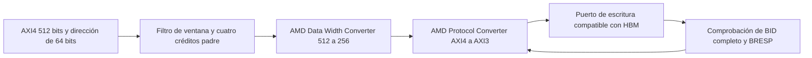

# Adaptador de escritura hacia una interfaz HBM

## Resultado y alcance

Continuación aislada del [barrido de fronteras](PEER_RX_RETURN_BOUNDARY.md).
El adaptador convierte AXI4 de 512 bits a escrituras AXI3 de 256 bits con
IP AMD real en XSIM 2026.1. Estado: `HBM_ADAPTER_FUNCTIONAL_PASS`.
El destino HBM es conductual; no se instancia su controlador endurecido,
no se introduce CDC ni se modifica el transporte validado o la cola de placa.

## Composición



`ntrpu_hbm_write_adapter.sv` reutiliza sin cambios
`ntrpu_axi_write_capacity_queue.sv` y `ntrpu_rv_elastic.sv`. La ventana
experimental es **[0, 16 GiB)**, con dirección HBM de 34 bits. No representa
memoria instalada ni traduce direcciones PCIe. Se comprueba el intervalo
completo de 64 bits antes de reducir el ancho.

El filtro admite ID cero, INCR, dirección alineada a 64 B, AWSIZE=6 y
ráfagas que no cruzan 4 KiB. Rechaza exclusivas, otros IDs, tamaños o ráfagas,
desalineación, cruce de página y direcciones fuera de ventana. Un rechazo
consume los datos y devuelve DECERR con el ID original, sin emitir AW/W
al destino. Se permiten strobes parciales, incluida una mitad vacía.

La IP `axi_dwidth_converter:2.1` usa `MAX_SPLIT_BEATS=16`, configuración
confirmada en la instalación 2026.1 y en los archivos generados. Produce
ocho fragmentos para 4 KiB. La IP `axi_protocol_converter:2.1` mantiene
`TRANSLATION_MODE=2`, modo protegido; recibe fragmentos que ya caben en AXI3.
Esto evita depender de su división de ráfagas largas, que reduce la
concurrencia. AMD documenta ambas conversiones en
[AXI Downsizer](https://docs.amd.com/r/en-US/pg059-axi-interconnect/AXI-Downsizer)
y [AXI4-to-AXI3 Converter](https://docs.amd.com/r/en-US/pg059-axi-interconnect/AXI4-to-AXI3-Converter).

Para tamaños no múltiplos de 512 B, esta IP emite primero el fragmento
corto: 576 B se observan como 64+512 B; 1.088 B, como 64+512+512 B.
El contrato exige cobertura contigua exacta y un máximo de 16 beats por
fragmento, sin imponer dónde aparece el fragmento corto.

## Créditos, errores y cierre

Cuatro descriptores padre incluyen respuestas retenidas hasta su handshake
aguas arriba. Los hijos conservan orden e ID cero. La B padre aparece
después de todas las B hijas; la prueba confirma prioridad
**DECERR > SLVERR > OKAY**, también con errores en orden inverso y en el
primer o último fragmento. El caso de 4 KiB con B demorada alcanzó cuatro
padres y **31 hijos pendientes simultáneamente**, frente al límite de
32 escrituras por puerto documentado en
[PG276: AXI Port Details](https://docs.amd.com/r/en-US/pg276-axi-hbm/AXI-Port-Details).

Se examinan los **seis bits de BID** antes del conversor de cuatro bits.
BID distinto de cero o EXOKAY enclavan `fault`, impiden nuevas admisiones
y dejan esa respuesta sin aceptar. Las operaciones comprometidas conservan
su estado; no se fabrica una completion para vaciarlas. No se cubren
respuestas duplicadas con BID cero ni recuperación en caliente.

`admit` controla solamente AW nuevas en esta frontera. Las aceptadas
conservan AW/W/B hasta terminar. Al integrarlo, no conectar directamente
`stop` del transporte a `admit`: el transporte puede tener descriptores
comprometidos cuya AW aún deba cruzar el adaptador. El cierre conjunto
necesita el inventario de esa frontera y el coordinador de placa.
Reset presupone una época fría coordinada; no debe propagarse como un
reset operativo del controlador HBM.

## Evidencia

La tanda `20261006T200350276380Z-sim` terminó en **41,090 s**:

- Once escenarios, 93 solicitudes padre y 284 fragmentos.
- 91 respuestas padre y 282 respuestas hijas; las dos operaciones restantes
  quedan deliberadamente retenidas por BID ajeno y EXOKAY.
- Diez rechazos locales y un sucesor válido comprobado después de ellos.
- 126.144 bytes de bus y 101.774 bytes habilitados por strobes comprobados;
  incluyen datos de las dos operaciones sin completion.
- Saturación de cuatro padres, B padre retenida, AW/W pausadas de forma
  independiente, dos beats W anteriores a AW y cierre/reapertura tras drenaje.
- Nueve corrupciones de trazas rechazadas por el verificador independiente.
- Tres mutaciones RTL aisladas detectadas: borrar la mitad alta de WSTRB,
  truncar la dirección antes de validarla y comprobar solo cuatro bits de
  BID. Las dos primeras son rechazadas por reproducción de trazas; la
  tercera dispara la aserción de cuarentena. La variante correcta no cambia.

La revisión aceptada está en `review-r2/REVIEW.json`. Se conservan dos
diagnósticos previos: la primera aserción IDLE mezclaba inventario anterior
al flanco con contadores posteriores; el primer revisor suponía que el
fragmento corto aparecía al final. Se corrigieron esas comprobaciones,
preservando la exigencia de inventario y cobertura completa de bytes.

## Reproducción y siguiente integración

Con Vivado 2026.1 cargado y una salida nueva:

```bash
python3 -B tools/run_ntrpu_hbm_adapter.py /tanda/output --stage sim --timeout 900
python3 -B tools/check_ntrpu_hbm_adapter.py /tanda/output --review /tanda/REVIEW.json
```

La ejecución usa dos CPU, prioridad baja, fuentes congeladas y manifiestos
SHA-256. Evidencia local:
`C:\Users\xasko\artifacts\ntrpu-hbm-adapter\20261006T195511902879Z`.
Los resultados se respaldan por contenido en
`D:\AI\artifacts\ntrpu-content-store`, sin conservar ZIP de transferencia.

Al cerrar esta etapa quedaban composición con el transporte, recursos/STA y CDC,
validación en el FPGA HBM seleccionado, autorización del mapa real y
lecturas/prefetch. El reloj de 5 ns usado por este banco es un estímulo
funcional: **no acredita cierre temporal de la nueva composición**.

La [tanda posterior de composición](PEER_RX_HBM_TRANSPORT.md) conecta dos
adaptadores al transporte, pasa 17 escenarios y mide síntesis. También
elabora por separado un enlace con la IP HBM nativa; CDC, inicialización
y validación de la cadena completa continúan pendientes.
