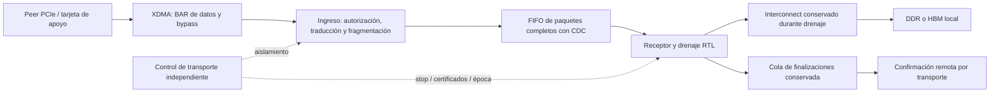

# Adaptación del receptor a PCIe, memoria y supervisor

Diseño de interfaces del 2026-10-04 UTC. El [receptor](PEER_RX_GUARD.md)
está implementado aisladamente; los adaptadores de este documento siguen
pendientes de RTL y validación conjunta. No se modifican el endpoint, la
FFN supervisada ni la cola del principal.

## Ruta propuesta

Los bloques de ingreso, CDC, control y confirmación remota son contratos de
integración; el diagrama no acredita su existencia. HBM continúa siendo
memoria local de cada FPGA. El espacio lógico conjunto debe traducir destino,
ventana y offset; ampliar un BAR no aumenta la velocidad del enlace entre tarjetas.

## Qué salida de XDMA utilizar

La configuración consultada de V4 usa DMA AXI-MM y AXI-Lite; su exportación
`20261002T091826Z-V4-pcie-r2/output/configured_properties.rpt` registra
`CONFIG.axist_bypass_en=false`. El script actual `ntrpu_board_pcie_probe.tcl`
tampoco solicita habilitarlo. Las pruebas H2C/C2H de la FFN no demuestran
por sí mismas escrituras P2P a un BAR de memoria. Revisar la XCI exacta de la
variante nueva antes de conectar el receptor; no extrapolar ese reporte
histórico a una generación posterior.

La ruta candidata es el master bypass `m_axib_*` para accesos recibidos por
el BAR correspondiente. AMD distingue esa interfaz del motor H2C y documenta
AWADDR, AWID, AWLEN, AWSIZE y AWBURST propios.
[PG195, señales AW del bypass](https://docs.amd.com/r/en-US/pg195-pcie-dma/AXI4-Memory-Mapped-Master-Bypass-Write-Address-Interface-Signals).

Preservar BAR0 de CSR/ABI2 y BAR1 usado para MSI-X en la variante existente.
El índice y tamaño del nuevo BAR deben verificarse en la configuración
generada: habilitar opciones y combinar BAR de 32/64 bits cambia su reparto.
No fijar BAR2 como hecho antes de esa comprobación.
[PG195, Target Bridge](https://docs.amd.com/r/en-US/pg195-pcie-dma/Target-Bridge).

## Contrato del adaptador de ingreso

| Entrada o contexto | Transformación / obligación |
| --- | --- |
| AWADDR y ventana activa | Validar rango, permiso y overflow; producir `cmd_addr` físico local de 64 bits |
| AWLEN/AWSIZE/AWBURST | Emitir spans INCR de beats completos de 64 bytes, sin cruzar 4 KiB ni superar `MAX_BEATS` |
| WDATA/WSTRB/WLAST | Comprobar longitud y strobes antes de exponer una ráfaga a memoria; no rellenar bytes no autorizados |
| AWID | Guardarlo para la respuesta al master de ingreso; el ID 0 del receptor es de otro tramo AXI |
| Descriptor de trabajo | Proveer `cmd_epoch` y `cmd_tag` desde un contexto autorizado, con deduplicación externa |
| Finalización | Agregar spans del trabajo y publicar éxito remoto solo tras todos los B finales correctos |
| Parada | Cerrar nuevas admisiones y resolver/discartar de forma controlada lo aceptado que aún no salió a memoria |

Los MemWr normales no transportan el tag/época NTRPU: el adaptador no puede
inventar una identidad a partir de AWID. Debe reservarse previamente la
ventana para un trabajo o establecerse un protocolo explícito de descriptores.
Un acceso antiguo a la misma dirección sigue siendo indistinguible después
de reutilizarla; por eso el drenaje y aislamiento son requisitos independientes.

El perfil inicial puede rechazar escrituras parciales/no alineadas; su
adaptador debe consumir/resolver correctamente el tramo AXI de ingreso y
registrar el error sin dejar una ráfaga a medias. Un B de error en el destino
no se convierte automáticamente en una notificación PCIe al autor de un
MemWr publicado. Hace falta un canal de estado/finalización propio.

Los CDC deben transferir descriptor y payload como una unidad confirmada.
Una reserva o paquete parcialmente llenado antes de reset no puede aparecer
como completo en la época nueva. La sincronización de ACK+época requiere
un handshake de bus estable, no sincronizadores independientes por bit.

## Separación respecto del supervisor de aplicación

`ntrpu_reset_supervisor.sv` afirma resets al detectar pérdida de reloj o de
disponibilidad. `ntrpu_ffn_supervised_fabric.sv` aplica esos resets y cierra
sus fronteras. Ese contrato es de reset coordinado de una isla de aplicación;
**no equivale a terminar escrituras externas ya publicadas**.

Mantener receptor, buffer, cola de finalizaciones y camino hasta memoria en
un dominio de transporte cuyo reloj/reset permita drenar aunque caiga la
aplicación. No conectar `guard.rst_n = device_reset_n`, ni recortar sus AWVALID,
WVALID o BREADY con `device_admit`. El reset de aplicación puede actuar sobre
la FFN; los árbitros y pares compartidos con el receptor necesitan aislamiento
independiente y conservar sus transacciones pendientes.

| Señal del receptor | Fuente requerida; equivalencias prohibidas |
| --- | --- |
| `stop` | Petición registrada en su reloj; la pérdida de enlace debe cerrar también el ingreso externo |
| `source_stopped` | Confirmación agregada de emisores detenidos para la época; no usar `!host_admit` |
| `ingress_isolated` | Confirmación de buffers/puente aislados y paquetes parciales resueltos; no usar `peers_held` |
| `quiesce_epoch` | Época asociada a ambos certificados, transferida coherentemente |
| `cpl_ready` | Espacio real en una cola que sobrevive al fallo de aplicación, o consumidor activo |
| `rearm_valid/epoch` | Decisión del gestor de transporte tras drenaje; distinta del rearme de aplicación |

Si desaparece también el reloj de transporte o la memoria no responde, no
hay prueba de drenaje: mantener cuarentena y las regiones inválidas. La
alternativa es un reset global coordinado con revocación física demostrada,
no una liberación por timeout. El receptor solo implementa reset síncrono
de arranque/coordinado; no resuelve por sí solo esa recuperación global.

## Ancho de banda: siguiente cambio necesario

El buffer actual alterna llenado y envío. Con N beats necesita al menos
`2*N` ciclos para los datos, además de control y B. A un reloj objetivo de
200 MHz, su techo analítico es **menor de 6,4 GB/s**, aunque el bus AXI de
512 bits permita 12,8 GB/s. Son límites calculados, no mediciones físicas.
La variante de 4 KiB reduce costes por ráfaga; no elimina esa serialización.

Para avanzar hacia el caudal PCIe previsto se necesita doble buffer o varias
colas que solapen llenado/envío y suficientes transacciones pendientes. Un
bus de 512 bits a 250 MHz ofrece 16 GB/s brutos; es un objetivo de diseño que
exigirá nueva síntesis, CDC y cierre de timing. Mantener contabilidad por
ventana, trabajo y respuesta al aumentar concurrencia. El paralelismo hacia
canales DDR/HBM no debe compartir un único buffer que serialice todo.

La [propuesta de múltiples buffers](PEER_RX_MULTIBUFFER.md) concreta cuatro
bancos de 4 KiB, organizables como dos pares, y seguimiento separado de
escrituras pendientes. Incluye comparación con doble y triple buffer,
criterios de drenaje y ensayos de tráfico desigual. Sigue pendiente de
implementación y medición.

## Criterios antes de conectar la variante

1. Generar una XCI aislada con bypass, BAR/ABI2/MSI-X verificados y anchos reales
   exportados. Probar MemWr al BAR elegido en el banco PIPE; no contar un H2C
   iniciado por descriptores como sustituto.
2. Probar traducción sobre 4 GiB, límites de ventana, strobes parciales, IDs,
   buffers llenos, distintos MPS y llegada AW/W en ambos órdenes.
3. Introducir stop antes/después de AW, durante W y antes de B; retirar un
   error temprano y comprobar escrituras tardías sin reasignación de ventana.
4. Interrumpir enlace y reloj de aplicación mientras el dominio de transporte
   conserva su reloj. Verificar ACK de aislamiento reales, no constantes.
5. Agregar doble buffer y medir bytes útiles/ciclo, latencia de B, pausas y
   ocupación; después, calificar la ruta con DDR/HBM y dos endpoints físicos.

La [síntesis aislada](PEER_RX_SYNTHESIS.md) mide coste lógico de la referencia.
Estos criterios permanecen fuera de las tandas activas del principal.
