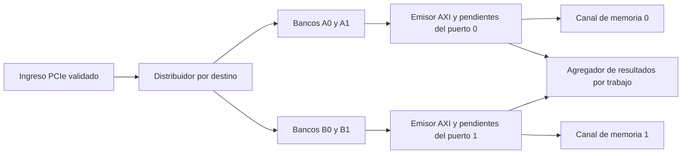

# Propuesta de múltiples buffers para el receptor NTRPU

Propuesta del 2026-10-04. **Candidato inicial: cuatro bancos de 4 KiB,
organizables como dos pares de doble buffer**, con seguimiento separado de
las escrituras pendientes. Comparar doble, triple y cuatro bancos antes de
elegir la organización final. Ya existen un
[asignador aislado](PEER_RX_BUFFER_ALLOCATOR.md) y un
[prototipo RTL con RAM, colas y seguimiento AXI](PEER_RX_MULTIBUFFER_RTL.md)
validados por simulación. Falta la integración con el contrato completo de
transporte. La [síntesis multibuffer](PEER_RX_MULTIBUFFER_SYNTHESIS.md) ya mide
las reservas cuatro/ocho: la segunda incumple setup estimado a 200 MHz.
La [variante compacta](PEER_RX_MULTIBUFFER_COMPACT.md) reduce BRAM y LUT y
alcanza setup interno estimado a 200 MHz en ambos perfiles, en módulos
independientes todavía pendientes de validación física e integración.
El [primer estudio de planificación](PEER_RX_MULTIBUFFER_STUDY.md)
compara 199 escenarios con supuestos ideales; las validaciones del
[receptor actual](PEER_RX_GUARD.md) y su
[síntesis](PEER_RX_SYNTHESIS.md) corresponden exclusivamente a un banco.

Extensión candidata: dos bancos por canal y una reserva común inicial de
cuatro bancos. Es una variante para comparar; cuatro bancos totales no
constituyen un límite arquitectónico.

## Problema y variantes

El receptor actual termina de llenar su buffer antes de enviarlo y espera
B/finalización para admitir otro trabajo. Además, el
[árbitro existente](../../fpga/rtl/ntrpu_axi_arbiter.sv) conserva una sola
escritura pendiente hacia su destino. Ambos puntos limitan el solapamiento.

| Organización | Capacidad con bancos de 4 KiB | Objetivo de la comparación |
| --- | ---: | --- |
| Doble buffer | 8 KiB | Llenar un banco mientras se transmite el otro |
| Triple buffer | 12 KiB | Añadir un bloque listo y absorber pausas breves |
| Cuatro bancos compartidos | 16 KiB | Absorber más variación en una ruta de salida |
| Dos pares de doble buffer | 16 KiB | Mantener colas separadas para dos canales de memoria |

Cuatro bancos con una salida comparten su ancho de banda. Dos pares con
salidas independientes permiten trabajo simultáneo hacia dos destinos,
sujeto al límite del ingreso PCIe y de cualquier recurso compartido.
Una partición fija 2+2 puede desperdiciar capacidad cuando todo el tráfico
va a un destino; medir ese caso antes de añadir préstamo dinámico de bancos.

## Configuración candidata

Estos nombres describen parámetros futuros, no opciones del RTL existente.

| Parámetro propuesto | Punto de partida | Variantes de prueba |
| --- | --- | --- |
| `BANK_COUNT` | 4 para la referencia compartida | 1 de control; 2/3/4/8/16/32 compartidos; híbrido `2*C+S` |
| `BANK_BYTES` | 4096 | Payloads efectivos de 256, 512, 1024 y 4096 bytes |
| `PORT_COUNT` | 1 para aislar el efecto del buffering | 2 para comparar canales independientes |
| `RESERVE_BANK_COUNT` | 4 en la variante híbrida | `S=0/4/8/16/32`, con `C` canales fijo |
| `MAX_OUTSTANDING_PER_PORT` | 4 escrituras pendientes | 1, 4 y 8; independiente del número de bancos |
| Bus interno | 512 bits, direcciones de 64 bits | Conversión específica hacia el controlador elegido |
| Reloj objetivo | 200 MHz, referencia de 5 ns | 250 MHz como estudio posterior de timing |

Los 16 KiB de la referencia de cuatro bancos son almacenamiento útil de
payload; metadatos, colas y adaptación de memoria tienen coste adicional.
La primera variante comparte el reloj
del receptor. Los cruces PCIe/memoria mantienen el
[contrato de integración](PEER_RX_INTEGRATION.md).

El diagrama representa la variante futura de dos puertos. Para sostener
ambas salidas, el almacenamiento debe permitir dos lecturas simultáneas,
por ejemplo mediante bancos físicos independientes por par. Una memoria
con un puerto de lectura compartido seguiría serializando esas salidas.
Costear LUTRAM/BRAM por ancho, profundidad y puertos; incluir la latencia de
lectura y los registros necesarios para mantener WDATA estable bajo pausa.

## Pares por canal y reserva compartida

Para `C` canales de salida y `S` bancos de reserva, proponer
`BANK_COUNT = 2*C + S`. Cada canal conserva dos bancos propios para
solapar llenado y envío. La reserva absorbe exceso transitorio y se presta
al admitir nuevos trabajos; no requiere copiar payload ya almacenado.
Un canal aquí es una ruta de servicio, no necesariamente un canal físico
HBM ni un enlace PCIe independiente.

| Canales | Bancos propios + reserva | Payload total, bancos de 4 KiB |
| --- | --- | ---: |
| 2 | 4 + 4 | 32 KiB |
| 4 | 8 + 4 | 48 KiB |
| 8 | 16 + 4 | 80 KiB |

Mantener colas de descriptores por destino: un canal detenido no debe
inmovilizar trabajos elegibles de otro detrás de una FIFO global. El
asignador debe conservar propietario, época y estado de cada banco,
garantizar asignación única y aplicar cuotas de préstamo configurables.
Comparar reparto justo bajo contención con préstamo de toda la reserva
a un solo canal activo; los préstamos ocupados no pueden revocarse.
Los bancos propios garantizan capacidad mínima, pero no garantizan
progreso si el ingreso o un puerto compartido están bloqueados.

Reservar banco y créditos de transacción/finalización antes de aceptar
payload. Devolver el banco prestado solo al cumplir las mismas reglas de
vida del payload que un banco propio. Ante agotamiento, cerrar admisión
mediante el contrato de créditos/backpressure; nunca descartar trabajos
ya aceptados. La adaptación PCIe debe cubrir además datos comprometidos
que sigan llegando tras ordenar la pausa.

Compartir la asignación no obliga a compartir un único puerto de RAM.
Implementar la reserva con suficientes bancos físicos, selección y
arbitraje para el paralelismo exigido, o medir explícitamente su límite
de servicio. Un pool con una lectura por ciclo puede serializar varios
canales que estén consumiendo reserva. El esquema no necesita un BAR
por buffer: la asignación interna se mantiene separada de las ventanas
de transporte ya definidas.

## Vida del banco y de la transacción

Separar explícitamente tres recursos:

1. **Banco de datos:** `FREE → FILL → READY → SEND → FREE`. Reservarlo antes
   de aceptar payload y validar la ráfaga completa antes de exponerla a AXI.
2. **Registro de transacción:** conservar puerto, dirección, longitud,
   época, tag, ventana/generación y progreso AW/W/B. Reservarlo antes de
   afirmar cualquier VALID; una petición expuesta sin handshake ya impide
   un descarte unilateral.
3. **Referencia de ventana y resultado:** retenerla hasta completar el
   contrato del trabajo, incluso si el banco de datos ya está libre.

La reutilización temprana del banco se habilita **solo después de aceptar
todos sus beats W** y de comprobar que ningún registro de salida sigue
dependiendo de su contenido. Si AW sigue pendiente, su dirección y VALID
permanecen en el registro de transacción. El banco deja de ser una copia
para reintentos; no hay retransmisión automática desde almacenamiento reutilizado.

El B final libera la entrada AXI pendiente, pero el resultado y la referencia
de ventana pueden seguir vivos hasta RETIRE. Un error deja inválido el
destino y mantiene la retención exigida por recuperación. Liberar datos,
consumir B y reasignar una ventana son eventos distintos.

Reservar también capacidad de finalización al admitir un trabajo. Una pausa
del consumidor debe cerrar nuevas admisiones conservando espacio para los
resultados ya comprometidos, sin crear dependencia circular entre B y una
cola llena.

## Orden y drenaje

Comenzar con un ID AXI fijo por puerto y cola de respuestas en orden hacia
un destino definido. Varias transacciones pueden estar pendientes sin usar
un ID diferente para cada banco. AXI4 exige enviar los datos W en el orden
de sus direcciones AW; las ráfagas no se intercalan beat a beat.
[Arm, reglas de orden de escritura](https://developer.arm.com/-/media/Arm%20Developer%20Community/PDF/Learn%20the%20Architecture/102202_0100_01_Introduction_to_AMBA_AXI.pdf).

El arbitraje debe permitir lanzar una ráfaga posterior mientras se espera
el B de una anterior. Verificar límites de aceptación/emisión en todo el
camino: AMD cuenta una escritura completada al consumir su respuesta B y
advierte que los buffers intermedios tienen capacidad adicional propia.
[PG059, límites de transacciones](https://docs.amd.com/r/en-US/pg059-axi-interconnect/Transaction-Acceptance-and-Issuing-Limits).

Ante stop o fallo, cerrar nuevas admisiones y descartar únicamente bancos
que nunca expusieron AXI. Mantener cada AW/W expuesto hasta aceptación y
consumir sus B, aunque ya se haya retirado una finalización de error. El
rearme exige drenaje de **todos los puertos**, resultados consumidos,
certificados de aislamiento/parada para la época actual y una época nueva.
Un BID inesperado no descarga otra transacción. Un destino sin respuesta
mantiene cuarentena; la pérdida de reloj de aplicación no debe resetear
los bancos o registros necesarios para terminar el transporte.

El agregador solo publica SUCCESS/FENCE cuando todas las escrituras
anteriores incluidas han cumplido sus condiciones, aunque sus B lleguen
en distinto orden entre puertos. La extensión a varios IDs requiere después
una tabla de correspondencia y pruebas explícitas de respuestas fuera de orden.

## Caudal y adaptación de memoria

Un bus de 512 bits ofrece techos calculados de 12,8 GB/s a 200 MHz y
16 GB/s a 250 MHz, antes de pausas y protocolo. El banco actual alterna
llenado/envío y su techo a 200 MHz es inferior a 6,4 GB/s. Los múltiples
bancos buscan acercarse al límite del bus; el número óptimo dependerá de
las latencias y pausas medidas. Ninguna de estas cifras es un resultado
experimental de la propuesta.

Separar tamaño de banco, tamaño de ráfaga y MPS: disponer de 4 KiB no autoriza
un TLP de ese tamaño ni omitir fronteras de 4 KiB. Para HBM UltraScale+, el
controlador documentado requiere transferencias de 32 bytes en su interfaz
de 256 bits. Adaptar ancho, protocolo, límites de ráfaga y respuestas antes
de conservar el significado de B como confirmación final.
[PG276, consideraciones AXI](https://docs.amd.com/r/en-US/pg276-axi-hbm/AXI-Considerations).

## Coste y dimensionamiento de la reserva

Los bancos consumen memoria interna, lógica de control, registros y
recursos de interconexión; también afectan consumo y timing. No hay un
precio monetario fijo por buffer dentro de una FPGA ya elegida. Agotar
RAM puede obligar a reducir otras cachés o cambiar de dispositivo.

La síntesis existente del receptor completo con un banco de 4 KiB usa
1320 LUT, de las cuales 586 son LUT de memoria, y 327 FF; no usa BRAM.
No multiplicar el total por el número de bancos: parte del control se
comparte y la implementación de memoria puede cambiar. La
[medición multibuffer posterior](PEER_RX_MULTIBUFFER_SYNTHESIS.md) informa
6883/9314 LUT, 9408/9691 FF y 60/90 tiles BRAM para reserva cuatro/ocho
con dos destinos; ese prototipo todavía no incorpora el contrato completo
del receptor. Su geometría de RAM y el timing del asignador deben mejorar
antes de ampliar mucho el pool.

Como estimación geométrica, ocho RAMB36 configuradas con 64 bits útiles
por palabra y profundidad 512 permiten un pool de 32 KiB y bus de 512 bits,
con una lectura y una escritura por ciclo. No es el coste sintetizado
del receptor ni ofrece múltiples lecturas independientes. Separar puertos
y bancos pequeños puede aumentar memoria física desaprovechada. Pasar
del array actual a BRAM exige adaptar la lectura síncrona y su pipeline.
[UG573, geometría y puertos BRAM](https://docs.amd.com/r/en-US/ug573-ultrascale-memory-resources/Block-RAM-Summary).

Dimensionar el espacio libre por la acumulación durante una pausa:
`reserva_bytes >= max(0, R_entrada - R_salida) * pausa`, para tasas
constantes en ese intervalo. Añadir margen para redondeo a bancos,
ráfagas ya comprometidas y reacción de los créditos. Con entrada ideal
de 12,8 GB/s (512 bits a 200 MHz), salida totalmente detenida y reserva
inicialmente vacía, cuatro bancos de 4 KiB cubren como máximo 1,28 us;
32 bancos cubren 10,24 us. Son cálculos de capacidad, no latencias medidas.

Medir por separado cuánto permanece ocupado el payload y cuánto tarda B:
si los datos ya fueron aceptados, una respuesta lenta puede requerir
más entradas de seguimiento sin necesitar más bancos de payload. Ninguna
reserva finita corrige una entrada sostenidamente mayor que la salida.
Elegir profundidad con ocupación máxima, pausas objetivo, caudal, recursos
y timing; ampliar mientras aporte una mejora útil y conservar presupuesto
para cómputo y cachés. El máximo práctico queda pendiente del diseño
integrado y de las mediciones.

## Plan de comparación y criterios de aceptación

| Dimensión | Casos requeridos |
| --- | --- |
| Bancos y concurrencia | 1/2/3/4/8/16/32 bancos compartidos; 1/4/8 escrituras pendientes por puerto; después híbrido `2*C+S` con `S=0/4/8/16/32` |
| Topología | Una salida; dos pares separados con destinos independientes; dos rutas que comparten cuello; pares por canal con reserva común |
| Tráfico | Tamaños mezclados; reparto 50/50, 90/10 y 100/0 entre destinos |
| Pausas | AW y W independientes; B demorado/irregular; consumidor de resultados detenido |
| Fallos | Stop en cada estado, error B, BID ajeno, escritura tardía y rearme prematuro |
| Integridad | Comparación byte a byte, ninguna pérdida/duplicación, wraparound de índices con tres bancos |
| Reserva | Canal detenido que retiene préstamos; varios canales pidiendo a la vez; agotamiento y devolución; cuotas, reparto justo y límite de puertos físicos |

El primer modelo acotado de planificación y sus contadores de bancos,
transacciones y resultados ya están disponibles en el
[estudio inicial](PEER_RX_MULTIBUFFER_STUDY.md). El
[asignador RTL aislado](PEER_RX_BUFFER_ALLOCATOR.md) valida préstamos,
devoluciones y cuotas; el [prototipo de datapath](PEER_RX_MULTIBUFFER_RTL.md)
añade RAM, colas y respuestas AXI. La síntesis aislada de dos perfiles ya
está disponible; faltan cierre físico, integración y pruebas de fallos
del contrato completo.
Medir bytes útiles/ciclo, latencia hasta B y hasta finalización, ocupación,
ciclos bloqueados por cada recurso y reparto efectivo entre destinos.
Comparar primero con banco de igual tamaño y luego a igual capacidad total
para distinguir el efecto del solapamiento del de añadir almacenamiento.

La aceptación exige integridad y drenaje correctos en todos los perfiles,
progreso acotado cuando pares y consumidor responden, y ausencia de
inanición entre destinos elegibles. Una demora ilimitada del entorno debe
producir retención explicable, nunca un rearme inseguro. Elegir la variante
por mejora medida de caudal/latencia frente a su coste y timing; confirmar
con síntesis y replay de netlist antes de integrar. Mantener el RTL validado
y las tandas del principal como referencias independientes.
