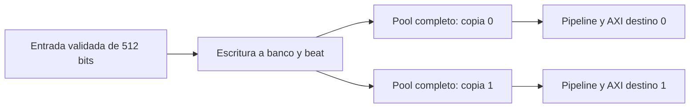

# Variante compacta de RAM y asignador multibuffer

Experimento aislado del 2026-10-04, posterior a la
[medición de referencia](PEER_RX_MULTIBUFFER_SYNTHESIS.md). La referencia
consume 60/90 tiles BRAM para 32/48 KiB y reserva ocho incumple setup
estimado a 5 ns. Esta variante conserva el contrato y las fuentes originales;
todavía no se integra en el endpoint o la cola del diseño principal.

## Cambios de arquitectura

El [datapath compacto](../../fpga/rtl/ntrpu_peer_multibuffer_compact.sv)
almacena los bancos lógicos en un array profundo, direccionado como
`banco * BANK_BEATS + beat`. Cada lector tiene una copia completa del pool;
la única entrada difunde sus escrituras a todas las copias. Cada array
necesita una escritura y una lectura síncronas por ciclo. Para dos destinos
hay dos copias físicas, pero la capacidad lógica sigue siendo 32/48 KiB.



Esto sustituye la fragmentación de arrays pequeños y el multiplexor de
datos entre bancos por replicación de arrays profundos. No añade puertos
al ingreso ni multiplica el caudal PCIe. La lectura conserva su latencia;
el pipeline de dos plazas por salida y los créditos no cambian.

El coste de replicación crece con el número de lectores. La comparación
de recursos se limita a dos: no extrapolar el ahorro a todos los canales
HBM. Con muchos destinos debe compararse agrupación por propietario y
reserva; las escrituras difundidas también requieren una medición de
consumo antes de atribuir un ahorro energético a la menor área.

El [asignador paralelo](../../fpga/rtl/ntrpu_buffer_pool_allocator_parallel.sv)
prepara candidatos por canal con rangos estáticos, cuenta préstamos con
el ancho necesario y actualiza cada generación desde su propio contador.
La generación concedida se selecciona entre incrementos locales. Evita
introducir el multiplexor del banco seleccionado en la entrada de datos
del contador; el resultado de síntesis se compara más abajo.

Se mantienen prioridad por banco propio, reparto round-robin, cuotas,
propietario y generación de 64 bits, rechazo de devoluciones incorrectas,
fault persistente y retiro al agotar generaciones. La devolución y
reasignación del mismo banco siguen siendo posibles en el mismo ciclo.
No se añadió una etapa de latencia al handshake.

## Regresión y comparación por cambios

La [tanda local final](../../artifacts/ntrpu-multibuffer-compact/20261004-rtl-r4/REVIEW.json)
pasó en 26,82 s con Icarus y los oráculos existentes, sin modificarlos:

| Grupo | Pruebas | Resultado |
| --- | ---: | --- |
| Asignador, tres semillas por perfil | 24 | 14.682 ciclos, 5389 asignaciones y 1575 reutilizaciones en el mismo ciclo |
| Ambos cambios, nueve perfiles y dos semillas | 18 | 1336 trabajos, 600.320 bytes comprobados |
| Solo RAM compacta | 4 | 332 trabajos, 323.840 bytes |
| Solo asignador nuevo | 4 | 332 trabajos, 323.840 bytes |
| RTL original | 4 | 332 trabajos, 323.840 bytes |

Los cuatro modos coinciden **ciclo por ciclo en todas las líneas TRACE,
CASE y PASS** para reserva cuatro/ocho y semillas 1/7. Esta comparación
dinámica no equivale a una demostración formal exhaustiva.

Se conservan las pruebas de pausas AW/W/B/CPL, concurrencia, propiedad de
RAM, stop, fault, drenaje, frontera de 4 KiB, descriptores inválidos,
generaciones obsoletas y agotamiento sin rollover. Se añade un perfil de
tres beats por banco para comprobar el stride no binario del pool.

Se detectaron seis mutaciones: omitir generación, perder el banco al
reasignarlo, ignorar cuota, permitir rollover, corromper una sola réplica
y eliminar el desplazamiento entre bancos. Las cuatro primeras fallaron
en señales comparadas por el oráculo; las dos de RAM dispararon la
comparación de cada palabra con su patrón esperado.

Los intentos previos se conservan: ruta relativa incorrecta de Icarus,
campo `seed` duplicado al construir el informe y un caso nuevo cuyo banco
de pruebas intentaba retener seis trabajos usando cinco descriptores.
Se corrigió ese fixture a 16 descriptores, manteniendo todas sus
comprobaciones. El RTL no cambió para superar esos fallos del ejecutor.

## Síntesis comparada

Ambos perfiles terminaron desde una copia independiente: Vivado 2026.1,
VU5P `xcvu5p-flva2104-2-i`, reloj 5 ns, dos CPU y prioridad `nice 10`.
Tardaron 426,850/537,316 s, incluyendo exportación. Se conservaron las
fuentes, restricciones y trabajos del principal. La comparación usa el
mismo dispositivo, capacidad lógica, puertos, créditos y reloj.

| Medición | Referencia R4 | Compacta R4 | Referencia R8 | Compacta R8 |
| --- | ---: | ---: | ---: | ---: |
| Payload lógico | 32 KiB | 32 KiB | 48 KiB | 48 KiB |
| LUT | 6883 | 4284 | 9314 | 4857 |
| FF | 9408 | 9386 | 9691 | 9695 |
| Tiles BRAM equivalentes | 60 | 15 | 90 | 29 |
| RAMB36E2 / RAMB18E2 | 56 / 8 | 14 / 2 | 84 / 12 | 28 / 2 |
| CARRY8 | 54 | 164 | 64 | 240 |
| WNS setup estimado | +0,365 ns | +0,742 ns | −0,653 ns | +0,408 ns |
| Niveles de la ruta peor | 26 | 16 | 28 | 17 |

R4/R8 indican bancos de reserva; hay además cuatro bancos propios.
La BRAM baja **75,00 % / 67,78 %** y las LUT **37,76 % / 47,85 %**.
Los incrementadores locales aumentan CARRY8; no se oculta ese coste.
La peor ruta ahora termina en el enable de un descriptor, con retardo
estimado de 4,154/4,488 ns. La comparación de recursos mide ambos cambios
juntos; las variantes por separado se compararon funcionalmente, sin
atribuirles un ahorro de síntesis individual.

El payload lógico aprovecha el 47,41 % / 36,78 % de los bits BRAM brutos
asignados, incluyendo las copias, frente a 11,85 % previo. Las capacidades
físicas brutas son 67,5/130,5 KiB; no son capacidad lógica adicional.
Ambos perfiles usan cero LUTRAM, UltraRAM y DSP.

No hay latches, cajas negras, lazos ni endpoints internos sin restricciones.
Setup, hold y ancho de pulso estimados cumplen; los márgenes de hold son
+0,065/+0,073 ns. **Esto no certifica 200 MHz en placa:** falta placement,
routing, delays externos y una fuente física de reloj. No se añadieron
excepciones de timing. El retardo denominado `route` todavía es estimado.

## Avisos y comprobación de netlist

Se conservaron los avisos de salidas AXI constantes (`Synth 8-3917`, 100
mensajes por perfil), `HD.CLK_SRC` ausente (`Timing 38-242`) y alcance OOC
del DRC (`DRC 23-814`). El ruledeck ejecutado tiene cero hallazgos.
Metodología informa 16/30 RAM sin registro de salida adicional integrado
(`SYNTH-6`) y delays externos ausentes (`TIMING-18`): `check_timing` cuenta
673 entradas y 1332/1336 salidas sin delay. No hubo errores ni avisos
críticos de herramienta. No se aplicaron waivers.

Las dos netlists pasaron. Se usa el banco de señales públicas, semilla 1,
espera GSR de 200 ns y reloj de 10 ns, sin SDF.
La simulación no certifica timing. La revisión interna de préstamos y
pipeline conserva su cobertura en RTL; la netlist no observa esos nombres.

| Netlist | Trabajos / bytes | Ciclos | Pendientes máximos por puerto | Tiempo de herramienta |
| --- | ---: | ---: | --- | ---: |
| Compacta R4 | 81 / 80.832 | 3869 | 4 / 4 | 62,325 s |
| Compacta R8 | 85 / 81.088 | 4046 | 4 / 4 | 66,422 s |

Ambas ejercitan una respuesta B con error y otra de ID ajeno; los ciclos
con W simultáneo en ambos destinos son 253/252. Los resultados coinciden
con las netlists de referencia: todas las líneas TRACE, CASE y PASS son
idénticas ciclo por ciclo para esa semilla. El replay local del archivo
descargado confirmó todos los bytes y transacciones.

XSIM conserva avisos por redefinición de `glbl` y presencia de
`LIBRARY_PATH`. Las definiciones de `glbl` son idénticas al normalizar
espacios. El banco ahora fija sus parámetros antes de elaborar la netlist,
evitando aplicar esos parámetros a `glbl`. No hubo errores de simulación.

## Decisión y siguiente paso

La variante compacta es candidata para continuar la evaluación física:
ahorra BRAM/LUT y ambas reservas alcanzan setup interno estimado a 5 ns.
No sustituye automáticamente al receptor integrado. La
[evaluación física posterior](PEER_RX_MULTIBUFFER_PHYSICAL.md) completó R4:
su arnés registrado cumple STA a 150 MHz, pero falla a 200 MHz, y la
netlist posterior conserva el comportamiento comprobado. R8 también
terminó el enrutado y pasó la regresión, pero sólo cumple a 125 MHz entre
las frecuencias auditadas. La estimación de síntesis anterior no reemplaza
esos resultados del arnés. El siguiente paso es reducir la ruta de devolución y
reasignación e integrar fronteras elásticas con el contexto del padre.
La elección entre reserva cuatro y ocho aún debe justificarse con pausas
y caudal representativos del transporte conectado.

## Reproducción y alcance

En Linux/WSL, con Icarus en PATH:

```bash
python3 -B tools/run_ntrpu_multibuffer_compact.py /ruta/nueva/rtl
```

Desde una copia de fuentes con el entorno Vivado cargado:

```bash
python3 -B tools/run_ntrpu_multibuffer_vivado.py /ruta/nueva/sintesis --variant compact
python3 -B tools/run_ntrpu_multibuffer_vivado.py /ruta/nueva/netlist --variant compact \
  --netlist-input /ruta/nueva/sintesis
```

El ejecutor RTL acepta `--iverilog`, `--vvp` y `--ivl-base`; usar rutas
absolutas para herramientas extraídas fuera de PATH. Las carpetas deben
ser nuevas. Las opciones `PACKED_RAM=0` y `NTRPU_REFERENCE_ALLOCATOR`
permiten comparar los cambios por separado; no son modos de ejecución
dinámica del hardware.

Persisten los límites del prototipo: entrada prevalidada, drenaje
cooperativo, reset coordinado y ausencia de framing PCIe, ventanas/épocas,
CDC y recuperación completa. Compactar RAM no modifica el contrato BAR
ni añade visibilidad o coherencia entre dispositivos.

## Evidencia y respaldo

- [Regresión RTL y comparaciones](../../artifacts/ntrpu-multibuffer-compact/20261004-rtl-r4/REVIEW.json).
- [Comparación de recursos con la referencia](../../artifacts/ntrpu-multibuffer-compact/COMPARISON.json).
- [Revisión de síntesis](../../artifacts/ntrpu-multibuffer-compact/20261004T063137920423Z-compact-synth/REVIEW.json).
- [Revisión de netlists](../../artifacts/ntrpu-multibuffer-compact/20261004T063137920423Z-compact-netlist/REVIEW.json).
- [Fuentes originales preservadas](../../artifacts/ntrpu-multibuffer-compact/SOURCE_PRESERVATION.json).
- [Respaldo local consolidado](../../artifacts/ntrpu-multibuffer-compact/20261004-compact-handoff.zip)
  y [verificación](../../artifacts/ntrpu-multibuffer-compact/20261004-compact-handoff.VERIFIED.json).

Los archivos de cada tanda incluyen entradas inmutables, comandos, logs,
manifiestos y resultados. Los ZIP descargados pasan SHA-256, CRC y todos
los hashes de sus miembros. El RTL actual coincide con las copias probadas
y sintetizadas; las netlists simuladas coinciden byte a byte con las
exportadas. El respaldo conserva también los intentos incompletos y los
informes de referencia usados en la comparación. No incluye instaladores
ni licencias. No se modificaron la cola del principal, su configuración,
el receptor original ni sus bancos de pruebas.
