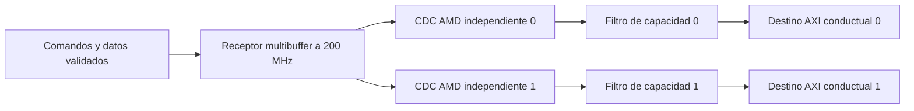

# Multibuffer: cruce de reloj y frontera de memoria

## Resultado y alcance

Validación lateral del 2026-10-04, posterior al
[receptor con colas elásticas](PEER_RX_MULTIBUFFER_ELASTIC.md).
La composición nueva pasa tres perfiles en XSIM 2026.1 con la IP AMD
AXI Clock Converter 2.1 y destinos de memoria conductuales.
Estado: `MEMORY_BOUNDARY_FUNCTIONAL_PASS_NOT_BOARD_INTEGRATED`.

Se conserva el núcleo R4: dos destinos, ocho bancos de 4 KiB, cuatro
de reserva, 16 descriptores y hasta cuatro pendientes por destino en el
receptor. Los 32 KiB son almacenamiento de payload del pool; las colas
elásticas, el CDC y el filtro añaden almacenamiento. El coste físico de
esta composición todavía no se ha medido. No se modificó la cola principal.

## Composición y contrato



Las respuestas B recorren la ruta inversa hasta la completion. El wrapper
`fpga/rtl/ntrpu_peer_multibuffer_memory.sv` compone un
`ntrpu_peer_memory_port` por destino. Cada puerto usa datos de 512 bits,
direcciones de 64 bits e IDs de cuatro bits. El filtro preservado comprueba
todo el intervalo antes de exponer una dirección de 37 bits: ventana de
128 GiB por destino, sin demostrar capacidad instalada ni memoria física.

La entrada exige tramas completas, alineadas a 64 bytes, de 1–64 beats,
sin cruzar 4 KiB; el receptor original requiere validación previa. No hay
adaptación de escrituras parciales de BAR, autorización de ventanas ni
traducción de direcciones entre tarjetas. Las lecturas quedan deshabilitadas.
El destino debe respetar AXI, incluido BID y orden de respuestas.

`stop` cierra comandos nuevos; las tramas aceptadas siguen llenándose y
sus AW/W/B deben terminar. Por ello el filtro interno mantiene `admit=1`.
Disponibilidad, calibración y revocación deben resolverse antes de admitir
comandos, sin bloquear escrituras ya aceptadas. `drained` proviene del
receptor y requiere retirar todas las completions; presupone respuestas
conformes y un mismo ciclo de operación entre resets.

El CDC se genera con `ACLK_ASYNC=1` y tres etapas de sincronización. AMD
usa FIFO para el cruce asíncrono; la integración física debe conservar sus
restricciones generadas y revisar CDC/STA del conjunto.
([AMD PG059: Clock Conversion](https://docs.amd.com/r/en-US/pg059-axi-interconnect/Clock-Conversion)).

Los resets deben sincronizarse a su reloj y solaparse entre ambos extremos
y los dispositivos conectados; AMD no admite reset parcial y recomienda
al menos 16 ciclos del reloj más lento.
([AMD PG059: Resets](https://docs.amd.com/r/en-US/pg059-axi-interconnect/Resets)).
El banco aplica 64 ciclos por dominio, con solapamiento suficiente para
los perfiles probados. El reset ocupado reinicia también ambos destinos
conductuales: descarta un trabajo sin completion y sin revertir sus bytes
ya escritos. No implementa un aborto AXI ni autoriza resets aislados.

## Pruebas y evidencia

Cada perfil cubre once escenarios: carga continua, aislamiento de destinos,
stop durante llenado, stop después de AW, W antes de AW, pausa de un reloj,
presión sobre completions, extremos de direccionamiento, SLVERR, rechazos
por capacidad y reset ocupado con recuperación.

Por perfil: 56 comandos, 55 completions y un descarte deliberado por reset;
146.688 bytes aceptados por los destinos, incluidos los del trabajo luego
descartado. De las completions, 51 son OKAY, una SLVERR y tres DECERR.
Se prueban direcciones superiores a 4 GiB, el final exacto de 128 GiB y
rechazos en 128 GiB, 128 GiB + 4 GiB y el extremo de 64 bits. Ningún rechazo
produce AW/W externo. Totales: 168 comandos y 440.064 bytes comprobados.

Tres mutaciones RTL fuerzan corrupción de datos, ocultación de BRESP y
truncado de la dirección de entrada al filtro; todas son detectadas.
El verificador Python reproduce las trazas sin confiar sólo en el marcador
PASS. Además detecta seis corrupciones de traza por perfil: dato alterado,
alias de 32 bits, B ausente, estado incorrecto, completion duplicada y
completion obsoleta tras reset: 18 controles negativos adicionales.

## Límite de caudal observado

Medición funcional de 32 transferencias alternadas de 4 KiB, incluyendo
admisión y drenaje final. Los destinos insertan pausas periódicas de AW/W.
GB/s usa unidades decimales; los periodos de reloj son exactos.

| Perfil | Periodos destino 0 / 1 | Parámetro de demora B | Caudal agregado |
| --- | --- | ---: | ---: |
| 0 | 4 / 7,3 ns | 3 ciclos locales | 11,609566 GB/s |
| 1 | 11,5 / 4,3 ns | 32 ciclos locales | 6,213416 GB/s |
| 2 | 4 / 7,3 ns | 160 ciclos locales | 4,559026 GB/s |

La implementación del destino añade dos ciclos al parámetro de demora:
el intervalo WLAST–B observado en el perfil 2 es 648 / 1182,6 ns.
En los tres perfiles sólo existe **una AW pendiente de B por destino**:
el filtro de capacidad serializa las escrituras aunque el receptor permita
cuatro pendientes. La comparación 0–2 mantiene los relojes y cambia B;
evidencia sensibilidad a esa serialización. No demuestra que B sea el
único límite: la entrada compartida de 512 bits a 200 MHz tiene un máximo
bruto agregado de 12,8 GB/s, independientemente del número de salidas.

**Estas cifras no estiman rendimiento de placa.** El propio modelo FIFO de
AMD advierte que no reproduce retardos de sincronización; tampoco existen
PCIe, MIG/HBM, arbitraje de memoria ni P&R en esta tanda. Se revisaron 60
avisos de esa limitación, seis sobre `LIBRARY_PATH` y uno de regeneración
del XDC dentro del proyecto nuevo; no hubo errores ni avisos críticos.

## Siguiente experimento

La [comparación con uno, dos y cuatro créditos](PEER_RX_MULTIBUFFER_CREDITS.md)
ya pasa la matriz funcional, conservando esta referencia. Sus resultados
y la medición física del filtro se registran por separado.

Preparar una variante aislada del filtro con dos y cuatro escrituras
pendientes, comparada contra esta referencia con el mismo pool. Debe
preservar el chequeo completo de 64 bits, el orden AW/W/B, los rechazos
locales y el drenaje bajo stop. Exigir mejora con B lento, ninguna regresión
de integridad y medición de recursos/STA antes de adoptarla. Añadir bancos
por sí solo no elimina la serialización ni aumenta el ancho de entrada.

Después quedan el productor PCIe con byte enables, el controlador de
memoria elegido, supervisión coordinada de clocks/resets, recuperación por
épocas, arbitraje y cierre físico del conjunto. Esta prueba no establece
compatibilidad física HBM, P2P operativo ni coherencia entre NTRPUs.

## Reproducción y respaldo

Con Vivado 2026.1 cargado en Linux y un directorio de salida nuevo:

```bash
python3 -B tools/run_ntrpu_multibuffer_memory.py /ruta/nueva/output --timeout 900
python3 -B tools/check_ntrpu_multibuffer_memory.py /ruta/tanda
python3 -B tools/analyze_ntrpu_multibuffer_memory.py /ruta/tanda
```

Los verificadores esperan `inputs/` con las fuentes exactas y `output/`
con resultados, tal como guarda el lanzador de respaldo. El runner limita
la carga a dos CPU, `nice=10` y dos hilos Vivado. La tanda final tardó
130,232 s; se preserva también el intento de 26,980 s fallido por un
argumento Tcl, anterior a cualquier simulación.

Todo está en `D:\AI\artifacts\ntrpu-multibuffer-memory\`:

- `20261004T165247314219Z-memory-sim/`: primer intento y causa del fallo.
- `20261004T165540976042Z-memory-sim/`: tanda final, fuentes, proyecto,
  logs, `REVIEW.json`, `ANALYSIS.json` y descarga verificada.
- `FINAL_REVIEW.json`, `SOURCE_PRESERVATION.json` y `HANDOFF.md`:
  índice, integridad y recuperación.
- `20261004-memory-handoff.zip` y su `.VERIFIED.json`: consolidado con
  hashes SHA-256 y CRC, sin depender del almacenamiento de la VM.

El ZIP de resultados de la tanda final tiene SHA-256
`25ce17985f39e5c00990d06387fa43babf94ce30ab5a17cabc63ebc466522e75`.
Se usa D: por falta de espacio en C:; no se borraron tandas anteriores.
