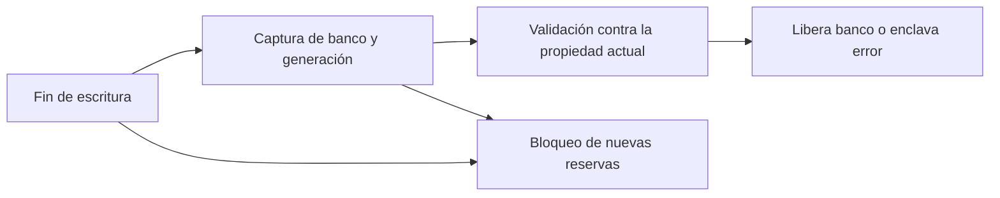

# Devoluciones registradas para el transporte AXI

Variante aislada validada tras el [ensayo del plano de bancos](PEER_RX_OVERLAP_AXI_BANKPLAN.md).
Su objetivo es cortar la dependencia combinacional entre finalización de
escritura, comparación de propietario/generación y admisión de nuevos trabajos.
Conserva las dos IP AMD AXI Register Slice y el transporte compacto.
**Resultado: cierre temporal interno a 200 MHz y comparación funcional
RTL/netlist aprobados**, dentro del alcance indicado al final.

## Contrato del corte

Cada canal captura `return_valid`, banco y generación en registros. El
asignador valida esa devolución en el ciclo siguiente. El banco permanece
ocupado hasta la validación; desaparece la reutilización en el mismo flanco.

Las reservas nuevas quedan bloqueadas globalmente durante **captura y
validación**, incluso si todavía existen bancos libres. Esto impide asignar
recursos antes de descubrir una devolución inválida. El error queda
enclavado al validar; no se usa una señal `ready` registrada como si fuera
un crédito adquirido. El receptor consulta `return_busy` y el fallo registrado
del asignador, sin propagar su comparador de devolución hacia la admisión.



Puede capturarse una devolución por canal y ciclo mientras se valida la
anterior. `stop` y el fallo no impiden devolver bancos válidos ni drenar
transacciones ya comprometidas. El reset sigue requiriendo una época fría
coordinada; no se valida recuperación en caliente.

## Evidencia funcional

`20261006T070934801478Z-rtl` termina en **141,413 s**:

- 13 escenarios de protocolo y 3 escenarios adicionales aprobados.
  Comprueban 129.088 bytes, 92 finalizaciones y 5 cuarentenas esperadas.
- 15 perfiles de rendimiento, cada uno con 128 trabajos; se mantienen
  orden, contenido de datos, cercas y avance del destino no bloqueado.
- Tres configuraciones del asignador: 8 bancos/2 canales, 3 bancos/2 canales
  y 1 banco con generación de 3 bits. El modelo independiente revisa
  **2.246 flancos**, incluidos retornos consecutivos, duplicados, propietario
  incorrecto, generación antigua, índice inválido y agotamiento de generación.
- 20 controles negativos de transporte y 12 del registro de propiedades
  rechazan trazas alteradas. Las aserciones integradas también impiden
  reservas y asignaciones durante `return_busy`.

En tráfico sin pausas, el intervalo N+4 se conserva: **5, 12 y 68 ciclos**
para 64 B, 512 B y 4 KiB, respectivamente. Los lotes de 128 trabajos siguen
durando 659, 1.562 y 8.786 ciclos. Con un destino bloqueado, los perfiles
de 64 y 512 B añaden 9 ciclos por lote; el de 4 KiB conserva la duración
del lote, aunque cambia ligeramente la distribución de intervalos.
Son medidas de simulación, sin acreditación física de rendimiento.

## Síntesis y comprobación del corte

`20261006T071304435864Z-synth` termina en **141,272 s**, sin latches,
cajas negras ni errores DRC y con cobertura temporal interna completa.
Utiliza 8.278 LUT, 18.695 registros y 15 bloques BRAM: frente al montaje
AXI anterior, añade 576 LUT y 166 registros, sin ampliar BRAM.
El setup estimado antes de colocar es −1,396 ns; no acredita cierre.

La lectura independiente `20261006T071844117446Z-audit` termina en
55,105 s, preservando el SHA-256 del checkpoint. Identifica **134 registros
de banco/generación capturados** y consulta sus rutas hacia los 18.589
objetos secuenciales ajenos al asignador: **cero rutas combinacionales**,
sin excepciones temporales añadidas. Esto confirma el corte en la netlist
sintetizada; no demuestra que las restantes rutas cumplan 200 MHz.

La colocación `20261006T071626487976Z-place` termina en **396,447 s**:
8.247 LUT, 18.695 registros y 15 bloques BRAM. El informe completo muestra
setup **+0,427 ns**, hold −0,187 ns y pulso +1,958 ns. El resumen intermedio
del colocador había mostrado +0,481 ns; se conserva +0,427 ns como dato
de esta etapa. No hay Pblocks ni excepciones añadidas.
La peor ruta previa al ruteo va del contador de generación de un banco
al habilitador de estado del receptor: 20 niveles y 4,184 ns de datos,
de los que 3,158 ns son cableado estimado.

## Resultado físico

`20261006T072526823637Z-route` termina en **193,295 s** con
`ROUTED_INTERNAL_TIMING_PASS`. El informe final acredita setup **+0,251 ns**,
hold **+0,006 ns** y pulso +1,958 ns a 5 ns, con TNS/THS cero.
Las **20.528 redes enrutables están completamente ruteadas**, sin errores.
Los 1.679 avisos de redes de frontera se verifican como conexiones externas
sin cargas internas ocultas. Los recursos permanecen en 8.247 LUT,
18.695 registros y 15 bloques BRAM; se verificó ausencia de Pblocks.

El resumen intermedio del router daba +0,230 ns de setup; el valor del
informe final es +0,251 ns. El cierre es interno y requiere conservar la
misma frecuencia, incertidumbres, parte y contexto de reloj. La comparación
funcional de la netlist es una comprobación adicional separada.

SHA-256 de `physical_route.dcp`:
`22f1d4311eed1e0291e330c80d92b182c6b3781d2f3b13adc4a85b0849c072e1`.

## Comparación de la netlist

El intento `20261006T072930748362Z-netlist` se conserva como diagnóstico.
XSim enlazó el modelo AXI parametrizable de referencia con módulos del
mismo nombre presentes en la netlist optimizada. Los avisos
`VRFC 10-2861` precedieron al fallo de atributos AW en la propia referencia;
esa ejecución no acredita equivalencia.

El adaptador `prepare_ntrpu_return_cut_netlist.py` separa los nombres
de 29 módulos estructurales con el prefijo `routeiso_`. Cambia solamente
declaraciones y tipos instanciados: 58 sustituciones. Conserva el módulo
superior, `glbl`, comentarios, cadenas e identificadores escapados.
Invertir las sustituciones recupera **exactamente los bytes originales**.
No se regeneran síntesis, colocación ni ruteo, ni se alteran las aserciones.

La netlist original tiene SHA-256
`52dc2e3bea9fc0e0d61860553a7d2f726f20cc87730de5f47b9ddf0bc14117ea`.
La copia aislada tiene SHA-256
`3e5dd0146cafe84f3106c582cd3ae5a0ff577aab9c0b79a4743a22517eb8d0e9`.
El comprobador verifica la reversibilidad, el manifiesto de fuentes
congeladas y la ausencia del conflicto de parámetros. Mantiene las
28 salidas, comparación ciclo a ciclo, arranque de 150 ns y ausencia
de SDF o `force` de la comparación original.

La ejecución corregida `20261006T073837820129Z-netlist` termina en
**171,500 s**: `ROUTED_FUNCTIONAL_EQUIVALENCE_PASS` y
`ROUTED_EXTRA_EQUIVALENCE_PASS`. Coinciden **5.281 ciclos** de los
16 escenarios, con 129.088 bytes y las mismas finalizaciones y cuarentenas
esperadas del RTL. Se rechazan 20 alteraciones de trazas y una modificación
de una constante en la prueba de reversibilidad. No aparecen los avisos
de parámetros que invalidaron el primer intento.

## Implementación y reproducción

Los generadores crean copias experimentales; el RTL original y las
referencias previamente validadas se preservan. La implementación usa
colocación libre, reloj de 5 ns, incertidumbres 0,100/0,050 ns y
BUFGCE_X0Y60. No reutiliza los Pblocks del ensayo anterior.

```bash
source /ruta/Vivado/settings64.sh
python3 -B tools/run_ntrpu_return_cut.py /rtl/output --stage rtl \
  --reference /qualified_compact_route/output
python3 -B tools/check_ntrpu_return_cut.py /rtl/output --review /rtl/REVIEW.json
# Revisar y respaldar antes de avanzar a synth -> place -> route -> netlist.
python3 -B tools/run_ntrpu_return_cut.py /synth/output --stage synth \
  --reference /qualified_compact_route/output --prior /rtl/output
# Tras aprobar place y route, usar el adaptador de simulación aislada.
python3 -B tools/run_ntrpu_return_cut_netlist.py /netlist/output --stage netlist \
  --reference /qualified_compact_route/output --prior /route/output
python3 -B tools/check_ntrpu_return_cut_netlist.py /netlist/output \
  --review /netlist/REVIEW.json
```

Usar salidas nuevas, dos CPU y prioridad baja; límite de 900 s por etapa.
Los generadores congelados se ejecutan en Linux: su comprobación por bytes
rechaza las traducciones CRLF de Windows. No se relajaron esos controles.
El cierre requiere ruteo completo, STA interno aprobado y comparación
funcional contra la netlist de esta misma variante; esta tanda cumple
los tres criterios para `xcvu5p-flva2104-2-i`. PCIe, HBM, retardos de puertos
externos y CDC siguen fuera de esa acreditación. Tampoco sustituye una
prueba en tarjeta; el margen hold de 0,006 ns corresponde a este ruteo.

El siguiente paso de integración es fijar relojes, retardos y créditos
de las fronteras reales de memoria/DMA, y medir pausas y latencia de
respuesta antes de redimensionar el pool. Se conserva la configuración
de dos canales, dos bancos dedicados por canal y cuatro de reserva;
esta tanda no demuestra rendimiento agregado entre varias NTRPU.

El [barrido posterior de fronteras](PEER_RX_RETURN_BOUNDARY.md) conserva este
circuito y compara 45 combinaciones de créditos, tamaños y demoras. Incluye
el contrato propuesto de adaptación HBM y distingue bancos de payload,
créditos de respuesta y confirmación remota.

Evidencia local:
`C:\Users\xasko\artifacts\ntrpu-return-cut\20261006T070634470554Z`.
Respaldo incremental por contenido en
`D:\AI\artifacts\ntrpu-content-store`, con verificación por tanda y sin
ZIP de transferencia retenidos.
