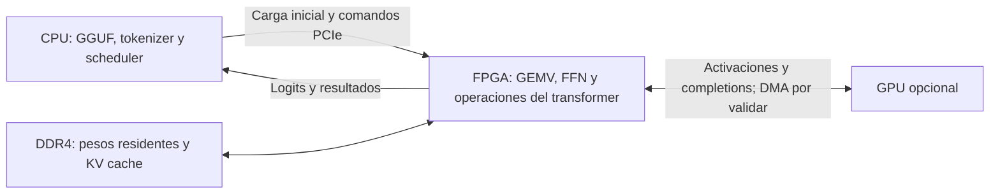

# Recuperación y reconstrucción de la FPGA para ntransformer

> Estado actualizado (2026-10-02): INT8, GEMV Q8_0, cuantizador corregido, composición FP32/Q8 y SwiGLU tienen co-simulación C/RTL correcta. La [FFN completa](HLS_FFN.md) también pasó las 23 transacciones RTL, incluida una muestra real de Brandon, con respaldo local verificado. Vivado/Vitis se recuperó del volumen persistente y la licencia funciona. Consultar los [hitos y criterios de cierre](POC_ROADMAP.md) y el [registro de la cola de placa](board/VIVADO_STATUS.md); las notas siguientes conservan el historial.

El objetivo confirmado es una NTRPU (ntransformer processing unit) con hasta 512 GB de DDR4 que ejecute la mayor parte de la inferencia, con una ruta opcional de cooperación con la GPU mediante PCIe/BAR. Varias NTRPU deberán presentarse como una unidad lógica: dos tarjetas de 512 GB aportan 1.024 GB físicos agregados, con pesos distribuidos. La recuperación encontró evidencia de un núcleo INT8 sintetizado con Vitis HLS, pero todavía no el proyecto completo ni la configuración de memoria de esa tarjeta. Esta propuesta distingue los datos recuperados del trabajo nuevo.

El diseño de direccionamiento, reparto de pesos y comunicación entre tarjetas se desarrolla en [Agrupación de varias NTRPU](NTRPU_FABRIC.md).

El [roadmap de diseño de la tarjeta](BOARD_DESIGN_ROADMAP.md) explica el paso desde la selección de FPGA y DDR4 hasta el esquemático, PCB, Gerber, fabricación y validación del prototipo, con entregables y criterios de cierre por etapa.

El [diseño para Llama 3.2 1B Instruct](LLAMA32_1B_HARDWARE.md) concreta tamaños de matrices, buffers y KV. El [lector AXI de 512 bits](AXI_READER.md), los [buffers dobles](WEIGHT_TILE_BUFFER.md) y el [desempaquetador Q8](Q8_UNPACKER.md) ya tienen pruebas RTL y síntesis, incluida su conexión conjunta. Todavía falta conectar este camino al cómputo y a la memoria física.

El [simulador funcional de dos NTRPU](SIMULATOR.md) ya implementa memoria dispersa, directorio de tensores, pesos protegidos y colas de transferencias sin CUDA. El [núcleo GEMV INT8/INT32](GEMV_INT8.md) añade cálculo con pesos locales y filas repartidas, verificado contra INT64. Las guías incluyen comandos de compilación, pruebas y límites.

El [primer top HLS y la adaptación Q8_0](HLS.md) ya tienen pruebas CPU y un flujo Vitis preparado con fuentes e informes separados por ejecución. La síntesis y co-simulación RTL siguen pendientes.

La [ruta Q8_0 distribuida](Q8_DISTRIBUTED.md) ya está conectada a las colas del simulador y encadena dos operaciones con resultados FP32 transferidos entre unidades.

La [FFN de Brandon con pesos reales](BRANDON_REFERENCE.md) añade SwiGLU local y valida las 12 FFN únicas frente a NumPy y PyTorch en una RTX 3090. Incluye una receta Docker para repetir la referencia GPU en Lambda.

El uso principal de Lambda será como [estación remota Vivado/Vitis](CLOUD_HLS.md) para síntesis y co-simulación del diseño FPGA.

Actualización 2026-10-01: Vivado/Vitis 2026.1 está instalado; la primera ejecución HLS se detuvo por falta de licencia Vivado. Mientras se genera Basic, el [segundo top Q8_0](HLS_Q8_0.md) incorpora escalas y acumulación por bloques, con 49 pruebas CPU y regresión de las FFN de Brandon. No hay todavía RTL validado.

Un [tercer top de cuantización de activaciones](HLS_QUANTIZATION.md) amplía la suite a 53 pruebas y conserva los resultados de Brandon al ejecutarse como C++. La síntesis y conexión RTL de los tres bloques siguen pendientes.

## Decisión de diseño y autonomía

La motivación confirmada por el usuario para migrar de GPU a FPGA fue la dificultad de controlar DMA y mapeos de memoria bajo CUDA, junto con las restricciones y el coste encontrados en ese camino. El requisito principal es que la plataforma NTRPU tenga control explícito de sus transferencias, memoria y protocolo entre tarjetas.

La inferencia con NTRPU y la agrupación NTRPU↔NTRPU deberán funcionar sin una GPU NVIDIA, CUDA ni parches BAR1 del controlador NVIDIA. El host seguirá siendo responsable de enumeración, registro de buffers, carga del modelo y envío de trabajo. Las operaciones todavía no implementadas en FPGA podrán tener una referencia o ruta CPU durante el desarrollo.

El simulador ya puede compilarse sin CUDA con `-DNTRANSFORMER_ENABLE_CUDA=OFF`. El motor de inferencia actual conserva su backend CUDA; su adaptación a NTRPU sigue pendiente. Las futuras herramientas host también deberán ser independientes de CUDA. La integración con GPU será un adaptador posterior que no bloquee los hitos de una o varias NTRPU.

## Material recuperado

Ver [el diagnóstico](RECOVERY.md), [el informe HLS original](recovered/unified_core_int8_loop_csynth.rpt) y [su procedencia verificable](recovered/provenance.json). El nombre encontrado es `uvp_hls_project`; la fuente referenciada es `compute/unified_core_int8.cpp`. La relación de ese prototipo con el diseño de 512 GB permanece sin confirmar.

## Plataforma y memoria

| Plataforma | Memoria documentada | Papel propuesto |
| --- | --- | --- |
| Alveo U50 | 8 GB HBM2 | Prototipo de cálculo; capacidad insuficiente para el objetivo final |
| Alveo U250 | 64 GB DDR4, cuatro bancos de 16 GB | Referencia más próxima para desarrollar el backend DDR4 |
| Tarjeta propia | Objetivo de 512 GB DDR4 | Diseño pendiente de seleccionar FPGA, encapsulado, módulos y controladores |

Las capacidades de las Alveo provienen de [AMD DS965](https://docs.amd.com/r/en-US/ds965-u50/Product-Details) y [AMD UG1700](https://docs.amd.com/r/en-US/ug1700-vitis-accelerated-data-center/Using-Alveo-Accelerator-Cards). Un cambio de configuración en Vivado no añade memoria física a esas tarjetas.

Para la tarjeta propia, estudiar 4 × 128 GB frente a 8 × 64 GB como **opciones de arquitectura, todavía sin validar**. Los canales independientes, el tipo de DIMM, ranks, densidad, bancos de E/S y recursos del controlador deben verificarse con el componente exacto y [AMD PG150](https://docs.amd.com/r/en-US/pg150-ultrascale-memory-ip/DDR4-SDRAM). Dos módulos en un canal no duplican su ancho de banda. Antes de esquemáticos hay que cerrar compatibilidad eléctrica, alimentación, integridad de señal y calibración. La capacidad total comercial y su equivalencia en GiB deben quedar explícitas.

## Arquitectura propuesta

Mantener los pesos junto al cálculo evita transferir el modelo completo a la GPU en cada token. La cantidad de RAM determina qué modelo cabe; los canales de memoria y el paralelismo del núcleo determinan cuánto tarda.

Como cálculo ilustrativo, cuatro canales de datos de 64 bits a DDR4-2400 suman `4 × 8 × 2,4 = 76,8 GB/s` teóricos; ocho suman `153,6 GB/s`. Un modelo denso de 70.000 millones de parámetros a 4 bits ocupa al menos 35 GB solo en valores. Si se leen todos por token, el techo ideal de memoria sería aproximadamente 2,19 o 4,39 tokens/s, respectivamente. **No son benchmarks ni predicciones**: faltan escalas de cuantización, KV cache, eficiencia DDR, cálculo y sincronización. Batch, sparsity y reutilización cambian ese modelo de tráfico.

## Integración con ntransformer

La revisión local examinada es `f2237be6b25693330ec8cf302f0351566fc66403`. Propuesta de implementación progresiva:

1. Definir una interfaz de ejecución para GEMV/FFN, tomando como referencia `src/model/ffn.cpp` y `src/cuda/kernels.h`. Disponer de una referencia CPU para pruebas pequeñas; mantener CUDA como comparación opcional.
2. Crear un núcleo HLS nuevo y verificable para productos INT8 con acumulación INT32. El informe recuperado orienta el trabajo, pero no reemplaza las fuentes. Validar tamaños irregulares, overflow, saturación y orden de almacenamiento.
3. Definir explícitamente la traducción desde GGUF. `Q8_0` contiene escalas FP16 por bloque; un MAC INT8 por sí solo no implementa ese formato. Cuantizar también activaciones cambia la precisión y requiere evaluación de calidad.
4. Añadir movimiento de datos, varios bancos DDR y ejecución de una FFN; después normalización, RoPE, atención y KV cache. Medir tanto decode como prefill.
5. Integrar una capa completa y comparar logits, calidad, latencia, ancho de banda y consumo. Mantener un modelo pequeño de regresión antes de escalar capacidad.

El backend FPGA necesita operaciones de cálculo y gestión de pesos propios. Añadir únicamente otro origen de datos a `LayerStreamer` conservaría el cálculo en CUDA y no cumpliría el objetivo principal.

## Reutilización de gpu nvme direct

Se inspeccionó [gpu-nvme-direct, revisión 36f85ee](https://github.com/xaskasdf/gpu-nvme-direct/tree/36f85ee5cf35a4ad93f3377a845c924f3d8dd5a2). Su [layer_loader.cu](https://github.com/xaskasdf/gpu-nvme-direct/blob/36f85ee5cf35a4ad93f3377a845c924f3d8dd5a2/src/host/layer_loader.cu) contiene resolución de direcciones BAR1 y transferencias NVMe→VRAM; `src/memory/streamer.cu` ya consume esa ruta.

Se pueden adaptar descubrimiento PCIe, patrones de validación, colas y sincronización. El controlador de la FPGA deberá implementar sus propios comandos y DMA: un acceso BAR es una ventana de direcciones, no un protocolo completo de coherencia.

La implementación actual de `gpunvme_bar1_resolve` asume un barrido de 24 GB con pasos de 2 MB, escribe patrones en el buffer y comprueba continuidad en un punto intermedio. Si ese `mmap` intermedio falla, continúa hasta devolver éxito. Es evidencia experimental útil, pero antes de reutilizarla se requieren límites reales de BAR, validación de todas las páginas o scatter/gather, errores cerrados y gestión de la vida del buffer. No usar el resolvedor sobre pesos ya cargados.

Para el prototipo: BAR de control con versión, capacidades y doorbells; descriptores con identificador de buffer registrado, offset, longitud y secuencia; DMA de activaciones/resultados; completions con error y timeout. Comenzar con memoria host fijada y habilitar FPGA→VRAM al validar la plataforma. La documentación de [NVIDIA GPUDirect RDMA](https://docs.nvidia.com/cuda/gpudirect-rdma/index.html) exige considerar topología, mapeo y orden de memoria; no se asume coherencia ni soporte portátil en una RTX 3090.

## Estado verificable y siguiente hito

La simulación de memoria, transferencias, GEMV INT8/Q8_0 y FFN SwiGLU distribuida está implementada, junto al modelo C++ del top HLS: 45 pruebas pasaron en Windows/MSVC y Linux/GCC, Release. Las FFN con pesos de Brandon pasaron la comparación con referencias CPU/GPU; todavía faltan inferencia completa y evaluación de calidad. Sigue ejecutar síntesis/co-simulación para un dispositivo elegido y medir un canal DDR y una transferencia de activaciones. El pinout de 512 GB se desarrollará sobre esos resultados; el enlace opcional con BAR1 de una GPU tendrá validación independiente. Aún faltan el hardware disponible, una instalación Vitis utilizable y el número de parte final; no se han inventado constraints ni generado un bitstream.
