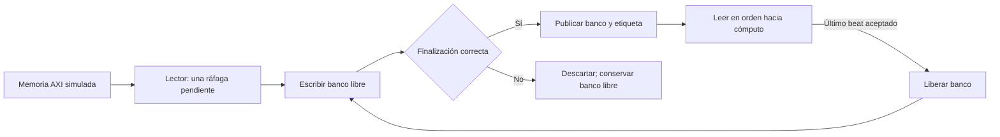

# Buffer doble de pesos conectado a AXI

Fecha: 2026-10-02. `fpga/rtl/ntrpu_weight_tile_buffer.sv` conecta el lector AXI existente con dos bancos de memoria interna. El circuito y su banco RTL están probados; todavía no existe la conexión al GEMV, a una IP DDR o a PCIe.

## Propiedad y publicación

Cada banco almacena hasta **544 beats de 512 bits: 34 KiB**. Juntos permiten guardar dos tiles Q8_0 de 32 × 1.024 pesos. El módulo también acepta bloques menores, siempre con longitud no nula y múltiplo de 64 bytes. Un comando mayor de 34 KiB se rechaza antes de acceder a memoria.



Productor y consumidor avanzan por bancos alternos. Una carga fallida no hace avanzar al productor; el siguiente intento reutiliza ese banco. El consumidor conserva la propiedad hasta aceptar el último beat. Si ambos bancos están ocupados, `load_ready` permanece bajo: un tercer comando espera sin sobrescribir datos.

La lectura de un banco puede solaparse con la carga del otro. Las lecturas de RAM son síncronas, y datos, etiqueta y `tile_last` permanecen estables si el consumidor aplica backpressure. Hay una pausa al cambiar de banco; no se promete transferencia continua entre tiles.

## Contrato de interfaces

- `load_valid/load_ready`: dirección de 64 bits, longitud en bytes y etiqueta opaca de 32 bits. El emisor mantiene el comando estable hasta aceptación. Dirección y longitud deben cumplir también el [contrato del lector](AXI_READER.md).
- `load_done_valid/load_done_ready`: etiqueta, estado y bytes recibidos del lector. Estados 0/1/2/3 conservan los significados éxito/comando inválido/error de lectura/error de protocolo. Una inconsistencia interna de longitud o `last` también produce estado 3.
- `tile_valid/tile_ready`: flujo de 512 bits con etiqueta y `tile_last` al final del bloque. Solo aparecen bloques completos validados, en orden de cargas correctas.

La publicación ocurre cuando el lector termina correctamente, sin esperar a que el host acepte la notificación `load_done`. Así, el consumidor puede leer un bloque correcto mientras la notificación está detenida. Sin embargo, no se acepta otra carga hasta que dicha notificación se consuma y exista un banco libre.

`load_done_bytes` es diagnóstico: ante un error tardío puede ser distinto de cero aunque **no se publique ningún byte de ese tile**. Los datos escritos antes del fallo quedan privados. Una carga fallida tampoco invalida el otro banco, que puede estar pendiente o en lectura.

El reset síncrono invalida metadatos y salida; no borra físicamente las RAM. Debe coordinarse con el lector/interconnect si hay tráfico pendiente. Las pruebas de reset usan memoria sin transacciones pendientes y dos bancos publicados. Siguen pendientes timeout, cancelación, validación de rangos registrados, épocas del modelo y CDC; la etiqueta no implementa esos mecanismos.

## Repetir la validación

```bash
source /ruta/AMDDesignTools/2026.1/Vivado/settings64.sh
python3 scripts/run_ntrpu_axi_reader.py --design tile_buffer --synth
# Regresión del lector independiente con el mismo ejecutor
python3 scripts/run_ntrpu_axi_reader.py --design reader
```

Cada ejecución archiva sus fuentes, SHA-256, comandos y resultados. La configuración probada es `TILE_BEATS=544`; el parámetro de capacidad requiere nueva validación si se cambia.

El banco integrado incluye ambos bancos llenos, tercer comando bloqueado, solapamiento, pausas aleatorias y prolongadas, estabilidad de etiquetas/datos, errores iniciales/intermedios/finales, reintentos, límites de dirección/longitud y reset sin limpiar RAM. Comprueba cada beat frente a un patrón independiente de dirección. No interpreta Q8_0 ni emplea pesos reales.

## Resultados

Vivado/XSIM 2026.1, componente de referencia `xczu7ev-ffvc1156-2-e`:

| Evidencia | Resultado |
| --- | --- |
| Integración `20261002T074541Z-97o68umt` | 50 casos × semillas 1/7/42: **150 correctos** |
| Por semilla | 34 tiles consumidos correctamente, 14 cargas rechazadas y 2 tiles descartados por reset |
| Regresión `20261002T074644Z-2jjm01fa` | **156 casos correctos** del lector sin cambiar su RTL |
| Síntesis del conjunto lector + buffers | **973 LUT, 957 FF, 28 RAMB36 + 2 RAMB18, 0 DSP** |
| Estimación con reloj de 5 ns | WNS +2,674 ns; WHS +0,047 ns |

Los 68 KiB útiles ocupan el equivalente de **29 bloques BRAM36** con esta organización de ancho/profundidad. Debe presupuestarse el resultado de síntesis, no dividir solamente bytes entre capacidad nominal. Optimizar el empaquetado de RAM queda para una revisión posterior.

No hay colocación/ruteo ni cierre temporal: faltan retrasos para 653 entradas y 682 salidas, y HD.CLK_SRC. Los avisos restantes corresponden a atributos AXI constantes. No se ha medido ancho de banda DDR real.

La primera ejecución `20261002T074444Z-5ui6chu1` se detuvo por un error del banco: no observaba el primer handshake después del reset. Se corrigió únicamente la temporización del estímulo; el RTL se mantuvo idéntico. Esa evidencia se conserva junto a las ejecuciones correctas.

Respaldo completo: `artifacts/ntrpu-tile-buffer-20261002/` y `/lambda/nfs/vivado/ntrpu/validation/`. La FFN larga continúa por separado. El [desempaquetador Q8_0](Q8_UNPACKER.md) ya está conectado y validado con estos bancos; siguen pendientes la entrada al cómputo y la acumulación entre tiles K para las dimensiones de Llama.
