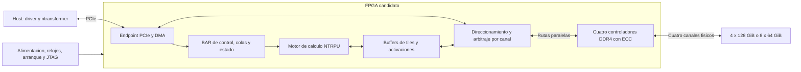

# Arquitectura preliminar de la tarjeta NTRPU

Revisión de estudio del 2026-10-02. Este paquete adelanta la primera etapa del [roadmap de placa](../BOARD_DESIGN_ROADMAP.md). Las decisiones siguientes son propuestas revisables; no constituyen un esquemático, pinout aprobado ni configuración de memoria validada.

## Base de trabajo

- Un FPGA con cuatro canales DDR4 independientes, cada uno con 64 bits de datos y ECC adicional.
- Objetivo de 128 GiB por canal: un RDIMM de 128 GiB o dos de 64 GiB, condicionado a la [matriz de viabilidad](MEMORY_FEASIBILITY.md).
- Puerto host PCIe Gen3 x16 como objetivo inicial para los candidatos VU5P/VU9P. Seleccionar bloque y transceptores en Vivado; no inferir Gen4 de la velocidad máxima del transceptor.
- Pesos residentes en DDR y buffers de trabajo dentro del FPGA. El host carga pesos y envía comandos; el cómputo previsto permanece cerca de la memoria.
- Primera revisión como **prototipo de banco**, confirmado por el usuario: priorizar acceso a memoria, refrigeración, JTAG y puntos de medida. PCIe sigue siendo la interfaz host; el contorno de tarjeta para instalar dentro del PC se estudiará después.

Los bloques PCIe dependen de dispositivo y encapsulado. [AMD: dispositivos y quads disponibles](https://docs.amd.com/r/en-US/pg213-pcie4-ultrascale-plus/Virtex-UltraScale-Devices-Available-GT-Quads).

## Diagrama funcional propuesto



El bloque de arbitraje representa rutas paralelas. Reunir todos los canales en un único puerto estrecho limitaría el ancho de banda agregado. Cada controlador requiere gestionar sus dominios de reloj y reset, calibración, errores y estados de disponibilidad.

## Capacidad y direccionamiento

En la hipótesis de 512 GiB hay `549.755.813.888` bytes antes de reservas del runtime: 39 bits de dirección de byte. Con cuatro canales iguales, cada uno contiene 128 GiB y necesita 37 bits locales. Usar direcciones y tamaños de 64 bits en el protocolo host.

Mapa contiguo provisional, con límite final exclusivo:

| Canal | Inicio | Fin |
| --- | --- | --- |
| 0 | `0x0000000000` | `0x2000000000` |
| 1 | `0x2000000000` | `0x4000000000` |
| 2 | `0x4000000000` | `0x6000000000` |
| 3 | `0x6000000000` | `0x8000000000` |

El runtime deberá repartir tiles entre canales; un mapa contiguo no los equilibra automáticamente. El decodificador comprobará límites antes de reducir la dirección al ancho local. Este mapa interno tampoco obliga a un BAR de 512 GiB. Las varias tarjetas conservan el [protocolo de agregación del proyecto](../NTRPU_FABRIC.md).

PG150 documenta direcciones AXI DDR4 de hasta 37 bits y buses de datos de hasta 512 bits; la instancia generada debe confirmar esos parámetros para la memoria elegida. Su interfaz AXI contempla ECC y operaciones de lectura-modificación-escritura para escrituras parciales. [Parámetros AXI](https://docs.amd.com/r/en-US/pg150-ultrascale-memory-ip/AXI4-Slave-Interface-Parameters?contentId=cVVPPpqyzLa9TxwbQF19YA), [interfaz AXI](https://docs.amd.com/r/en-US/pg150-ultrascale-memory-ip/AXI4-Slave-Interface?contentId=Tntr5yihqgHD~3jISQC4WA).

## Presupuesto de ancho de banda

Para DDR4-2400 y 64 bits útiles por canal:

**Revisión Vivado 2026-10-02:** el perfil genérico de dos RDIMM 2Rx4 de 64 GiB con ECC fue rechazado a 2400 MT/s y generó targets a **1600 MT/s**, conservando 128 GiB/canal. Su techo DDR analítico de cuatro canales baja a **51,2 GB/s** (35,84 GB/s si se aplica el supuesto de eficiencia del 70%). La tabla siguiente conserva el escenario original de 2400 MT/s para comparación; no es la tasa aceptada de este perfil. Véanse [evidencia y límites de calificación](MEMORY_QUALIFICATION.md). Ninguna cifra sustituye una medida física.

```text
DDR teorica = canales × 8 bytes × 2400 millones de transferencias/s
Fabric teorico = puertos independientes × bytes por transferencia × frecuencia
Techo de streaming del escenario = min(DDR teorica × eficiencia supuesta, fabric teorico)
```

Se utiliza 70 % únicamente como sensibilidad, sin medición que lo respalde. ECC no suma ancho útil. Refresco, accesos, arbitraje y backpressure afectan al resultado real.

| Canales DDR | Puertos internos de 512 bits a 200 MHz | DDR teórica | DDR al 70 % supuesto | Fabric teórico | Techo del escenario |
| ---: | ---: | ---: | ---: | ---: | ---: |
| 4 | 1 | 76,8 GB/s | 53,76 GB/s | 12,8 GB/s | 12,8 GB/s |
| 4 | 4 | 76,8 GB/s | 53,76 GB/s | 51,2 GB/s | 51,2 GB/s |
| 8 | 8 | 153,6 GB/s | 107,52 GB/s | 102,4 GB/s | 102,4 GB/s |

La última fila es comparativa y no valida ocho canales en los candidatos. Todos los relojes son objetivos analíticos. Leer 35 GB de pesos a 51,2 GB/s exige al menos 0,684 s bajo estos supuestos, antes del cálculo y demás tráfico. Ese volumen equivale solo a los valores de 70.000 millones de parámetros a 4 bits; un modelo real agrega metadatos, escalas y KV cache.

La [calculadora local](../../../tools/estimate_ntrpu_board.py) reproduce capacidad, anchos de dirección y cotas. Solo imprime JSON y utiliza la biblioteca estándar de Python:

```bash
python tools/estimate_ntrpu_board.py
python tools/estimate_ntrpu_board.py --dimms-per-channel 1 --dimm-gib 128
python tools/estimate_ntrpu_board.py --fabric-ports 1
python tools/estimate_ntrpu_board.py --channels 8 --dimms-per-channel 1 --fabric-ports 8
```

`--dimm-gib` usa unidades binarias; `--weight-gb` y GB/s usan unidades decimales. El volumen de pesos sirve como carga hipotética y puede cambiarse. La herramienta no comprueba compatibilidad ni predice tokens/s.

En la estación Windows actual se verificó también la invocación directa, porque la resolución de `python` varió entre sesiones de PowerShell:

```powershell
& 'C:\Users\xasko\AppData\Local\Programs\Python\Python314\python.exe' -B tools/estimate_ntrpu_board.py
```

Comprobación local de esta revisión: cuatro escenarios aritméticos, seis entradas inválidas y nueve enlaces locales correctos. Se verificaron los 39/37 bits de dirección y las cotas de 12,8, 51,2 y 102,4 GB/s. Son comprobaciones de la calculadora y la documentación.

## Preparación del esquemático

Separar las hojas siguientes cuando se cierre la selección de componentes:

| Hoja prevista | Contenido y datos que debe resolver |
| --- | --- |
| Alimentación | Entrada, protecciones, reguladores por rail, secuencia, medición de corriente y puntos de prueba |
| FPGA | Encapsulado, bancos, desacoplos, configuración y pines reservados |
| DDR0 a DDR3 | DIMM, terminaciones, reloj, reset, alimentación y acceso de diagnóstico al SPD |
| PCIe | Conector, pares TX/RX, referencia de reloj, reset y señales auxiliares |
| Relojes | Fuentes, distribución, jitter y dominios de cada interfaz |
| Arranque y depuración | Flash de configuración, JTAG, recuperación y señales de diagnóstico |
| Supervisión | Temperaturas, ventilación, límites de fallo e identificación de revisión |

El [plan preliminar de E/S y arranque](IO_PLAN.md) reserva tres bancos HP por canal, identifica candidatos PCIe x16 y documenta el conflicto del banco 65 con Tandem. Los números de banco proceden de mapas oficiales; las bolas BGA y los byte lanes siguen pendientes de Vivado. Mantener una tabla futura `señal → puerto RTL → banco → bola → net del PCB`; todo intercambio de pines se reflejará también en Vivado.

## Potencia, coste y mecánica

El presupuesto eléctrico se calculará por rail: `P_entrada = suma(P_carga_rail / eficiencia_regulador) + cargas_directas`. Incluir FPGA, DIMM, terminaciones, relojes, supervisión y ventiladores sin contabilizarlos dos veces. Registrar corrientes máximas y transitorias, temperatura ambiente y margen de refrigeración.

Para los candidatos UltraScale+, AMD recomienda actualmente Power Design Manager; el análisis posterior en Vivado refinará la estimación con actividad representativa. [AMD: herramientas de estimación por familia](https://docs.amd.com/r/en-US/ug440-xilinx-power-estimator/Supported-Device-Families). Los vatios y reguladores quedan pendientes de esos datos y de las fichas DIMM.

La lista para cotizar contendrá un FPGA, cuatro u ocho DIMM y sus conectores, alimentación, relojes, flash, PCB, montaje BGA, disipación y pruebas. Sin cotizaciones ni stackup definido, no se fija un coste de tarjeta. Comparar espacio ocupado, altura de DIMM/disipador, acceso a JTAG y flujo de aire antes de fijar un contorno PCIe.

## Siguiente paquete de validación de placa

1. Inventariar en Vivado los números de parte VU5P/FLVA2104 y VU9P/FLGA2104 disponibles; seleccionar velocidad a partir de requisitos DDR/PCIe.
2. Calificar primero un canal de la opción B y después cuatro canales junto con PCIe. Guardar IP, XDC y reportes sin reutilizar el proyecto de simulación activo.
3. Confirmar capacidad, ECC, direcciones por encima de 4 GiB, rank/slot final y comportamiento ante errores; resolver la parte 3DS de A por separado.
4. Medir los cuellos de botella del cómputo con Brandon y Llama 3.2 1B Instruct para dimensionar buffers y paralelismo, sin exigir 512 GiB para esas pruebas.
5. Cerrar matriz de componentes, pinout y presupuestos para iniciar el ECAD. Fabricación y desempeño físico permanecen pendientes.
