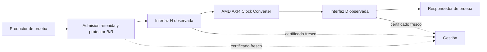

# Sección AXI4 retenida con CDC AMD

## Revisión posterior del índice inicial

La ampliación con fallos antes/durante el certificado encontró un índice
indeterminado al arrancar en la simulación RTL original. Se conserva la
evidencia previa con su alcance; no prueba todas las secuencias iniciales.
La revisión candidata RTL R2 y el banco R3 corrigen el índice y una espera
prematura del banco, y pasan la matriz ampliada y la regresión anterior.
La síntesis previa pertenece a los módulos originales. Ver
[diagnósticos, validación y siguientes pasos](AXI4_SECTION_FAULT_LIFETIMES.md).

## Cancelaciones en tránsito revisadas

La tanda `20261006T005042Z` pasa cuatro cancelaciones/reemplazos por perfil
con receptores detenidos y B/R locales retenidas. Se rechazan 92 alteraciones
de evidencia y dos defectos RTL privados. Ver [casos y respaldo](AXI4_SECTION_CANCELLATION.md).
Los fallos externos antes/durante la prueba y el cambio de generación con
mailbox ocupado continúan pendientes.

## Síntesis integrada revisada

La tanda `20261006T000729Z` mide 10.631 LUT/13.771 FF incluyendo el CDC AMD.
La revisión conserva un aviso CDC-15 nativo y no aprueba temporización física.
El bit lógico 6 de admisión se optimiza a cero; seis alarmas registradas llegan
a gestión. Ver [recursos, restricciones y diagnósticos](AXI4_SECTION_SYNTHESIS.md).

## Revisión vigente R2

`20261005T232715Z-V4-ffn-supervised-axi4-section-r2` repite ambos perfiles
con al menos 64 períodos de reset por dominio. Las cuatro transiciones de
reset ocurren 1 ps después de un flanco ascendente local observado. Durante
el reset sostenido, VALID/READY de ambos extremos de las interfaces H/D
permanecen inactivos; las respuestas locales de S y la retención permanecen.
No se está calificando un circuito físico de distribución de reset.

| Período D | Reset H | Reset D | Solapamiento |
| --- | --- | --- | --- |
| 5 ns | 455 ns | 455 ns | 452,6 ns |
| 37 ns | 2.401 ns | 2.405 ns | 2.373,4 ns |

La referencia es [PG059, Resets](https://docs.amd.com/r/en-US/pg059-axi-interconnect/Resets),
v2.1 del 2025-12-19, consultada el 2026-10-05: sincronizar cada entrada a su
reloj, resetear con solapamiento las interfaces conectadas y, como pauta,
mantener reset al menos 16 períodos del reloj más lento. **La tanda inicial
de abajo conserva valor funcional, pero su pulso de 315,001 ns en D=37 ns
no cubre esa pauta ni su liberación estaba ligada al reloj local.** R2
sustituye esa parte de la evidencia sin modificar la tanda original.

R2 pasa la revisión de transacciones y 54 alteraciones negativas. Mantiene
24 escrituras/24 lecturas normales y 16 transferencias locales por sentido.
Las latencias simuladas de aviso de fallo D/admisión son 21,9/21,5 ns
en el perfil de 5 ns y 21,9/23,5 ns en el de 37 ns.

Archivo R2: `9648c5144893c10eb86623a29c6a4dc067ce988ef304508f845317169e58e23a`.
Adenda R2: `8c93887729b8d09bad24ee7c73b0826b1446585519991870a04ece2fc6722b84`.

## Defectos RTL deliberados

`20261005T232256Z-V4-ffn-supervised-axi4-section-mutants` modifica sólo
copias privadas del certificado y reutiliza el banco inicial sin cambios:
omitir el certificado del par pasa las aserciones HDL, pero la revisión
independiente detecta ACK incompleto; añadir un registro fuente XPM impide
transmitir el fallo cuando H se detiene y dispara la aserción prevista.
No llamar a ambos casos detección HDL. Se ejecutaron con D=5 ns;
no sustituyen los ensayos R2 ni califican su entrega física de reset.
Archivo: `8d05f62caade5e3486e6e3e36bd0dc3059752d0c7dd1b1c53953afa5fa6abec5`.

## Tanda inicial conservada

Tanda V4 `20261005T231510Z-V4-ffn-supervised-axi4-section`, Vivado
2026.1 build 6511674, `xcvu5p-flva2104-2-i`. Simulación completa en
82,167 s de ejecución Vivado, con dos perfiles revisados independientemente.
No incorpora XDMA ni DDR.

## Composición y certificado

`ntrpu_axi4_section_certificate.sv` combina el certificado del productor
con los de ambos extremos. Reutiliza los módulos sellados de admisión,
protector causal, monitores y mailbox. La identidad contiene generación
y tag de 64 bits. Cambiar cualquiera invalida el certificado anterior;
la renovación requiere una solicitud nueva y observar ACK bajo antes de
aceptar el nuevo ACK.

El cierre permanece hasta reconfiguración. `section_ack` acredita vaciado
de esta sección, **excluye respuestas locales pendientes y colas protegidas
XDMA**. No concede permiso para resetear el endpoint ni reabrir admisión.
`local_idle` se comprueba por separado.

Los siete bits lógicos de fallo de admisión se conectan individualmente a
XPM de tres etapas, sin registro fuente adicional. La síntesis integrada
conserva seis fuentes registradas y optimiza el diagnóstico de estado (bit 6)
a cero; no se acredita un detector físico de estados ilegales. `fault_mgmt[6:0]`
conserva esos bits; `[12:7]` corresponde al monitor H y `[18:13]` al D.
Los doce fallos del par ya están sincronizados a gestión. Cualquier fallo
revoca inmediatamente los certificados al llegar a su sincronizador;
otro registro de retención no añade un ciclo a esa revocación.

## Pruebas y medidas

Relojes H=7 ns, gestión=10 ns, D=5/37 ns. El Clock Converter real usa
AXI4, datos de 512 bits, direcciones de 64 bits e IDs de cuatro bits.
Se identificaron la IP generada, fuentes compiladas y bibliotecas AMD.

Cada perfil verifica:

- 24 escrituras y 24 lecturas, con 1.045 transferencias W y 1.045 R;
  W anterior a AW, IDs reutilizados, respuestas intercaladas y backpressure.
- Todos los atributos, incluyendo REGION/QOS, datos completos y WSTRB.
  Las respuestas son OKAY, SLVERR o DECERR; no se simulan exclusivas.
- Cierre con dos transferencias de una ráfaga de cuatro ya aceptadas y
  WVALID bajo: reserva y termina exactamente el resto del grupo finito.
- Tres certificados distintos: inicial, nuevo tag y nueva generación.
  Detener H impide renovar el certificado.
- Una escritura y una lectura locales de 16 transferencias. B/R permanecen
  retenidas mientras ambos resets del CDC se activan durante 315,001 ns;
  `cold_rst_n` permanece alto y la admisión continúa cerrada.
- Una R huérfana real desde D atraviesa el CDC, pero queda retenida en su
  salida H: no sustituye ni contamina las respuestas locales sanas.
- Detener D o H inmediatamente después de registrar su fallo no impide
  transportarlo a gestión. Las respuestas locales completan después del
  fallo y éste permanece retenido.

| Período D | Aviso de fallo D a gestión | Aviso de admisión a gestión |
| --- | --- | --- |
| 5 ns | 21,9 ns | 21,5 ns |
| 37 ns | 20,9 ns | 24,0 ns |

Son medidas de simulación XPM. Diez avisos del modelo FIFO AMD señalan
que no representa los retardos de sincronización de los canales de datos:
no convertir sus ciclos o caudal simulado en rendimiento físico.

## Revisión y respaldo

`check_ntrpu_axi4_section.py` reconstruye colas independientes por ID y
compara las tres interfaces, estabilidad bajo espera, atributos, respuestas,
grupo finito, resets y muestras de gestión. Se rechazaron 46 alteraciones
de evidencia. Una primera revisión detectó que el comprobador aceptaba
una generación alterada en el evento de prueba; se conservó esa versión
y se añadió cotejo contra las muestras independientes de gestión. No se
cambió el RTL, banco, Tcl ni resultado de la tanda sellada.

- Archivo de ejecución: `1016d5af816c3e4b692d038140c142f7bfb0f0a3bc19b0f79d6d868054064c8c`.
- Fuentes: `15685461f083c4d8bb566a718de2f0941264744a370c04de5574f262eb899686`.
- Adenda de revisión: `76c8a922a46a01d3d9a3f8d4310c74d7c076dd5eaa4eae691cb8205441c7d7ca`.

Archivo y adenda están verificados localmente y en NFS. La revisión original
`AXI4_SECTION_SIM_AWAITING_REVIEW` se conserva; la adenda registra
`PASS_ACTIVE_AXI4_SECTION_TWO_CLOCK_PROFILES`.

## Dependencias restantes

Completar fallos anteriores/durante la prueba, reemplazo de generación con
mailbox ocupado y otras fuentes alcanzables de fallo de admisión. Las cuatro
cancelaciones con reemplazo de tag ya están comprobadas en ambos perfiles. La síntesis
integrada y la inspección preliminar READY ya están revisadas; quedan el
aviso CDC-15 nativo y las restricciones justificadas de implementación.
Los monitores pasivos no inspeccionan REGION/QOS: su transporte se verificó
mediante las trazas completas del banco.

Continúan pendientes las colas internas XDMA, coordinación global y reset
nativo completo. El reset probado aquí sólo afecta al Clock Converter.
Tampoco hay aprobación de colocación/ruteo, temporización física o tarjeta.
