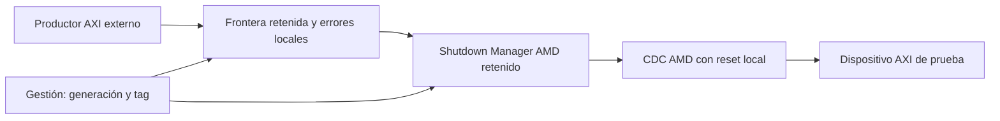

# Frontera AXI-Lite retenida y certificado de sección

## Implementación y alcance

`ntrpu_axil_retained_admission.sv` implementa una frontera de admisión
permanente. `ntrpu_axil_fence_certificate.sv` lleva la solicitud desde gestión
y reúne certificados nuevos del productor de esa frontera y de ambos
extremos del convertidor. Se reutilizan los buzones, inventarios y actuador
ya revisados, sin modificar sus fuentes selladas.

El banco sustituye únicamente U/D por fixtures; manager, CDC, admisión,
certificación y actuador son RTL real. No instancia PCIe ni DDR.
El certificado cubre la sección permanentemente aislada detrás de F.
**No demuestra que XDMA haya detenido su productor externo ni vaciado sus
colas protegidas.** Tampoco incluye las respuestas locales tardías de F.

## Límite y cierre sin abandonar solicitudes

Cada canal AW/W/AR admite como máximo **32 operaciones pendientes**, con
inventario retenido de ocho bits. B retira una obligación de cada mitad
de escritura; R retira una lectura. AW y W permanecen independientes.

Al observar el cierre en el reloj host, F fija el número de escrituras del
grupo pendiente como el máximo entre AW y W pendientes, incluyendo una
oferta actualmente presentada en cada canal. Continúa recibiendo solo las
mitades necesarias para completar ese grupo y la AR ya presentada. El
grupo puede incluir la oferta número 33, pero nunca supera 32 obligaciones
pendientes por canal simultáneamente. No crece después de cerrar.

Una vez entregadas todas esas ofertas y consumidas sus respuestas, F pasa
irreversiblemente a responder SLVERR localmente. Conserva solicitudes,
respuestas y cargas estables bajo backpressure; no aplica STOP directamente
a VALID. Retirar una solicitud de certificado o cambiar su identidad no
reabre F. Solo una nueva configuración reinicializa esa vida.

El certificado espera el inventario G vacío, el cierre real del manager y
los certificados H/D consecutivos. Cada nueva generación/tag atraviesa el
buzón completo; un ACK anterior no se puede reasignar a otra identidad.
Un reloj detenido o una mitad de escritura faltante impiden completar la
prueba. La frontera y el manager conservan su estado durante el reset local.

## Simulación y controles negativos

`20261005T182439Z-V4-ffn-supervised-shutdown-fence-r3` pasa tres escenarios
en cada perfil de dispositivo de 5/37 ns, con host de 7 ns, en **78,062 s**.
Los escenarios son AW sin W, W sin AW y lecturas/escrituras con B/R retenidas.

| Tráfico por perfil | Escrituras | Lecturas |
| --- | ---: | ---: |
| Aceptado y completado en U | 387 | 131 |
| Grupo enviado por F al manager | 88 | 36 |
| Entregado a H y D | 67 | 35 |
| Rechazado por el manager | 21 | 1 |
| Rechazado localmente por F | 299 | 95 |

La comparación independiente verifica orden, direcciones, máscaras, datos,
respuestas, inventarios y máximos. Los datos de respuestas reenviadas con
error también se comparan. La fixture usa los cuatro patrones de bits de
respuesta como testigos de transporte; `01` no califica accesos exclusivos
AXI-Lite. Hay un readback enmascarado inicial por escenario.

Se mantiene una respuesta local bloqueada mientras se certifica y reinicia
la sección CDC, con al menos 64 flancos reales por dominio. Después se cambia
la generación manteniendo el tag y deteniendo el reloj host: el ACK anterior
desaparece y el nuevo espera al reloj. Las solicitudes restantes completan
con error local; no hay nuevas transferencias G/H/D después del certificado.

El banco original sin modificar también detecta dos copias RTL incorrectas:
un crédito adicional falla a 3.994.201 ps y cortar una W retenida falla a
5.639.200 ps. Tanda `183229Z-V4-ffn-supervised-shutdown-fence-mutants`,
89,090 s. La revisión positiva rechaza además 20 alteraciones de evidencia.

## Recursos y restricciones

Síntesis OOC `182843Z-V4-ffn-supervised-shutdown-fence-synth`, 146,404 s:

| Bloque aislado | LUT | FF | BRAM/URAM/DSP |
| --- | ---: | ---: | ---: |
| Admisión retenida | 226 | 117 | 0 |
| Certificados y tres buzones | 540 | 1.589 | 0 |

Sin latches ni módulos sin resolver. Estos recursos no incluyen manager,
CDC, actuador ni cómputo y no sustituyen la síntesis de un top integrado.
Las inicializaciones de registros están conservadas en los informes.

Admisión: un reloj, sin excepciones. Certificación: seis sincronizadores
CDC-3 de tres etapas, seis false paths a primera etapa y tres max-delay
datapath-only de 10/7/7 ns. Se conservan los scripts XPM y sus waivers CDC-15
para los buses de handshake. No se añadieron grupos de reloj generales.

Los WNS OOC son 4,715/5,231 ns y WHS 0,088/0,077 ns; faltan retardos externos
en 77/157 y 216/82 entradas/salidas, respectivamente, y colocación física de
los relojes. No acreditan frecuencia ni cierre de placa. Se revisan nueve
avisos OOC/XPM; no se suprimen. Tampoco se demuestra equivalencia funcional
del netlist sintetizado.

## Diagnósticos y respaldo

R1 `181806Z` falla al comprobar la liberación del manager antes de terminar
sus tres ciclos iniciales. R2 `182052Z` pasa el perfil rápido, pero el lento
agota un timeout por oferta de 7 µs mientras el grupo de 32 sigue avanzando.
R3 retrasa esa comprobación hasta el arranque completo y permite 56 µs por
oferta para cubrir drenaje y mantenimiento. El RTL de producción y el
revisor funcional permanecen iguales en las tres tandas.

El recolector R3 detectó la palabra `ERROR` del marcador deliberado
`CERTIFIED_WITH_LOCAL_ERROR_PENDING` como si fuera un error del simulador.
La adenda revisa diagnósticos completos y aprueba ambas trazas sin repetirlas.
Los cuatro avisos de simulación corresponden al entorno y al parámetro de
perfil aplicado también a `glbl`; no hay avisos de ejecución.

Todos los archivos comprimidos están verificados localmente y en NFS:

| Tanda | SHA-256 del respaldo |
| --- | --- |
| R1 fallida | `64b937ab309ec414857c4229384ac7b2913c9caa1007022a3ea5daf30e9e1b7d` |
| R2 fallida | `e49b2231dfd48d36c2afde84b459ce324a9e5033e9b3365248122f10610d358c` |
| R3 aprobada | `aad514c32881f53a67e321179a253155745335688b910d5b490bf2f03eaef0b3` |
| Síntesis | `edd01d86bff118e5d1c4ae0d9caf95749bccdcf287678cd898f9501677c5335d` |
| Controles RTL negativos | `ede0cb95d4c5c41e0e3bd81c03b44a220d57a4d487f92ffec379e584f5ee0301` |

Adendas R3/síntesis: `78dafdd7bece2b847044401c64c153225bccec80839a07d7b916cb3e837e2ff3`
y `872c691ce45805de9476e0641c7aa4a61871b7f5c33d3e9097c6483db168e335`.
Reproducir con `tools/ntrpu_board_axil_retained_fence_r3.tcl`,
`tools/ntrpu_board_axil_fence_synth.tcl` o
`tools/ntrpu_board_axil_fence_mutants.tcl`, siempre en una carpeta nueva.

## Integración pendiente

La revisión original se conserva. La revisión R3 y los bancos de
[revocación ante fallos](AXIL_FAULT_REVOCATION.md) prueban el caso posterior
al certificado en admisión/H/D, con retención en gestión y reloj de origen
activo o detenido. Aún deben calificarse la composición CDC de admisión,
fallos anteriores a la prueba y durante un buzón pendiente. Después,
extender admisión/drenaje a AXI4 con ráfagas, IDs, WLAST/RLAST y colas de
XDMA; conectar el guard en una revisión nueva.
El cierre local no permite reiniciar todo el endpoint ni reutilizar sesiones NTRD.

[AMD PG195](https://docs.amd.com/r/en-US/pg195-pcie-dma/Clocking-and-Resets)
exige terminar transacciones antes del reset opcional y mantenerlo durante
el Completion Timeout. Sigue pendiente calificar el mecanismo para el modo
DMA exacto y ensayar sus 50 ms completos; no se reduce ese tiempo para
acelerar la simulación. Los criterios V2–V9 de placa e inferencia permanecen
separados de esta validación AXI-Lite.
