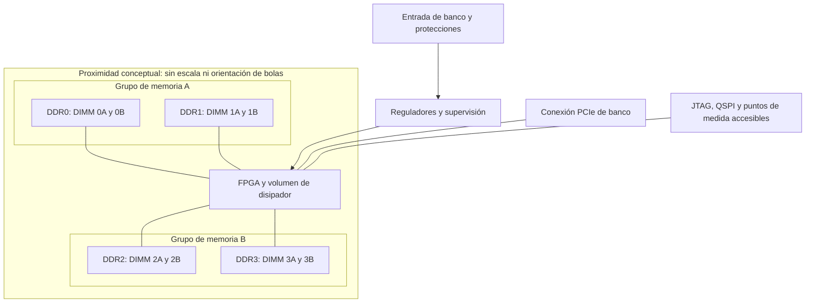

# Distribución mecánica preliminar R1

Fecha: 2026-10-15. Prototipo de banco de la [base eléctrica](ELECTRICAL_BASELINE_R1.md).
Escenario B: un FPGA y ocho RDIMM, dos por cada uno de cuatro canales.
Se definen zonas y relaciones de proximidad; aún no hay PCB ruteado ni
conjunto 3D dimensionado. El contorno y la orientación final dependen del
pinout implementado, conectores, alimentación y refrigeración.

## Zonas propuestas

Las líneas no son rutas PCB ni orden de conexión de los slots. Su topología
eléctrica se fija con el controlador y el modelo de canal. Alimentar también
memoria y auxiliares según el árbol de la base eléctrica; el diagrama omite
esas ramas para mostrar proximidad. “Izquierda/derecha” es una propuesta de
zonas, no una transformación validada del mapa del encapsulado.

| Zona | Decisión preliminar | Dato que falta para dimensionar |
| --- | --- | --- |
| FPGA | Zona central con acceso térmico superior | Orientación de pin 1, altura, disipador, anclajes y escape BGA |
| DDR0–DDR3 | Cada par de módulos próximo a sus bancos; reservar cuatro bancos por grupo durante el estudio | Validación MIG, planos del socket/DIMM, distancias y reglas de canal |
| Potencia | Conversores próximos a su carga; entrada y protecciones en un borde accesible | Inductores, corriente, refrigeración, desacoplos y zonas de conmutación |
| PCIe | Acceso de banco próximo a los GTY seleccionados | Conector/adaptador, retención mecánica y presupuesto de pérdidas |
| Gestión | JTAG y medidas accesibles con memoria y disipador instalados | Huellas, conectores y separación para sondas |
| Refrigeración | Corredores de aire hacia FPGA, DIMM y reguladores | Caudal y presión, temperaturas y volumen de ventiladores |

El ejemplo DDR utiliza cuatro bancos; reservarlos aquí conserva margen,
sin aprobar cuatro controladores ni modificar [io_plan.json](io_plan.json).
Ver [exploración de pines](PIN_PLANNING.md). Los bancos concretos y la
adaptación de PERST se cierran antes de fijar la colocación.

## Dimensiones verificadas y variables abiertas

Los encapsulados FLVA2104 y FLGA2104 tienen cuerpo de **47,5 × 47,5 mm**
y pitch de **1,0 mm**, según [UG575 v1.22, tabla 1-1, página 14](https://docs.amd.com/api/khub/documents/GnuVZDIoTcrlIuu8Aok5XQ/content).
Es el cuerpo del encapsulado: el disipador, anclajes y área de escape
necesitan espacio adicional. No deducir de esas medidas la huella completa.

| Variable | Valor R1 | Cómo cerrarla |
| --- | --- | --- |
| `fpga_body_xy_mm` | 47,5 × 47,5 | Contrastar dibujo del encapsulado elegido |
| `fpga_height_mm` | Pendiente | Plano mecánico exacto |
| `dimm_installed_xyz_mm` | Pendiente | Módulo y socket exactos, incluida altura sobre PCB |
| `dimm_latch_clearance_mm` | Pendiente | Recorrido de pestillos y extracción con componentes vecinos |
| `dimm_pair_pitch_mm` | Pendiente | Socket, mantenimiento, señal y circulación de aire |
| `heatsink_xyz_mm` | Pendiente | Presupuesto térmico, interfaz y anclajes |
| `board_xy_mm` / espesor | Pendientes | Colocación viable y stackup del fabricante |
| `mounting_holes_xy_mm` | Pendiente | Soportes de banco, esfuerzos y zonas libres |

No se asigna una longitud de pista, impedancia ni número de capas a partir
de este croquis. Incorporar retardos del encapsulado, reglas de memoria,
stackup y análisis del canal al definirlos:
[AMD UG583](https://docs.amd.com/r/en-US/ug583-ultrascale-pcb-design).

## Siguiente revisión mecánica

1. Fijar un candidato por variante, reunir planos y modelos de FPGA,
   socket, DIMM, conectores y disipación; registrar fuente y revisión.
2. Crear el contorno y volúmenes en ECAD/MCAD con dimensiones reales.
   Ubicar pin 1 y cotejar bancos/GTY con el pinout de Vivado.
3. Comprobar extracción de módulos, sondas/JTAG, cables, montaje del
   disipador y ventilación; ajustar ubicación y pinout conjuntamente.
4. Exportar conjunto STEP y vistas acotadas de la misma revisión del PCB.
   Revisar interferencias y tolerancias antes de fijar anclajes y contorno.

La alternativa A de cuatro DIMM 3DS requiere otra distribución y su propio
presupuesto. No se obtiene quitando cuatro módulos del perfil B sin revisar
controlador, conexiones y topología. El cierre mecánico depende de la
calificación eléctrica, no de que el modelo 3D sea visualmente completo.
