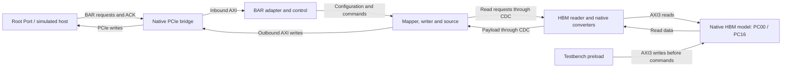

# Integrated BAR, HBM reader and PCIe writer bank

This private bank continues [native BAR traffic](HBM_BAR_TLP.md) with the frozen
VU47P/HBM control top, writer, mapper, clock supervision, source queues, reader
and AMD converters. It does not modify the main simulation queue or the separate
DDR card. The earlier synthesized checkpoint remains the physical-design baseline.

## Composition and explicit fixtures

The test restores AMD PIPE scaffolding around the frozen serial top. All control
and data-path RTL modules remain byte-identical to the reviewed donor. The board
bench supplies 100 MHz references and external sequencing; the real Clocking
Wizard supplies 200 MHz reader and 450 MHz memory clocks. PCIe supplies its native
250 MHz AXI clock. HBM configuration and readiness come from the generated IP.

Xilinx/AMD notices remain intact in copied generated sources. The only functional
top change exposes the existing HBM write ports for **testbench preloading**;
the synthesized design still has no weight loader. The bench writes 64 bytes to
PC00 at `0x1000` and 128 bytes to PC16 at `0x200001000`, using different patterns.
No HBM read response or internal DUT state is forced or deposited.

The Root Port sets BAR0 to `0x80000000` using its normal PCIe configuration task.
The Tcl script changes only its allocator seed, as in the preceding bank. HBM
references remain stopped and cold reset asserted until PCIe enumeration finishes;
the bench then starts the references, releases the Clocking Wizard reset, waits
for lock, releases configuration reset and waits for native readiness. This limits
HBM model activity before useful traffic without bypassing initialization.

AMD documents XSIM support through an internal HBM responder; this is a functional
model, not physical DRAM or serial-link qualification. Its generated configuration
`.mem` files must accompany simulation. See [PG276 Simulation](https://docs.amd.com/r/en-US/pg276-axi-hbm/Simulation).

## Acceptance



The host performs 75 BAR operations: 52 posted writes and 23 reads. Configuration,
commands and ACKs use the register protocol; there are no parallel direct producers.
The native mapper must verify and program the bridge translation. HBM data then
crosses the real read converters, CDC queues and writer before native PCIe delivers
it to Root Port addresses `0x1234567800001000` and `0x1234567800001100`.

The bank checks every byte, including separate HBM-stack addressing. AXI B and
receipt of bytes must leave both writer and source ownership held. Only after
receipt and verification does the simulated host publish the matching ACK through
BAR; result mailbox identity and byte counts must match before software POP.
The host is an explicit test fixture, not an OS driver or authenticated peer.

`review_hbm_tlp.py` reconstructs the 75-operation plan independently, checks native
mapping transactions and matches HBM writes, HBM reads, outgoing AXI and PCIe CQ
payloads. It compares both BAR and full-path logs against pre-edge VCD values,
including clock periods, native readiness, resets and B/ACK/result order.
Waveform checks also require continuous writer/source ownership from outgoing AW
through result acceptance, and all host CQ payload bytes before ACK. Deliberate
evidence corruption must be rejected, including dropped ownership or host receipt
in the waveform. Timeout, incomplete traffic or missing
completions cannot count as success.

## Reproduction and evidence

1. `generate_hbm_tlp_models.tcl SOURCE NEW_OUTPUT` imports the five frozen HBM,
   clock and converter XCI files into a new project. An explicit inventory top
   ensures the exported compile order includes every IP.
2. `prepare_hbm_tlp.py FROZEN_CONTROL_SOURCE PIPE_BANK_SOURCE NEW_PREPARED` creates
   the board binding, retains module hashes and copies the bench and runner.
3. Run `run_hbm_tlp.py NEW_RUN --stage traffic --prepared NEW_PREPARED
   --models CLOSED_MODEL_RUN --seed COMPILED_PCIE_SEED --settings VIVADO_SETTINGS`.
4. Restore the exported archive, verify its closed manifest and run
   `python -B review_hbm_tlp.py RESTORED_RUN --output REVIEW.json`.

All VM paths are private children of `/home/ubuntu/vivado/ntrpu-side` and outputs
must be new. Two CPUs and nice 10 are used. Limits are 300 seconds for generation,
120 per compilation group, up to 2,400 for elaboration and 2,400 for native simulation;
the bench also has a 300 us watchdog. Only owned process groups may be terminated.
Sources and copied donors are hashed before and after each attempt. Logs, VCD,
generated IP, failed attempts and receipts are stored under
`D:/AI/artifacts/ntrpu-axi-bridge-hbm-tlp`; the final bundle must be restored and
reviewed before it is reported as backed up.

The first model export selected only the clock block as its automatic top; it is
retained as a nonselected preparation. The second explicitly inventories all five
IP. No inference kernel, hardware weight loader, fault/retraining sweep, multi-peer
authentication, board pinout or routed timing closure is qualified by this bank.

The first traffic attempt compiled all sources, then exhausted its 1,200-second
elaboration limit with `debug=typical`. It is retained as failed, with no traffic
claim. A fresh retry uses `--resume`: it checks identical HDL hashes, copies the
closed compiled libraries and skips compilation. `debug=wave` retains waveform
visibility without line debugging; the retry allows 2,400 seconds for elaboration.
See the [UG900 debug options](https://docs.amd.com/r/en-US/ug900-vivado-logic-simulation/xelab-xvhdl-and-xvlog-xsim-Command-Options).

The next attempt elaborated successfully in 1,353.2 seconds and simulated for
1,269.6 seconds. Both native HBM stacks initialized, accepted all six preload
beats and returned successful write responses. The mapper verified native bridge
identity and both translation words. At 135.306 us, BAR case 12 correctly returned
`0x09`; the bench incorrectly expected `0x08` and stopped. This is retained as a
failed bank, with **no outbound-data claim**.

`cfg_busy` includes a retained configuration response, and `cmd_busy` includes a
retained event. The corrected expectations are therefore `0x09` for the full
configuration mailbox and `0x92` for the full result mailbox after ACK. Only these
two bench constants change; the control RTL remains identical. `--bench-update`
checks every other HDL hash, recompiles only the probe and reuses the existing
model libraries. `STATUS_EXPECTATION_REVIEW.json` and `BENCH_REVISION.diff` record
the failing read and the exact correction.

## Recorded stages (2026-10-12 UTC)

| Run | Status |
|---|---|
| `models-20261012T015346Z` | Nonselected export: incomplete compile inventory |
| `models-20261012T015918Z` | Selected export; five frozen IP profiles match |
| `traffic-20261012T020138Z` | Elaboration timed out; no simulation |
| `traffic-20261012T022418Z` | Native startup/preload/mapping reached; wrong bench status expectation |
| `traffic-20261012T031239Z` | Full native PASS; elaboration 1,361.7 s; simulation 1,833.7 s |

The selected bank finished at 153.322 us with **16,909 checks, two transfers,
192 payload bytes, 75 BAR requests and 23 completions**. `REVIEW.json` independently
matches logs and VCD: two native HBM read bursts/six read beats, three outgoing
512-bit AXI beats, five Root Port CQ beats, two ACKs and two attributed results.
Both complete host payloads precede their ACKs. The waveform supplies 8,691
samples of continuous writer/source ownership from outgoing AW to result
acceptance. Measured periods are 4,000 ps for PCIe/AXI, 5,000 ps for the reader,
10,000 ps for management and 2,222/2,223 ps for memory. All **14 deliberately
corrupted-evidence controls** are rejected; these are reviewer checks, not a DUT
fault-injection campaign.

`JOBS.json` identifies the isolated runners and remote paths. The first simulated
attempt's 331,654,845-byte runtime archive is restored locally with 19 files
verified; it is marked
`traffic_validated=false`. `PREFIX_REVIEW.json` matches its 12 BAR operations and
native preload/mapping handshakes to VCD, then rejects incomplete transfer
accounting. Its partial evidence remains separate from the successful selection.

The final VM audit confirms all five jobs are closed, with no live or zombie
processes in the 31 owned groups checked. It verifies 720 closed evidence files,
the unchanged compiled donors and the unchanged native bounded checkpoint.
`FINAL_PROCESS_AUDIT.json` records this audit; `FINAL_BACKUP.json` identifies the
consolidated archive, exact file count and SHA-256 after restoration and review.

## Recovery

The successful runtime archive is 331,623,352 bytes; its 19 files have been
restored and hashed locally, with executable modes preserved in the archive.
Its receipt is marked `traffic_validated=true`. The final bundle includes both
runtimes, the original PCIe model seed, all attempts and the independent reviewer.

Runtime recovery uses a separate archive with initialization files and executable
modes. Restoring and hashing it does not claim a second native execution;
Vivado 2026.1 remains an external prerequisite.

For runtime recovery on Linux, extract `recovery/integrated-runtime.tar.gz` into
a fresh working directory, source Vivado's `settings64.sh`, then run from there:

```bash
NTRPU_NATIVE_OUT=/absolute/new/output NTRPU_BAR_BASE=80000000 \
  xsim hbm_tlp_behav -tclbatch /absolute/final-source/run_hbm_tlp_trace.tcl \
  -testplusarg TESTNAME=ntrpu_bridge_native -log simulate.log
```

The runtime archive preserves the executable and `.mem` files; the Tcl script
requires a nonexistent output directory. A source rebuild should regenerate the
five IP models at their new location: `compile_order.tsv` contains absolute paths
from model generation, so relocating that file alone is insufficient.
